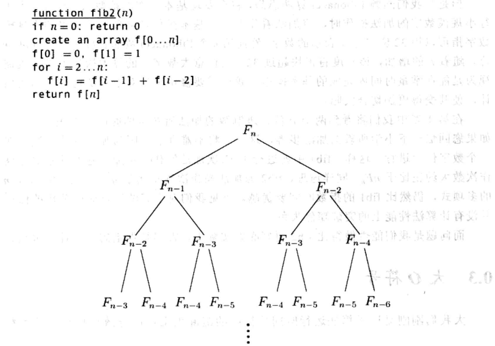

import Guide from '@/components/Guide.astro';
import Knowledge from '@/components/Knowledge.astro';
import Example from '@/components/Example.astro';
import Analysis from '@/components/Analysis.astro';
import Solution from '@/components/Solution.astro';
import Variant from '@/components/Variant.astro';
import Note from '@/components/Note.astro';
import Block from '@/components/Block.astro';
import Method from '@/components/Method.astro';
import Exercise from '@/components/Exercise.astro';
import Algorithm from '@/components/Algorithm.astro';

## 0.2 从 Fibonacci 数列开始

如果没有了某个人的努力，Al Khwarizmi 的工作在西方将难觅立足之地，这个人就是 13 世纪意大利的数学家 Leonardo Fibonacci，他预见了进位系统的巨大潜力，并且为了它的进一步发展和传播而不懈努力。

但是今天 Fibonacci 的著名却更多地归功于以他的名字命名的著名数列

$$
0, 1, 1, 2, 3, 5, 8, 1 6, 2 1, 3 4, \dots
$$

数列中的每个数都是其两个直接前项的和。我们以一种更形式化的方式给出 Fibonacci 数 $F_{n}$ 生成的规则

$$
F _ {n} = \left\{ \begin{array}{c l} F _ {n - 1} + F _ {n - 2} & \text {如果} n > 1 \\ 1 & \text {如果} n = 1 \\ 0 & \text {如果} n = 0 \end{array} \right.
$$

其他任何数列都比不上 Fibonacci 数列研究的范围之广，或者应用领域之多。这个数列如今已经应用于生物学、人口统计学、艺术、建筑和音乐等众多领域，而这些也还只是冰山一角。Fibonacci 数列与 2 的幂组成的数列一起，都是计算机科学中最常用的数列。

实际上，Fibonacci 数增长的速度几乎与 2 的幂增长的速度相当：例如， $F_{30}$ 超过了 100 万，而 $F_{100}$ 已经达到 21 位数字！一般而言， $F_n \approx 2^{0.694n}$ (参见习题 0.3)。

但是 $F_{100}$ 、甚至 $F_{200}$ 的精确数值是多少？Fibonacci本人一定也十分想知道答案。为了回答这个问题，我们需要一个计算Fibonacci数列中第 $\pmb{n}$ 个数的算法。

  
Leonardo of Pisa (Fibonacci)
1170-1250

© Corbis

## 一个指数算法

有一种解决方法就是死板地严格执行 $F_{n}$ 的递归定义。以下是相应的算法，以“伪代码”的方式书写，这种方式将贯穿本书：

```txt
function fib1(n)
if n=0: return 0
if n=1: return 1
return fib1(n-1) + fib1(n-2)
```

一旦我们拥有了一个算法，就必须考虑以下三个问题：

1. 它是正确的吗？

2. 它将耗费多少时间，其时间耗费关于 $n$ 是一个什么样的函数？

## 3. 我们能够改进它吗？

此处第一个问题没有什么意义，因为该算法严格地遵循着 Fibonacci 对于 $F_{n}$ 的定义。但是第二个问题需要解决。令函数 $T(n)$ 表示计算 $\operatorname{fib1}(n)$ 所需的基本操作次数；对于这个函数我们有何结论？首先，如果 $n$ 小于 2，程序将很快结束，仅仅执行了很少的几次操作。从而有

$$
\text { 当 } n \leqslant 1 \text { 时 }, T (n) \leqslant 2
$$

当 $n$ 的数值逐渐增大, fib1 将被递归调用两次, 运行时间分别是 $T(n - 1)$ 和 $T(n - 2)$ , 另外还有 3 次基本操作 (检查 $n$ 的值和一个最终的加法操作)。从而有

$$
\text { 当 } n > 1 \text { 时 }, T (n) = T (n - 1) + T (n - 2) + 3
$$

将该式与 $F_{n}$ 的递推关系式相比较：我们很快发现 $T(n)\geqslant F_n$

这是一个坏消息：该算法运行时间增长的速度跟 Fibonacci 数增长的速度一样快！ $T(n)$ 关于 n 是指数级的，这意味着除了 n 取一些很小的数值之外，算法将很慢，并不实用。

让我们以一个实际的小例子来说明指数时间的问题在哪里。如果要计算 $F_{200}$ , fib1 算法执行了 $T(200)$ 次基本操作, 其中 $T(200) \geqslant F_{200} \geqslant 2^{138}$ 。它的实际运行时间当然依赖于所使用的计算机。现今世界上最快的计算机是 NEC Earth Simulator, 它的时钟频率是每秒 40 万亿次基本操作。即使在这台机器上, fib1(200)最少也要耗时 $2^{92}$ 秒。这意味着如果我们从今天开始计算, 那么直到太阳变成一个红色巨型星球, 计算仍将继续。

但是科技的脚步日新月异——计算机的运算速度一直以每18个月翻一番的速度迅猛提升，这种现象有人称其为摩尔定律(Moore's law)。有了这种惊人的增长速度，或许 fib1 算法在来年的计算机上将运行得更快。我们发现 fib1(n) 的运行时间正比于 $2^{0.694n} \approx (1.6)^n$ ，因而计算 $F_{n+1}$ 的时间要比 $F_n$ 长 1.6 倍。而遵循摩尔定律，计算机的运算速度每年大约要增长 1.6 倍。因此如果我们能利用今年的技术合理地计算出 $F_{100}$ ，那么明年将计算出 $F_{101}$ ，下一年 $F_{102}$ ，以此类推：仅仅是每年多算出一个 Fibonacci 数！这简直是指数时间的噩梦！

```python
function fib2(n)
if n=0: return 0
create an array f[0...n]
f[0] = 0, f[1] = 1
for i=2...n:
    f[i] = f[i-1] + f[i-2]
return f[n]
```

简言之，这个简单的递归算法虽然正确，但是却毫无效率，令人失望。我们能做出改进吗？

## 一个多项式算法

让我们试着理解为什么 fib1 算法会如此之慢。图 0-1 揭示了由一个单独的 fib1(n) 调用过程触发的一连串递归操作。请注意其中有很多计算步骤都是重复的！

一种更合理的机制是随时存储中间计算结果—— $F_{0},F_{1},\ldots,F_{n-1}$ 的值。

  
图 0-1 fib1 中递归调用方法的扩张过程

与 fib1 算法一样，由于该算法思想直接采用了 $F_{n}$ 的定义，所以其正确性是显而易见的。那么它的执行时间怎样？其内层循环包含一个单独的操作，并且执行了 n-1 次。因此 fib2 中的基本操作次数关于 n 是线性的。从 fib1 的指数时间降至 fib2 的多项式时间，我们在运算时间上取得了巨大突破。现在我们完全可以在可接受的时间内计算 $F_{200}$ ，甚至是 $F_{200,000}^{1}$ 了。

我们将在本书中不断见证这样一个道理：正确的算法将让一切变得不同。

## 更仔细的分析

在迄今为止的讨论中，我们一直在计算每个算法执行的基本操作次数，并且认为这些基本操作的时间耗费为一个常量。这是一个十分有用的简化。毕竟，一个处理器的指令集具有一系列的基本指令单元：分支、存入内存、比较数值、简单算术等——与其在这些基本操作间进行区分，不如将它们归为一类来得方便。

但是当我们回顾 Fibonacci 算法思想，将会发现基本操作的范畴太宽泛了。当进行小规模数字的加法操作时，将加法看作是一个基本操作是合理的，这里的小规模数字指可以用 32 位二进制表示的数字。然而第 $n$ 个 Fibonacci 数的长度大约是 $0.694n$ 位，随着 $n$ 的增加，该长度将很快超过 32。而任意大数字上的算术操作不可能也被视为是能在常量时间内完成的基本操作。我们需要修正早先对于算法运行时间的估计，使其变得更加切合实际。

在第1章中我们将看到两个 $n$ 位二进制数的加法所花费的时间大约正比于 $n$ ; 如果您回忆一下小学所教的加法步骤, 这一点将不难理解, 因为加法操作每次只在一个数字位上进行。这样, fib1 中就进行了 $F_{n}$ 次加法操作, 实际上它的基本加法操作次数大约正比于 $nF_{n}$ 。同样道理, fib2 的加法操作次数正比于 $n^{2}$ , 它仍然是关于 $n$ 的多项式, 仍然比 fib1 的指数时间要优越。可见我们对于算法运行时间分析的修正并没有让算法性能上的突破黯然失色。

而问题是我们能否做得比fib2更好呢？实际上，答案是肯定的。请看习题0.4。
