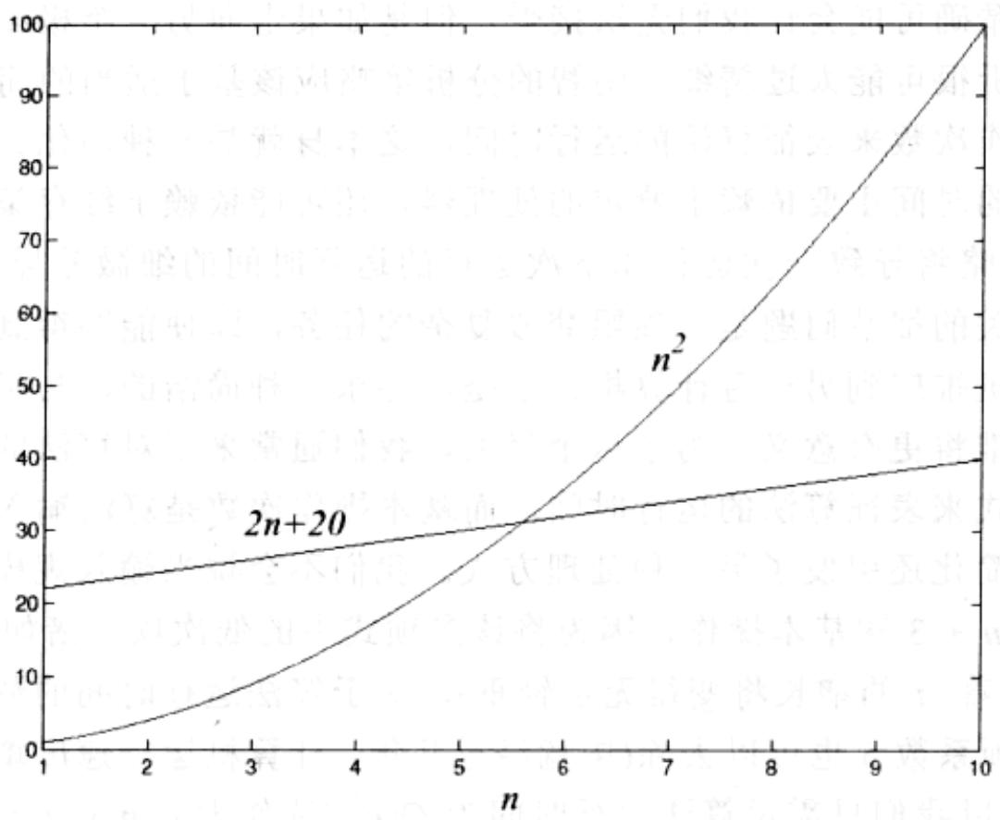

import Guide from '@/components/Guide.astro';
import Knowledge from '@/components/Knowledge.astro';
import Example from '@/components/Example.astro';
import Analysis from '@/components/Analysis.astro';
import Solution from '@/components/Solution.astro';
import Variant from '@/components/Variant.astro';
import Note from '@/components/Note.astro';
import Block from '@/components/Block.astro';
import Method from '@/components/Method.astro';
import Exercise from '@/components/Exercise.astro';
import Algorithm from '@/components/Algorithm.astro';

## 0.3 大 O 符号

大我们刚刚见证了算法运行时间分析中的疏漏大意可能导致分析结果的不精确，而这种不精确可能会让我们无法接受。但是如果走向另一个极端，又会暴露另一个问题：分析很可能太过精细。明智的分析策略应该基于适当的简化。

以基本操作次数来表征算法的运行时间，这本身就是一种简化。毕竟这样的一次操作所耗费的时间主要依赖于特定的处理器，还可能依赖于缓存策略这样的细节(不同的缓存策略将导致一次运行和下次运行的运行时间的细微差异)。而解决与特定体系结构相关的细节问题是一项噩梦般复杂的任务，即使能够得到结果，它也无法从一台计算机推广到另一台计算机。于是，寻求一种简洁的、与机器无关的刻画算法性能的标准将更有意义。为了这个目的，我们通常采用对算法的基本操作次数进行计数的方式来表征算法的运行时间，而基本操作次数是算法输入规模的函数。

同时这一简化还引发了另一种处理方式。我们不会说当输入规模是 n 时，算法执行了 $5n^{3} + 4n + 3$ 次基本操作，因为将该多项式中的低次项，诸如 4n 和 3，去除之后(这些项随着 n 的增长将变得无足轻重)，对于算法运行时间的估计将变得更加简洁，甚至首项系数 5 也可以去除(毕竟经过几年，计算机运行速度增加 5 倍总是容易达到的)，所以我们只需说算法运行时间为 $O(n^{3})$ (读作大 O n 立方)。

下面我们给出大 $O$ 符号的精确定义。假设当算法输入规模是 $\pmb{n}$ 时，两个算法的运行时间分别为 $f(n)$ 和 $g(n)$ 。

令 $f(n)$ 和 $g(n)$ 均为从正整数到正实数的函数。如果存在一个常数 $c > 0$ ，使得 $f(n) \leqslant c \cdot g(n)$ 成立，则我们称 $f = O(g)$ （这意味着“ $f$ 增长的速度慢于 $g$ ”）。

$f = O(g)$ 类似于 $f \leqslant g$ 。但是它又不同于通常意义下的“ $\leqslant$ ”，主要是因为存在常数 c 的某些取值，使得等号可以成立，例如 $10n = O(n)$ 。这一常数也允许我们可以忽略 n 比较小的情况。例如，假定针对某一特殊的计算任务，我们不得不在两个算法之间做出抉择。其中一个算法执行了 $f_{1}(n) = n^{2}$ 次基本操作，而另一个执行了 $f_{2}(n) = 2n + 20$ 次基本操作（如图 0-2 所示）。哪个算法更优？这取决于 n 的取值。当 $n \leqslant 5$ 时， $n^{2}$ 更小；而其后 $2n + 20$ 的值大。在 $n \leqslant 5$ 的情况下，随着 n 的增大， $f_{2}$ 增长的幅度更缓慢，因此 $f_{2}$ 更加优越。

这一优越性可以由大 O 符号来体现： $f_{2}=O(f_{1})$ ，因为

$$
\frac {f _ {2} (n)}{f _ {1} (n)} = \frac {2 n + 2 0}{n ^ {2}} \leq 2 2
$$

上式对所有的 $n$ 均成立；另一方面， $f_{1} \neq O(f_{2})$ ，由于比率 $f_{1}(n) / f_{2}(n) = n^{2} / (2n + 20)$ 可以变得任意大，因此不存在常数 $c$ ，使得大 $O$ 符号的定义成立。

  
图0-2 哪个算法的运行时间更短

假定还有另外一个算法，它执行了 $f_{3}(n) = n + 1$ 次基本操作。它比 $f_{2}$ 更好吗？结果当然是肯定的，但是其优越性只是体现在一个常数上。 $2n + 20$ 与 $n + 1$ 之间的差异很小，与 $n^{2}$ 和 $2n + 20$ 之间的巨大差异相比简直是小巫见大巫。为了抓住算法分析中的主要矛盾，如果两个函数只是相差一个常数，我们就将它们视为相等。

让我们回到大 $O$ 符号的定义，我们发现 $f_{2} = O(f_{3})$

$$
\frac {f _ {2} (n)}{f _ {3} (n)} = \frac {2 n + 2 0}{n + 1} \leq 2 0
$$

同时，显然有 $f_{3}=O(f_{2})$ ，这时c=1。

正如 $O(\cdot)$ 类似于 $\leqslant$ ，我们同样可以如下分别定义与 $\geqslant$ 和 $=$ 的相似的符号：

$$
f = \Omega (g) \text { 意味着 } g = O (f)
$$

$f=\Theta(g)$ 意味着 $f=O(g)$ 和 $f=\Omega(g)$ 同时成立。

在前述的例子中，有 $f_{2} = \Theta (f_{3})$ 以及 $f_{1} = \Omega (f_{3})$ 成立。

大 $O$ 符号让我们得以从更高的高度来关注算法分析。当面对一个复杂的函数，如 $3n^{2} + 4n + 5$ ，我们只需将它用 $O(f(n))$ 替换，其中的 $f(n)$ 要尽可能的简单。在这个特例中，我们使用 $O(n^{2})$ ，因为与多项式中的其他项相比，二次项处于支配地位。以下是一些经验规则，通过忽略低次项，以简化算法运行时间的函数表示：

1. 常系数可以忽略： $14n^{2}$ 可以变为 $n^{2}$ 。

2. 当 a > b 时， $n^{a}$ 支配 $n^{b}$ ：例如， $n^{2}$ 支配 n。

3. 任何指数项支配任何多项式项： $3^{n}$ 支配 $n^{5}$ (它甚至支配 $2^{n}$ )。

4. 同理，任何多项式项支配对数项： $n$ 支配 $(\log n)^3$ 。进一步的，例如， $n^2$ 支配 $n \log n$ 。

请不要误解这种忽略常系数的态度。编程人员和算法设计者们通常对常量都非常感兴趣，即使只是为了让算法的运行时间减少二分之一，他们也会乐此不疲、挑灯夜战的。但是如果没有大 $O$ 符号带来的简化，根据本书内容理解算法思想几乎是不可能的。
