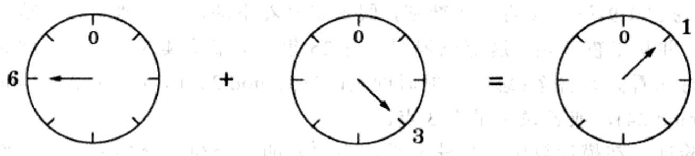
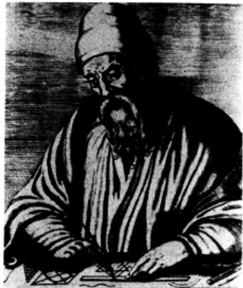
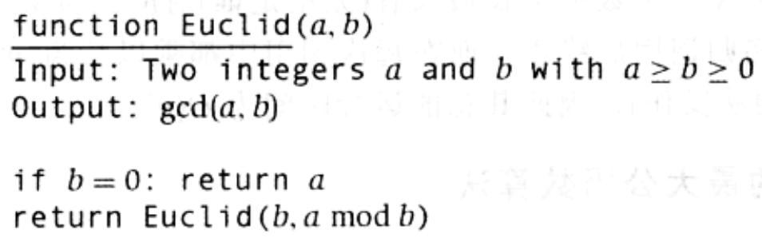
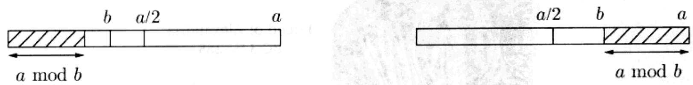

import Guide from '@/components/Guide.astro';
import Knowledge from '@/components/Knowledge.astro';
import Example from '@/components/Example.astro';
import Analysis from '@/components/Analysis.astro';
import Solution from '@/components/Solution.astro';
import Variant from '@/components/Variant.astro';
import Note from '@/components/Note.astro';
import Block from '@/components/Block.astro';
import Method from '@/components/Method.astro';
import Exercise from '@/components/Exercise.astro';
import Algorithm from '@/components/Algorithm.astro';

## 1.2 模运算

重复的加法和乘法会让计算结果变得非常大。而生活中，每当时钟走过24小时，我们就可以把时间重新置0；每当连续度过12个月，我们又可以重新从1月开始，这样的处理为我们带来了很多方便。同样的，对于内置于计算机处理器内部的算法操作而言，其能够处理的数值也被限定在一定的范围内，比如32位，这已经足够大，能够对付大多数应用了。

而对于我们将要研究的主题——素性测试和密码学而言，具备处理超过32位的大数的能力将是很有必要的，不过，这些数再大，归根结底也是有限的。

模运算(modular arithmetic)是一整套处理受限整数的方法。我们将 $x$ 模 $N(x \bmod u N)$ 的结果定义为 $x$ 除以 $N$ 的余数，即就是说，如果 $x = qN + r$ 且 $0 \leqslant r < N$ 则 $x$ 模 $N$ 等于 $r$ 。它强调了数与数之间的一个等价概念：我们说 $x$ 与 $y$ 模 $N$ 同余(congruent modulo)，当且仅当它们相差 $N$ 的倍数。如果以数学语言表示这一结论，则如下所示

$$
x \equiv y (\mathrm{mod} N) \Leftrightarrow N \text {整除} (x - y)
$$

例如， $253 \equiv 13 \pmod{60}$ ，因为253-13是60的倍数。打个更形象的比方，253分钟就是4小时又13分钟。参与模运算的数也可以是负数，如 $59 \equiv -1 \pmod{60}$ ，可以解释为：当现在时间是某点过59分，那么也可以说是下一点差1分。

理解模运算的一种方法是认为模运算将所有的整数限定在一个预先定义好的范围 $\{0,1,\dots,N - 1\}$ 内，一旦离开这个范围时，您会发现您又绕了回来——跟表盘上的指针很相似(如图1-3所示)。

  
图 1-3 加法模 8 运算

模运算的另一种解释是模运算虽然处理所有的整数，但却将它们划分成 $N$ 个等价类(equivalence class)，每个等价类的形式是 $\{i + kN:k\in \mathbb{Z}\}$ ，其中 $i$ 在0到 $N - 1$ 之间取值。例如，模3运算就有3个等价类：

$$
\begin{array}{c c c c c c c c c} \dots & - 9 & - 6 & - 3 & 0 & 3 & 6 & 9 & \dots \\ \dots & - 8 & - 5 & - 2 & 1 & 4 & 7 & 1 0 & \dots \\ \dots & - 7 & - 4 & - 1 & 2 & 5 & 8 & 1 1 & \dots \end{array}
$$

一个等价类中的任一元素都可被该等价类中的其他元素替代，在模3运算的意

义下，5和11是没有区别的。在这种替代意义下，加法和乘法保持了良好的定义：

<Knowledge title="专栏: 二进制补码">

模运算在二进制补码(two's complement)中得到了完美的诠释，二进制补码是存储符号整数的最常见形式。它使用了 $n$ 位来表示在 $[-2^{n-1}, 2^{n-1}-1]$ 之间的数字，其表示规则通常被描述成以下两点：

\- 在 0 到 $2^{n-1}-1$ 范围内的正整数被存储为常见的二进制形式，同时在首位上取值为 0。

\- 负整数 $-x, 1 \leqslant x \leqslant 2^{n-1}$ , 它的存储方式是, 首先将 $x$ 表示成二进制形式, 然后按位取反, 最后在末位加 1。负数补码表示的首位是 1。

(您会发现，以二进制补码形式进行的常规加法和乘法将变得不可思议！)

有一种更简单的方式来理解二进制补码表示：任何在 $-2^{n-1}$ 到 $2^{n-1}-1$ 范围内的整数都被存储为其模 $2^n$ 的结果。从而负数 $-x$ 的二进制补码表示，除去首位的符号位，后面各位与 $2^n - x$ 的补码表示完全相同。像加法和减法这些算术操作都可以用二进制补码表示直接进行，操作中忽略任何可能的溢出位。

替代准则 如果有 $x \equiv x' (\bmod N)$ 和 $y \equiv y' (\bmod N)$ 成立，则有以下两式成立：

$$
x + y \equiv x ^ {\prime} + y ^ {\prime} (\mathrm{mod} N) \text {和} x y \equiv x ^ {\prime} y ^ {\prime} (\mathrm{mod} N) _ {\circ}
$$

(参见习题 1.9)举例说明上述准则，假定您坐着不动，连续地观看一整部您喜欢的电视剧，并从午夜开始。这部电视剧共有 25 集，每集持续 3 个小时。问您将在某天的什么时间看完？答案：您看完的时间是 $(25 \times 3) \mod 24$ ，即等于 $1 \times 3 = 3 \mod 24$ （因为 $25 \equiv 1 \mod 24$ ），或者说是早上 3 点。

不难验证，在模运算中，加法和乘法中通常的结合律、交换率和分配率仍然成立，比如：

$$
\begin{array}{r l r} {x + (y + z)   \equiv   (x + y) + z (\mathrm{mod} N)} & {} & {\text {结合律}} \\ {x y   \equiv   y x (\mathrm{mod} N)} & {} & {\text {交换律}} \\ {x (y + z)   \equiv   x y + y z (\mathrm{mod} N)} & {} & {\text {分配率}} \end{array}
$$

替代准则和以上运算率的成立意味着当进行一系列的算术操作时，可以在任何运算阶段将中间计算结果简化为其模 $N$ 操作的余数。这种简化无疑将对大数的计算带来极大的帮助。下面的例子就是一个很好的说明：

$$
2 ^ {3 4 5} \equiv (2 ^ {5}) ^ {6 9} \equiv 3 2 ^ {6 9} \equiv 1 ^ {6 9} \equiv 1 (\mathrm{mod} 3 1)
$$

</Knowledge>
## 1.2.1 模的加法和乘法

要将两个数 $x$ 和 $y$ 分别模 $N$ 的结果相加，我们可以先考虑常规的加法。由于 $x$ 和 $y$ 都在0到 $N - 1$ 的范围内，它们的和将在0到 $2(N - 1)$ 的范围内。如果和超过了 $N - 1$ ，我们只需在和的基础上减去 $N$ ，就能将结果控制在要求的范围内。从而整个计算过程包含一次加法，一次可能的减法，加减法的操作数都不会超过 $2N$ 。运行时间是操作数大小的线性函数，即 $O(n)$ ，其中 $n = \lceil \log N\rfloor$ 是 $N$ 的大小需要指出的是，按照我们的规定，总是使用 $n$ 来标记输入的大小。

如何将两个数 $x$ 和 $y$ 分别模 $N$ 的结果相乘？我们仍然先考虑常规的乘法，然后将计算结果模 $N$ 。两数相乘的积最大可以达到 $(N - 1)^2$ ，但这个数仍最多占用 $2n$ 位长，因为 $\log (N - 1)^2 = 2\log (N - 1) \leqslant 2n$ 。为了简化模 $N$ 的计算结果，我们将余数除以 $N$ ，除法运算采用前述的平方时间的除法算法。从而乘法仍然是一个平方时间的操作。

模运算的除法则没有这么简单。在常规的算术运算中，只有一个需要注意的小地方——除数为0的情况。看起来在模运算中也潜在地存在这样的情况，对此我们将在本节的最后加以讨论。但不管怎样，只要除法操作是合法的，那么它就可以在立方时间内完成，即 $O(n^{3})$ 。

为了保证我们针对密码学所需的一系列基本模运算的讨论的完整性，我们接下来将转入对模的指数运算的讨论，接着将讨论最大公因数，它是除法的关键所在。以上两个操作中，最核心流程的运算时间是指数级的，但是如果您有一定的创意，将可以找到多项式时间的算法。而一个精心设计的算法将使一切变得不同。

## 1.2.2 模的指数运算

在我们即将讨论的密码系统中，经常会遇到这样的问题，给定 $x$ 和 $y$ ，计算 $x^y$ 模 $N$ 的值，其中 $N$ 有数百位长。这一运算能否很快地实现？

该运算的结果等于某个数字模 $N$ ，从而运算结果本身也将占用数百位长。然而， $x^y$ 的原始结果可能比这大得多。即使当 $x$ 和 $y$ 只有 20 位长， $x^y$ 也最少是 $\left(2^{19}\right)^{\left(2^{19}\right)} = 2^{(19)(524288)}$ ，大约有 100 万位长！想象一下，当 $y$ 有 500 位长时，结果将会怎样？

为了确保我们处理的数字不至于太大，我们需要对所有的中间计算结果进行模 $N$ 运算。从而有以下思想：通过重复乘以 $x$ 模 $N$ 的结果来计算 $x^y$ 模 $N$ 。中间乘积的

$\therefore m = \frac{1}{2}$

相应序列如下：

$$
x \bmod N \rightarrow x ^ {2} \bmod N \rightarrow x ^ {3} \bmod N \rightarrow \dots \rightarrow x ^ {y} \bmod N
$$

其中包含的数均比 $N$ 小，所以每次乘法的结果也不会占用太多的位。但是存在一个问题：如果 $y$ 有500位长，我们将需要执行 $y - 1 \approx 2^{500}$ 次乘法操作！该算法的运算时间显然是 $y$ 的输入大小 $n$ 的指数函数。

幸运的是，我们可以做的更好：以 $x$ 模 $N$ 开始，不断重复进行平方模 $N$ 操作，我们将得到：

$$
x \bmod N \rightarrow x ^ {2} \bmod N \rightarrow x ^ {4} \bmod N \rightarrow x ^ {8} \bmod N \rightarrow \dots \rightarrow x ^ {2 \lfloor \log y \rfloor} \bmod N
$$

其中每一步的运行时间都是 $O(\log^2 N)$ ，而这一次只有 $\log y$ 次乘法运算。为了求得 $x^y \bmod N$ 的结果，我们只需简单地将 $x$ 的所有这些幂中的一部分相乘， $x$ 的这部分幂恰好对应于 $y$ 的二进制表示中的每一个数字1。例如，

$$
x ^ {2 5} = x ^ {1 1 0 0 1 _ {2}} = x ^ {1 0 0 0 0 _ {2}} \cdot x ^ {1 0 0 0 _ {2}} \cdot x ^ {1 _ {2}} = x ^ {1 6} \cdot x ^ {8} \cdot x ^ {1}
$$

这样，一个多项式时间的算法终于浮出水面！

function modexp(x, y, N)
Input: Two n-bit integers x and N, an integer exponent y
Output:  $x^{y} \mod N$ 
if y = 0: return 1
    z = modexp(x, [y/2], N)
    if y is even:
    return  $z^{2} \mod N$ 
    else:
    return  $x \cdot z^{2} \mod N$

图1-4 模的指数运算

我们可以将这一算法思想表示成一种简单的形式: 即图 1-4 中给出的递归算法, 它计算 $x^y$ 模 $N$ 的方式采用了以下不证自明的规则:

$$
x ^ {y} = \left\{ \begin{array}{l l} {\left(x ^ {\lfloor y / 2 \rfloor}\right) ^ {2}} & {\text {当} y \text {为偶数时}} \\ {x \cdot \left(x ^ {\lfloor y / 2 \rfloor}\right) ^ {2}} & {\text {当} y \text {为奇数时}} \end{array} \right.
$$

该算法的思想十分类似于前述的递归乘法算法(参见图1-1)。例如，前述乘法算法计算 $x \cdot 25$ 的乘积采用了我们刚才见过的类似于分解操作的方式： $x \cdot 25 = x \cdot 16 + x \cdot 8 + x \cdot 1$ 。对于乘法，其中的项 $x \cdot 2^i$ 来自于不断重复的加倍(doubling)操作。而相应地，对于指数运算，其中 $x^2$ 则来自于不断重复的平方操作。

令 $n$ 为 $x, y$ 和 $N$ 三个数中位长最长者(无论是谁)对应的位数。对于乘法运算，算法最多在 $n$ 次递归调用后终止，而在每次调用中都乘以长为 $n$ 位的数(对于模 $N$ 运算，则不用此乘法操作)，因此其总的运行时间为 $O(n^3)$ 。

## 1.2.3 Euclid 的最大公因数算法

我们接下来要研究的算法是由古希腊数学家 Euclid 在 2000 多年前设计的。给定两个整数 $a$ 和 $b$ ，该算法将求出能够同时整除两者的最大整数，即通常所说的最大公因数。

最显而易见的求最大公因数的方法是首先对 $a$ 和 $b$ 分别进行因子分解，然后将它们的公共因数相乘。比如， $1035 = 3^2 \cdot 5 \cdot 23$ ， $759 = 3 \cdot 11 \cdot 23$ ，所以它们的最大公因数是 $3 \cdot 23 = 69$ 。然而问题是，我们还没有进行因子分解的有效算法。那么，是否存在其他的方法来计算最大公因数呢？

Euclid 算法采用了以下的简单计算公式。

  
Euclid of Alexandria
BC 325-265  
Euclid 规则 如果 $x$ 和 $y$ 是正整数，且有 $x \geqslant y$ ，那么 $\gcd(x, y) = \gcd(x \mod y, y)$ 。

© Corbis

证明：要想证明上述结论成立，只需证明 $\gcd(x, y) = \gcd(x - y, y)$ 。由此结论，经过不断重复的 $x$ 减 $y$ 操作即可推出原结论成立。

以下是关于 $\gcd(x, y) = \gcd(x - y, y)$ 的证明。任何能够整除 $x$ 和 $y$ 的整数一定也可以整除 $x - y$ ，所以有 $\gcd(x, y) \leqslant \gcd(x - y, y)$ 成立。同理，任何能够整除 $x - y$ 和 $y$ 的整数一定也可以整除 $x$ 和 $y$ ，所以有 $\gcd(x, y) \geqslant \gcd(x - y, y)$ 成立，从而得证 $\gcd(x, y) = \gcd(x - y, y)$ 。

  
图1-5Euclid的求两数的最大公因数算法

基于 Euclid 规则的思想，我们可以写出一个精妙的递归算法(如图 1-5 所示)，算法的正确性可由规则直接保证。为了估计算法的运行时间，我们需要了解参数(a, b)随着每次递归调用而减小的速度有多快。在每次递归调用中，参数(a, b)变成了(b, a mod b)，a 和 b 的次序发生了交换，两者中的大者 a，减少至 a mod b。这是一个显著的简化。

引理 如果 $a \geqslant b$ ，那么 $a \bmod b < a/2$ 。

证明：注意到有 $b \leqslant a / 2$ 或 $b > a / 2$ 成立。两种情况分别在下面的图中加以说明。如果 $b \leqslant a / 2$ ，那么将有 $a \bmod b < b \leqslant a / 2$ 成立；如果 $b > a / 2$ ，那么将有 $a \bmod b = a - b < a / 2$ 成立。

这意味着经过了两次连续的操作之后，a 和 b 这两个参数，都至少在各自原取值的基础上减半——各自的位长都至少减 1。如果它们初始时都为 n 位二进制整数，那么最多经过 2n 次递归调用，就将到达边界条件。而由于每次调用都包含一个平方时间的除法操作，所以总的运行时间为 $O(n^{3})$ 。

## 1.2.4 Euclid算法的一种扩展

对Euclid算法的一个小小扩展构成了模的除法运算的关键步骤。

为了形象地说明它，假定 $d$ 是 $a$ 和 $b$ 的最大公因数：我们怎么检验该假定是对是错？仅仅验证 $d$ 能整除 $a$ 和 $b$ 是不够的，因为这只是表明了 $d$ 是 $a$ 和 $b$ 的公因数，但不一定是最大的。以下这种方法可以被用来验证最大公因数，前提是 $d$ 满足一种特殊的形式。

引理 如果 $d$ 整除 $a$ 和 $b$ ，同时存在整数 $x$ 和 $y$ ，使得 $d = ax + by$ 成立，那么一定有 $d = \gcd(a, b)$ 。

证明：由题设中的两个前提条件可知，d 是 a 和 b 的公因数，所以 d 的取值不会超过 a 和 b 的最大公因数，即 $d \leqslant \gcd(a, b)$ 。另一方面，由于 $\gcd(a, b)$ 是 a 和 b 的公因数，所以它也一定整除 $ax + by = d$ ，从而意味着 $\gcd(a, b) \leqslant d$ 。综上， $d = \gcd(a, b)$ 。

因此，如果我们能够找到两个整数 $x$ 和 $y$ ，使得 $d = ax + by$ 成立，那么我们就有 $d = \gcd(a, b)$ 。例如，我们知道 $\gcd(13, 4) = 1$ ，因为有 $13 \cdot 1 + 4 \cdot (-3) = 1$ 成立。但是问题是怎样找到 $x$ 和 $y$ ：什么情况下， $\gcd(a, b)$ 可以表示成这种形式？实际上最大公因数总是可以写成这样的形式。而且，系数 $x$ 和 $y$ 可以通过以下的扩展 Euclid 算法求得，参见图 1-6。

function extended-Euclid(a,b)
Input: Two positive integers a and b with  $a \geq b \geq 0$ 
Output: Integers x, y, d such that  $d = \gcd(a, b)$  and  $ax + by = d$ 
if b = 0: return (1, 0, a)
 $(x', y', d) = \text{extended-Euclid}(b, a \mod b)$ 
return  $(y', x' - \lfloor a/b \rfloor y', d)$

图1-6Euclid算法的一个简单扩展

引理 对于任意的正整数 $a$ 和 $b$ ，利用扩展 Euclid 算法可以求得整数 $x, y$ 和 $d$ ，使得 $\gcd(a, b) = d = ax + by$ 成立。

证明：首先需要明确的是，如果忽略了引理中关于 $x$ 和 $y$ 的部分，扩展算法就与原算法别无二致。所以，至少我们需要计算 $d = \gcd(a, b)$ 。

对于引理的剩余部分，算法的递归特性提示我们使用归纳法来证明。递归将在 $b = 0$ 时结束，所以针对 $b$ 的取值作归纳将很方便。

$b = 0$ 的基准情况很容易直接证明。现在考虑令 $b$ 为任意更大的数。算法计算 $\gcd(a, b)$ 是通过调用 $\gcd(b, a \mod b)$ 得到的。因为 $a \mod b < b$ ，所以我们可以将归纳假设应用于这一递归调用过程，并有结论：调用返回的 $x'$ 和 $y'$ 是正确的：

$$
\operatorname * {g c d} (b, a \bmod b) = b x ^ {\prime} + (a \bmod b) y ^ {\prime}
$$

如果将 $(a \bmod b)$ 记为 $(a - \lfloor a / b \rfloor b)$ ，我们将发现

$$
\begin{array}{r l} d = \operatorname * {g c d} (a, b) & = \operatorname * {g c d} (b, a \bmod b) = b x ^ {\prime} + (a \bmod b) y ^ {\prime} \\ & = b x ^ {\prime} + (a - \lfloor a / b \rfloor b) y ^ {\prime} = a y ^ {\prime} + b (x ^ {\prime} - \lfloor a / b \rfloor y ^ {\prime}) \end{array}
$$

从而有 $d = ax + by$ ，其中 $x = y'$ 且 $y = x' - \lfloor a / b \rfloor y'$ ，于是证明了算法针对输入 $(a, b)$ 的正确性。

例：为了计算 gcd(25, 11)，Euclid 算法将采用如下步骤：

$$
\begin{array}{r l} \underline {{2 5}} & = 2 \cdot \underline {{1 1}} + 3 \\ \underline {{1 1}} & = 3 \cdot \underline {{3}} + 2 \\ \underline {{3}} & = 1 \cdot \underline {{2}} + 1 \\ \underline {{2}} & = 2 \cdot \underline {{1}} + 0 \end{array}
$$

(每一步中，最大公因数的计算被简化成关于其中有下划线数字的计算)。从而有 $\gcd(25, 11) = \gcd(11, 3) = \gcd(3, 2) = \gcd(2, 1) = \gcd(1, 0) = 1$ 。

为了找到 $x$ 和 $y$ ，使得 $25x + 11y = 1$ 成立，我们先是将 1 用最后一个数对 $(1,0)$ 表示。然后反推回去，将它用数对 $(2,1),(3,2),(11,3)$ 表示，最终用 $(25,11)$ 表示。第一步是：

$$
1 = \underline {{1}} - \underline {{0}}
$$

为了将它以数对(2,1)表示，我们在最大公因数计算过程的最后一行使用如下替换： $0 = 2 - 2\cdot 1$ ，从而得到：

$$
1 = \underline {{1}} - (\underline {{2}} - 2 \cdot \underline {{1}}) = - 1 \cdot \underline {{2}} + 3 \cdot \underline {{1}}
$$

最大公因数计算过程的倒数第二行告诉我们有 $1 = 3 - 1 \cdot 2$ 。做如下替换：

$$
1 = - 1 \cdot \underline {{2}} + 3 (\underline {{3}} - 1 \cdot \underline {{2}}) = 3 \cdot \underline {{3}} - 4 \cdot \underline {{2}}
$$

继续这种方式，并使用替换 $2 = 11 - 3 \cdot 3$ 和 $3 = 25 - 2 \cdot 11$ ，将有下式成立：

$$
1 = 3 \cdot \underline {{3}} - 4 (\underline {{1 1}} - 3 \cdot \underline {{3}}) = - 4 \cdot \underline {{1 1}} + 1 5 \cdot \underline {{3}} = - 4 \cdot \underline {{1 1}} + 1 5 (\underline {{2 5}} - 2 \cdot \underline {{1 1}}) = 1 5 \cdot \underline {{2 5}} - 3 4 \cdot \underline {{1 1}}
$$

这样就完成了 $x$ 和 $y$ 的计算： $15 \cdot 25 - 34 \cdot 11 = 1$ ，所以 $x = 15$ 且 $y = -34$ 。

## 1.2.5 模的除法

在一般的算术中，每个数 $a \neq 0$ 都有一个逆元—— $1/a$ ，被 $a$ 除相当于乘以这个逆元。在模的算术中，我们可以做一个类似的定义。

我们称 $x$ 是关于 $a$ 模 $N$ 的一个乘法逆元，如果有 $ax \equiv 1 (\bmod N)$ 成立。

在模 $N$ 运算下，至多有一个这样的 $x$ 满足上面的定义(参见习题1.23)，我们将这样的 $x$ 标记为 $a^{-1}$ 。但是，这个逆元并不一定总是存在！例如，对于模6运算来说，2就不是可逆的：即不存在这样的 $x$ ，使得 $2x \equiv 1 (\bmod 6)$ 成立。在这种不可逆的情况中， $a$ 和 $N$ 均为偶数，从而 $a \bmod N$ 也为偶数，因为 $a \bmod N = a - kN$ ，其中 $k$ 为某个整数。更一般的，我们可以确定， $\gcd(a, N)$ 整除 $ax \bmod N$ ，因为后者可以写成 $ax + kN$ 的形式。所以当 $\gcd(a, N) > 1$ 时，将有 $ax \not\equiv 1 \bmod N$ ，不论 $x$ 取什么值， $a$ 都不会有一个模 $N$ 的乘法逆元。

实际上，以上情况是 $a$ 不可逆的唯一情况。当 $\gcd(a, N) = 1$ 时(我们称 $a$ 和 $N$ 互素)，由扩展 Euclid 算法，将存在整数 $x$ 和 $y$ ，使得 $ax + Ny = 1$ ，这意味着 $ax \equiv 1 (\bmod N)$ 。这样， $x$ 就是要找的 $a$ 的逆元。

举例说明。继续我们之前的例子，假定我们想要计算 $11^{-1} \bmod 25$ 。利用扩展 Euclid 算法，我们得到 $15 \cdot 25 - 34 \cdot 11 = 1$ 。用模 25 来化简等式两边，得到 $-34 \cdot 11 \equiv 1 \bmod 25$ 。所以 $-34 \equiv 16 \bmod 25$ 是 $11 \bmod 25$ 的乘法逆元。

模的除法定理 对于任意的 $a \bmod N$ , $a$ 有一个模 $N$ 的乘法逆元, 当且仅当 $a$ 与 $N$ 互素。如果该逆元存在, 那么可以在 $O(n^3)$ 时间内, 通过扩展 Euclid 算法求得(按照本书的惯例, $n$ 等于 $N$ 的位数)。

这就解决了模除法的问题：当进行模 $N$ 运算时，我们可以除以与 $N$ 互素的数——而且也只能这样做。实际上对于模的除法，我们总是通过乘以除数的逆元来实现的。
