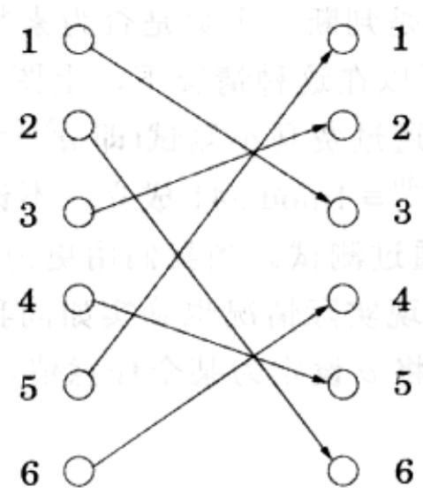
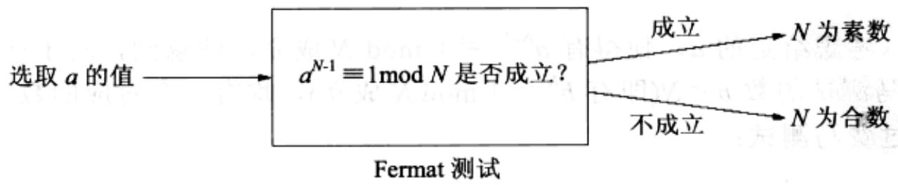
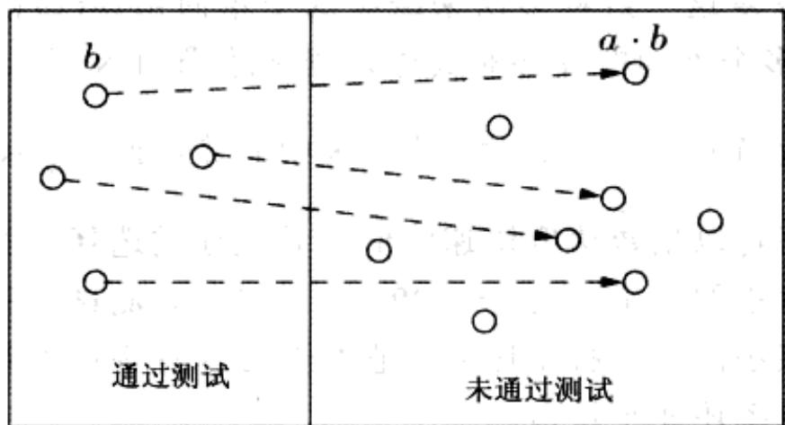
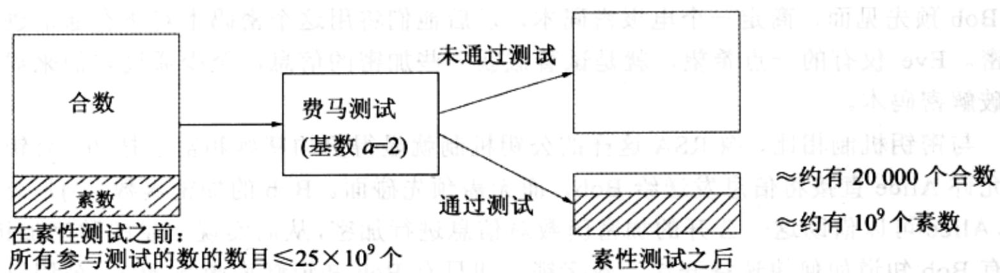

import Guide from '@/components/Guide.astro';
import Knowledge from '@/components/Knowledge.astro';
import Example from '@/components/Example.astro';
import Analysis from '@/components/Analysis.astro';
import Solution from '@/components/Solution.astro';
import Variant from '@/components/Variant.astro';
import Note from '@/components/Note.astro';
import Block from '@/components/Block.astro';
import Method from '@/components/Method.astro';
import Exercise from '@/components/Exercise.astro';
import Algorithm from '@/components/Algorithm.astro';

## 1.3 素性测试

是否存在一种如同石蕊试纸一样的测试，使得无需分解一个数就能判断其是否为素数？我们寄希望于公元1640年的一个定理。

费马小定理 如果 $p$ 是一个素数，那么对于任意的 $1 \leqslant a < p$ ，有

$$
a ^ {p - 1} \equiv 1 (\mathrm{mod} p) 。
$$

证明：令 $S$ 为模 $p$ 所得的所有非零整数的集合；即 $S = \{1,2,\dots,p - 1\}$ 。这里有一个重要的结论：将这些数与 $a(\text{模} p)$ 的结果相乘相当于对它们进行一个简单的排列变换。例如，针对 $a = 3, p = 7$ 的情况：

## 您的社会保险号码是素数吗？

我们知道，7、17、19和79是素数，但717-19-7179是素数吗？判断一个相当大的数是否为素数看起来会很费时，因为有太多可能的因数需要去尝试。但是，存在一些小技巧可以加速这个过程。比如，当您排除了因数2之后，您就可以忽略所有的偶数候选因数。您实际上可以忽略除掉其本身是素数的所有候选因数。

实际上, 一旦您排除了直到 $\sqrt{N}$ 的所有候选因数, 只要再仔细想一想就不难得出, $N$ 是一个素数。因为如果 $N$ 真的可以分解为 $N = K \cdot L$ 的形式, 那么 $K$ 和 $L$ 这两个因数都不可能超过 $\sqrt{N}$ 。

我们似乎正在取得突破！或许通过排除越来越多的候选因数，一个真正有效的素性测试方法可以被发现。

但是，沿着这个思路，并不存在快捷的素性测试。原因在于我们始终在尝试通过因子分解来判断一个数是否为素数。而因子分解是一个很难的问题！

现代密码学，以及本章的焦点，都基于以下重要思想，即：因子分解是困难的，而素性测试是简单的。我们无法分解大整数，但是我们却可以很容易地判断大整数是否为素数！(大概是这样的，如果一个数是合数，这样的测试将发现这个事实，而无须找到该数的一个因数)。

让我们对这个例子作进一步的研究。从上图中，我们可得：

$$
\{1, 2, \dots , 6 \} = \{3 \cdot 1 \bmod 7, 3 \cdot 2 \bmod 7, \dots , 3 \cdot 6 \bmod 7 \}
$$

分别将等号两边各自括号内的所有数字相乘，有 $6! \equiv 3^6 \cdot 6!\pmod{7}$ 成立，然后两边除以 $6!$ ，将得到 $3^6 \equiv 1 (\bmod{7})$ ，恰好是在 $a = 3, p = 7$ 的情况下我们所需要的结果。

现在让我们把这一结论推广到 $a$ 和 $p$ 的取值更一般的情况，令 $S = \{1,2,\dots,p - 1\}$ 。我们将证明，当 $S$ 中的每个元素乘以 $a$ 模 $p$ 后，结果将各不相同，并且非零。同时由于它们落在 $[1,p - 1]$ 的范围内，它们一定是 $S$ 的一个排列。

当 $i$ 取值不同时， $a \cdot i \bmod p$ 将各不相同，因为如果 $a \cdot i \equiv a \cdot j (\bmod p)$ ，那么两边同除以 $a$ ，将有 $i \equiv j (\bmod p)$ 成立。它们均非零，因为若 $a \cdot i \equiv 0$ ，则可直接推出 $i \equiv 0$ 。（我们可以将其除以 $a$ ，因为根据假设， $a$ 非零，因而与 $p$ 互素。）

我们现在有两种方法来表示集合 S:

$$
\mathrm{S} = \{1, 2, \dots , p - 1 \} = \{a \cdot 1 \bmod p, a \cdot 2 \bmod p, \dots , a \cdot (p - 1) \bmod p \}
$$

我们可以将集合 $S$ 的两种表示中各自的所有元素相乘，将得到

$$
(p - 1)! \equiv a ^ {p - 1} \cdot (p - 1)! (\mathrm{mod} p)
$$

两端同时除以 $(p - 1)!$ (我们之所以能够这样做，是因为假定 $p$ 为素数，所以 $(p - 1)!$ 与 $p$ 互素)，定理得证。

该定理提供了一种无需分解整数的测试方法，以判断一个数 $N$ 是否为素数：

问题在于费马小定理并不是判断一个数是否为素数的充分必要条件。它没有指明当 $N$ 不是素数时会怎样，所以在这种情况下，上图是存在问题的。实际上，对 $a$ 的某些取值，合数 $N$ 可能能够通过费马小测试(即 $a^{N-1} \equiv 1 \bmod N$ )。例如， $341 = 11 \cdot 31$ 并不是一个素数，然而却有 $2^{340} \equiv 1 \bmod 341$ 成立。不论怎样，我们都希望对于合数 $N$ ， $a$ 的大多数取值都将无法通过测试。当我们用更为精确的数学语言来描述图1-7中给出的算法时，我们就会发现实际情况也确实如同我们所希望的那样。基于此，图1-7中给出的算法并不预先将 $a$ 设定为某个任意值，而是随机地从 $\{1, \ldots, N-1\}$ 中选择一个值赋给 $a$ 。

function primality(N)
Input: Positive integer N
Output: yes/no

Pick a positive integer a &lt; N at random
if  $a^{N-1} \equiv 1 \pmod{N}$ :
return yes
else:
return no

图1-7 一个素性测试算法

为了分析该算法的表现，首先需要排除一种特殊情况。存在一类极其罕见的合数 $N$ ，称为Carmichael数，针对所有与 $N$ 互素的 $\pmb{a}$ ， $N$ 将通过费马测试。对于这类数，我们的算法将失效；但是这类数极其罕见，随后我们将了解如何对付它们(参见1.3节中针对Carmichael数的灰色方框的内容)，当前我们先忽略这类数的存在。

在不考虑 Carmichael 数的情况下，我们的算法表现得很好。任何素数 $N$ 显然将通过费马测试，并给出正确答案。另一方面，任何不是 Carmichael 数的合数 $N$ ，针对 $a$ 的某些取值，一定无法通过费马测试；正如我们将给出的结论，这直接意味着对于 $a$ 的至少一半的可能取值， $N$ 将无法通过费马测试。

引理 如果对于某些与 $N$ 互素的 $a$ , 有 $a^{N-1} \not\equiv 1 \bmod N$ , 那么对于 $a < N$ 的至少一半的可能取值, $N$ 将无法通过费马测试。

证明：考虑给定的 $a$ ，使得有 $a^{N-1} \not\equiv 1 \bmod N$ 成立。注意到，对于任意通过关于 $N$ 的费马测试的数 $b < N$ （即有 $b^{N-1} \equiv 1 \bmod N$ 成立），均有一个对应的数， $a \cdot b$ ，该数无法通过费马测试：

$$
(a \cdot b) ^ {N - 1} \equiv a ^ {N - 1} \cdot b ^ {N - 1} \equiv a ^ {N - 1} \not \equiv 1 \bmod N
$$

并且，所有形如 $a \cdot b$ 的数，当 $a$ 给定，而 $b$ 取不同值时，其值是各不相同的。对于这一论断的证明，与费马素性测试证明中用到的套路一样：如果 $a \cdot i \neq a \cdot j$ 成立，两端同除以 $a$ 即可。

$$
\text { 集合 } \{1, 2, \ldots , N - 1 \}
$$

一一映射 $b \mapsto a \cdot b$ 的存在，表明无法通过费马测试的数至少跟通过费马测试的数一样多。证毕。

既然忽略 Carmichael 数，我们可以有以下结论：

\- 如果 $N$ 是素数，那么对所有的 $a < N$ ， $a^{N - 1} \equiv 1 \bmod N$ 成立。

\- 如果 $N$ 不是素数，那么， $a < N$ 的所有取值情况中，至多有一半满足 $a^{N - 1} \equiv 1 \mod N$ 。

从而，图 1-7 中的算法具有以下概率表现：

Pr(当 N 为素数，图 1-7 中的算法返回 yes) = 1

$\operatorname{Pr}(\text{当 } N \text{ 不是素数，图 1-7 中的算法返回 yes}) \leq 1/2$

## 多么奇妙的群理论！

对于任意的整数 $N$ ，所有与 $N$ 互素的数 mod $N$ 后组成的集合构成了代数学中的群(group):

\- 存在一个定义在该集合上的乘法运算。

\- 该集合包含一个单位元(即1：集合中的任何元素与它相乘都保持不变)

\- 该集合中的所有元素都有一个(定义良好的)逆元。

这个特殊的群称为关于 N 的乘法群，常常被标记为 $Z_{N}^{*}$

群理论是一个相当成熟的数学分支。其中的一个重要概念是一个群可以含有个子群——子群作为群的子集，其本身也构成一个群。而关于子群的一个重要结论是，子群的元素数一定可以整除其所在群的元素数。

现在考虑集合 $B = \{b:b^{N - 1}\equiv 1\bmod N\}$ 。不难证明它是 $\mathbb{Z}_N^*$ 的一个子群(只需证明 $B$ 在乘法和求逆元操作下封闭)。从而 $B$ 的元素数一定整除 $\mathbb{Z}_N^*$ 的元素数。这意味着如果 $B$ 不含有 $\mathbb{Z}_N^*$ 的所有元素，那么 $B$ 能够含有的元素数最多为 $|\mathbb{Z}_N^*| / 2$ 。

我们可以通过重复这一过程多次来减少这个单向错误(该错误源自算法的概率表现)，即随机抽取多个不同的 a 并对其进行测试(如图 1-8 所示)。

$\Pr$ (当 $N$ 不是素数时，图1-8中的算法返回yes) $\leq 1 / 2^k$

可见，出错概率将以指数速度快速降低，并且通过选择足够大的 $k$ 值，能够使出错概率降低至任意小的水平。当 $k = 100$ 时，取定 $a$ ，测试结果出错的概率最多只有 $2^{-100}$ ，这是一个极小的数：打个比方，它甚至比任意宇宙射线恰好辐射到运行该算法的计算机上的概率还要小得多！

function primality2(N)
Input: Positive integer N
Output: yes/no
Pick positive integers  $a_{1}, a_{2}, \ldots, a_{k} < N$  at random if  $a_{i}^{N-1} \equiv 1 \pmod{N}$  for all  $i = 1, 2, \ldots, k$ :
return yes
else:
return no

图1-8 一个低出错概率的素性测试算法

<Knowledge title="专栏: Carmichael 数">

最小的 Carmichael 数是 561。它不是一个素数，因为有 $561 = 3 \cdot 11 \cdot 17$ 成立；然而它却使费马测试出现了失误，因为对于任意与 561 互素的 $a$ ，都有 $a^{560} \equiv 1 \pmod{561}$ 成立。曾经有很长时间，Carmichael 数被认为是有限的，但现在我们知道，它们是无限的，只是相对稀少罢了。

关于 Carmichael 数的检测，利用了 Rabin 和 Miller 提供的一种更细化的素性测试法。将 N-1 写成 $2^{t}u$ 的形式。跟以前的方法一样，我们将随机选择一个数 a 作为基数，计算 $a^{N-1} \mod N$ 的值。首先计算 $a^{u} \mod N$ 的值，然后不断进行平方操作，得到以下的序列：

$$
a ^ {u} \bmod = N, a ^ {2 u} \bmod N, \dots , a ^ {2 ^ {t} u} = a ^ {N - 1} \bmod N
$$

如果有 $a^{N-1} \not\equiv 1 \bmod N$ ，那么由费马小定理知 $N$ 是一个合数，判定结束。但是如果有 $a^{N-1} \equiv 1 \bmod N$ ，我们将进行随后的测试：在上述的序列中，我们一定可以找到首次出现元素 1 的位置。如果该位置在首项之后(即，如果 $a^u \bmod N \neq 1$ ），且在序列中前一位置的值不是 -1 mod $N$ ，那么我们可以断定 $N$ 是合数。

在后一种情况下，我们找到了1模 $N$ 的一个非平凡平方根：这个数不是 $\pm 1 \bmod N$ ，但当它平方后，结果等于 $1 \bmod N$ 。只有当 $N$ 是合数时这样的数才存在(参见习题1.40)。事实证明，当我们将这个平方根检查过程与费马测试结合起来时，在1和 $N - 1$ 范围内的至少3/4的 $a$ 值将显示 $N$ 是一个合数，即使 $N$ 是一个Carmichael数。

</Knowledge>
<Knowledge title="专栏: 素数的随机生成">

我们现在离获得密码学应用所需的所有工具已经很近了。谜团的最后一角即将揭开，它是一个随机生成素数的快速算法，该素数可能有几百位长。因为素数足够多，所以随机生成一个这样的素数就变得相对简单——一个随机的 $n$ 位长的数字为素数的概率大约是 $1 / n$ (实际上大约是 $1 / (\ln 2^n) \approx 1.44 / n$ )。事实上，20个社会保险号码中就大约有一个是素数！

Lagrange 素数定理 令 $\pi(x)$ 为 $\leqslant x$ 的素数的个数。则有 $\pi(x) \approx x / (\ln x)$ ，或者更准确的，

$$
\lim _ {x \rightarrow \infty} \frac {\pi (x)}{(x / \ln x)} = 1
$$

既然素数足够多，随机生成一个 $n$ 位长的素数就变得相对简单：

\- 随机选定一个 $n$ 位长的数 $N$ 。

\- 对 $N$ 进行素性测试。

\- 如果通过测试，输出 $N$ ；否则重复以上过程。

该算法有多快？当随机选定一个 $N$ ， $N$ 是素数的概率最少有 $1/n$ ，素数 $N$ 显然会通过测试。所以在每次迭代中，该过程最少有 $1/n$ 的概率停止。从而平均起来，该过程将在 $O(n)$ 次迭代后终止(参见习题 1.34)。

</Knowledge>
<Knowledge title="专栏: 随机算法：一个虚拟的章节">

令人惊异的，更让人感到自相矛盾的是，一些高效算法和大多数精妙算法都依赖于可能性(chance): 在算法的特定步骤, 算法流程推进的方向视随机抛硬币的结果而定。这些随机算法常常十分简单和精妙, 它们的输出并不总是正确, 而是以较小的概率出错。对所有可能的输入, 这一错误概率的上限同样存在; 它只依赖于算法自身做出的随机选择, 并且可以很容易地被降低到所期望的程度。

在本书中，我们没有专门划出一章来讨论随机算法，而是把它们分散在特定的章节中，在特定的应用背景下它们的出现显得更为自然。而且，研读本书中的随机算法，无需具备概率论的专门知识。您只需熟悉以下基本概念：概率、期望值、抛硬币得到正面的期望抛掷次数，以及大家所知的“期望的线性性”。

以下是关于本书中主要概率算法的要点：随机算法的最早且最形象的例子之一就是图1-8中给出的概率性素性测试算法。尽管一个确定性素性测试算法最近被发现，但是随机测试算法却更快，因此完全可以作为另一种选择。在本章的后续部分，在1.5节中我们将讨论散列表，这是一种一般的随机数据结构，它支持插入、删除和查找操作。并且，在实际应用中，它比确定性数据结构，如二叉查找树，具有更快的数据访问速度。

随机算法可以分为两大类。第一类称为 Monte Carlo 算法，通常运行很快，输出错误解的概率很小，例如素性测试；另一类称为 Las Vegas 算法，它总是给出正确解，而以很高的概率保证运行时间较短。这一类随机算法的例子是第 2 章将讨论的排序算法和寻找中项算法(分别在本书的 2.3 节和 2.4 节)。

已知的针对最小分割问题的最快算法是随机 Monte Carlo 算法，将在 5.2 节中的第一个灰色方框中加以讨论。随机性在启发式算法中也扮演着很重要的角色，这将在 9.3 节展开讨论。同时，针对整数因子分解的量子算法(10.7 节)的工作机制也与随机算法很类似，它输出正确解的概率很高——只是它的随机性不是来自于抛硬币，而是来自于量子机制中的叠加原理。

虚拟章节习题：1.29、1.34、1.46、2.24、2.33、5.35、9.8、10.8。

接下来，我们不禁要问，到底应该使用哪一种素性测试？在当前的应用中，由于我们进行素性测试的数是随机选取的，而不是由一个假想对手选取的，所以使用基数 $a = 2$ (或者为了确保正确， $a = 2$ 、3、5) 进行素性测试已绰绰有余，因为对于随机数来说，Fermat 测试出错的概率，将比之前证明过的最差情况的概率上限 1/2 小得多。通过这一测试的数被有趣地称为“工业级素数”。基于这一算法，在 PC 机上只需一眨眼的功夫就能生成一个几百位长的素数。

另一个悬而未决的的重要问题是：该算法输出的结果确实是素数的概率有多大？回答这一问题我们首先需要了解费马测试具有多么强大的辨识能力。举一个实际的例子，假定我们针对所有的 $N \leqslant 25 \times 10^{9}$ ，以 $a = 2$ 为基数作素性测试。在 $N \leqslant 25 \times 10^{9}$ 的范围内存在大约 $10^{9}$ 个素数，同时大约有 20000 个合数通过测试(如下图所示)。因此，算法出错，输出一个合数的概率约为 $20000 / 10^{9} = 2 \times 10^{-5}$ 。随着参与计算的数的位数的增加(达到我们所预想应用中的几百位长)，这一出错概率将会迅速降低。

</Knowledge>
