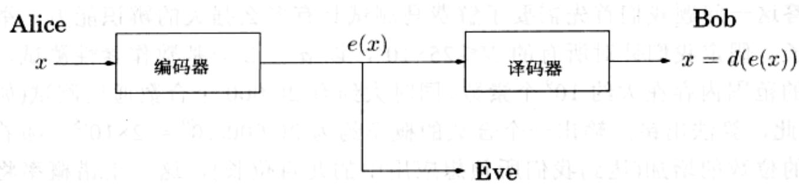
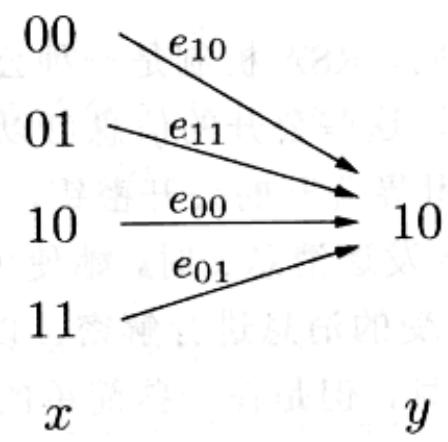

import Guide from '@/components/Guide.astro';
import Knowledge from '@/components/Knowledge.astro';
import Example from '@/components/Example.astro';
import Analysis from '@/components/Analysis.astro';
import Solution from '@/components/Solution.astro';
import Variant from '@/components/Variant.astro';
import Note from '@/components/Note.astro';
import Block from '@/components/Block.astro';
import Method from '@/components/Method.astro';
import Exercise from '@/components/Exercise.astro';
import Algorithm from '@/components/Algorithm.astro';

## 1.4 密码学

我们的下一个论题——Rivest-Shamir-Adleman(RSA)密码机制，将利用我们在本章介绍的所有思想！它之所以能够严格地确保安全，是因为它创造性地利用了某些数论问题(模的指数运算、求最大公因子、素性测试)的多项式时间可解性和其他问题(大整数的分解)的不可解性之间的天然鸿沟。

密码学的典型应用背景可以通过以下三个角色之间的活动来描述：Alice 和 Bob，他们想要私下进行通信，而 Eve 是一个窃听者，她竭尽全力地想要知道他们交流的信息。具体来说，假设 Alice 想要发送信息 x 给她的朋友 Bob，信息是二进制格式的(二进制形式如此简单，又何乐而不为呢？)。她把信息加密成 $e(x)$ ，发送给 Bob，而 Bob 使用他的解密函数 $d(\cdot)$ 对收到的信息进行解密： $d(e(x))=x$ 。这里的 $e(\cdot)$ 和 $d(\cdot)$ 都是对信息的某种转换函数。

Alice 和 Bob 担心窃听者 Eve 将会截获信息 $e(x)$ : 比如, Eve 可能是网络上的一个嗅探者。但是理想情况下, 加密函数 $e(x)$ 是在不知道解密函数 $d(\cdot)$ 的情况下选定的, 这样一来, Eve 即使截获了信息, 她也无法作任何事。换言之, 知道 $e(x)$ 只能告诉她很少的信息, 甚至无法告诉她任何关于 $x$ 本身的信息。

几个世纪以来，密码学都是以所谓的密钥机制为基础的。在这样的机制下，Alice 和 Bob 预先见面，商定一个电报密码本，以后他们将用这个密码本对所有通信进行加密。Eve 仅有的一点希望，就是试着截获一些加密的信息，至少通过它们来局部地破解密码本。

与密钥机制相比，像 RSA 这样的公钥机制就显得更加精妙和富于技巧：公钥机制允许 Alice 直接将信息发送给 Bob，而无需预先碰面。Bob 的加密函数 $e(\cdot)$ 是公开的，Alice 可以借助这一公开的加密函数对信息进行加密，从而实现信息的数字加锁。只有 Bob 知道如何快速解开这一数字锁：即只有 Bob 知道解密函数 $d(\cdot)$ 。公钥机制的要点在于，Alice 和 Bob 只需通过一些简单的计算，分别对各自的信息进行加密和解密操作——这些操作是任何便携式的计算设备都可以胜任的。相反，如果不知道解密函数，Eve 要想解密信息，她必须进行像大整数的因子分解那样的复杂操作，这些操作需要巨大的计算能力，可能世界上最强大的计算机组合起来都无法胜任。这一强制性的保证机制使得安全的 Web 商务成为可能，用户可以方便地在 Internet 上将信用卡账号发送给业务相关的公司。

## 1.4.1 密钥机制：一次一密乱码本和 AES

如果 Alice 想要传送一个重要的私人信息给 Bob，通过一个加密函数对信息进行乱码处理对她来说是一个明智的选择，

$$
e \colon \langle \text {信息} \rangle \to \langle \text {加密的信息} \rangle
$$

当然，这个加密函数必须是可逆的——就是说对应于加密和解密都是可行的——也就是要求必须有一个从信息到加密信息之间的双向映射。加密函数的逆函数是解密函数 $d(\cdot)$ 。

在一次一密乱码本(one-time pad)机制下，Alice 和 Bob 预先见面，两人私下商定一个二进制位串 $r$ ， $r$ 与 Alice 即将发送的重要信息 $x$ 的长度一样，都是 $n$ 位。从而 Alice 的加密函数就是一个按位异或运算，即 $e_r(x) = x \oplus r$ ：加密后信息的每一位的取值都是 $x$ 和 $r$ 相应位置上取值的异或操作结果。例如，如果 $r = 01110010$ ，那么信息11110000就被乱码处理为以下形式：

$$
e _ {r} (1 1 1 1 0 0 0 0) = 1 1 1 1 0 0 0 0 \oplus 0 1 1 1 0 0 1 0 = 1 0 0 0 0 0 1 0 。
$$

函数 $e_r$ 是一个从 $n$ 位位串到 $n$ 位位串的双向映射，实际上它的逆映射就是它本身！

$$
e _ {r} (e _ {r} (x)) = (x \oplus r) \oplus r = x \oplus (r \oplus r) = x \oplus \overline {{{0}}} = x
$$

其中 $\overline{0}$ 是每一位都为 0 的位串。从而，Bob 可以通过再一次应用相同的加密函数来解密 Alice 发送过来的信息： $d_r(y) = y \oplus r$ 。

为了确保一次一密乱码本机制的安全，Alice 和 Bob 该如何选择 r 呢？答案很简单：他们应该随机地选择位串 r，每一位的取值都由抛硬币来决定，以便最终得到的位串可能是 $\{0,1\}^{n}$ 集合中的任意元素，即位串 r 取 $\{0,1\}^{n}$ 集合中每个元素的概率是相等的。这样的话，即使 Eve 截获了加密信息 $y=e_{r}(x)$ ，她也无从得到关于 x 本身的任何信息。我们可以设想一下，假如 Eve 截获了加密信息 y=10；她能从中推断出什么信息？由于她不知道 r，因此 r 所有可能的取值均对应于原始信息 x 的不同取值：

所以 Eve 知道的信息只能告诉她这样的结论：x 的所有可能取值都是相等的！

正如一次一密乱码本机制的名字所指出的那样，该机制的缺陷在于位串 $r$ 使用一次之后就必须丢弃。使用同一个密码本对另一个信息进行加密将带来安全隐患，因为如果 Eve 对于两个信息 $x$ 和 $z$ ，知道了 $x \oplus r$ 和 $z \oplus r$ 的结果，那么她可以通过异或操作得到 $x \oplus z$ 的结果，这可能蕴含重要的信息——例如，(1)它揭示了两个信息对应的位串是否具有相同的开头和结尾，(2)如果一个信息包含了一个较长的 0 位串(正如当信息是一个图像时，经常会出现的情况)，那么另一个信息对应位置的取值将被暴露。因此，Alice 和 Bob 共享的随机位串的长度必须为他们通信的所有信息的长

度之和。

虽说一次一密乱码本机制是一个小型的密码机制，但是它的工作机制和理论根据却是相当清晰的。在其所属的密钥机制里，还有一种高级加密标准，这是一种被广泛使用的密码机制，它已于2001年被美国国家标准和技术委员会认证。AES仍是一种密钥机制：在这种机制下，Alice和Bob还是需要就共享的随机位串达成一致。不同的是，该机制要求的随机位串的长度固定，是一个比较小的值，通常定为128位(也有定为192位或256位的情况)，该机制定义了一个从128位位串到128位位串的双向映射 $e_r$ 。AES与其它密钥机制的主要区别在于这一双向映射可以被重复使用，因此，如果是一个比较长的信息，就可以将原信息分成多个128位的片段，然后对每一个片段使用 $e_r$ 进行加密。

AES 机制的安全性并没有被严格的证明，但是可以确定的是，至少至今一般人无法知道怎样破解该机制——从截获的 $e_{r}(x)$ 中恢复出原信息 x——除非使用跟蛮力破解方法差不多的傻瓜技术，对信息发送方和接收方共享的位串 r 的所有可能取值一一尝试。

## 1.4.2 RSA

与前述的两种密码机制不同，RSA 机制是一种公钥密码机制：任何人可以使用公开的信息向其他人发送消息，这些公开的信息可以是地址或电话号码等。在这种机制下，每个人具备一个向全世界公开的公开密钥，以及一个只有他/她自己知道的保密密钥。当 Alice 想要向 Bob 发送消息 x 时，她使用 Bob 的公开密钥对消息加密。而 Bob 使用他的保密密钥对接受的消息进行解密，以获得原始消息 x。Eve 可以随意地查看发送给 Bob 的加密消息，但是在一些简单的基本假设下，她将无法对这些消息解密。

RSA 机制绝大部分依赖于数论的知识。我们可以将 Alice 发送给 Bob 的消息看作是模 N 的数的序列；长度比 N 大的消息被分解为比 N 小的片段。从而，加密函数是定义在集合 $\{0,1,\ldots,N-1\}$ 上的双向映射，解密函数就是该映射的逆映射。N 取什么样的取值比较合适？应该使用什么样的双向映射呢？

性质 随机选取两个不同的素数 $p$ 和 $q$ ，并令 $N = pq$ 。对任意与 $(p - 1)(q - 1)$ 互素的整数 $e$ ，有以下性质成立：

1. 映射 $x \mapsto x^e \bmod N$ 是定义在集合 $\{0, 1, \ldots, N-1\}$ 上的双向映射。

2. 另外，容易得到该映射的逆映射：令 $d$ 为 $e$ 模 $(p - 1)(q - 1)$ 操作的逆，则对于

所有的 $x \in \{0,1,\dots,N-1\}$ ，有

$$
(x ^ {e}) ^ {d} \equiv x \bmod N
$$

第一个性质告诉我们映射 $x \mapsto x^e \bmod N$ 是一个对消息 $x$ 进行加密的合理方式，因为加密过程没有丢失任何信息。所以，如果 Bob 将 $(N, e)$ 发布为他的公开密钥，其他人就可以使用这个公钥来向他发送加密消息。第二个性质告诉我们解密过程是如何进行的。Bob 需要将 $d$ 作为他的保密密钥，利用它，Bob 就可以解密所有发送给他的加密消息，解密过程只需将接受到的消息 $x^e$ 进行模 $N$ 的指数运算即可，其中指数取值为 $d$ 。

示例：令 $N = 55 = 5 \cdot 11$ 。选定加密指数 $e = 3$ ，其满足 $\gcd(e, (p - 1)(q - 1)) = \gcd(3, 40) = 1$ 。解密指数就为 $d = 3^{-1} \bmod 40 = 27$ 。现在对于任何消息 $x \bmod 55$ ， $x$ 加密为 $y = x^3 \bmod 55$ ， $y$ 解密为 $x = y^{27} \bmod 55$ 。因此，如果 $x = 13$ ，那么 $y = 13^3 = 52 \bmod 55$ ， $13 = 52^{27} \bmod 55$ 。

接下来，让我们验证上面的结论，并检查 RSA 机制的安全性。

证明：如果映射 $x \mapsto x^e \bmod N$ 是可逆的，那么它一定是一个双向映射；因此，性质2将包含性质1，从而只需证明性质2即可。要想证明性质2，我们注意到 $e$ 关于模 $(p-1)(q-1)$ 操作是可逆的，这是因为 $e$ 与 $(p-1)(q-1)$ 互素。要想证明 $(x^e)^d \equiv x \bmod N$ 成立，我们考察该式中的指数部分：由于 $ed \equiv 1 \bmod (p-1)(q-1)$ ，所以存在 $k$ ，使得我们可以将 $ed$ 写成 $1 + k(p-1)(q-1)$ 的形式。现在我们注意到两者之间的差值

$$
x ^ {e d} - x = x ^ {1 + k (p - 1) (q - 1)} - x
$$

总是与0模 $N$ 同余。上式的右端形式很简便，因为它可以应用费马小定理进行简化。 $p$ 整除该差值(因为有 $x^{p - 1} \equiv 1 \mod p$ 成立)，同理， $q$ 也整除该差值。又因为 $p$ 和 $q$ 均为素数，两者的积 $N$ 也一定整除该差值。从而有 $x^{ed} - x = x^{1 + k(p - 1)(q - 1)} - x \equiv 0 (\mod N)$ 成立，证毕。

图1-9中简要地给出了RSA机制的运作步骤。该机制的使用十分方便：Alice和Bob所需的计算量都是初级的。但是问题是该机制针对Eve这样的窃听者的安全性如何？

RSA的安全性主要基于以下一个简单假设：

给定 $N, e$ 以及 $y = x^{e} \bmod N$ ，想要计算 $x$ 将是十分困难的。

Bob 选择他的公开密钥和保密密钥。

\- 首先随机选取两个不同的大素数 $p$ 和 $q$ 。

\- 他的公开密钥是 $(N, e)$ ，其中 $N = pq$ ， $e$ 是一个 $2n$ 位长的数，且与 $(p - 1)(q - 1)$ 互素。通常情况下选择 $e = 3$ ，以便能够快速地进行加密操作。

\- 他的保密密钥是 $d, d$ 是 $e$ 模 $(p - 1)(q - 1)$ 操作的逆元，由扩展 Euclid 算法求得。  
Alice 想要向 Bob 发送消息 $x$ 。

\- 她找到 Bob 的公开密钥 $(N, e)$ ，将加密消息 $y = (x^e \bmod N)$ 发送给 Bob，加密过程可以使用模的指数算法高效地进行。

\- Bob 对接收到的消息进行解密，解密过程需要计算 $y^{d} \mod N$ 。

图1-9 RSA机制

以上假设是合理的。Eve 要想猜出 $x$ 的值，该当如何？她需要尝试 $x$ 的所有可能取值，针对每个可能取值都需要判断 $x^e \equiv y \mod N$ 是否成立，而这个判断过程所需的时间是指数级的。她的另一种选择是尝试分解大整数 $N$ ，以得到 $N$ 的因子 $p$ 和 $q$ ，然后求出 $e$ 模 $(p-1)(q-1)$ 操作的逆元 $d$ ，而我们确信大整数的因子分解是困难的。计算上的困难性通常会令人败兴而归，但它恰恰是 RSA 机制安全性的基石。
