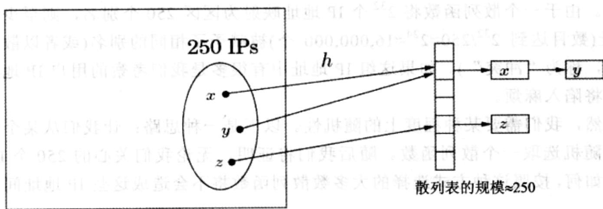

import Guide from '@/components/Guide.astro';
import Knowledge from '@/components/Knowledge.astro';
import Example from '@/components/Example.astro';
import Analysis from '@/components/Analysis.astro';
import Solution from '@/components/Solution.astro';
import Variant from '@/components/Variant.astro';
import Note from '@/components/Note.astro';
import Block from '@/components/Block.astro';
import Method from '@/components/Method.astro';
import Exercise from '@/components/Exercise.astro';
import Algorithm from '@/components/Algorithm.astro';

## 1.5 通用散列表

我们以数论在散列函数设计中的应用来结束本章。散列表是在表中存储数据项的一种有效方法，它支持插入、删除和查找操作。

设想如下的应用场景, 我们需要维护一个存储有大约 250 个 IP 地址的不断变化的列表, 这些 IP 地址可能就是某个 Web 服务当前在线用户的地址。(让我们回顾一下相关的知识, 一个 IP 地址包含 32 位, 它指示了互联网上一台计算机的位置, 通常 IP 地址被划分成四个 8 位的区段, 例如 128.32.168.80 就是一个 IP 地址)。如果我们将这些 IP 地址存储在一个由 IP 地址索引的数组里, 我们将能够得到很快的查找速度。但是这种方式相当浪费存储空间: 该数组将含有 $2^{32} \approx 4 \times 10^{9}$ 个元素, 而它们中的大部分都是空的。另一种存储方式是使用一个链表, 只存储这 250 个 IP 地址, 但访问每个 IP 地址的操作将很慢, 所需时间与 250, 即用户的总数成比例。是否存在一种方式能够集两种方式所长, 既能做到占用的存储空间与用户的总数成比例、又能保证快捷的查找操作呢? 散列表应运而生。

## 1.5.1 散列表

以下我们将从一个较高的层次来审视散列表。我们将给 $2^{32}$ 个可能的IP地址每个一个简短的“别名”。您可以把这个别名想象成一个1到250之间的数(我们随后将对这个区间范围做出细微调整)。这样的话，难免将有很多IP地址具有相同的别名。但是我们希望的是，我们关注的那些特定用户对应的250个IP地址，大多数都被赋予了不同的别名，从而我们就可以将这些IP地址存储在一个大小为250的数组中，并用这些别名来索引这些IP地址。如果多个IP地址具有同一个别名怎么办？答案很简单：该集合的每个元素指向一个链表，链表中存储了该元素对应别名相关的所有IP地址。因此总的存储空间与250，即用户总数成比例，同时与所有可能的IP地址的总数无关。另外，如果没有很多用户的IP地址被赋予同一个别名，则查找操作会很迅速，因为我们需要遍历的链表的平均规模并不大。

  
$2^{32}$ 个IP地址的存储空间

但是问题是我们该如何给每个 IP 地址赋予一个别名呢？散列函数能解决这个问题：在我们给出的例子中，函数 $h$ 将 IP 地址映射到列表中的元素，该列表长度大约有 250(恰好也是我们所期望的数据项的数目)。分配给 IP 地址 $x$ 的别名为 $h(x)$ ，同时 IP 地址 $x$ 即存储在列表中的 $h(x)$ 位置。如前所述，列表中的每个位置实际上是一个桶数组结构，它是一个链表，其中存储着映射到该位置的所有 IP 地址。所幸只有很少的桶数组中存储有比较多的 IP 地址。

## 1.5.2 散列函数族

设计散列函数需要一定的技巧。一个散列函数在某种意义上必须是“随机的”(以便能将数据项充分地分散开)，但同时作为一个函数，它也应当是“一致的”(以便我们每次执行该函数时都能得到相同的结果)。然而，实际操作中数据项的分布常常与我们期望的情况之间存在差异。在我们的例子中，散列函数的一种可能形式是将IP地址映射为8位二进制数，即IP地址的最后一个分段： $h(128.32.168.80)=80$ 。这时我们需要一张含有n=256个桶数组的表。不过这是一个好的散列函数吗？或许不是，因为当IP地址最后一个分段的数值往往比较小时(如一位数或是两位数)，则低位数值对应的桶数组中将会十分拥挤。而选择IP地址的第一个分段对应的另一个散列函数同样存在问题——例如，如果本例中的大多数用户来自亚洲时，同样会出现某些桶数组中挤满了IP地址的情况。

其实以上两个散列函数本身并没有什么问题。如果我们考察的250个IP地址在所有 $N = 2^{32}$ 种IP地址可能性中满足均匀分布的话，那么这两个散列函数将表现良好。问题是我们无法保证这些IP地址的分布是均匀的。

反之，单一的散列函数不论设计多么精妙，也不可能在所有的数据实例上都表现良好。由于一个散列函数将 $2^{32}$ 个IP地址映射为区区250个别名，则至少有一组IP地址(数目达到 $2^{32} / 250 \approx 2^{24} \approx 16,000,000$ 个)被赋予了相同的别名(或者以散列表中的术语，称为“冲突”)。如果这组IP地址中有很多是我们考察的用户IP地址，那么我们将陷入麻烦。

显然，我们需要某种程度上的随机性。以下是一种思路：让我们从某个散列函数族中随机选取一个散列函数。随后我们将证明，无论我们关心的250个IP地址的分布如何，按照这种方式选择的大多数散列函数将不会造成这些IP地址间的大量冲突。

为了上述目的，我们需要定义一个可供我们随机选取散列函数的函数族；从而我们将借助于数论的知识。我们不再将桶数组的数目设为250，而是设为 $n = 257$ —一个素数！接着我们将每个IP地址 $x$ 视为一个四元组 $x = (x_{1},\ldots ,x_{4})$ ，四元组中每个元素都是经过模 $n$ 操作的整数——对应于IP地址，其实该四元组就是四个在0到255之间的整数的组合，所以255和 $n = 257$ 之间的微小差异也就不是什么大问题。我们可以定义一个函数 $h$ ，按以下方式将IP地址映射到一个数模 $n$ 的结果：任意取定四个模 $n(n = 257)$ 的整数，例如分别为87、23、125和4。从而将IP地址 $(x_{1},\dots,x_{4})$ 映射为 $h(x_{1},\dots,x_{4}) = (87x_{1} + 23x_{2} + 125x_{3} + 4x_{4})\mathrm{mod}257$ 。事实上，任意四个数 $\mathrm{mod}n$ 都定义了一个散列函数。

对于任意四个系数 $a_1, \ldots, a_4 \in \{0, 1, \ldots, n-1\}$ ，记 $a = (a_1, a_2, a_3, a_4)$ ，并定义 $h_a$ 为如下的散列函数：

$$
h _ {a} (x _ {1}, \dots , x _ {4}) = \sum_ {i = 1} ^ {4} a _ {i} \cdot x _ {i} \bmod n
$$

我们将证明，如果我们能够随机地选取这些系数 $a$ ，那么 $h_a$ 将在下述意义下表现良好。

性质 考虑任意一对不同的 IP 地址 $x = (x_{1},\ldots ,x_{4})$ 和 $y = (y_{1},\dots ,y_{4})$ 。如果系数 $a = (a_{1},$ $a_2,a_3,a_4)$ 能做到从 $\{0,1,\dots ,n - 1\}$ 中随机均匀地选取，那么有下式成立：

$$
\operatorname * {P r} \left\{h _ {a} (x _ {1}, \dots , x _ {4}) = h _ {a} (y _ {1}, \dots , y _ {4}) \right\} = \frac {1}{n}
$$

换言之，在散列函数 $h_a$ 下， $x$ 和 $y$ 冲突的概率与 $x$ 和 $y$ 均被随机独立地赋予别名的概率相同。该条件保证了对于任意数据项的期望查找时间很短。原因如下：如果我们想要在散列表中查找 $x$ ，查找所需的时间决定于 $x$ 所在的桶数组的大小，也就是决定于与 $x$ 被赋予的别名相同的数据项的数目。然而散列表中只有 250 个数据项，从而任意一个数据项和 $x$ 具有相同别名的概率是 $1/n = 1/257$ 。因此，与 $x$ 被赋予的别名(赋予别名由一个随机选择的散列函数 $h_a$ 来完成)相同的数据项的期望数目是 $250/257 \approx 1$ ，这意味着 $x$ 所在桶数组的期望容量小于 $2^1$ 。

现在让我们来证明前述的性质。

证明：由于 $x = (x_{1},\ldots ,x_{4})$ 和 $y = (y_{1},\ldots ,y_{4})$ 互不相同，所以这两个四元组一定在某些部分存在差异；不失一般性，我们假设 $x_{4}\neq y_{4}$ 。接下来我们要计算概率 $\operatorname {Pr}[h_a(x_1,\dots ,x_4) = h_a(y_1,\dots ,y_4)]$ ，也就是概率 $\sum_{i = 1}^{4}a_{i}\cdot x_{i}\equiv \sum_{i = 1}^{4}a_{i}\cdot y_{i}\bmod n$ 。而后者可以写为

$$
\sum_ {i = 1} ^ {3} a _ {i} \cdot (x _ {i} - y _ {i}) \equiv a _ {4} \cdot (y _ {4} - x _ {4}) \bmod n\tag{1}
$$

假定我们通过随机选取 $a = (a_{1}, a_{2}, a_{3}, a_{4})$ 来达到随机选取散列函数 $h_{a}$ 的目的。我们先是选取 $a_{1}, a_{2}$ 和 $a_{3}$ ，然后停下来，思考以下问题：选取 $a_{4}$ 使公式(1)成立的概率是多少？此时我们令公式(1)左边的取值为 $c$ 。而由于 $n$ 是素数，以及 $x_{4} \neq y_{4}$ ， $(y_{4} - x_{4})$ 关于模 $n$ 操作将只有一个唯一的逆元。因此，为了使公式(1)成立，四元组中的最后一个元素 $a_{4}$ 一定要恰好为 $c \cdot (y_{4} - x_{4})^{-1} \bmod n$ ，而 $a_{4}$ 的值共有 $n$ 种可能的取法。所以 $a_{4}$ 的取值使得公式(1)成立的概率是 1/n，证毕。

现在让我们回顾一下所讲的内容。由于我们无法控制数据项集合的分布特征，我们转而寻求随机均匀地从一个散列函数族 $H$ 中选取一个散列函数 $h$ 。在本例中，

$$
H = \{h _ {a}: a \in \{0, \dots , n - 1 \} ^ {4} \}
$$

为了能从该函数族中随机均匀地选取一个散列函数，我们随机均匀选取的四个整数分别为 $a_1, \ldots, a_4$ ，并分别对其进行模 $n$ 操作。（顺便需要指出的是，上文中提到的两个简单散列函数，即取IP地址的最后一个或第一个8位二进制分段的函数，也都属于该函数族。它们分别是 $h_{(0,0,0,1)}$ 和 $h_{(1,0,0,0)}$ ）。需要强调的是，该函数族具有以下性质：

对于任意两个不同的数据项 $x$ 和 $y$ ，函数族 $\mathcal{H}$ 中恰有 $|\mathcal{H}| / n$ 个散列函数将 $x$ 和 $y$ 映射到同一个桶数组中，其中 $n$ 是桶数组的总数。

满足这样性质的散列函数族称为通用散列函数族。换言之，对于任意的两个数据项，如果散列函数随机地选自一个通用函数族，那么两个数据项发生冲突的概率是 $1 / n$ 。它也是我们将 $x$ 和 $y$ 随机均匀地映射到同一个桶数组中的冲突概率——从某种意义来说，这一点是散列表的金科玉律。我们随后将证明，这一性质意味着从期望意义上讲，散列操作将具有良好的性能。

散列表这一概念, 虽说来自于假想的 IP 地址应用场景, 却有着非常广泛的应用。其应用通常遵循如下步骤: 首先, 将散列表的大小 $n$ 定为一个素数, 该素数比将要存储在该表中的期望数据项数目稍大(总是存在这样的素数, 它接近于我们任意给定的整数; 实际上, 为了确保散列表具有良好的应用性能, 散列表的最佳大小约为其中数据项数目的两倍)。接下来, 假定所有数据项取值范围的规模是 $N = n^k$ , 即 $n$ 的一个幂(如果我们想要为数据项的真实数目留有余地, 我们就需要这样做)。然后每个数据项可以视为一个关于模 $n$ 操作的 $k$ 元组, 而 $\mathcal{H} = \{h_a : a \in \{0, \ldots, n-1\}^k\}$ 即为一个通用散列函数族。
