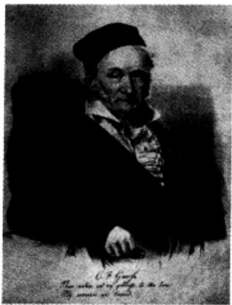
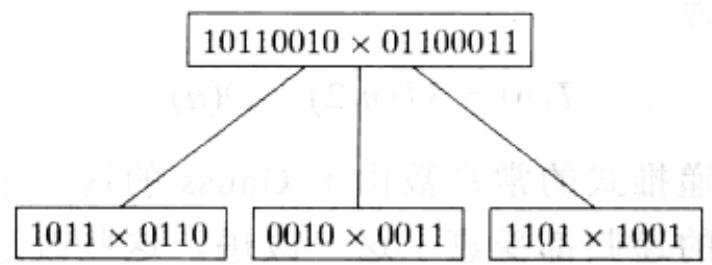
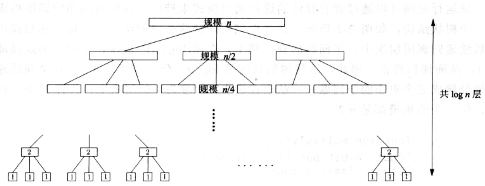

import Guide from '@/components/Guide.astro';
import Knowledge from '@/components/Knowledge.astro';
import Example from '@/components/Example.astro';
import Analysis from '@/components/Analysis.astro';
import Solution from '@/components/Solution.astro';
import Variant from '@/components/Variant.astro';
import Note from '@/components/Note.astro';
import Block from '@/components/Block.astro';
import Method from '@/components/Method.astro';
import Exercise from '@/components/Exercise.astro';
import Algorithm from '@/components/Algorithm.astro';

## 第2章 分治算法

利用分治法解决问题通常需要以下三个步骤：

1. 将原问题分解为一组子问题，每个子问题都与原问题类型相同，但是比原问题的规模小；

2. 递归求解这些子问题；

3. 将子问题的求解结果恰当合并，得到原问题的解。

分治策略实际操作起来，分为三项不同的工作：原问题到子问题的分解工作；在递归将要结束，当子问题足够小时的直接求解工作；子问题解的合并工作。这三项工作由分治算法的核心递归结构加以整合和协调。

为了给出分治思想的一个直观印象，我们将看看如何将这一思想应用于数字乘法，以得到一种新的乘法算法，它将比我们在小学里学过的乘法要高效得多！

## 2.1 乘法

数学家 Carl Friedrich Gauss(1777-1855)曾经注意到这样一个现象：虽然计算两个复数的乘积看似包含四次实数乘法，

$$
(a + b i) (c + d i) = a c - b d + (b c + a d) i
$$

但是它其实可以仅仅通过三次实数乘法完成： $ac, bd$ 以及 $(a + b)(c + d)$ ，这是因为

$$
b c + a d = (a + b) (c + d) - a c - b d
$$

对于算法复杂性的大- $O$ 分析而言，将乘法次数由4次减到3次似乎算不上什么

突破。但当这一小幅改进被递归地加以应用时，算法效率的改进将会变得极其显著。

  
Carl Friedrich Gauss
1777–1855

© Corbis

让我们从复数乘法的情况转换到常规的乘法，看看上述思路能有什么帮助。假定 $x$ 和 $y$ 是两个 $n$ 位二进制整数，为了便于讨论，不妨假定 $n$ 是2的幂(其实 $n$ 不是2的幂的情况并没有很大不同)。作为 $x$ 乘以 $y$ 的第一步，我们将这两个数都一分为二，每个数的左半部分和右半部分都是 $n / 2$ 位二进制数：

$$
\begin{array}{l} x = \boxed {x _ {L}} \boxed {x _ {R}} = 2 ^ {n / 2} x _ {L} + x _ {R} \\ y = \boxed {y _ {L}} \boxed {y _ {R}} = 2 ^ {n / 2} y _ {L} + y _ {R} \end{array}
$$

例如，如果 $x = 10110110_{2}$ (下标2意味着该数是二进制数)，那么 $x_{L} = 1011_{2}$ ， $x_{R} = 0110_{2}$ ，同时 $x = 1011_{2} \times 2^{4} + 0110_{2}$ 。 $x$ 和 $y$ 的乘积从而可以写为以下形式：

$$
x y = (2 ^ {n / 2} x _ {L} + x _ {R}) (2 ^ {n / 2} y _ {L} + y _ {R}) = 2 ^ {n} x _ {L} y _ {L} + 2 ^ {n / 2} \left(x _ {L} y _ {R} + x _ {R} y _ {L}\right) + x _ {R} y _ {R}
$$

我们将通过第二个等号右边的表达式来计算 $xy$ 。其中的加法操作需要线性时间，乘以2的幂的操作也需要线性时间(因为相当于是左移位操作)。比较重要的操作是四次 $n/2$ 位二进制数的乘法： $x_L y_L, x_L y_R, x_R y_L, x_R y_R$ ；它们可以通过四次递归调用实现。因此我们的 $n$ 位二进制数乘法从调用这四对 $n/2$ 位二进制数的相乘(四个乘法子问题，每个子问题的规模都是原问题规模的一半)开始，然后在 $O(n)$ 时间内计算第二个等号右边表达式的值。记 $T(n)$ 为以 $n$ 位二进制数为输入的乘法的运行时间，我们得到以下递推式：

$$
T (n) = 4 T (n / 2) + O (n)
$$

我们将很快看到求解此类递推式的一般方法。此时，我们先给出上述递推式的运行时间： $O(n^{2})$ ，它与小学教授的传统乘法的运行时间是一致的。虽然我们得到了一个全新的乘法算法，但是在算法效率方面却没有任何改进。怎样让这个新算法变得更快呢？

Gauss 当时的灵感正是被这样的问题所激发。虽然计算 $xy$ 看似需要四次 $n/2$ 位二进制数的乘法，但是如前所述，仅仅三次就足够了： $x_L y_L$ 、 $x_R y_R$ 以及 $(x_L + x_R)(y_L + y_R)$ 。因为 $x_L y_R + x_R y_L = (x_L + x_R)(y_L + y_R) - x_L y_L - x_R y_R$ 。最终的算法在图 2-1 中给出，其改进后的运行时间为 $^1$

$$
T (n) = 3 T (n / 2) + O (n) 。
$$

问题的关键在于现在递推式的常系数由于 Gauss 的这一小技巧而得到了改进，从 4 减为 3，而每个层次的递归都受惠于这一改进，这些改进的组合效应带来了算法时间下界的巨大改进，达到 $O(n^{1.59})$ 。

该运行时间可以通过查看算法的递归调用模式来推出。其所有的递归调用构成了一个树状结构，如图2-2所示。让我们试着理解这个树的结构。在每一递归调用的后续递归调用层次中，子问题的规模减半。在第 $(\log_2 n)^{th}$ 层次，子问题的规模降为1，从而递归终止。因此，这棵树的高度是 $\log_2 n$ 。分支因子是3——每个问题递归地分解成三个更小的子问题——从而在树中，深度为 $k$ 的层次上，共有 $3^k$ 个子问题，每一个的规模都是 $n / 2^k$ 。

function multiply(x, y)
Input: n-bit positive integers x and y
Output: Their product
if n=1: return xy
 $x_{L}$ ,  $x_{R}$  = leftmost  $\lceil n/2 \rceil$ , rightmost  $\lfloor n/2 \rfloor$  bits of x
 $y_{L}$ ,  $y_{R}$  = leftmost  $\lceil n/2 \rceil$ , rightmost  $\lfloor n/2 \rfloor$  bits of y
 $P_{1}$  = multiply( $x_{L}$ ,  $y_{L}$ )
 $P_{2}$  = multiply( $x_{R}$ ,  $y_{R}$ )
 $P_{3}$  = multiply( $x_{L} + x_{R}$ ,  $y_{L} + y_{R}$ )
return  $P_{1} \times 2^{n} + (P_{3} - P_{1} - P_{2}) \times 2^{n/2} + P_{2}$

图2-1 整数相乘的分治算法

$$
\left( \begin{array}{c c}  & 0 \\  & 0 \end{array} \right)
$$

$$
T (n) \leq 3 T (n / 2 + 1) + O (n)
$$

对于每个子问题，确定其子问题及合并子问题的解对应的工作，都能够在线性时间内完成。因此在树中深度为 $k$ 的层次上花费的总时间为

$$
3 ^ {k} \times O \left(\frac {n}{2 ^ {k}}\right) = \left(\frac {3}{2}\right) ^ {k} \times O (n).
$$

(a)  

  
图2-2 分治整数乘法。(a)每个问题被划分为三个子问题；(b)递归的层次

在树的最顶层，即当 $k = 0$ 时，所做工作耗时 $O(n)$ 。在树的最底层，当 $k = \log_2 n$ 时，所做工作耗时 $O(3^{\log_2 n})$ ，它也可以写为 $O(n^{\log_2 3})$ （您知道其中的原因吗？）。在最顶层和最底层之间，所做工作的耗时从 $O(n)$ 到 $O(n^{\log_2 3})$ 呈几何级数增长，每一层次增长的因子是 $3/2$ 。回顾一下关于几何级数的知识，任意递增的几何级数的和，只不过是该级数末项的常数倍，而末项的大小反映了该级数的增长速度(参见习题0.2)。因此算法的运行时间是 $O(n^{\log_2 3})$ ，大约为 $O(n^{1.59})$ 。

如果不考虑 Gauss 的小技巧，递归树的高度将保持不变，不过分支因子将变为 4。这棵树将有 $4^{\log_2 n} = n^2$ 个叶节点，此时算法运行时间至少也有 $O(n^2)$ 。在分治算法中，划分成的子问题个数对应于递归树中的分支因子；分支因子的微小改变将对算法运行时间造成巨大影响。

一个经验之谈：对于二进制乘法，通常并不需要将子问题的规模，即二进制整数的位数降至1位。因为对于大多数处理器而言，16位或32位的二进制乘法都被视为是一次单独的操作，所以当子问题中参与相乘的数的位数达到这个水平时，它们的乘法都可以借助处理器内置的过程来进行。

最后，还是那个永恒的问题：我们能够做的更好吗？事实证明，存在更快的数字乘法算法，它基于另一种重要的分治算法：快速Fourier变换，我们将在2.6节详细阐述。
