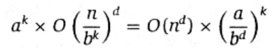
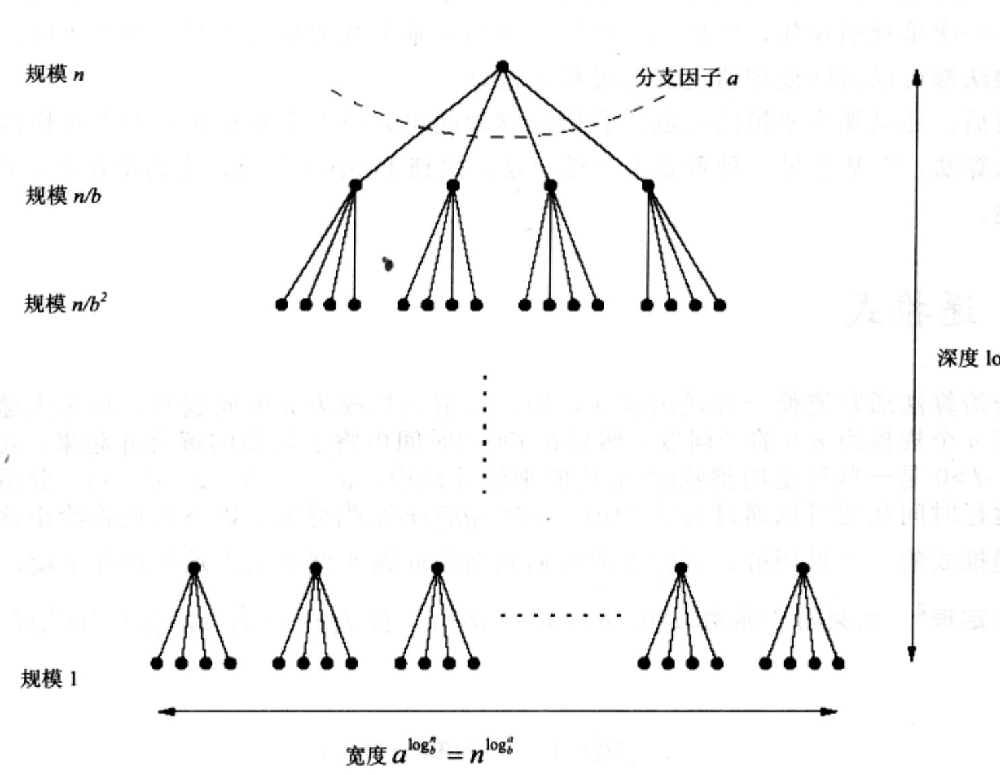

import Guide from '@/components/Guide.astro';
import Knowledge from '@/components/Knowledge.astro';
import Example from '@/components/Example.astro';
import Analysis from '@/components/Analysis.astro';
import Solution from '@/components/Solution.astro';
import Variant from '@/components/Variant.astro';
import Note from '@/components/Note.astro';
import Block from '@/components/Block.astro';
import Method from '@/components/Method.astro';
import Exercise from '@/components/Exercise.astro';
import Algorithm from '@/components/Algorithm.astro';

## 2.2 递推式

分治算法通常遵循一种通用模式，即：在解决规模为 $n$ 的问题时，总是先递归地求解 $a$ 个规模为 $n / b$ 的子问题，然后在 $O(n^{d})$ 时间内将子问题的解合并起来，其中 $a, b, d > 0$ 是一些特定的整数(在前述的乘法算法中， $a = 3, b = 2, d = 1$ )。分治算法的运行时间从而可以通过公式 $T(n) = aT(\lceil n / b \rceil) + O(n^{d})$ 得出。以下我们将给出这类一般递推式的一个封闭解，以便以后再遇到新的问题实例时无需重新进行求解。

主定理 $^{2}$ 如果对于常数 a>0、b>1 以及 $d\geqslant0$ ，有 $T(n)=aT(\left\lceil n/b\right\rceil)+O(n^{d})$ 成立，
则

$$
T (n) = \left\{ \begin{array}{l l} O \big (n ^ {d} \big) & \text {如果} d > \log_ {b} a \\ O \big (n ^ {d} \log n \big) & \text {如果} d = \log_ {b} a \\ O \big (n ^ {\log_ {b} a} \big) & \text {如果} d <   \log_ {b} a \end{array} \right.
$$

仅仅这样一个定理就可以告诉我们可能用到的大多数分治算法的运行时间。

证明：简便起见，首先假定 $n$ 是 $b$ 的幂。这一假定将不会对最终得到的算法时间界限产生任何重要影响——毕竟， $b$ 的某个整数幂与 $n$ 相差再大，也不会超过 $b$ 的 $n$ 倍(参见习题2.2)——这一事实允许我们忽略 $\lceil n / b \rceil$ 带来的舍入影响。

接下来，我们注意到：伴随着每一层次递归的进行，子问题规模以因子 $b$ 的速率在减小，从而在经过 $\log_b n$ 个层次的递归后达到基准情况。 $\log_b n$ 恰好是递归树的高度。该树的分支因子是 $a$ ，所以树的第 $k$ 层上一共有 $a^k$ 个子问题，每个子问题的规模都是 $n / b^k$ (参见图2-3)。在该层次上的所有工作耗时：

  
图2-3 每个规模为 $n$ 的问题被分解为 $a$ 个规模为 $n / b$ 的子问题

随着 $k$ 从0(底部)增加到 $\log_b n$ (树叶对应的层次)，每个层次上的耗时形成一个几何级数，级数的公比为 $a / b^d$ 。我们可以很容易地以大-O标记来表示这一几何级数的和(参见习题0.2)，最终分为以下三种情况：

## 1. 公比小于 1。

这意味着级数是递减的，从而它的和可以仅用其首项来表示，即 $O(n^{d})$ 。

2. 公比大于 1。

这意味着级数是递增的，从而它的和可以用其末项来表示，即 $O(n^{\log_{b}a})$ :

$$
n ^ {d} \left(\frac {a}{b ^ {d}}\right) ^ {\log_ {b} n} = n ^ {d} \left(\frac {a ^ {\log_ {b} n}}{(b ^ {\log_ {b} n}) ^ {d}}\right) = a ^ {\log_ {b} n} = a ^ {(\log_ {a} n) (\log_ {b} a)} = n ^ {\log_ {b} a}
$$

## 3. 公比恰等于 1。

这种情况下级数中所有的 $O(\log n)$ 项均等于 $O(n^{d})$ 。

以上三种情况恰好对应于主定理中的三个分支。证毕。

<Knowledge title="专栏: 二分搜索">

最终的分治算法显然是一个二分搜索过程，其思想可以阐释如下：一个大型文件中包含键 $z[0,1,\dots,n-1]$ ，这些键是有序的。要想找到一个键 $k$ ，首先将它与 $z[n/2]$ 比较，根据比较的结果，我们将在文件的前半部分 $z[0,\dots,n/2-1]$ 或在后半部分 $z[n/2,\dots,n-1]$ 重新开始该比较过程。此时递推式是 $T(n)=T(\lceil n/2\rceil)+O(1)$ ，对应于主定理中 $a=1,b=2,d=0$ 的情况。将上述值代入主定理，得到一个熟悉的结果：算法的运行时间仅为 $O(\log n)$ 。

</Knowledge>
