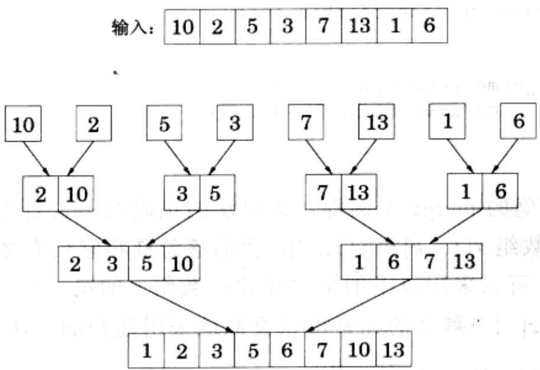
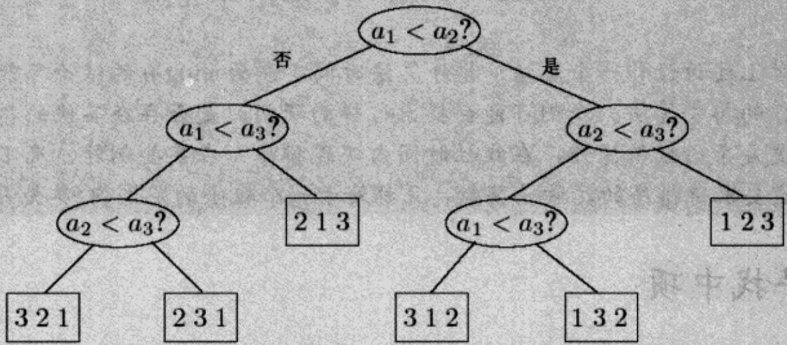

import Guide from '@/components/Guide.astro';
import Knowledge from '@/components/Knowledge.astro';
import Example from '@/components/Example.astro';
import Analysis from '@/components/Analysis.astro';
import Solution from '@/components/Solution.astro';
import Variant from '@/components/Variant.astro';
import Note from '@/components/Note.astro';
import Block from '@/components/Block.astro';
import Method from '@/components/Method.astro';
import Exercise from '@/components/Exercise.astro';
import Algorithm from '@/components/Algorithm.astro';

## 2.3 合并排序

对一列数进行排序的问题不禁让我们想到了分治策略：将该列数分为两部分，递归地对每一部分进行排序，然后将两个有序子序列进行合并。

```python
function mergesort(a[1...n])
Input: An array of numbers a[1...n]
Output: A sorted version of this array
if n > 1:
    return merge(mergesort(a[1...lf/2]), 
    mergesort(a[lf/2]+1...n]))
else:
    return a
```

只要指定了正确的 merge 子例程，该算法的正确性不言自明。如果给定两个有序(元素升序排列)数组 $x[1 \ldots k]$ 和 $y[1 \ldots l]$ ，我们该怎样将它们有效地合并成一个有序数组 $z[1 \ldots k + l]$ 呢？可以采用以下的解决思路：数组 $z$ 的第一个元素是 $x[1]$ 或 $y[1]$ ，这取决于谁更小。 $z[\cdot]$ 中剩余的元素可以类似地采用递归的方法逐个确定。

```python
function merge(x[1...k], y[1...l])
if k=0: return y[1...l]
if l=0: return x[1...k]
if x[1] ≤ y[1]:
    return x[1] ∘ merge(x[2...k], y[1...l])
else:
    return y[1] ∘ merge(x[1...k], y[2...l])
```

伪代码中的○代表连接操作。该 merge 过程在每次递归调用时的工作量保持不变(该结论基于这样的前提：merge 过程要求的数组空间预先已分配好)，其过程的总运行时间为 $O(k + l)$ 。因此 merge 过程是线性时间的，mergesort 的总运行时间满足

$$
T (n) = 2 T (n / 2) + O (n),
$$

或 $O(n\log n)$ 。

当回头审视 mergesort 算法时，我们会发现所有的实际工作都在合并过程中进行，而合并操作直到递归进入到单元素数组的层次时才真正开始。两个单独的元素被合并为一对，组成一个二元数组。然后一对二元数组合并成一个四元数组，依次类推。图 2-4 中给出一个例子。

<div class="mineru-algorithm">
function iterative-mergesort(a[1...n])
Input: elements  $a_{1}, a_{2}, \ldots, a_{n}$  to be sorted
Q = [ ] (empty queue)
for i = 1 to n:
    inject(Q, [a_i])
while |Q| &gt; 1:
    inject(Q, merge(eject(Q), eject(Q)))
return eject(Q)
</div>

  
图 2-4 mergesort(合并排序)中合并操作的顺序

上述算法思想也暗示了 mergesort 可以通过迭代的形式实现。在任意时刻，都有一组“活动的”数组——起初是单元素数组——当前的活动数组成对地进行合并，形成下一批活动数组。这些数组可以通过一个队列来组织，同时不断地从队列头部取出两个数组进行合并，然后把合并的结果插入队列尾部。

在下述伪代码中，基本操作 inject 向队列尾部插入一个元素，而 eject 从队列头部取出一个元素，并返回这个元素。

<Knowledge title="专栏: 排序算法的 nlogn 时间下界">

排序算法可以通过树结构来描述。图2-5中的树实现了对一个数组的排序，该数组中含有三个元素， $a_1, a_2, a_3$ 。排序过程的步骤如下：首先比较 $a_1$ 和 $a_2$ ，如果前者更大，则将它与 $a_3$ 比较；否则，比较 $a_2$ 和 $a_3$ 。按照这一思路不断进行下去。最终排序过程在树的某个叶节点终止，这个叶节点以1,2,3三个数排列的方式，给出了三个元素的实际顺序。例如，如果 $a_2 < a_1 < a_3$ ，则我们最终得到的叶节点上标记的顺序为“213”。

  
图2-5 一个数组的排序

这棵树的深度(depth)——即从树根节点到树叶节点的最长路径上的比较次数，在本例中是3——恰好是该算法时间复杂度的最差情况。

这种理解排序算法的方式非常有用，因为它可以推出合并排序是最优的结论，从这个意义上讲， $\Omega(n \log n)$ 次比较操作对于 $n$ 个元素的排序是必须的。

证明如下：考虑用来对一组元素(n个元素)进行排序的树结构。树的每个叶节点标记一个关于 $\{1,2,\ldots,n\}$ 的排列。实际上，每个排列都必须作为一个叶节点的标记出现。原因很简单：如果一个特定的排列被遗漏，而当我们按照这个排列对输入元素进行排序时，算法针对该输入的输出将推翻算法的正确性。由于n个元素的排列共有n!种，从而这棵树最少含有n!个叶节点。

我们的证明马上就要完成：这是一棵二叉树，同时我们认定它至少含有 $n!$ 个叶节点。回顾我们讲过的知识，一棵深度为 $d$ 的二叉树最多含有 $2^{d}$ 个叶节点(关于这个结论的证明，只需对 $d$ 进行一个简单的归纳)。因此，这棵树的宽度——同时也是该算法的复杂度——一定至少是 $\log (n!)$ 。

众所周知，对于某些 c>0， $\log(n!)\geqslant c\cdot n\log n$ 。对该结论的解释可以有很多种方法。最简单的一种如下：注意到因为 $n!=1\cdot2\cdots n$ ，而 $1\cdot2\cdots n$ 中至少有 n/2 项大于 n/2，所以有 $n!\geqslant(n/2)^{(n/2)}$ 成立；然后对该式两边分别取对数，即得该结论。另一种解释方法是借助于 Stirling 公式：

$$
n! \approx \sqrt {\pi \left(2 n + \frac {1}{3}\right)} \cdot n ^ {n} \cdot e ^ {- n}
$$

无论用哪种方法，我们认识到，任何用于元素比较的树结构若要对 $n$ 个元素进行排序，在最差情况下，必须要执行 $\Omega(n \log n)$ 次比较操作，因此合并排序是最优的！

现在对上述讨论作一个总结：排序算法时间下界为 $n \log n$ 的结论只能应用于使用比较操作的排序算法。我们可能会提出这样的疑问：是否存在其他的排序策略，可能借助更复杂的数值操作，在线性时间内实现排序？在某些例外情况下，答案是肯定的：这要求待排序的元素是整数，且都处于一个较小的范围内(参见习题2.20)。

</Knowledge>
