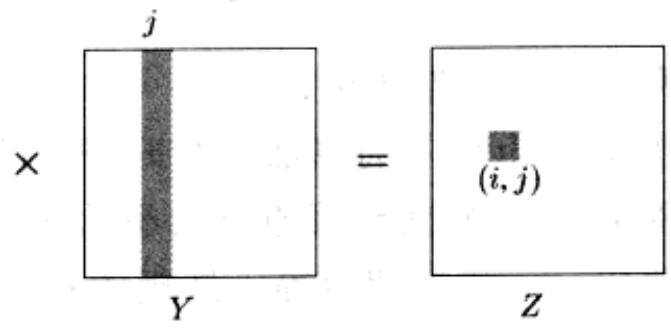

import Guide from '@/components/Guide.astro';
import Knowledge from '@/components/Knowledge.astro';
import Example from '@/components/Example.astro';
import Analysis from '@/components/Analysis.astro';
import Solution from '@/components/Solution.astro';
import Variant from '@/components/Variant.astro';
import Note from '@/components/Note.astro';
import Block from '@/components/Block.astro';
import Method from '@/components/Method.astro';
import Exercise from '@/components/Exercise.astro';
import Algorithm from '@/components/Algorithm.astro';

## 2.4 寻找中项

一列有序数的中项是其中间元素：这列数中有一半大于中项，另一半小于中项。例如，[45,1,10,30,25]的中项是25，因为当这列数排好序后，25是中间元素。当序列的长度是偶数时，中间元素就有两种选择，这时我们一般取两数间的小者作为中项。

之所以专门研究一列数的中项，是因为如果想要用一个单独的数来概括一列数的特征，中项无疑是最典型的。平均数也常常担任这一角色，但是平均数和中项相比来讲，在一定意义上，中项更具典型性：因为中项总是这列数中的一员，而平均数则不一定，所以平均数给这列数的使用者带来的感性认识不如中项那么强。例如，100个1构成的一列数的中项当然是1，其平均数也是1。但是，如果这100个数中的某一个突然激增至10000，其平均数将随着升至100以上，而其中项却保持不变。

寻找 $n$ 个数的中项比较简单：只需对它们排序即可。这种方法的缺陷在于它耗时 $O(n \log n)$ ，而我们当然希望其运行时间是线性的。这种希望倒也不是遥不可及，因为通过排序来寻找中项，显然其中有些工作是多余的——我们只需要找到这 $n$ 个数的中项，并不关心其它数之间的相对顺序。

当研究寻找中项的递归算法时，如果把寻找中项问题变为更一般的问题(寻找一列数的第某项)反而会相对简单一些，这可能会令人难以置信——原因在于，更一般问题的递归步骤的功能显得更强大。在我们的例子中，考虑的寻找中项问题的推广版本是选择问题。

选择问题

输入：一列数的集合 S；一个整数 k

输出：集合 $S$ 中第 $\pmb{k}$ 小的元素

例如，当 $k = 1$ 时，该问题寻找 $S$ 的最小元素，而当 $k = \left| |S| / 2 \right|$ 时，它寻找 $S$ 的中项。

选择问题的一个随机分治算法

以下是解决选择问题的一种分治算法。对于任意给定的数 v，假定 S 中的数被分成三组：比 v 小的数、与 v 相等的数(可能会有多个)以及比 v 大的数。分别记这三组数为 $S_{L}$ 、 $S_{v}$ 和 $S_{R}$ 。例如，如果集合 S 如下所示：

<table><tr><td>S:</td><td>2</td><td>36</td><td>5</td><td>21</td><td>8</td><td>13</td><td>11</td><td>20</td><td>5</td><td>4</td><td>1</td></tr></table>

针对 v=5，S 被分成三组，分别为

$$
S _ {L}: \boxed {2} \boxed {4} \boxed {1}
$$

$$
S _ {v}: \boxed {5} \boxed {5}
$$

<table><tr><td> $S_{R}$ :</td><td>36</td><td>21</td><td>8</td><td>13</td><td>11</td><td>20</td></tr></table>

搜索范围立即被缩小，转而在 $S$ 的这三个子集中的某一个上继续进行。如果我们想要寻找集合 $S$ 的第8小元素，我们知道它一定是 $S_{R}$ 的第3小元素，因为 $|S_L| + |S_\nu | = 5$ ，即selection $(S,8) =$ selection $(S_R,3)$ 。更一般的，通过比较 $k$ 与这些子集所含元素数之间的大小关系，我们可以很快确定所要寻找的元素在哪个子集中：

$$
\mathrm{selection} \left(S, k\right) = \left\{ \begin{array}{l l} {\mathrm{selection} \left(S _ {L}, k\right)} & {\text {如果} k \leq \left| S _ {L} \right|} \\ {v} & {\text {如果} \left| S _ {L} \right| <   k \leq \left| S _ {L} \right| + \left| S _ {v} \right|} \\ {\mathrm{selection} \left(S _ {R}, k - \left| S _ {L} \right| - \left| S _ {v} \right|\right)} & {\text {如果} k > \left| S _ {L} \right| + \left| S _ {v} \right|} \end{array} \right.
$$

由 $S$ 可在线性时间内得到 $S_{L}$ ， $S_{\nu}$ 和 $S_{R}$ ；实际上，这一划分过程可以就地进行，也即无需为其重新分配内存空间(参见习题2.15)。然后我们就可以在某个合适的子集上进行递归了。划分过程的效果在于把待搜索的元素数目从 $|S|$ 至少减少到 $\max\{|S_{L}|,|S_{R}|\}$ (可以比这个最大值还小)。

针对选择问题的分治算法已经逐渐显露出它的全貌，只剩下如何选择 $\pmb{\nu}$ 这一至关重要的细节了。 $\pmb{\nu}$ 的选定应该快速进行，并且它应该能实质性地缩减搜索数组大小，理想的情况是 $|S_L|, |S_R| \approx \frac{1}{2} |S|$ 。如果我们能够确保这一情形，该算法的运行时间将满足

$$
T (n) = T (n / 2) + O (n)
$$

也即我们所期望的线性时间。但它要求选出的 v 是中项，这恰好是我们的终极目标！因此，作为替代，我们采用一种相对简单的方案：从 S 中随机选取 v。

## 效率分析

很显然，该算法的运行时间依赖于我们随机选取的 v。完全有可能出现这样的情况：由于持续的背运，我们挑选出来的 v 总是数组中最大元素(或是最小元素)。这样的话，每次我们只能将待搜索的数组大小缩减 1。对应的，在之前的例子中，我们可能首先选出的 v = 36，然后选出的 v = 21，以此类推。这种最差情况将使得我们的选择问题算法必须要执行

$$
n + (n - 1) + (n - 2) + \dots + \frac {n}{2} = \Theta (n ^ {2})
$$

次操作(当寻找中项时)。但是，这种情况出现的概率还是很低的。同样很少出现的还有我们前面讨论过的最佳情形，即每次随机选取的 $\nu$ 刚好能将数组一分为二，从而使算法的运行时间达到 $O(n)$ 。在 $O(n)$ 到 $\Theta (n^2)$ 的范围内，算法的平均运行时间是多少呢？非常幸运，它与最佳情形下的运行时间很接近。

为了区分选中的 $\nu$ 的质量好坏，我们做出以下规定：如果 $\nu$ 落在它所在数组中的四分之一位置和四分之三位置之间，那么我们就称选中的 $\nu$ 是好的。我们偏爱 $\nu$ 的这种情况，是因为它能够确保子集 $S_{L}$ 和 $S_{R}$ 的大小最多是 $S$ 大小的四分之三(您知道其中的原因吗？)，从而能实质性地缩减待搜索数组的大小。幸运的是，选中的 $\nu$ 质量好的几率并不小：因为数组中有一半元素都落于其四分之一和四分之三位置之间！

既然一个随机选定的 $\nu$ 质量较好的概率有 $50\%$ ，那么在能够得到一个质量较好的 $\nu$ 之前，我们平均需要挑选多少个质量不好的 $\nu$ 呢？以下是我们更为熟悉的一个形式化描述(同时请参见习题1.34):

引理 在掷硬币游戏中，在得到一次正面之前，平均需要掷一个匀质硬币2次。

证明：令 $E$ 表示在得到正面之前，抛掷硬币的期望次数。不管怎样，我们至少需要抛掷一次，如果得到正面，就算结束。如果得到反面(反面出现的概率是1/2)，我们需要重新掷硬币。因此， $E = 1 + \frac{1}{2} E$ ，化简后得到 $E = 2$ 。证毕。

因此，在平均两次划分操作之后，待搜索数组的大小将最多缩减至其原始大小的四分之三。令 $T(n)$ 表示以大小为 $n$ 的数组为输入的算法的期望运行时间，我们可以得到

$$
T (n) \leq T (3 n / 4) + O (n)
$$

对下述语句两端分别取期望值：

以大小为 $n$ 的数组为输入的算法运行时间 $\leqslant$ (以大小为 $3n / 4$ 的数组为输入的算法运行时间) + (将数组大小缩减至其原有大小的 $3 / 4$ 以下所花费的时间), 并对不等号的右侧应用以下性质——和的期望等于期望的和, 即可得到该递推式。

由该递推式可得 $T(n) = O(n)$ ，这意味着：对于任意输入，我们的算法平均可以在在线性次操作内返回正确的解。

<Knowledge title="专栏: Unix 的 Sort 命令">

当我们对排序算法和寻找中项算法进行比较时会发现，除却两者共同采用的分治策略和整体架构，其他方面它们是完全相反的。合并排序使用最简捷的方法将相关数组分成两部分(前半部分和后半部分)，不考虑每一部分中元素的取值大小；然后它费力地对已排序的子数组进行合并。相比之下，寻找中项算法在对数组进行划分时就显得谨慎得多(先将小的数划为一组，再将大的数划为一组)，它最终以递归调用来结束工作。

快速排序是这样一种排序算法，它对数组进行划分的方式与寻找中项算法完全相同；一旦子数组已排好序，通过两次递归调用，整个排序即告结束。在最差情况下该算法的运行时间是 $\Theta(n^2)$ ，与寻找中项算法相同。但可以证明(参见习题2.24)，在平均情况下，该算法的运行时间是 $O(n \log n)$ ；另外，从实际应用的角度来讲，它比其他排序算法要优越。这使得快速排序成为许多应用的宠儿——例如，它是超大

</Knowledge>
## 规模文件系统排序算法的基础。
