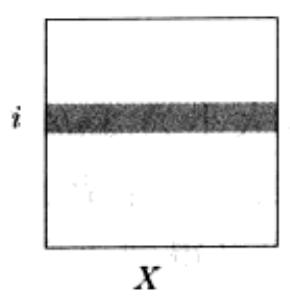

import Guide from '@/components/Guide.astro';
import Knowledge from '@/components/Knowledge.astro';
import Example from '@/components/Example.astro';
import Analysis from '@/components/Analysis.astro';
import Solution from '@/components/Solution.astro';
import Variant from '@/components/Variant.astro';
import Note from '@/components/Note.astro';
import Block from '@/components/Block.astro';
import Method from '@/components/Method.astro';
import Exercise from '@/components/Exercise.astro';
import Algorithm from '@/components/Algorithm.astro';

## 2.5 矩阵乘法

两个 $n \times n$ 的矩阵 $X$ 和 $Y$ 的乘积是另一个 $n \times n$ 的矩阵 $Z = XY$ ，其中第 $(i, j)$ 项满足下式：

$$
Z _ {i j} = \sum_ {k = 1} ^ {n} X _ {i k} Y _ {k j}
$$

为了更直观地说明上面的公式，可以将 $Z_{ij}$ 理解成 $X$ 的第 $i$ 行和 $Y$ 的第 $j$ 列的点积，如图2-6所示：

  
图2-6 公式

一般地，XY 并不等于 YX；因为矩阵乘法不满足交换率。

上面的公式给出了矩阵乘法的一种运行时间为 $O(n^3)$ 的算法：因为一共要计算 $n^2$ 个元素，而每个元素的计算需要 $O(n)$ 的时间。曾经有很长一段时间，该算法被认为是所能达到的最快矩阵乘法算法，甚至有人还证明了，在某些计算模型下，没有其他算法能够做得更好。因此，当德国数学家Volker Strassen在1969年宣布他发现了一种更高效的算法时，其所引起的举世轰动也就不足为奇了，这种新算法就是基于分治思想的。

矩阵乘法能够很容易地划分成一系列子问题，因为矩阵乘法能够分块地进行。为了说明什么叫做分块，我们将 $X$ 和 $Y$ 都划分成四个 $n / 2 \times n / 2$ 的子块，如下所示：

$$
X = \left[ \begin{array}{c c} A & B \\ C & D \end{array} \right], Y = \left[ \begin{array}{c c} E & F \\ G & H \end{array} \right]
$$

从而 $X$ 和 $Y$ 的乘积可以用这些子块进行表达，而这类似于将每个子块都看作

个单独的元素(参见习题 2.11)。

$$
X Y = \left[ \begin{array}{l l} A & B \\ C & D \end{array} \right] \left[ \begin{array}{l l} E & F \\ G & H \end{array} \right] = \left[ \begin{array}{l l} A E + B G & A F + B H \\ C E + D G & C F + D H \end{array} \right]
$$

我们的分治策略应运而生：要计算规模为 $n$ 的矩阵的乘积 $XY$ ，可以先递归地计算8个规模为 $n / 2$ 的矩阵的乘积 $AE$ 、 $BG$ 、 $AF$ 、 $BH$ 、 $CE$ 、 $DG$ 、 $CF$ 、 $DH$ ，然后再进行 $O(n^2)$ 时间的加法运算即可。该分治算法的总运行时间满足以下的递推式：

$$
T (n) = 8 T (n / 2) + O \left(n ^ {2}\right) 。
$$

这样一来，该算法的运行时间也是 $O(n^3)$ ，与前述的普通算法一致，没有任何改进。然而利用整数乘法，该算法的效率其实是可以得到改进的，关键在于一些精妙的代数技巧。结果表明， $XY$ 可以仅通过7个 $n / 2 \times n / 2$ 的子问题的计算求得。而其中的分解过程是如此的富于技巧和复杂精细，使得我们都不禁怀疑，Strassen 当时是如何发现它的！

$$
X Y = \left[ \begin{array}{c c} P _ {5} + P _ {4} - P _ {2} + P _ {6} & P _ {1} + P _ {2} \\ P _ {3} + P _ {4} & P _ {1} + P _ {5} - P _ {3} - P _ {7} \end{array} \right]
$$

其中

$$
\begin{array}{r l} & P _ {1} = A (F - H) \\ & P _ {2} = (A + B) H \\ & P _ {3} = (C + D) E \\ & \quad P _ {4} = D (G - E) \end{array}
$$

$$
\begin{array}{l} P _ {5} = (A + D) (E + H) \\ P _ {6} = (B - D) (G + H) \\ P _ {7} = (A - C) (E + F) \end{array}
$$

新的算法运行时间满足

$$
T (n) = 7 T (n / 2) + O \left(n ^ {2}\right) 。
$$

通过主定理对该式进行简化，得到最终的时间为 $O(n^{\log_{2}7}) \approx O(n^{2.81})$ 。
