import Guide from '@/components/Guide.astro';
import Knowledge from '@/components/Knowledge.astro';
import Example from '@/components/Example.astro';
import Analysis from '@/components/Analysis.astro';
import Solution from '@/components/Solution.astro';
import Variant from '@/components/Variant.astro';
import Note from '@/components/Note.astro';
import Block from '@/components/Block.astro';
import Method from '@/components/Method.astro';
import Exercise from '@/components/Exercise.astro';
import Algorithm from '@/components/Algorithm.astro';

## 2.6 快速Fourier变换

至此我们已经见证了分治策略如何应用于整数乘法和矩阵乘法，从而得到快速的算法。我们的下一个目标是多项式。两个 $d$ 次多项式的乘积是一个2d次多项式，

比如：

$$
(1 + 2 x + 3 x ^ {2}) \cdot (2 + x + 4 x ^ {2}) = 2 + 5 x + 1 2 x ^ {2} + 1 1 x ^ {3} + 1 2 x ^ {4} 。
$$

更一般地，如果 $A(x) = a_0 + a_1x + \ldots +a_dx^d$ ， $B(x) = b_0 + b_1x + \ldots +b_dx^d$ ，他们的乘积 $C(x) = A(x)\cdot B(x) = c_0 + c_1x + \ldots +c_{2d}x^{2d}$ ，该式中的系数

$$
c _ {k} = a _ {0} b _ {k} + a _ {1} b _ {k - 1} + \dots + a _ {k} b _ {0} = \sum_ {i = 0} ^ {k} a _ {i} b _ {k - i}
$$

(当 i > d 时， $a_{i}$ 和 $b_{i}$ 都等于 0)。利用上面的公式计算 $c_{k}$ 需要 $O(k)$ 次操作，因此，求出所有 $2d + 1$ 个系数需要 $\Theta(d^{2})$ 的时间。有没有可能让多项式乘法变得更快呢？

对上述问题的解答将引出快速 Fourier 变换。快速 Fourier 变换的发现变革了一一实际上，应该说是定义了——整个信号处理领域(参见接下来的灰色方框中讲述的内容)。由于快速 Fourier 变换举足轻重的地位，以及其中所蕴含的来自不同学科的思想精髓，使得我们不禁要放慢讲述的节奏。如果您只想了解快速 Fourier 变换的算法核心，可以跳过以下部分，直接进入 2.6.4 节。

## 为什么是多项式相乘？

首先，事实表明，整数相乘最快的算法严重依赖于多项式相乘；毕竟，多项式和二进制整数是很相似的。事实上，在多项式乘法中，只需将多项式中的变量 $x$ 换为基数2，并留意进位值，即可得到二进制乘法。但是，也许更重要的还是多项式相乘在信号处理领域中所具有的举足轻重的地位。

一个信号是关于时间如下图中的(a)或位置的函数上的任意一个值。举例来说，它可能通过测量一个人嘴部附近空气压力的波动反映出他的声音；也可能通过将亮度建模为角度的函数，反映出夜晚星空中星星的亮度特征。

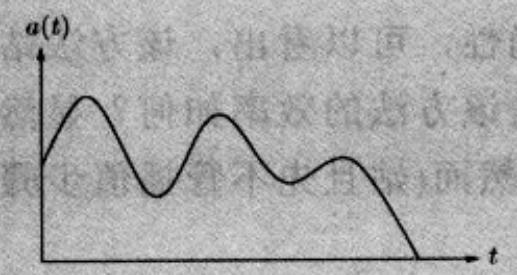  
(a)

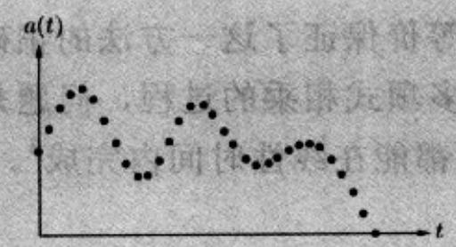  
(b)

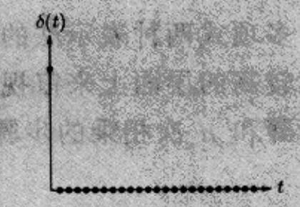  
(c)

为了从一个信号中提取信息, 我们需要首先通过采样对信号进行数字化(参见上图(b))——然后, 将信号输入一个系统, 系统会对信号进行一定的转换。系统的输出称为响应:

$$
\text { 信号 } \rightarrow \boxed {\text { 系   统 }} \rightarrow \text { 响   应 }
$$

线性系统是一类很重要的系统——它对两个信号和的响应等于对两个信号各自响应的和；时不变系统也是一类很重要的系统——把输入信号平移 $t$ 个时间，时不变系统得到的输出与其平移前的输出相同，反向平移也是如此。具有线性和时不变性的系统由其对最简单输入信号的响应所确定。最简单的输入信号是单位脉冲 $\delta(t)$ ，它仅仅包含一个在 $t=0$ 处的“抖动”（参见上图(c)）。为了更好地理解线性和时不变性系统的特征，首先考虑单位脉冲的一个平移脉冲 $\delta(t-i)$ ，其抖动发生在时刻 $t=i$ 处。任意信号 $a(t)$ 都可以表示为形如这样的脉冲的线性组合，或者，可以以脉冲 $\delta(t-i)$ 来抽取信号 $a(t)$ 在时刻 $i$ 的表现：

$$
a (t) = \sum_ {i = 0} ^ {T - 1} a (i) \delta (t - i)
$$

(假设该信号包含 $T$ 个样本点)。由于系统是线性的，其对输入信号 $a(t)$ 的响应取决于针对不同 $\delta(t - i)$ 的响应。又由于系统的时不变性，对不同 $\delta(t - i)$ 的响应即为脉冲响应(针对单位脉冲 $\delta(t)$ 的系统响应)的平移副本。

换言之，在时刻 $k$ ，系统的输出为

$$
c (k) = \sum_ {i = 0} ^ {k} a (i) b (k - i)
$$

**恰为多项式的乘积形式！**

## 2.6.1 多项式的另一种表示法

在讲述多项式乘法的快速算法之前，我们有必要先了解多项式的一个重要性质。

性质 一个 $d$ 次多项式被其在任意 $d + 1$ 个不同点处的取值所唯一确定。

上述性质的一个最常见例子就是“任意两点确定一条直线”。随后我们将了解为什么这一说法可以推广至更一般的情况(参见2.6.3节)。现在我们关心的是，该性质引出了多项式的另一种表示法。给定任意不同的点 $x_{0},\ldots,x_{d}$ ，我们现在可以通过以下两种方法中的任意一种，来确定一个d次多项式 $A(x)=a_{0}+a_{1}x+\ldots+a_{d}x^{d}$ ：

1. 系数表示法：多项式的系数 $a_0, a_1, \ldots, a_d$

2. 值表示法： $A(x_{0}), A(x_{1}), \ldots, A(x_{d})$ 的值

在这两种表示法中，第二种更方便于多项式乘法操作。由于 $A(x)$ 和 $B(x)$ 的乘积 $C(x)$ 的次数为 $2d$ ，所以它被任意 $2d + 1$ 个不同点处的取值所唯一确定。同时对于定点 $z$ 处的 $C(x)$ 的计算也很简单，只需把 $A(z)$ 和 $B(z)$ 相乘即可。这样，在值表示法下，多项式乘法是线性时间的。

不过问题在于我们希望多项式乘法的输入多项式，以及输入多项式的乘积都能用其系数来表示。因此我们需要先利用输入多项式的系数得到一组值——这只需计算多项式在选定点处的取值——然后，将两个输入多项式在相同点处的取值相乘，并最终利用乘积多项式的值表示法求出它的系数。以上从值到系数的过程被称为插值。

<table><tr><td rowspan="2">系数表示法 $a_0,a_1...,a_d$ </td><td>计算</td><td rowspan="2">值表示法 $A(x_0),A(x_1),...,A(x_d)$ </td></tr><tr><td>插值</td></tr></table>

图 2-7 中给出了相应的算法。

<Algorithm title="图 2-7 多项式相乘">
**输入**：$d$ 次多项式 $A(x)$ 和 $B(x)$ 的系数  
**输出**：它们的乘积 $C = A \cdot B$  

**选择（Selection）**  
选取一些点 $x_0, x_1, \ldots, x_{n-1}$，其中 $n \geq 2d + 1$  

**计算（Evaluation）**  
计算 $A(x_0), A(x_1), \ldots, A(x_{n-1})$ 以及 $B(x_0), B(x_1), \ldots, B(x_{n-1})$  

**乘法（Multiplication）**  
对所有 $k = 0, \ldots, n-1$ 计算 $C(x_k) = A(x_k)B(x_k)$  

**插值（Interpolation）**  
还原多项式 $C(x) = c_0 + c_1x + \cdots + c_{2d}x^{2d}$  
</Algorithm>

多项式两种表示法的等价保证了这一方法的正确性，可以看出，该方法站在一个比较高的层面上来审视多项式相乘的过程，问题是该方法的效率如何？显然，选择步骤和 $n$ 次相乘的步骤都能在线性时间内完成。然而(姑且先不管插值步骤，因为我们对它的了解更少)计算步骤的效率如何呢？在一个单独的点处计算一个 $d$ 次多项式的值需要花费 $O(n)$ 次操作(参见习题2.29)，所以计算 $\pmb{n}$ 个点处的多项式取值的时间下界即为 $\Theta (n^2)$ 。接下来我们将看到快速Fourier变换(简称FFT)针对计算步骤所需的时间仅为 $O(n\log n)$ ，只是对于 $x_0,\dots,x_{n - 1}$ 的选取要有一定的技巧，以使得不同点处的多项式取值计算过程之间有一些重复步骤，如果将这些重复步骤作为公共步骤，就能够节省算法的时间。

## 2.6.2 计算步骤的分治实现

下面的思想阐明了如何选取次数小于等于 $n - 1$ 的多项式的计算步骤所需的 $\pmb{n}$ 个点。如果我们选择它们为正负的数对，即

$$
\pm x _ {0}, \pm x _ {1}, \dots , \pm x _ {n / 2 - 1}
$$

则每个 $A(x_{i})$ 和 $A(-x_{i})$ 所需的计算过程中会有很大一部分重复，因为 $x_{i}$ 的偶次幂与 $-x_{i}$ 的偶次幂相同。

为了仔细研究这一点，我们需要将 $A(x)$ 划分成 $x$ 的奇次幂项和偶次幂项，例如

$$
3 + 4 x + 6 x ^ {2} + 2 x ^ {3} + x ^ {4} + 1 0 x ^ {5} = (3 + 6 x ^ {2} + x ^ {4}) + x (4 + 2 x ^ {2} + 1 0 x ^ {4})
$$

注意到括号中的项是关于 $x^{2}$ 的多项式。更一般地，

$$
A (x) = A _ {e} (x ^ {2}) + x A _ {o} (x ^ {2})
$$

其中 $A_{e}(\cdot)$ 包含偶次幂项的系数，而 $A_{o}(\cdot)$ 包含奇次幂项的系数，它们均为次数小于等于 $\mathbf{n} / 2 - 1$ 的多项式(方便起见，假定 $n$ 是偶数)。给定点对 $\pm x_{i}$ ， $A(x_{i})$ 的计算过程可以被 $A(-x_{i})$ 的计算过程所借用：

$$
\begin{array}{l} A (x _ {i}) = A _ {e} (x _ {i} ^ {2}) + x _ {i} A _ {o} (x _ {i} ^ {2}) \\ A (- x _ {i}) = A _ {e} (x _ {i} ^ {2}) - x _ {i} A _ {o} (x _ {i} ^ {2}) \end{array}
$$

换言之，在 $n$ 个成对的点 $\pm x_0, \ldots, \pm x_{n/2-1}$ 处， $A(x)$ 的计算过程可以化简为在 $n/2$ 个点处的 $A_e(x)$ 和 $A_o(x)$ 的计算过程(每个的次数都是 $A(x)$ 次数的一半)。

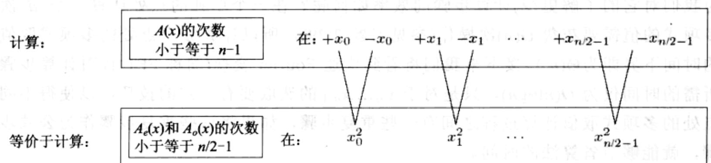

按照上述方法，规模为 $n$ 的原问题被转换成规模为 $n / 2$ 的两个子问题，另外还要加上一些线性时间的算术操作。如果我们可以采用递归技术，我们将得到一个分治算法，其运行时间满足：

$$
T (n) = 2 T (n / 2) + O (n),
$$

上式经过化简，得到的算法运行时间为 $O(n\log n)$ ，正是我们所需要的。

但是仍然存在一个问题：这一正负数对的技巧只适用于递归的顶层。在递归的下一层次上，我们需要 $n / 2$ 个计算点 $x_0^2, x_1^2, \ldots, x_{n / 2 - 1}^2$ ，要求它们本身可以表示成正负数对的形式。而一个数的平方又怎能成为负的？这似乎成了不可能完成的任务！除非，我们使用复数。

如果我们使用复数，那么该选取哪些复数呢？为了回答这一问题，我们对递归过程做“反向工程”。在递归的最底层，我们只有一个单独的点。这个点可能是1，这种情况下，在这一层之上的一层，一定包含1的平方根，即 $\pm \sqrt{1} = \pm 1$ 。

紧接着的上一层将含有 $\pm \sqrt{+1} = \pm 1$ 以及复数 $\pm \sqrt{-1} = \pm i$ ，其中 $i$ 是复数单元。按照这种方式继续进行，我们最终将得到初始的 $n$ 个点的集合。或许您已经猜到了它们的身份：单位元的 $n$ 次复根，即等式 $z^n = 1$ 的 $n$ 个复数解。

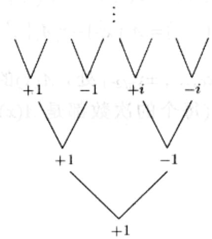

图2-8针对复数的一些基本性质给出了形象的说明。该图的第3部分描绘了单位元的 $n$ 次复根：即复数1、 $\omega ,\omega^2,\dots ,\omega^{n - 1}$ ，其中 $\omega = e^{2\pi i / n}$ 。如果 $n$ 是偶数，将具备下述两条性质：

<table><tr><td>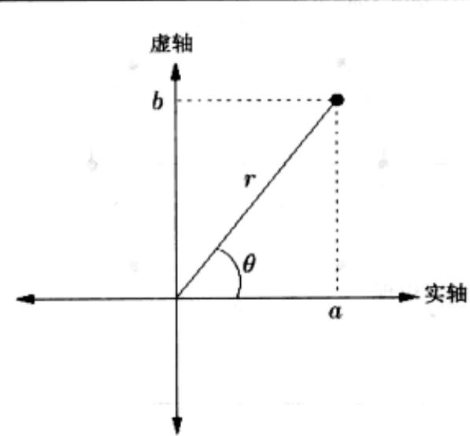</td><td>复平面 $z=a+bi$ 是位置(a,b)处的一个点。极坐标:z可以表示成 $z=r(\cos\theta+i\sin\theta)=re^{i\theta}$ ,代表(r,θ)。·长度(length) $r=\sqrt{a^2+b^2}$ 。·角度(angle) $\theta\in[0,2\pi]$ :  $\cos\theta=a/r$ ,  $\sin\theta=b/r$ 。·θ可以通过模 $2\pi$ 运算进行化简。例子:复数-1 i 5+5i极坐标 (1,π) (1,π/2) (5√2,π/4)</td></tr><tr><td>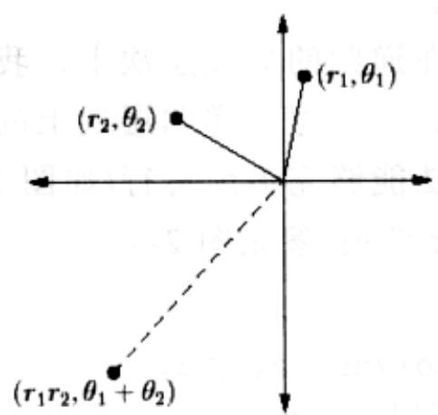</td><td>极坐标上的乘法简便易行长度相乘,角度相加: $(r_1,\theta_1)\times(r_2,\theta_2)=(r_1r_2,\theta_1+\theta_2)$ 。对于任意的 $z=(r,\theta)$ ,·-z=(r,θ+π),因为-1=(1,π)。·如果z是在单位圆上(例如r=1),那么 $z^n=(1,n\theta)$ 。</td></tr><tr><td>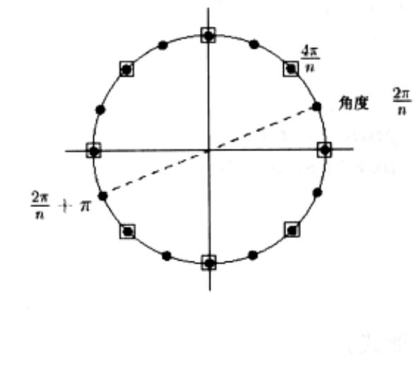</td><td>单位元的n次复根方程 $z^n=1$ 的解。按照乘法规则:上述方程的解是 $z=(1,\theta)$ ,其中θ是 $2\pi/n$ 的倍数(左图显示的是n=16的情况)。当n是偶数时:·该方程的解是正负成对出现的:- $(1,\theta)=(1,\theta+\pi)$ ·该方程的解的平方是单位元的n/2次根,左图中以带方框的点表示。</td></tr></table>

图2-8 单位元的复根是多项式相乘分治算法的理想选择

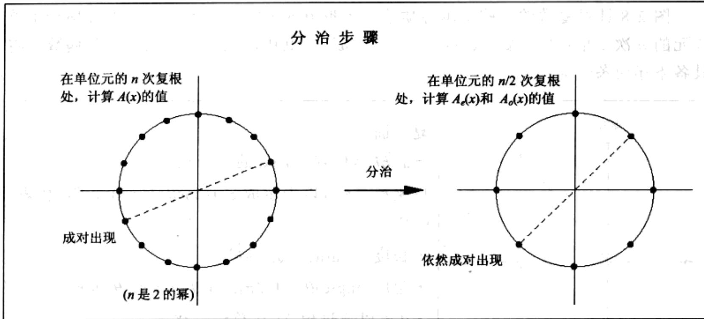  
图2-8 (续)

1. $n$ 个复根成对(一正一负)出现， $\omega^{n / 2 + j} = -\omega^j$

2. 将这 $n$ 个复根平方后，将得到单位元的 $n / 2$ 次根。

因此，如果 $n$ 是2的幂，我们以这些数开始递归，在递归的后续层次上，我们将依次得到单位元的 $n / 2^k$ 次复根，其中 $k = 0, 1, 2, 3, \ldots$ 。每个递归层次上的这些数的集合都由正负数对组成，这保证了我们的分治算法能够完美地运行(如图2-8最后一部分所示)。最终得到的分治算法即为快速Fourier变换(参见图2-9)。

```julia
function FFT(A, ω)
Input: Coefficient representation of a polynomial A(x) of degree ≤ n-1, where n is a power of 2 ω, an nth root of unity
Output: Value representation A(ω⁰), ..., A(ωⁿ⁻¹)

if ω = 1: return A(1)
express A(x) in the form Ae(x²) + xAo(x²)
call FFT(Ae, ω²) to evaluate Ae at even powers of ω
call FFT(Ao, ω²) to evaluate Ao at even powers of ω
for j = 0 to n-1:
    compute A(ω^j) = Ae(ω²^j) + ω^j Ao(ω²^j)

return A(ω⁰), ..., A(ω^(n-1))
```  
图 2-9 快速 Fourier 变换(多项式形式)

## 2.6.3 插值

现在让我们看看进展到了什么地方。我们先是提出了一种比较高级的多项式乘法算法(如图2-7)，该算法基于这样一种观察：多项式可以以两种方式表示，一种以多项式的系数表示，另一种以多项式在一组选定点处的取值表示。

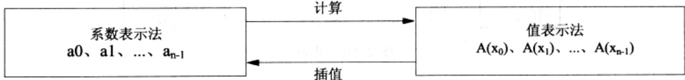

值表示法让多项式的相乘变得简单，但是我们也不能因此就忽视了系数表示法的重要性，因为系数表示法是整个多项式相乘算法的输入多项式和输出多项式所采用的格式。

因此我们设计了 FFT，该方法在 $O(n \log n)$ 的时间内从多项式的系数表示生成一组值，这些值是单位元的 n 次复根 (1、 $\omega$ 、 $\omega^{2}$ 、…、 $\omega^{n-1}$ )。

$$
\langle \text {值} \rangle = \mathrm{FFT} (\langle \text {系数} \rangle , \omega)
$$

最后遗留的一点难题在于从值到系数的反向操作——插值。令人惊奇的是，事实上

$$
\langle \text {系数} \rangle = \frac {1}{n} \mathrm{FFT} (\langle \text {值} \rangle , \omega^ {- 1})
$$

这样的话，插值步骤竟然以一种最简单和最优雅的方式——同样借助于FFT算法解决了，之前这简直是一种奢望。只不过插值步骤在调用FFT算法时以 $\omega^{-1}$ 来替换 $\omega$ 即可。这看起来像是一种奇迹般的巧合，但不可否认的是，当我们以线性代数的知识来理解多项式操作时，这种巧合又是顺理成章的。与此同时，我们的时间复杂度为 $O(n\log n)$ 的多项式相乘算法(参见图2-7)也终于露出了全貌。

## 多项式操作的矩阵表示

为了更清楚地理解插值步骤，让我们重新审视多项式两种表示法之间的关系，仍然假定多项式为 $A(x)$ ，其次数小于等于 $n - 1$ 。 $A(x)$ 的两种表示法均可以视为 $n$ 个数组成的向量，一种表示法对应的向量是另一种表示法对应向量的线性变换：

将图2-10中间的矩阵称为 $M$ 。它的格式很特殊，其实它是一个Vandermonde矩阵，该矩阵具有很多奇妙的性质，下面的这条性质跟我们的讨论息息相关：

如果 $x_{0},\ldots,x_{n-1}$ 互不相同，则 M 是可逆的。

$$
\left[ \begin{array}{c} A (x _ {0}) \\ A (x _ {1}) \\ \vdots \\ A (x _ {n - 1}) \end{array} \right] = \left[ \begin{array}{c c c c c} 1 & x _ {0} & x _ {0} ^ {2} & \dots & x _ {0} ^ {n - 1} \\ 1 & x _ {1} & x _ {1} ^ {2} & \dots & x _ {1} ^ {n - 1} \\ & & \vdots & & \\ 1 & x _ {n - 1} & x _ {n - 1} ^ {2} & \dots & x _ {n - 1} ^ {n - 1} \end{array} \right] \left[ \begin{array}{c} a _ {0} \\ a _ {1} \\ \vdots \\ a _ {n - 1} \end{array} \right]
$$

图2-10 矩阵

$M^1$ 的存在使得我们可以将上图中含有矩阵的公式倒转过来，即用值来表示多项式的系数。简言之，就是

计算过程通过乘以 M 实现，而插值过程通过乘以 $M^{1}$ 实现。

这种多项式操作的矩阵表示清晰地揭示了多项式两种表示法之间的本质联系。另外，它还证明了我们之前讨论一直赖以维持的基本假定—— $A(x)$ 被它在任意 n 个不同点处的取值所唯一确定——实际上，我们现在已经具备了一个公式，它可以给出多项式的系数表示。Vandermonde 矩阵还有一个特性，求它的逆矩阵要比求一般矩阵的逆矩阵快得多，只需要 $O(n^{2})$ 的时间，而求一般矩阵的逆矩阵则需要 $O(n^{3})$ 的时间。然而，即使采用乘以 $M^{1}$ 的方式进行插值仍显得不够快，还是无法满足我们的要求，因此我们再一次将注意力转向之前选定的那些特殊的点——单位元的复根。

## 插值步骤的解决

在线性代数的术语中，FFT将一个任意的 $n$ 维向量——之前我们称之为多项式的系数表示——与一个 $n \times n$ 的矩阵相乘

$$
M _ {n} (\omega) = \left[ \begin{array}{c c c c c} {{1}} & {{1}} & {{1}} & {{\dots}} & {{1}} \\ {{1}} & {{\omega}} & {{\omega^ {2}}} & {{\dots}} & {{\omega^ {n - 1}}} \\ {{1}} & {{\omega^ {2}}} & {{\omega^ {4}}} & {{\dots}} & {{\omega^ {2 (n - 1)}}} \\ {} & {} & {{\vdots}} & {} & {} \\ {{1}} & {{\omega^ {j}}} & {{\omega^ {2 j}}} & {{\dots}} & {{\omega^ {(n - 1) j}}} \\ {} & {} & {{\vdots}} & {} & {} \\ {{1}} & {{\omega^ {(n - 1)}}} & {{\omega^ {2 (n - 1)}}} & {{\dots}} & {{\omega^ {(n - 1) (n - 1)}}} \end{array} \right] \begin{array}{l l l} {{\longleftarrow}} & {{\omega^ {0} = 1   \text {对应的行}}} \\ {{\longleftarrow}} & {{\omega}} \\ {{\longleftarrow}} & {{\omega^ {2}}} \\ {} & {{\vdots}} \\ {{\longleftarrow}} & {{\omega^ {j}}} \\ {} & {{\vdots}} \\ {{\longleftarrow}} & {{\omega^ {n - 1}}} \end{array}
$$

其中 $\omega$ 是单位元的一个 $n$ 次复根，而 $n$ 是2的幂。请注意该矩阵是如何被简单表示的：其中位置 $(j, k)$ 的元素(行标和列标都从0开始)为 $\omega^{jk}$ 。

乘以 $M = M_{\mathfrak{n}}(\omega)$ 的操作将第 $k$ 个坐标轴(除了第 $k$ 个分量为1，其余分量都为0的向量)映射到 $M$ 的第 $k$ 列。现在我们先列出一个重要的观察结论，等会儿再去证明它： $M$ 的列向量都是彼此正交(彼此间夹角为直角)的。因此， $M$ 的列向量可以视为是另一个坐标系统的坐标轴，通常我们称之为Fourier基(Fourier basis)。对一个向量乘以 $M$ 等于将该向量从标准基(常规坐标轴)旋转到Fourier基(由 $M$ 的列向量定义)下(参见图2-11)。因此，FFT是一个基的变换，严格意义上讲是一个刚性旋转变换。 $M$ 的逆矩阵是 $M$ 对应的刚性旋转变换的反向旋转变换，即从Fourier基变换回标准基。当我们精确地表达正交条件时，我们能从中一眼看出这一逆变换：

$$
\text { 反   演   公   式 } \quad M _ {n} (\omega) ^ {- 1} = \frac {1}{n} M _ {n} (\omega^ {- 1})
$$

$\omega^{-1}$ 也是单位元的一个 $n$ 次复根，因此插值操作——或等价的，乘以 $M_{n}(\omega)^{-1}$ 的操作——本身就是一个FFT操作，只是以 $\omega^{-1}$ 替换了 $\omega$ 。

现在让我们更深入地研究一下其中的细节。简便起见，以 $\omega$ 来代替 $e^{2\pi i / n}$ ，并将 $M$ 的每一列看作是 $\mathbb{C}^n$ 中的列向量。注意到， $\mathbb{C}^n$ 中两个向量 $u = (u_0, \ldots, u_{n-1})$ 和 $\nu = (v_0, \ldots, v_{n-1})$ 间的角度恰好等于一个比例因子乘以这两个向量的内积：

$$
u \cdot v ^ {*} = u _ {0} v _ {0} ^ {*} + u _ {1} v _ {1} ^ {*} + \dots + u _ {n - 1} v _ {n - 1} ^ {*}
$$

其中以 $z^{*}$ 来标记复数 $z$ 的共轭复数 $^{4}$ 。当两个向量处于同一方向上时，其内积最大；而当两个向量正交时，内积为 0。

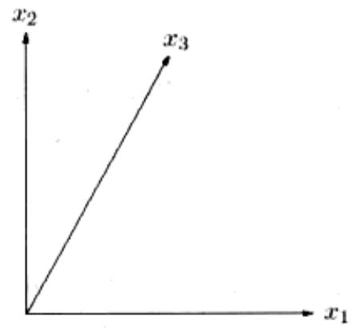

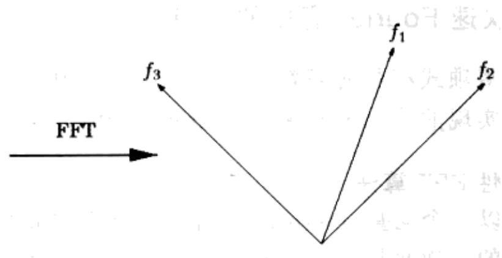  
图2-11 FFT将标准坐标系统(其坐标轴为图中的 $x_{1}, x_{2}, x_{3}$ ) 中的点，经过旋转变换，变换为Fourier基(其坐标轴为矩阵 $M_{n}(\omega)$ 的列向量，即图中的 $f_{1}, f_{2}, f_{3}$ ) 中的点。例如， $x_{1}$ 方向上的点被映射到 $f_{1}$ 的方向上

我们所需的基本观察结论如下：

引理 矩阵 M 的列向量彼此正交。

证明：取矩阵 $M$ 中的任意两个列向量 $j$ 和 $k$ ，计算它们的内积，得

$$
1 + \omega^ {j - k} + \omega^ {2 (j - k)} + \dots + \omega^ {(n - 1) (j - k)} 。
$$

上式中的各项组成一个几何级数，首项为1，末项为 $\omega^{(n - 1)(j - k)}$ ，公比是 $\omega^{(j - k)}$ 。因此，上式等于 $(1 - \omega^{n(j - k)}) / (1 - \omega^{(j - k)})$ ，化简后为0——除了当 $j = k$ 时，上式中的每一项都是1，从而上式等于 $n$ 。证毕。

正交性质可以总结为一个公式：

$$
M M ^ {*} = n I,
$$

其中 $(MM^{*})_{ij}$ 是矩阵 $M$ 中第 $i$ 列和第 $j$ 列的内积(您知道其中的原因吗？)。这意味着 $M^{-1} = (1 / n)M^{*}$ ，我们从而得到了一个反演公式！但是它和我们之前得到的那个相同吗？让我们来看一下—— $M^{*}$ 的第 $(j, k)$ 个元素是 $M$ 中对应元素的共轭复数，换言之，即 $\omega^{-jk}$ 。而 $M^{*} = M_{n}(\omega^{-1})$ ，因此两个反演公式相同。

现在我们回顾一下以上的内容，并从几何的角度审视整个过程。我们需要进行的多项式乘法，在Fourier基中进行要比在标准基中容易得多。因此，我们首先将向量旋转变换到Fourier基下(对应于计算过程evaluation)，然后相乘，最终再将结果旋转回标准基(对应于插值过程)。初始向量是系数表示法，旋转后的向量即为值表示法。在这两种表示法之间高效地来回切换，正是FFT的拿手好戏。

## 2.6.4 快速Fourier变换的细节

针对多项式相乘的高效算法已经完全实现了，现在再让我们仔细审视一下让该算法得以实现的核心——快速Fourier变换。

## 确定性 FFT 算法

FFT 以一个向量 $a = (a_0, \ldots, a_{n-1})$ 和一个复数 $\omega$ 为输入，其中 $\omega$ 的幂 $1, \omega, \omega^2, \ldots, \omega^{n-1}$ 是单位元的 $n$ 次复根。FFT 将向量 $a$ 与 $n \times n$ 的矩阵 $M_n(\omega)$ 相乘，矩阵 $M_n(\omega)$ 的第 $(j, k)$ 个元素(行下标和列下标都从 0 开始)是 $\omega^{jk}$ 。如何在这一矩阵与向量的相乘中利用分治思想呢？当我们尝试将 $M$ 的列向量分成偶数列和奇数列时，分治的思路就逐渐清晰起来：

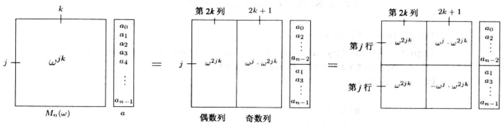

接下来，我们利用 $\omega^{n/2} = -1$ 和 $\omega^n = 1$ 对矩阵下半部分中的元素进行了简化。矩阵左上角的 $n/2 \times n/2$ 的子矩阵为 $M_{n/2}(\omega^2)$ ，左下角的子矩阵亦然。同时，矩阵右上角和右下角的子矩阵也几乎 $M_{n/2}(\omega^2)$ 相同，只是它们各自的第 $j$ 行都是在 $M_{n/2}(\omega^2)$ 对应行的基础上分别乘以了 $\omega^j$ 和 $-\omega^j$ 的结果。因此最终的乘积是如下的向量：

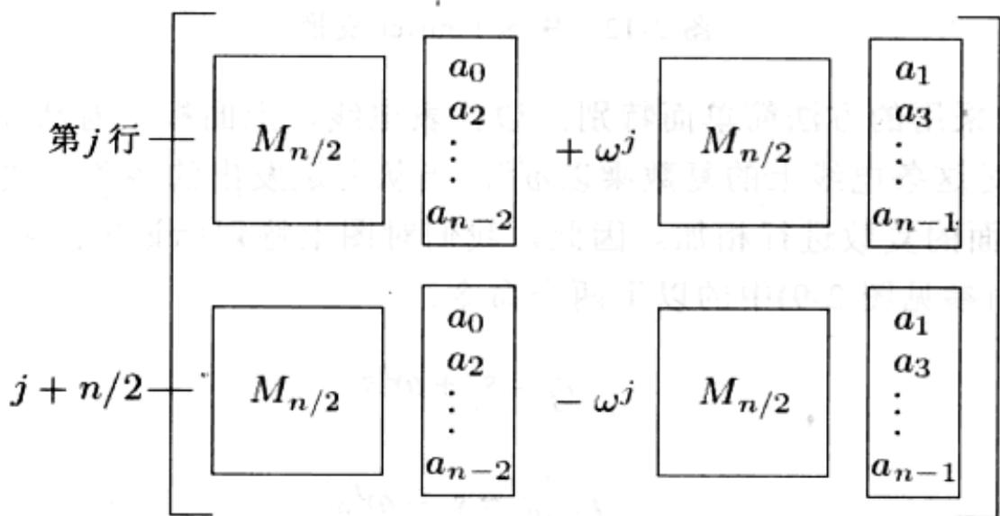

简言之， $M_{n}(\omega)$ 与向量 $(a_{0},\ldots,a_{n-1})$ 相乘这一规模为 n 的问题，可以被转化成两个规模为 n/2 的子问题： $M_{n/2}(\omega^{2})$ 与向量 $(a_{0},a_{2},\ldots,a_{n-2})$ 相乘以及 $M_{n/2}(\omega^{2})$ 与向量 $(a_{1},a_{3},\ldots,a_{n-1})$ 相乘。这一分治策略最终成就了图 2-12 中的确定性 FFT 算法，其运行时间为 $T(n)=2T(n/2)+O(n)=O(n\log n)$ 。

## 快速 Fourier 变换的内部机制

回顾我们之前关于Fourier变换的讨论，不难发现：快速Fourier变换仍然被分治思想所紧紧包裹，让我们无法看清其中的机理。为了弄清楚其内部的结构，现在我们拆开它的“外壳”(一种递归结构)。

FFT 的分治步骤可以看作是一个简单的电路。图 2-13 展示了一个规模为 n 的问题如何被化简为 2 个规模为 n/2 的子问题(清晰起见，一对输出 $(j, j+n/2)$ 被特别标记出):

<Algorithm title="图 2-12 快速 Fourier 变换">
**函数** $\text{FFT}(a, \omega)$  
**输入**：数组 $a = (a_0, a_1, \dots, a_{n-1})$，其中 $n$ 为 2 的幂；本原 $n$ 次单位根 $\omega$  
**输出**：$M_n(\omega)a$  

如果 $\omega = 1$：返回 $a$  
$(s_0, s_1, \ldots, s_{n/2-1}) = \text{FFT}((a_0, a_2, \ldots, a_{n-2}), \omega^2)$  
$(s_0', s_1', \ldots, s_{n/2-1}') = \text{FFT}((a_1, a_3, \ldots, a_{n-1}), \omega^2)$  
对于 $j = 0$ 到 $n/2 - 1$：  
&nbsp;&nbsp;&nbsp;&nbsp;$r_j = s_j + \omega^j s_j'$  
&nbsp;&nbsp;&nbsp;&nbsp;$r_{j + n/2} = s_j - \omega^j s_j'$  
返回 $(r_0, r_1, \ldots, r_{n-1})$  
</Algorithm>

图2-13中采用的方法简单而特别：边代表电线，上面标记着从左到右的复数。权重 $j$ 代表“对这条电线上的复数乘以 $\omega^j$ ”。当从左边发出的两条电线交汇的时候，意味着各自上面的复数进行相加。因此，我们对图上特别标记出的两个输出分别执行了FFT算法(参见图2-9)中的以下两个命令：

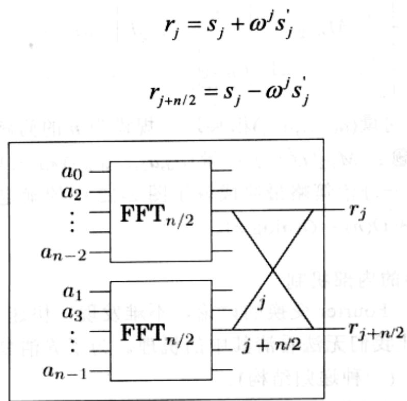  
图2-13 FFT的分治步骤

以上两个命令的执行对应于图 2-13 上的一个蝴蝶式的线路样式：☒。

当 FFT 电路一共含有 n=8 个输入时，我们将它完全拆开，得到如图 2-14 所示的情况。请注意以下两点：

1. 对于 $n$ 个输入，共有 $\log_2^n$ 个层次，每个层次有 $n$ 个节点，共有 $n\log n$ 次操作。

2. 输入按照以下特定顺序排列：0,4,2,6,1,5,3,7。

为什么会这样？回忆一下，在递归的顶层，我们首先生成了输入多项式的偶次幂项系数，然后又生成了奇次幂项系数。然后在下一层次中，产生出第一组(这些系数是4的倍数，换言之，就是对应的二进制表示最后两位为0的数)中的偶次幂项系数，并如此继续。用另一种方式进行解释，即将输入节点按其二进制表示的最后一位的升序进行排列，当最后一位相同时，再按其前一个二进制位的升序排列，如此递归。最终得到的顺序以二进制写出就是：000, 100, 010, 110, 001, 101, 011, 111，与二进制数的自然升序：000, 001, 010, 011, 100, 101, 110, 111类似，只是对应的二进制数位互为镜像！

3. 每个输入 $a_{j}$ 和输出 $A(\omega^{k})$ 之间存在唯一的路径。

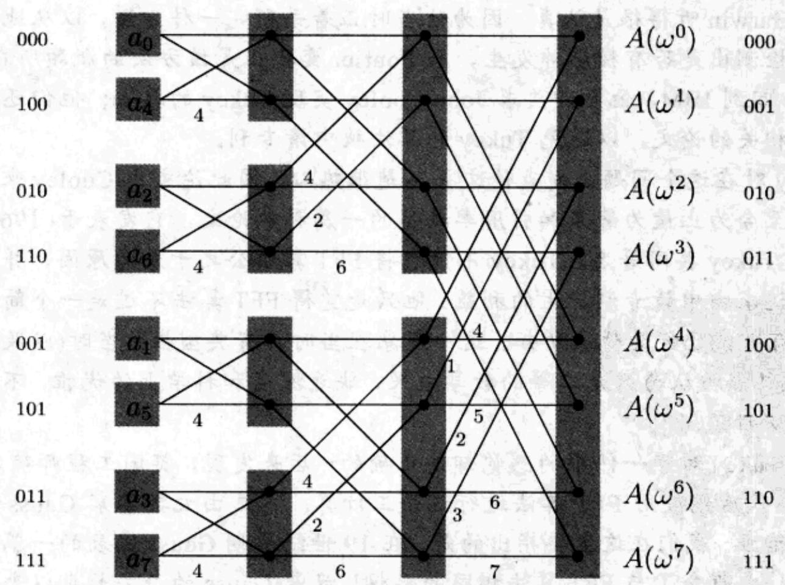  
图 2-14 快速 Fourier 变换电路

借助 $j$ 和 $k$ 的二进制表示法能够很方便地描绘出这条路径(参见图2-14)。从每个节点发出两条边，一条上行(0-边)，一条下行(1-边)。为了从任意一个输入节点到达输出 $A(\omega^k)$ ，只需简单地按照 $k$ 的二进制表示所指示的边的顺序(从二进制表示最右端的位数开始)选择一条路径。(您能模仿这一方法，指出从输出到输入的反向路径吗？)

4. 在 $a_{j}$ 和 $A(\omega^k)$ 之间的路径上，标记的数逐渐增加到 $jk \bmod 8$ 。

由于 $\omega^8 = 1$ ，这意味着输入 $a_{j}$ 对输出 $A(\omega^k)$ 的贡献是 $a_{j}\omega^{jk}$ ，因此该电路正确地计算了多项式 $A(x)$ 的值。

5. 最后，请注意，FFT 电路具备与生俱来的并行计算特征，它可以直接在硬件中实现。

<Knowledge title="专栏: 快速算法的缓慢传播">

1963年，在时任美国总统的Kennedy的一次技术幕僚例会上，一名来自Princeton大学的数学家John Tukey向IBM的Dick Garwin解释了一种进行Fourier变换的快速算法。Garwin听得很是认真，因为他当时正着手研究一种方法，以从地震监测资料数据中检测出是否有核爆炸发生，而Fourier变换正是该方法的瓶颈所在。于是，当Garwin回到IBM，他立即要求John Cooley实现Tukey的算法；他们还决定应该发表一篇相关的论文，以避免Tukey的算法被申请专利。

Tukey 对在这个问题上发表论文并不是很热心，因此论文由 Cooley 来执笔。这就成就了至今为止最为著名和引用率最高的一篇科学论文，它发表于 1965 年，由 Cooley 和 Tukey 共同署名。Tukey 不情愿将 FFT 算法公之于众的原因，并不是出于保密或是追求由申请专利产生的利益。他只是觉得 FFT 算法不过是一个简单的观察结论，很有可能已经为他人所知。这一现象在当时具有典型性：当时(以及后来的一段时间里)算法被认为只是二等的数学成果，缺乏深度和科学上的优雅，不值得认真仔细地加以研究。

但是 Tukey 对于一件事的感觉却是正确的：后来发现，英国工程师确实曾在 20 世纪 30 年代后期使用 FFT 算法进行过手工计算。本章由大数学家 Gauss 开始，也将由他来结束。我们在这里要指出的是，在 19 世纪早期 Gauss 发表的一篇关于插值的论文中，也蕴含了与 FFT 算法相同的思想！只是 Gauss 的论文长期以来一直不为外人所知，而这主要得益于一种老式的加密技术：与当时大多数的科学论文一样，它是用拉丁文撰写的。

</Knowledge>
