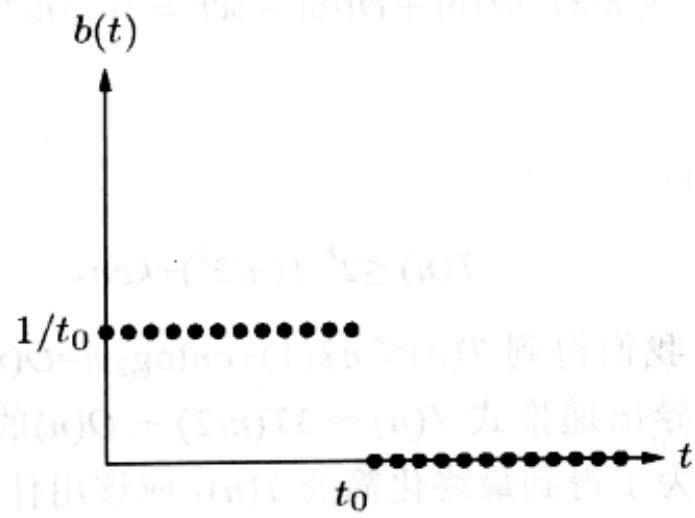

import Guide from '@/components/Guide.astro';
import Knowledge from '@/components/Knowledge.astro';
import Example from '@/components/Example.astro';
import Analysis from '@/components/Analysis.astro';
import Solution from '@/components/Solution.astro';
import Variant from '@/components/Variant.astro';
import Note from '@/components/Note.astro';
import Block from '@/components/Block.astro';
import Method from '@/components/Method.astro';
import Exercise from '@/components/Exercise.astro';
import Algorithm from '@/components/Algorithm.astro';

## 第2章 习题

<Exercise title="习题 2.1">

利用分治整数相乘算法，对两个二进制整数 10011011 和 10111010 相乘。

</Exercise>

<Exercise title="习题 2.2">

证明：对于任意的正整数 $n$ 和基数 $b$ ，一定存在 $b$ 的某个整数幂落在 $[n, bn]$ 的范围内。

</Exercise>

<Exercise title="习题 2.3">

2.2 节曾介绍了一种求解递推式的方法，该方法依赖于以下两个方面：分析递归树结构和推导每个递归层次已完成工作的一个公式。另一种(两种方法相互关联)方法是不断对递推式加以展开，直到出现某个通项公式为止。以我们熟知的递推式 $T(n) = 2T(n/2) + O(n)$ 为例。假定对于某个常数 $c$ ，有 $O(n) \leqslant cn$ ，因此有 $T(n) \leqslant 2T(n/2) + cn$ 成立。反复应用该式，我们可以得到以 $T(n/2)$ 来表示的 $T(n)$ 的上界，然后是以 $T(n/4)$ ， $T(n/8)$ 来表示的 $T(n)$ 的上界，依此类推。我们最终的目标是以一个我们熟知的 $T(\cdot)$ (如 $T(1) = O(1)$ ) 来表示 $T(n)$ 的上界，而我们正在逐渐地接近这个目标。

$$
\begin{array}{r l} T (n) & \leq 2 T (n / 2) + c n \\ & \leq 2 [ 2 T (n / 4) + c n / 2 ] + c n = 4 T (n / 4) + 2 c n \\ & \leq 4 [ 2 T (n / 8) + c n / 4 ] + 2 c n = 8 T (n / 8) + 3 c n \\ & \leq 8 [ 2 T (n / 1 6) + c n / 8 ] + 3 c n = 1 6 T (n / 1 6) + 4 c n \\ & \vdots \end{array}
$$

从而，通项公式为：

$$
T (n) \leq 2 ^ {k} T (n / 2 ^ {k}) + k c n 。
$$

将 $k = \log_2 n$ 代入，我们得到 $T(n) \leqslant nT(1) + cn\log_2 n = O(n\log n)$ 。

(a) 照此方法，推导出递推式 $T(n) = 3T(n / 2) + O(n)$ 的通项公式。该递推式对应的第 $k$ 个通项是什么？为了得到最终化简的 $T(n)$ ，应该用什么来替换通项公式中的 $k$ ?

(b) 再试试递推式 $T(n) = T(n - 1) + O(1)$ ，主引理中并没有提供解决这种形式递推式的方法。您能将它化简吗？

</Exercise>

<Exercise title="习题 2.4">

假定您需要在以下三种算法中做出抉择：

\- 算法 $A$ 将原问题划分成规模减半的5个子问题，递归地求解这些子问题，然后在线性时间内将子问题的解合并，得到原问题的解。

\- 算法 $B$ 这样求解规模为 $n$ 的原问题: 先递归地求解 2 个规模为 $n - 1$ 的子问题, 然后在常量时间内将子问题的解合并。

\- 算法 $C$ 将规模为 $n$ 的原问题划分成规模为 $n / 3$ 的9个子问题，递归地求解这些子问题，然后在 $O(n^3)$ 时间内将子问题的解合并。

给出以上三个算法的运行时间，以大-O标记表示，您会选择哪个算法？

</Exercise>

<Exercise title="习题 2.5">

求解以下的递推式，并针对每个递推式给出一个 $\Theta$ 界限。

(a) $T(n) = 2T(n / 3) + 1$

(b) $T(n) = 5T(n / 4) + n$

(c) $T(n) = 7T(n / 7) + n$

(d) $T(n) = 9T(n / 3) + n^2$

(e) $T(n) = 8T(n / 2) + n^3$

(f) $T(n) = 49T(n / 25) + n^{3 / 2}\log n$

(g) $T(n) = T(n - 1) + 2$

(h) $T(n) = T(n - 1) + n^c$ ，其中常数 $c\geqslant 1$

(i) $T(n) = T(n - 1) + c^n$ ，其中某一常数 $c\geqslant 1$

(j) $T(n) = 2T(n - 1) + 1$

(k) $T(n) = T(\sqrt{n}) + 1$

</Exercise>

<Exercise title="习题 2.6">

一个线性时不变系统具有如下图所示的脉冲响应：



(a) 描述该系统的效果。

(b) 该系统对应的多项式是什么？

</Exercise>

<Exercise title="习题 2.7">

单位元的所有 $n$ 次复根的和是多少？当 $n$ 是奇数时，所有 $n$ 次复根的积是多少？当 $n$ 是偶数时呢？

</Exercise>

<Exercise title="习题 2.8">

练习快速 Fourier 变换。

(a) $(1,0,0,0)$ 的FFT是什么？本题中 $\omega$ 的值是多少？什么序列经过FFT，能够得到 $(1,0,0,0)?$

(b) 对 $(1,0,0,0)$ 重复上一问。

</Exercise>

<Exercise title="习题 2.9">

练习利用 FFT 进行多项式相乘运算。

(a) 假定您要利用 FFT 对两个多项式 $x + 1$ 和 $x^2 + 1$ 相乘。选择一个合适的 2 的幂，找到对应的两个序列的 FFT，逐项相乘，并通过逆 FFT 得到最终的乘积。

(b) 对另两个多项式 $1 + x + 2x^{2}$ 和 $2 + 3x$ 重复上一问。

</Exercise>

<Exercise title="习题 2.10">

求出唯一的 4 次多项式，满足 $p(1) = 2, p(2) = 1, p(3) = 0, p(4) = 4$ 和 $p(5) = 0$ 。将多项式以系数表示法表示。

</Exercise>

<Exercise title="习题 2.11">

为了给出我们的矩阵相乘算法(参见2.5节)，我们称有以下矩阵分块性质成立：如果 $X$ 和 $Y$ 都是 $n \times n$ 的矩阵，

$$
X = \left[ \begin{array}{c c} A & B \\ C & D \end{array} \right], Y = \left[ \begin{array}{c c} E & F \\ G & H \end{array} \right]
$$

其中 $A$ 、 $B$ 、 $C$ 、 $D$ 、 $E$ 、 $F$ 、 $G$ 、 $H$ 均为 $n / 2 \times n / 2$ 的子矩阵，从而乘积 $XY$ 可以表示成以下分块相乘的形式：

$$
X Y = \left[ \begin{array}{l l} A & B \\ C & D \end{array} \right] \left[ \begin{array}{l l} E & F \\ G & H \end{array} \right] = \left[ \begin{array}{l l} A E + B G & A F + B H \\ C E + D G & C F + D H \end{array} \right]
$$

证明该性质。

</Exercise>

<Exercise title="习题 2.12">

以下的程序会输出多少行(以 $n$ 的函数，并以 $\Theta(\cdot)$ 的形式表示输出的行数)? 写出一个递推式，并求解之。您可以假定 $n$ 是 2 的幂。

```python
function f(n)
    if n > 1:
    print.line("still going")
    f(n/2)
    f(n/2)
```

</Exercise>

<Exercise title="习题 2.13">

当一个二叉树的所有顶点都有 0 个子顶点或 2 个子顶点时，我们称该二叉树是满的。令 $B_{n}$ 表示含有 $n$ 个顶点的所有满二叉树的数目。

(a) 分别画出含有 3 个、5 个和 7 个顶点的所有满二叉树，以此给出 $B_{3} 、 B_{5}$ 和 $B_{7}$ 的值。为什么我们不要求给出含有某偶数个顶点的所有满二叉树的数目，如 $B_{4}$ ?

(b) 对于一般的顶点数 $n$ ，给出一个 $B_{n}$ 的递推式。

(c) 归纳证明 $B_{n}$ 是 $2^{\Omega(n)}$ 。

</Exercise>

<Exercise title="习题 2.14">

给定一个含有 $n$ 个元素的数组，注意到数组中的某些元素是重复的，即这些元素在数组中出现不止一次。给出一种算法，以 $O(n \log n)$ 时间移除掉数组中的

所有重复元素。

</Exercise>

<Exercise title="习题 2.15">

在寻找中项算法中(参见 2.4 节)，一个基本操作是 split 操作，该操作以一个数组 S 和一个值 v 为输入，将 S 划分成 3 个子集：比 v 小的元素组成的集合，等于 v 的元素组成的集合以及比 v 大的元素组成的集合。给出一种算法，以就地实现 split 操作，即该算法不要求额外分配新的内存。

</Exercise>

<Exercise title="习题 2.16">

给定一个无穷数组 $A[\cdot]$ ，其中前 $n$ 个元素都是整数，且已排好顺序，剩余元素均为 $\infty$ 。 $n$ 的值未知。给出一个算法，以一个整数 $x$ 为输入，以 $O(\log n)$ 时间找到数组中的一个位置，并满足其上的元素为 $x$ （当然前提是如果这样的位置存在）。(如果您被该数组的长度无穷所困扰，建议您可以假定它的长度为 $n$ ，只是您并不知道这个长度的实际值，并且在您的算法实现代码中，一旦数组元素 $A[i]$ 满足 $i > n$ ，则您的代码应该返回错误信息 $\infty$ 。）

</Exercise>

<Exercise title="习题 2.17">

给定一个有序数组 $A[1, \ldots, n]$ ，其中的元素各不相同，要求确认是否存在一个数组索引，使得 $A[i] = i$ 。给出一个针对以上任务的分治算法，运行时间为 $O(\log n)$ 。

</Exercise>

<Exercise title="习题 2.18">

考虑以下任务：在一个有序数组 $A[1, \ldots, n]$ 中寻找一个给定的元素 $x$ ：该任务如果利用通常的二分搜索算法，可以在 $O(\log n)$ 时间内完成。证明：任意仅通过比较操作(即通过形如“ $A[i] \leqslant z$ 吗？”的提问)来访问数组的算法，一定需要执行 $\Omega(\log n)$ 次操作。

</Exercise>

<Exercise title="习题 2.19">

$k$ -路合并操作。假定有 $k$ 个有序数组，每个数组中含有 $n$ 个元素，您的任务是将它们合并为单独的一个有序数组，该数组共含有 $kn$ 个元素。

(a) 可以采用下面的策略：使用2.3节的merge过程，先合并前两个数组，再与第三个数组合并，并与第四个数组合并，并一直持续下去。该算法的时间复杂性如何？请用关于 $k$ 和 $n$ 的函数表示。

(b) 针对本题的任务，给出一种更有效的分治型算法。

</Exercise>

<Exercise title="习题 2.20">

证明：任意整数数组 $x[1,\dots ,n]$ 可以在 $O(n + M)$ 时间内进行排序，其中

$$
M = \max _ {i} x _ {i} - \min _ {i} x _ {i} 。
$$

对于 $M$ 比较小的情况，排序可以在线性时间内完成：我们不禁要问，为什么排序算法的 $\Omega(n\log n)$ 的时间下界不适用于 $M$ 比较小的情况呢？

</Exercise>

<Exercise title="习题 2.21">

平均数和中项。统计学中的一项最基本任务就是以一个单独的数来概括一组观测数值 $\{x_{1}, x_{2}, \ldots, x_{n}\} \subseteq \mathbb{R}$ 的特征。两种比较常见的选择是：

\- 中项，我们记为 $\mu_{1}$

\- 平均数，我们记为 $\mu_{2}$

(a) 证明：中项等于使以下函数最小的 $\mu$ 值：

$$
\sum_ {i} \left| x _ {i} - \mu \right|
$$

为了证明的简便，可以假定 $n$ 是奇数。(提示：先证明以下结论：对于任意的 $\mu \neq \mu_{1}$ ，无论是微量缩小 $\mu$ 还是微量增大 $\mu$ ，该函数值都将减少。)

(b) 证明：平均数等于使以下函数最小的 $\mu$ 值：

$$
\sum_ {i} \left(x _ {i} - \mu\right) ^ {2}
$$

一种证明方法是利用微积分。另一种方法是证明对于任意的 $\mu \in \mathbb{R}$ ，有下式成立：

$$
\sum_ {i} \left(x _ {i} - \mu\right) ^ {2} = \sum_ {i} \left(x _ {i} - \mu_ {2}\right) ^ {2} + n \left(\mu - \mu_ {2}\right) ^ {2}
$$

请注意： $\mu_{2}$ 对应的函数相比 $\mu_{1}$ 对应的函数，它对于远离 $\mu$ 的数值的惩罚(因为目标是使函数值最小，而数值越远离 $\mu$ ，相应函数的值越大，形象地称为对偏离最小化目标的惩罚)要重得多。因此， $\mu_{2}$ 会与所有的观测数值更加接近。 $\mu_{2}$ 的这一特征听起来不错，但是从统计学的角度来讲，这一特征并不合需要，因为只需少量的边缘数据就能将 $\mu_{2}$ 的值远远甩离位于整体观测数值中央的数值。因此，有时候 $\mu_{1}$ 被视为是比 $\mu_{2}$ 更好的对于一组观测数值的估计指标。然而，却存在另一个比它俩都要差的指标： $\mu_{\infty}$ ，它等于使以下函数最小的 $\mu$ 值：

$$
\max _ {i} \left| x _ {i} - \mu \right|
$$

(c) 证明： $\mu_{\infty}$ 可以在 $O(n)$ 时间内计算出来(假定数值 $x_{i}$ 足够小，使得关于它们的基本算术操作可以在单位时间内完成)。

</Exercise>

<Exercise title="习题 2.22">

给定两个有序列表，大小分别为 $m$ 和 $n$ 。给出一个算法，以 $O(\log m + \log n)$ 时间找出两个列表合并后的有序列表中的第 $k$ 小元素。

</Exercise>

<Exercise title="习题 2.23">

如果一个数组 $A[1, \ldots, n]$ 中超过半数的元素都相同时，该数组被称为含有一个主元素。给定一个数组，设计一个有效算法，确定该数组中是否含有一个主元素，如果有，找出这个元素。该数组中的元素之间不一定存在顺序，如整数之间就存在顺序，可以作形如“ $A[i] > A[j]$ 吗？”的比较，与此不同的是，该数组中的元素则不一定能做出这样的比较。(比如可以把该数组中的元素设想成 GIF 文件。)但是，却可以在常量时间内回答如下形式的问题“ $A[i]=A[j]$ 吗？”。

(a) 给出一个算法，以 $O(n \log n)$ 时间完成本题的要求。(提示：将数组 $A$ 划分成两个数组 $A_{1}$ 和 $A_{2}$ ，各含有 $A$ 中的一半元素。考虑以下的问题：如果知道了 $A_{1}$ 和 $A_{2}$ 中各自的主元素，是否会对找出 $A$ 中的主元素有所帮助？如果答案是肯定的，您就可以使用一种分治方法。)

(b) 能否给出一个线性时间算法？(提示：以下有另一种分治方法：

\- 对 $A$ 中的元素任意两两组合，得到 $n / 2$ 对元素

\- 对每对元素作如下工作：如果两个元素不同，则两者都可以舍弃；如果它们相同，则只保留它们中的一个

证明：在经历了上述过程之后，最多留下 $n / 2$ 个元素，如果 $A$ 中含有一个主元素，则这些元素中也含有一个主元素。）

</Exercise>

<Exercise title="习题 2.24">

本书 2.4 节的灰色方框中有一个针对快速排序算法的概要性描述。

(a) 写出快速排序算法的伪代码。

(b) 证明：当输入数组的大小为 n 时，该算法最差情况下的运行时间是 $\Theta(n^{2})$ 。

(c) 证明：该算法的期望运行时间满足以下的递推式：

$$
T (n) \leq O (n) + \frac {1}{n} \sum_ {i = 0} ^ {n - 1} (T (i) + T (n - i))
$$

再证明该递推式的解是 $O(n\log n)$ 。

</Exercise>

<Exercise title="习题 2.25">

2.1节我们曾给出了一个算法，在 $n^a$ 时间内对两个 $n$ 位二进制整数 $x$ 和 $y$ 相乘，其中 $a = \log_23$ 。我们称该算法为 fastmultiply $(x,y)$ 。

(a) 我们想要把十进制整数 $10^{n}$ (一个 1 后面有 $n$ 个 0) 转换成二进制形式。以下是转换算法(假定 $n$ 是 2 的幂):

<div class="mineru-algorithm">
function pwr2bin(n)
    if n=1: return  $1010_{2}$ 
    else:
    z=??? 
    return fastmultiply(z,z)
</div>

将算法中漏掉的细节补全。然后给出关于算法运行时间的递推式，并求解该递推式。

(b) 接下来, 我们想要把任意 $n(n$ 是 2 的幂)位十进制整数 $x$ 转换成二进制形式。

相应的算法如下：

<div class="mineru-algorithm">
function dec2bin(x)
    if n=1: return binary[x]
    else:
    split x into two decimal numbers  $x_{L}$ ,  $x_{R}$  with n/2 digits each
    return ???
</div>

这里 binary[·] 是一个向量，代表了括号中的 1 位整数的二进制表示。例如，binary[0]=0₂，binary[1]=1₂，binary[9]=1001₂。假定 binary 中的一个查找操作需要 O(1) 时间。将算法中漏掉的细节补全，然后给出关于算法运行时间的递推式，并求解该递推式。

</Exercise>

<Exercise title="习题 2.26">

F.Lake 教授告诉他的学生这样一个论断：从极限的角度来讲，当 $n$ 趋于无穷大时，计算一个 $n$ 位二进制整数的平方要渐近地快于计算两个 $n$ 位二进制整数的乘积。该论断正确吗？

</Exercise>

<Exercise title="习题 2.27">

矩阵 A 的平方是 A 自乘后的乘积，即 AA。

(a) 证明：5 次乘法足以完成对一个 $2 \times 2$ 矩阵的平方。

(b) 下述算法旨在计算一个 $n \times n$ 矩阵的平方，指出其中的错误：

“使用 Strassen 算法中的分治方法，不同于 Strassen 算法中将规模为 n 的原问题划分成 7 个规模为 n/2 的子问题，我们现在只得到 5 个规模为 n/2 的子问题，这要归功于(a)中的结论。利用 Strassen 算法采用的同一种算法分析方法，我们可以得出以下结论：该算法的运行时间为 $O(n^{\log_{2}5})$ ”

(c) 实际上，矩阵平方并不比矩阵相乘容易。证明：如果一个 $n \times n$ 的矩阵可以在 $O(n^{c})$ 时间内平方，那么，任意两个 $n \times n$ 的矩阵可以在 $O(n^{c})$ 时间内相乘。

</Exercise>

<Exercise title="习题 2.28">

Hadamard 矩阵 $H_0, H_1, H_2, \ldots$ 定义如下：

\- $H_0$ 是 $1 \times 1$ 的矩阵[1]

\- 对于 $k > 0$ ， $H_{k}$ 是 $2^{k} \times 2^{k}$ 的矩阵

$$
H _ {k} = \left[ \begin{array}{c c} H _ {k - 1} & H _ {k - 1} \\ \hline H _ {k - 1} & - H _ {k - 1} \end{array} \right]
$$

证明：如果 v 是一个长度为 $n=2^{k}$ 的列向量，那么矩阵-向量的乘积 $H_{k}v$ 可以通过 $O(n\log n)$ 次操作求得。假定所有参与计算的数都足够小，使得关于它们的基本算术操作，如加法和乘法等，都可以在单位时间内完成。

</Exercise>

<Exercise title="习题 2.29">

假定我们需要计算多项式 $p(x) = a_0 + a_1x + a_2x^2 +\ldots +a_nx^n$ 在 $\pmb{x}$ 点处的值。

(a) 证明如下简单规则能够完成题设要求的工作，并给出答案 $z$ ，又名 Horner 准则。

<div class="mineru-algorithm">
$z = a_{n}$ for $i = n - 1$ downto 0: $z = zx + a_{i}$
</div>

(b) 该准则分别进行了多少次加法操作和乘法操作？分别写成 $n$ 的函数。您能否找到一个多项式，使得另一种方法相比 Horner 准则更好？

</Exercise>

<Exercise title="习题 2.30">

本题给出了一种方法，以模运算来进行 Fourier 变换(FT)，以模 7 运算为例：(a) 存在一个数 $\omega$ ，使得 $\omega$ 的七个幂 1(1 相当于是 $\omega^0$ ), $\omega, \omega^2, \ldots, \omega^6$ 各不相同(模 7)。找到这个数 $\omega$ ，并证明 $\omega + \omega^2 + \ldots + \omega^6 = 0$ 。(有趣的是，对于任意的素模数，都存在一个这样的数 $\omega$ 。)

(b) 利用 FT 的矩阵形式，生成以下序列(0,1,1,1,5,2)模 7 的变换；即将该序列对应的向量与矩阵 $M_6(\omega)$ 相乘，其中的 $\omega$ 即为(a)中找出的 $\omega$ 。在矩阵乘法中，所有的计算都是模 7 运算。

(c) 写出执行逆 FT 所必需的矩阵。证明：乘以该矩阵将得到原序列。(同样，所有的运算都是模 7 运算。)

(d) 现在说明如何利用 FT 模 7 方法，将两个多项式 $x^{2} + x + 1$ 和 $x^{3} + 2x - 1$ 相乘。

</Exercise>

<Exercise title="习题 2.31">

在 1.2.3 节，我们曾研究了 Euclid 算法，用来计算两个正整数的最大公因数(gcd): 即同时整除这两个整数的最大整数。现在我们考虑一种基于分治的最大公因数算法。

(a) 证明以下规则是正确的：

$$
\operatorname * {g c d} (a, b) = \left\{ \begin{array}{l l} 2 \operatorname * {g c d} (a / 2, b / 2) & \text {如果} a, b \text {都是偶数} \\ \operatorname * {g c d} (a, b / 2) & \text {如果} a \text {是奇数}, b \text {是偶数} \\ \operatorname * {g c d} ((a - b) / 2) & \text {如果} a, b \text {都是奇数} \end{array} \right.
$$

(b) 给出一个有效的分治型最大公因数算法。

(c) 如果 $a$ 和 $b$ 都是 $n$ 位二进制整数，您的分治型算法和 Euclid 算法相比，效率如何？(特别需要指出的是，由于 $n$ 可能会比较大，因此您不能假定基本算术操作，如加法能够在常量时间内完成。)

</Exercise>

<Exercise title="习题 2.32">

在本题中，我们将设计一种分治算法，针对以下几何任务：

最近点对问题(CLOSEST PAIR)

输入：平面上的一组点， $\{p_{1}=(x_{1},y_{1}),\ldots,p_{n}=(x_{n},y_{n})\}$

输出：最近点对：即找到两个点 $p_i \neq p_j$ ，使得它们之间的距离

$$
\sqrt {\left(x _ {i} - x _ {j}\right) ^ {2} + \left(y _ {i} - y _ {j}\right) ^ {2}}
$$

在所有的点对间为最小。

简便起见，假设 $n$ 是2的幂，同时，所有点的 $\pmb{x}$ 坐标 $x_{i}$ 互不相同， $\pmb{y}$ 坐标也是如此。

该分治算法可以概要综述如下：

\- 找到一个值 $x$ ，恰好能够使得半数的点满足 $x_{i} < x$ ，半数的点满足 $x_{i} > x$ 。在此基础上，将所有的点分成两组， $L$ 和 $R$ 。

\- 递归地寻找 $L$ 和 $R$ 中各自的最近点对。记这两对点分别为 $p_L, q_L \in L$ 和 $p_R, q_R \in R$ ，这两对点间的距离分别为 $d_L$ 和 $d_R$ 。记 $d$ 为两个距离中的小者。

\- 接下来需要看看 $L$ 中的点和 $R$ 中的点之间的最小间距是否比 $d$ 还小。如果最近点对由 $L$ 中的某个点和 $R$ 中的某个点组成，则这两个点的 $x$ 坐标一定与 $x$ 的差值不超过 $d$ ，从而可以丢弃所有满足 $x_{i} < x - d$ 或 $x_{i} > x + d$ 的点，并将剩余的点按照 $y$ 坐标递增序排序，形成一个列表。

\- 现在，遍历该有序列表，对每个点，只需计算它与列表中后续的7个点之间的距离(此处隐含一个重要的观察结论：列表中的每个点最多需要和列表中的7个点进行比较)。令 $p_{M}$ 和 $q_{M}$ 表示最小距离对应的最近点对。

\- 最终的最近点对是以下三对点中距离最近的一对： $\{p_L, q_L\}, \{p_R, q_R\}, \{p_M, q_M\}$ 。

(a) 为了验证上述算法的正确性，首先需要证明以下性质：平面上的任意 $d \times d$ 的矩形区内最多可以容纳 $L$ 中的4个点。

(b) 证明上述算法是正确的。证明中需要着重考虑以下情况：当最近点对由 $L$ 中的某个点和 $R$ 中的某个点组成时。

(a) 写出上述算法的伪代码，证明其运行时间满足以下递推式：

$$
T (n) = 2 T (n / 2) + O (n \log n)
$$

证明该递推式的解是 $O(n \log^{2} n)$ 。

(d) 您能改进该算法，使其运行时间降至 $O(n \log n)$ 吗？

</Exercise>

<Exercise title="习题 2.33">

给定 3 个 $n \times n$ 的矩阵 $A, B, C$ ，需要验证是否 $AB = C$ 。借助 Strassen 算法，验证过程可以通过 $O(n^{\log_2 7})$ 次基本操作实现。本题将设计一种更快的随机验证方法，

时间复杂度为 $O(n^{2})$ 。

(a) 令 v 表示一个 n 维向量, 其每一个分量的值随机独立地在 0 或 1 之间选取(每种选择的概率都是 1/2)。证明: 如果 M 是一个非零的 $n \times n$ 矩阵, 那么 $\Pr[Mv=0] \leqslant 1/2$ 。

(b) 证明：如果 $AB \neq C$ ，则 $\Pr[ABv = Cv] \leqslant 1/2$ 。为什么这保证了针对 $AB = C$ 的随机验证方法的时间复杂度为 $O(n^2)$ ?

</Exercise>

<Exercise title="习题 2.34">

线性 3SAT。8.1 节中详细定义了 3SAT 问题。这里我们提前给出 3SAT 问题的简要描述: 问题输入是一个布尔公式——以一组子句表示——由一组变量组成, 问题的目标是确定是否存在所有变量的一个赋值(每个变量赋给 true/false 值), 使得整个公式的值为 true。

考虑具有以下特殊局部性质的一个3SAT问题实例。布尔公式中包含 $n$ 个变量，每个变量以 $1,2,\dots,n$ 进行编号，公式中的每个子句包含变量的编号差异在 $\pm 10$ 以内。给出一个线性时间算法，求解这样的一个3SAT问题实例。

圆交点个个的城市中深城市客座小站，点个新站，深站（台新出圈），合照。中深深味要满足选点个新的中交局，多指聚燃的要素一个含副类由）离围的。按点预量的效应图小量不实mp 市 $_{mq}$ 合与（定时开放点个个）

$\{u_{p,q}\},\{q_{p,q}\},\{u_{q,s}\}$ 为一的顶最离出了点三和点最重量的变量。


1. 由按点数是常，若若干对数多重求解中即下。如高可多乘数之上即下 (d)

1. 面散不过且有同向对象其顶面，提升的油去臭氧土出量。(6)

$$
(n, y \circ (n) O + (S _ {1} n) T S = (n) T
$$

$(n^{-1} \text{golw})$ 是颗的左臂数与便而

即 $(n + 20)(3)$ 于朝向书目及其处，若有此真题。(b)

，若真 $n\geq 2802$ 时， $O = 8$ ，香虽正斜要需 $D_{1}A$ 南欧的 $n \times n$ 个 $\varepsilon$ 安全： $\varepsilon \in S$ ，故正斜斜圆的为更小，长宽椭圆本。把实斜基本为 $(^{1945}\mathrm{R})$ ，故反以同量正斜基金投资本基金并不因故，而纳入特定风险的本基金的投资中

</Exercise>

