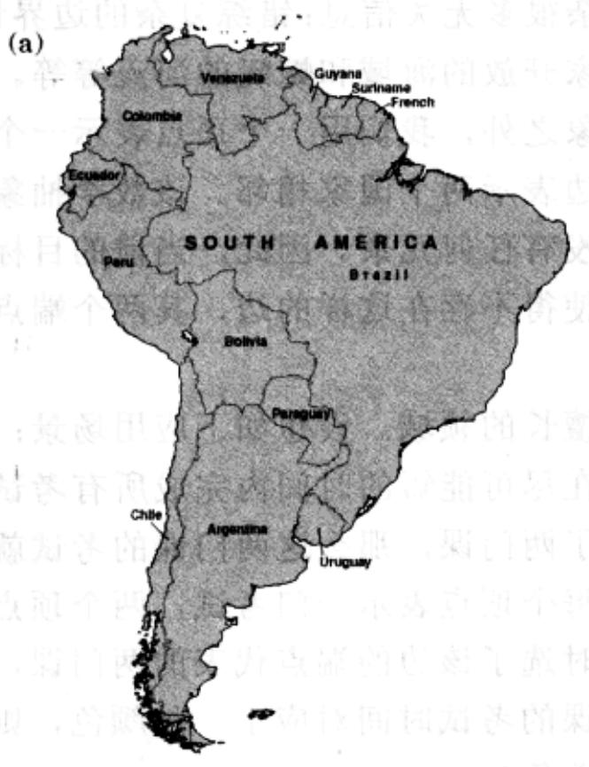
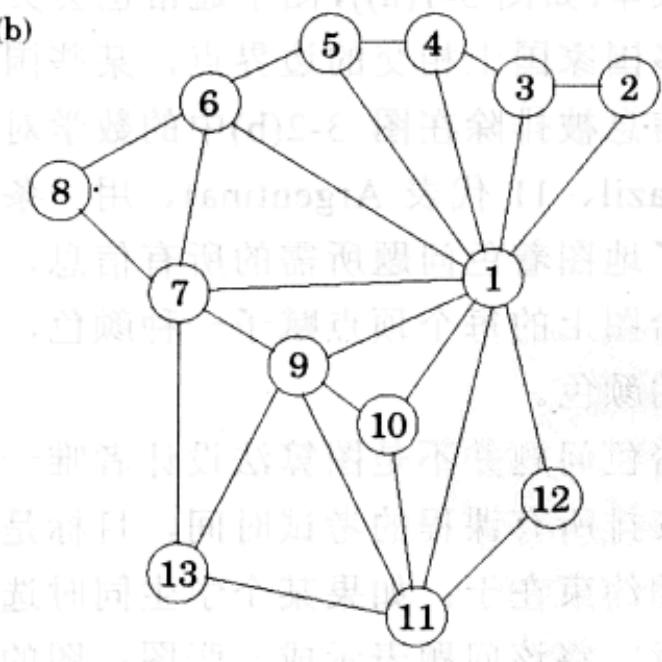
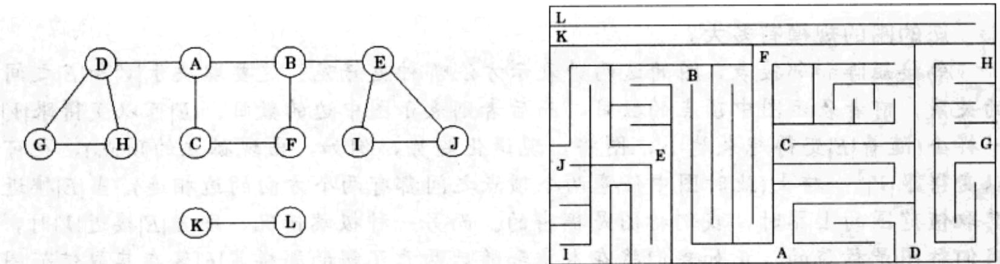

import Guide from '@/components/Guide.astro';
import Knowledge from '@/components/Knowledge.astro';
import Example from '@/components/Example.astro';
import Analysis from '@/components/Analysis.astro';
import Solution from '@/components/Solution.astro';
import Variant from '@/components/Variant.astro';
import Note from '@/components/Note.astro';
import Block from '@/components/Block.astro';
import Method from '@/components/Method.astro';
import Exercise from '@/components/Exercise.astro';
import Algorithm from '@/components/Algorithm.astro';

## 第3章 图的分解

## 3.1 为什么是图

现实生活中有很大一类问题可以用简洁明了的图论语言来描述，该描述过程既清晰又能达到一定的精确性。例如，著名的地图着色问题。该问题有一个最基本的约束条件，即地图上相邻的国家不能着相同的颜色，在这一约束条件下，完成着色最少需要多少种颜色？问题的难点之一源于地图本身，即使是从整个地图上剥离下来的局部版本(如图3-1(a))，图中通常也会夹杂很多无关信息：错综复杂的边界情况，三个或更多国家国土相交的边界点，某些国家开放的海域和蜿蜒的河流等等。以上这些无关信息被排除在图3-2(b)中的数学对象之外，我们用一个顶点表示一个国家(1代表Brazil、11代表Argentina)、用一条边表示两个国家相邻。该数学抽象表示恰巧具备了地图着色问题所需的所有信息，没有任何冗余。因此，当前的目标很明确：就是给图上的每个顶点赋予一种颜色，使得不存在这样的边，其两个端点被赋予了相同的颜色。

地图着色问题并不是图算法设计者唯一擅长的领域。设想如下应用场景：一所大学需要安排所有课程的考试时间，目标是在尽可能短的时间内完成所有考试。该问题唯一的约束在于：如果某个学生同时选了两门课，那么这两门课的考试就不应该同时进行。将该问题表示成一张图：图的每个顶点表示一门考试，两个顶点间的边表示考试之间的上述约束，如果有学生同时选了该边的端点代表的两门课，则这两门课的考试时间不能出现冲突。设想每门课的考试时间对应于一种颜色，则安排所有课程的考试时间就相当于为这张图进行着色！

这些基本的图操作问题在实际生活中比比皆是，从上述应用中可见一斑。很多算法设计者致力于为实际问题寻找有效的基于图论的求解算法。本章将就这些算法中涉及的最基本的问题展开深入探讨，以揭示图基本的连通结构。

通常，图可以用顶点(也有人称之为节点)集合 V 和连接顶点的边的集合 E 来表示。在上文地图着色的例子中， $V=\{1,2,3,\ldots,13\}$ ，E 包含的边有 $\{1,2\},\{9,11\}$ 和 $\{7,13\}$ 等。顶点 x 和 y 之间存在一条边意味着 “x 和 y 领土接壤”。这种二元关系是一个对称关系，即 x 和 y 领土接壤也就蕴含着 y 和 x 领土接壤，我们将它用集合语言表示为 $e=\{x,y\}$ 。作为无向图的组成部分，这样的边当然也是无向的。

有时，图中的连接关系并不具备这种对称性，因此我们有必要用有方向的边来表示。顶点 $x$ 到 $y$ 之间存在一条有向边，(我们记为 $e = (x, y)$ )； $y$ 到 $x$ 之间存在一条有向边，(我们记为 $(y, x)$ )；当然，这两个顶点之间也有可能同时存在以上两条有向边。有向图的一个大规模的典型例子是关于Web中所有链接的图。图中用顶点表示因特网上的每个站点，如果站点 $u$ 和站点 $v$ 之间存在一个链接，则图中相应地存在一条有向边 $(u, v)$ 。如此，该图将包含了数以亿计的顶点和边！理解Web最基本的连通性将有着巨大的经济和社会意义。尽管该问题的规模可能有点让人望而却步，但令人欣慰的是，我们很快就会发现有关图结构的许多有价值的信息都能在线性时间内提取出来。

(b)  
  
图 3-1 (a)一张地图以及(b)该地图对应的图

## 图的表示

图可以用一个邻接矩阵来表示；如果图中有 $n = |V|$ 个顶点 $\nu_{1},\ldots ,\nu_{n}$ ，则该邻接矩阵是一个 $n\times n$ 的矩阵，矩阵中的第 $(i,j)$ 个元素为

$$
a _ {i j} = \left\{ \begin{array}{l l} 1 & \text {如果从} v _ {i} \text {到} v _ {j} \text {之间存在一条边} \\ 0 & \text {否则} \end{array} \right.
$$

对于无向图，因为每条边 $\{u, v\}$ 都是双向的，所以该矩阵是对称的。

这种表示法带来的最大便利在于：能够在常量时间内确定某条边是否存在，而且只需一次内存访问操作。而该表示法的缺陷在于，邻接矩阵占据 $O(n^{2})$ 空间，当图中并不含有很多边时，这种存储方式是一种浪费。

## 您的图的规模有多大？

邻接矩阵和邻接表，图的这两种表示方法哪种更好呢？这要取决于 $|V|$ 和 $|E|$ 之间的关系，前者表示图中顶点的数目，而后者则表示图中边的数目。 $|E|$ 可以变得跟 $|V|$ 一样小（随着 $|E|$ 变得越来越小，图将出现退化趋势，例如，出现孤立的顶点），也可以变得跟 $|V|^2$ 一样大（此时图中任意两个顶点之间都有两个方向的边相连）。当 $|E|$ 接近其取值范围的上界时，我们称图是稠密的。而另一种极端情况，即当 $|E|$ 接近 $|V|$ 时，我们称图是稀疏的。正如我们将在本章和随后两章了解的那样， $|E|$ 落在其取值范围的哪个确切位置通常是选择正确的图算法的一个关键因素。 $|E|$ 的大小也将影响对图的表示方法的选择。

如果我们想要在计算机的存储器中存储和表示万维网(World Wide Web)的图，是否选用邻接矩阵表示法可要三思而后行：在本书成文之时，当前搜索引擎在Web对应的图中大约访问过80亿个顶点，如果用邻接矩阵存储这些信息，将占用数以百万计TB(10 $^{12}$ 位)存储空间，当前世界上是否有足够大的计算机存储空间能够存储这些信息仍未可知(针对这种巨大的存储需求而坐以待之，直到出现有足够大的存储空间无疑是不明智的，因为网络的规模与此同时也在增长，或许还将增长得更快)。

如果使用邻接表来表示万维网(World Wide Web)对应的图，那将是可行的：因为其上只有数百亿个超链接，而每一个超链接只会占用邻接表中的若干字节。您甚至可以使用能置于口袋中的便携设备来存储这些信息(或许不久以后，挂在耳边的灵巧设备都能满足您的要求)，因为所需的存储空间也就是一两个TB的规模。

针对万维网(World Wide Web)的应用背景，邻接表更高效的原因在于Web是稀疏的。相对于数十亿的超链接总量，每个页面指向其他页面的超链接数，平均也就是6个左右。

另一种表示法被称为邻接表，其空间消耗与图中边的数目成比例。它包含 $|V|$ 个链表，每个链表对应一个顶点。顶点 $u$ 的链表记录了从顶点 $u$ 出发可到达的顶点名称(从顶点 $u$ 出发可到达的顶点即为满足 $(u, v) \in E$ 的顶点 $v)$ 。因而，有向图中的每条边仅在某一个链表中出现一次，而无向图中的每条边在某两个链表中各出现一次。无论是有向图还是无向图，该数据结构表示法的空间耗费是 $O(|E|)$ 。但是检查某条边 $(u, v)$ 所花费的时间就不再是常量了，因为该操作需要遍历顶点 $u$ 的整个邻接表。不过遍历某个顶点的所有相邻顶点也十分简单，只需顺着该顶点的邻接表走一遍即可。同时，我们很快将会发现，这个遍历顶点所有相邻顶点的操作在图算法中是十分有用的。需要指出的是，对于无向图而言，该表示法具有一定的对称性：顶点 $v$ 在 $u$ 的邻接表中当且仅当顶点 $u$ 在 $v$ 的邻接表中。

  
图3-2 搜索一个图与探索一个迷宫很相似
