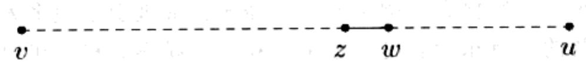
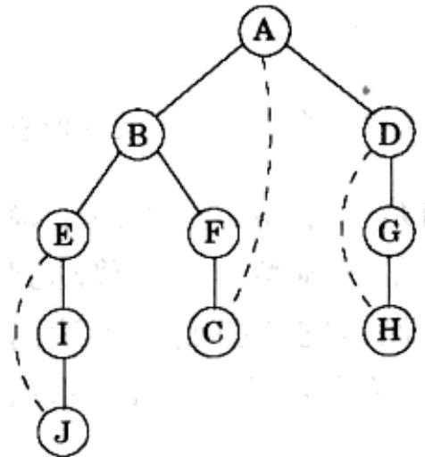
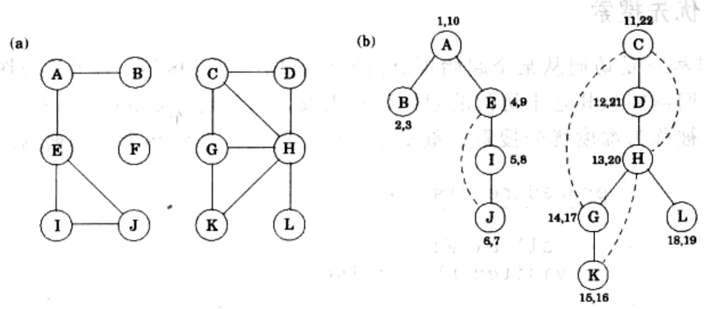

import Guide from '@/components/Guide.astro';
import Knowledge from '@/components/Knowledge.astro';
import Example from '@/components/Example.astro';
import Analysis from '@/components/Analysis.astro';
import Solution from '@/components/Solution.astro';
import Variant from '@/components/Variant.astro';
import Note from '@/components/Note.astro';
import Block from '@/components/Block.astro';
import Method from '@/components/Method.astro';
import Exercise from '@/components/Exercise.astro';
import Algorithm from '@/components/Algorithm.astro';

## 3.2 无向图的深度优先搜索

## 3.2.1 迷宫探索

深度优先搜索是一种强有力的搜索方法，它的时间耗费是线性的，能解决很多实际问题，应用它能够揭示出图的很多信息。它能够解决的基本问题如下：

给定图中的一个顶点，从该顶点出发，图中哪些部分是可到达的？

为了更好地理解这个问题，从计算机的角度考虑以下情况：给定一个新图，并且图以邻接表来表示。该表示法仅仅提供了一项基本操作：寻找给定顶点的相邻节点。仅仅借助这一基本操作，可达性问题可以转化为迷宫探索问题(如图3-2所示)。从一个给定的地点开始迷宫行走，一旦到达一个关节点(相当于顶点)，您将面对一些路径(相当于边)供您选择。如果选择不慎，结果可能使您不停地兜圈子，或是使您忽视迷宫中的一些可行的路径。显然，您需要对迷宫探索中的中间信息进行记录。

几个世纪以来，迷宫探索问题中的这一经典挑战吸引了很多人。几乎每个人都知道迷宫探索需要的所有东西就是一根细绳和一支粉笔。粉笔可以在访问过的关节点处作标记，避免兜圈子。细绳可以把您带回到出发位置，在回来的过程中，您可以知道哪些路径是您曾经发现过然而却没走过的。

我们怎样在计算机上模拟粉笔和细绳对应的这两个基本操作呢？作标记的粉笔很好模拟：对于每个顶点，维护一个布尔变量，标记该顶点是否已经访问。对于那根细绳，最好的数据结构是一个堆栈。因为细绳的作用就是提供两个基本操作——延伸以到达一个新的关节点(对应于堆栈操作就是将新顶点压入堆栈)和回溯到曾经访问的关节点(对应于堆栈的弹出操作)。

在相应的算法中我们没有明确地使用堆栈，而是通过递归(隐含地使用一个堆栈来记录当前的信息)来实现。算法的具体流程在图3-3中给出 $^{1}$ 。算法中previsit过程和postvisit过程是可选的，前者指的是当一个顶点被首次访问时对其进行的操作，后者指当一个顶点被最后一次访问时对其进行的操作。很快我们就能看到它们各自的用武之地。

```python
procedure explore(G, v)
Input: G = (V, E) is a graph; v ∈ V
Output: visited(u) is set to true for all nodes u reachable from v

visited(v) = true
previsit(v)
for each edge (v, u) ∈ E:
    if not visited(u): explore(u)
postvisit(v)
```  
图 3-3 寻找从给定顶点出发的所有可达顶点

当前，我们首先要确定的是 explore 过程的正确性。它的确没有怎么偏离我们的既定目标，因为它只是进行了一项操作——移动到顶点的相邻顶点。因此，它永远不会跳出顶点 v 可达区域。但是它能找到 v 可达的所有顶点吗？我们不妨采用反证法：假设 explore 过程错过了某个可达顶点 u，那么我们可以选择从 v 到 u 的任意一条路径，并查看explore过程在该路径上实际访问过的最后一个顶点，记它为 $z$ 并记 $\pmb{w}$ 为该路径上 $z$ 的直接后继顶点。



这时会出现顶点 $z$ 被访问过，而顶点 $w$ 没有被访问过的情况。于是出现了矛盾：由于explore过程访问过顶点 $z$ ，而 $w$ 是 $z$ 的相邻顶点，按理explore过程会发现顶点 $w$ ，并访问它。从而假设不成立，explore过程的正确性得到了确认。

需要指出的是，以上的这种推理模式在图的研究中将会经常出现，它实质上是一种简化的归纳法。更正式的归纳证明过程通常由一个基本假设出发，例如“对于任意的 $k \geqslant 0$ ，从顶点 $\nu$ 出发最多经过 $k$ 次跳跃（一次跳跃对应于一个从当前顶点到其相邻顶点的操作）后可达的顶点都已被访问”。归纳法的基准情况通常都是显然成立的，在本例中顶点 $\nu$ 显然被访问过。同时，如果一般情况也成立——从顶点 $\nu$ 出发最多经过 $k$ 次跳跃可达的顶点都被访问过，那么从顶点 $\nu$ 出发最多经过 $k + 1$ 次跳跃可达的顶点也将都被访问过——恰好是我们要证明的结论。

图3-4阐明了前面给出的图例上运行explore过程的结果，该过程从顶点 $A$ 出发，一旦需要在多个顶点中选出一个进行访问时就按照字母表顺序来做抉择。图中的实线边代表那些实际上被检查过的边，每一条边都调用了一次explore过程，调用过程将发现一个新的顶点。例如，当前访问到顶点 $B$ ，发现存在一条边 $B - E$ ，而 $E$ 并未被访问过，这条边就通过调用explore(E)过程被检查。这些实线边形成了一棵树(一个没有环的连通图)，从而这些边被称为树边。虚线边被忽略，因为它们将我们带回到熟悉的区域，即那些曾经访问过的顶点。虚线边被称为回边。

  
图3-4 在图3-2中的图上运行explore(A)的结果

## 3.2.2 深度优先搜索

explore 过程只是访问从某个起始顶点出发可达的一部分区域。为了检查图中的剩余部分，我们需要从其它未访问的起始顶点出发，重新运行 explore 过程。图 3-5 中给出的算法被称为深度优先搜索。重复进行这个过程，直到整个图都被遍历。

<div class="mineru-algorithm">
procedure dfs(G)
for all  $v \in V$ :
visited(v) = false
for all  $v \in V$ :
if not visited(v): explore(v)
</div>

图3-5 深度优先搜索

分析 DFS 的运行时间之前需要注意以下观察结论：每个顶点仅调用 explore 过程一次。该结论要归功于对已访问数组(作标记的粉笔)的维护。在访问一个顶点的过程中，进行了以下步骤：

1. 一些常量时间的操作——标记一个顶点被访问，以及 pre/postvisit 操作。

2. 一个对邻边进行遍历的循环，以确定该遍历过程能否将整个搜索过程引向未曾访问的区域。

对于每个顶点，该循环的时间耗费是有差异的。因此，我们需要考虑所有的顶点。步骤1的所有工作的时间耗费是 $O(|V|)$ 。对于步骤2，整个DFS过程中，每条边 $\{x, y\} \in E$ 恰被检查两次，一次是在explore $(x)$ 的过程中，一次是在explore $(y)$ 的过程中。从而整个步骤2的时间耗费是 $O(|E|)$ ，所以深度优先搜索的运行时间是 $O(|V| + |E|)$ ，是算法输入规模的线性函数。这已经达到了我们想要效率的极限，因为即使仅仅将邻接表读入计算机的内存也需要这样的时间耗费。

图 3-6 给出了在一张含有 12 个顶点的图上运行深度优先搜索的结果, 其中仍然采用了字母表顺序作为在多个顶点间选定一个访问方向的依据(当前可以先忽略图上标注的数字对)。DFS 的外层循环调用了三次 explore 过程, 先是在顶点 A 和 C 上, 最后是在顶点 F 上。DFS 的运行结果是生成了三棵树, 每一棵分别以起始顶点 A、C 和 F 作为根。三棵树一起构成了一个森林(forest)。

  
图 3-6 (a)一张含有 12 个顶点的图 (b)DFS 生成的森林

## 3.2.3 无向图的连通性

一个无向图被称为是连通的当且仅当在任意两个顶点之间存在一条可达路径。图3-6中的图是非连通的，因为，比如在顶点 $A$ 和 $K$ 之间就没有路径可达。但是，该图却含有彼此分离的三个连通区域，分别对应于以下的顶点集合：

$$
\{A, B, E, I, J \} \quad \{C, D, G, H, K, L \} \quad \{F \}
$$

这些区域被称为连通部件：每一个都是原图的一个子图，并且内部顶点间彼此相连通，但却与区域外，即原图中的其他顶点间没有边可达。当 explore 过程从一个特定的顶点开始，该过程就能确定一个包含该顶点的连通部件。DFS 的外部循环每调用 explore 过程一次，就能够生成一个新的连通部件。

因此，对深度优先搜索进行少许调整就可以用来检查一个图是否是连通的，更一般的，如果为每个顶点 $\nu$ 指定一个整数ccnum[v]，就可以确定该顶点所属的连通部件。所需的全部操作如下：

```txt
procedure previsit(v)
ccnum[v] = cc
```

其中 cc 需要初始化为 0，当 DFS 过程每次调用 explore 时对它进行加 1 操作。

## 3.2.4 前序和后序

我们已经认识到深度优先搜索如何通过几行实用的代码，仅仅在线性时间内就揭示出了无向图结构的连通性信息。然而深度优先搜索的应用远远不止这些。为了列举它的其他应用，我们将在图的遍历过程中多搜集一些信息：对于每个顶点，我们将记录下两个重要事件发生的时间，一个是每个顶点最先被访问(对应于 previsit 过程)的时刻，另一个是最后离开(对应于 postvisit)每个顶点的时刻。图 3-6 中给出了前述例子中的这些时间信息，图中一共有 24 个事件。第 5 个事件是首次访问顶点 I。第 21 个事件是最后离开顶点 D。

生成含有时间信息的数组 pre 和 post 的一种方法是定义一个简单的时钟，初始时刻设为 1，时钟以以下方式进行时间更新：

```matlab
procedure previsit(v)
pre[v] = clock
clock = clock + 1

procedure postvisit(v)
post[v] = clock
clock = clock + 1
```

以上计时过程的重要性很快就会显现出来。同时，您或许会从图3-4中发现以下结论：

性质 对于任意的顶点 $u$ 和 $v$ , $[pre(u), post(u)]$ 和 $[pre(v), post(v)]$ 两个区间要么彼此分离, 要么一个包含另一个。

为什么呢？因为区间 $[pre(u), post(u)]$ 实质上是顶点u在堆栈中的时间段。而堆栈的后进先出的特点让剩余的解释不言自明。
