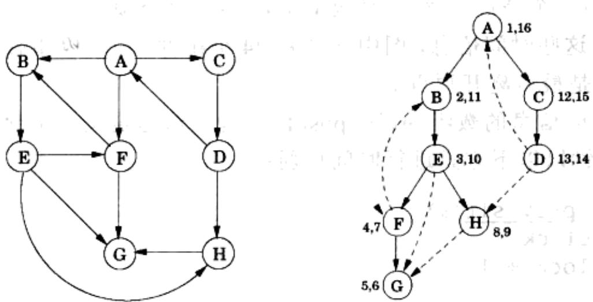
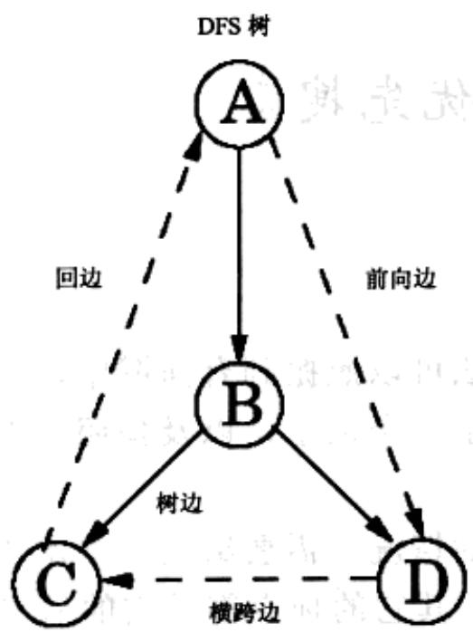
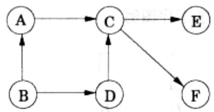

import Guide from '@/components/Guide.astro';
import Knowledge from '@/components/Knowledge.astro';
import Example from '@/components/Example.astro';
import Analysis from '@/components/Analysis.astro';
import Solution from '@/components/Solution.astro';
import Variant from '@/components/Variant.astro';
import Note from '@/components/Note.astro';
import Block from '@/components/Block.astro';
import Method from '@/components/Method.astro';
import Exercise from '@/components/Exercise.astro';
import Algorithm from '@/components/Algorithm.astro';

## 3.3 有向图的深度优先搜索

## 3.3.1 边的类型

前述的深度优先搜索算法可以照搬到有向图中，只是要注意按照边的指定方向来检查每条边。图3-7给出了一个例子，以及按照字典序排列顶点时运行深度优先搜索得到的树。

为了进一步分析有向图的情况，需要给出一些术语，以利于表达树的顶点间的重要关系。 $A$ 是搜索树的根；其它的顶点都是它的后裔。类似地，顶点 $E$ 的后裔是顶点 $F, G$ 和 $H$ , 反过来, 顶点 $E$ 是这三个顶点的祖先。这种与家庭关系的类比可以进一步扩展: 顶点 $C$ 是顶点 $D$ 的父顶点, D 是 C 的子顶点。

  
图 3-7 在有向图上运行 DFS

对于无向图的情况，我们在树边和非树边之间进行区分。在有向图的情况下，需要对边的分类进一步细化：

树边是 DFS 森林的实际组成部分。

前向边是 DFS 树中从一个顶点指向该顶点的一个非子顶点后裔的边。

回边是 DFS 树中从一个顶点指向其祖先的边。

横跨边既不是从一个顶点指向其后裔的边，也不是指向其祖先的边；横跨边是从一个顶点指向一个已完全访问过的顶点(即就是已经在该顶点上进行了 postvisit 操作)的边。

图 3-7 中含有两条前向边，两条回边以及两条横跨边。您能分别找到它们吗？

祖先顶点和后裔顶点之间的关系，以及边的类型都可以直接从 pre 值和 post 值中获得。由于采用的是深度优先搜索策略，所以顶点 u 是 v 的一个祖先恰好对应于在图的遍历中，u 先被访问，v 在调用 explore(u) 的过程中被访问的情况。这就意味着有 pre(u) &lt; pre(v) &lt; post(v) &lt; post(u) 成立，可以借助两个嵌套的区间来形象地解释该式：

$$
\left[ \begin{array}{c c c c} & & \\ u & v & & \end{array} \right] \quad \left[ \begin{array}{c c c c} & & \\ & v & & u \end{array} \right]
$$

后裔顶点和祖先顶点之间的关系是对称的，因为顶点 $u$ 是 $\nu$ 的一个后裔当且仅当 $\nu$ 是 $u$ 的一个祖先。而由于边的分类是完全基于祖先-后裔关系的，所以边的类型信息也能够从pre值和post值中得到。以下是针对边 $(u, v)$ 的不同可能类型的总结：

$$
\begin{array}{c c c c} \text {针对边} (u, v) \text {的前序/后序图例} \\ \left[ \begin{array}{l l l l} & [ & ] & ] \\ u & v & v & u \\ \hline [ & [ & ] & ] \\ v & u & u & v \\ \hline [ & ] & [ & ] \\ v & v & u & u \end{array} \right] \end{array}
$$

边的类型

树边/前向边

回边

您可以通过查询以上针对边的类型的图表来确认每种边的特征。您知道为什么边没有可能再出现其他类型吗？

## 3.3.2 有向无环图

有向图中的一个环是指一个形如 $v_{0} \rightarrow v_{1} \rightarrow v_{2} \rightarrow \cdots \rightarrow v_{k} \rightarrow v_{0}$ 的循环路径。图 3-7 给出的图中就含有一些环，比如， $B \rightarrow E \rightarrow F \rightarrow B$ 。没有环的图称为无环的。事实证明我们可以在线性时间内验证图的无环性，验证过程只需进行一次深度优先搜索即可。

性质 有向图含有一个环当且仅当深度优先搜索过程中探测到一条回边。

证明：充分性的证明相对简单：如果 $(u, v)$ 是一条回边，那么将存在一个包含该回边以及搜索树中从 $v$ 到 $u$ 的路径的环。

反过来，对于必要性的证明如下：如果一个图含有一个环 $v_{0} \rightarrow v_{1} \rightarrow \cdots \rightarrow v_{k} \rightarrow v_{0}$ ，考察该环中最先被访问的顶点（即就是 pre 值最低的顶点）。假设该顶点为 $v_{i}$ 。 $v_{i}$ 对环上其他任意顶点 $v_{j}$ 均可达，从而环上的其它顶点均为 $v_{i}$ 在搜索树中的后裔。特别的，边 $v_{i-1} \rightarrow v_{i}$ （当 i=0 时，即为边 $v_{k} \rightarrow v_{0}$ ）是一条从某顶点出发指向其祖先的边，按照定义即为回边。

有向无环图或者简称为 dags，在现实中普遍存在。它可以方便地对某些关系进行建模，如因果关系、层次关系以及时序依赖关系。例如，假设您需要完成很多任务，但是在其中的一些任务完成之前其他任务不能开始（举个最生活化的例子：在您起床之前您得先睡醒，您得在已经起床之后，但还没有着装之前洗澡，如此等等）。这样问题就来了，执行这些任务的合理顺序是什么？

  
图3-8 有向无环图的一个例子，它含有一个源点、两个汇点以及四个可能的线性序

以上这些任务之间的约束可以很方便地用有向图来表示。其中，每个顶点代表一项任务，当任务 $u$ 是任务 $\nu$ 的前提条件时，从 $u$ 到 $\nu$ 就存在一条边。换言之，在执行一项任务之前，指向该任务的所有任务都得先完成。如果这张图有环，那么想要完成所有任务就没什么希望了：因为不存在一个合理的任务执行顺序。另一方面，如果该图是一个有向无环图，我们将寻求对它进行线性化(或称为拓扑排序)，就是找出图顶点的一个线性序，图的每条边都是从排序靠前的顶点指向排序靠后的顶点，以满足图中所有的优先条件。例如，在图3-8中，一个合理的排序是 $B$ 、 $A$ 、 $D$ 、 $C$ 、 $E$ 、 $F$ 。（您能否找到其他三个合理的排序吗？）

什么类型的有向无环图可以被线性化？答案很简单：所有的都可以。同时，深度优先搜索又可以告诉我们怎么实现线性化：按照顶点的 post 值的降序，简单地对图顶点执行深度优先搜索即可。因为图中只有回边 $(u, v)$ 满足 $post(u) < post(v)$ （可以参见本书 3.3.1 节中关于边的类型的图表）——从而我们发现有向无环图中不含有回边，并有以下结论成立：

## 性质 在有向无环图中，每条边都指向一个 post 值更小的顶点。

该性质为我们提供了一个对有向无环图中的顶点进行排序的线性时间算法。同时，结合我们早先的观察结论，该性质告诉我们：以下三个在深度优先搜索中出现的看似不同的性质——无环性、可线性化以及无回边性——实际上是一回事。

既然有向无环图可以通过对顶点的 post 值降序进行线性化，则 post 值最小的顶点一定出现在线性序的末尾，从而它一定是汇点——出度为 0。对称地，post 值最大的顶点是源点，该顶点的入度为 0。

性质 每个有向无环图至少含有一个源点和一个汇点。

源点存在性的保证给出了另一种线性化的方法：

找到一个源点，输出它，然后将它从图中删除。

重复以上过程直至图为空。

该方法针对任何有向无环图都能产生一个有效线性序，您知道其中的原因吗？如果图中含有环结果又会怎样？另外，怎样在线性时间内实现该算法？(参见习题3.14)
