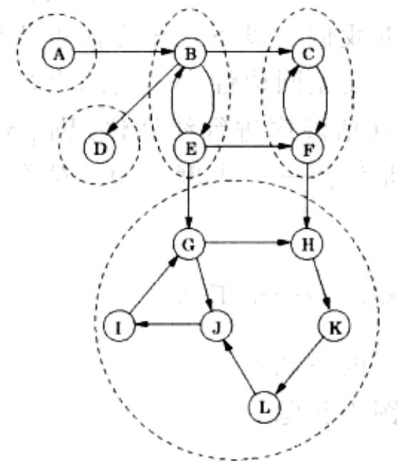
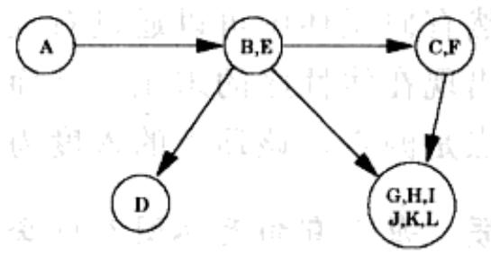
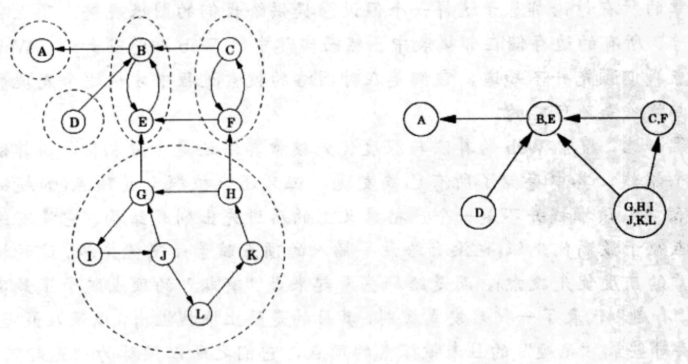

import Guide from '@/components/Guide.astro';
import Knowledge from '@/components/Knowledge.astro';
import Example from '@/components/Example.astro';
import Analysis from '@/components/Analysis.astro';
import Solution from '@/components/Solution.astro';
import Variant from '@/components/Variant.astro';
import Note from '@/components/Note.astro';
import Block from '@/components/Block.astro';
import Method from '@/components/Method.astro';
import Exercise from '@/components/Exercise.astro';
import Algorithm from '@/components/Algorithm.astro';

## 3.4 强连通部件

## 3.4.1 定义有向图的连通性

无向图中的连通性相当直观：一张不连通的图可以用一种自然且显而易见的方式分解成几个连通部件(图3-6给出了一个相应的例子)。正如我们在3.2.3节中所见，深度优先搜索可以很方便地做到这一点，每执行一次深度优先搜索就能生成一个连通部件。

在有向图的情况下，连通性显得更加微妙。从较基本的意义来讲，图3-9(a)给出的有向图是“连通的”——它无法被“分开”，或者说，它没有断裂的边。但是这种意义上的“连通”既无趣又不蕴含有效信息。实际上该图不能被视为是连通的，比如，从顶点 $G$ 到 $B$ ，或从 $F$ 到 $A$ 都没有路径可达。以下是有向图中定义连通性的恰当方式：

(b)

我们称有向图中的两个顶点 $u$ 和 $v$ 是连通的(connected)，当从顶点 $u$ 到 $v$ ，以及从 $v$ 到 $u$ ，各存在一条路径。

(a)  

  
图 3-9 (a) 一个有向图的例子及其强连通部件 (b) 图元

这一连通关系将顶点集合 V 划分成一系列分离集(见习题 3.30)，我们称这些分离集为强连通部件。图 3-9(a)给出的图中含有 5 个强连通部件。

现在将每个强连通部件缩微成一个单独的超级节点，同时，如果从一个强连通部件的某个内部顶点到另一个强连通部件的某个内部顶点间有边可达(同向的)，则从前者对应的超级节点向后者对应的超级节点画一条有向边(如图3-9(b)所示)。由此得到的图元一定是有向无环图。原因很简单：一个包含不同强连通部件的环将把这些强连通部件合并为一个更大的强连通部件。让我们重述这个结论：

性质 每个有向图关于其强连通部件都是一个有向无环图。

该性质传递了一些重要信息：有向图的连通结构是两个层次上的。在顶层，我们有一个有向无环图，它的结构相对简单——比如，它能够被线性化。如果我们想要进一步关注于细节，我们可以查看该有向无环图节点的内部结构，研究其中的强连通部件的全貌。

## 3.4.2 一个有效的算法

将有向图分解为强连通部件是十分有用的，它能够提供许多有意义的信息。幸运的是，事实证明，通过进一步使用深度优先搜索过程，有向图的分解能够在线性时间内实现。相应的算法基于我们已经了解的一些性质，在此我们对这些性质作进一步的强调。

性质1 如果explore子过程从顶点 $u$ 开始, 那么该子过程恰好在从 $u$ 可达的所有顶点都已访问之时终止。

因此，如果我们在汇点强连通部件(超图中的汇点对应的原图中的强连通部件)中的某个顶点上调用了explore过程，则我们将恰好获得该强连通部件。图3-9中含有两个汇点强连通部件。例如，从顶点 $K$ 开始explore过程，我们将在完全遍历两个汇点强连通部件中的较大部件之后终止。

该性质提供了确定强连通部件的一种方法，但是仍然留下两个悬而未决的关键问题：(A)我们怎样发现位于汇点强连通部件中的一个顶点，同时还要确定它一定位于该强连通部件中？(B)一旦发现了一个汇点强连通部件，接下来该怎么办？

让我们从问题(A)开始。不存在一种简单直接的方法，能够挑选出一个顶点，并保证它一定位于一个汇点强连通部件中。然而却存在一种方法，能够得到源点强连通部件中的一个顶点。

性质2 在深度优先搜索中得到的 post 值最大的顶点一定位于一个源点强连通部件中。

该性质基于以下更一般的性质：

  
图 3-10 图 3-9 中所给图的反转

性质3 如果 $C$ 和 $C'$ 是强连通部件，同时从 $C$ 中的一个顶点到 $C'$ 中的一个顶点存在一条边，则 $C$ 中 post 的最大值要大于 $C'$ 中 post 的最大值。

证明：为了证明性质3，需要考虑以下两种情况。如果深度优先搜索在部件 $C$ 之前先访问了部件 $C$ ，那么很明显，在该过程无法继续进行下去之前， $C$ 和 $C^{\prime}$ 中的所有顶点都已被遍历(参见性质1)。因此， $C$ 中被访问的第一个顶点的post值将大于 $C^{\prime}$ 中任何顶点的post值。另一方面，如果部件 $C^{\prime}$ 被先访问，那么深度优先搜索过程将在遍历了 $C^{\prime}$ 中所有顶点之后，但却在访问 $C$ 中任意顶点之前陷入阻塞状态，这种情况下，性质3显然成立。

性质3能够被重述为以下形式：强连通部件能够通过按照其各自内部顶点的post最大值的降序排列，实现线性化。这是我们之前的有向无环图线性化算法的一般形式；在有向无环图中，每个顶点都是一个单独的强连通部件。

性质2辅助我们找到图 $G$ 的源点强连通部件中的一个顶点。但是，我们所需的是汇点强连通部件中的顶点。我们的方法提供的结果看起来恰恰与我们的需求相反！不过，考虑图 $G$ 的反转图 $G^R$ ，它的边的方向与图 $G$ 的边的方向相反，其他保持不变(如图3-10所示)， $G^R$ 与 $G$ 含有完全相同的强连通部件(您知道其中的原因吗？)。因此，如果我们对 $G^R$ 进行深度优先搜索，post值最大的顶点将来自于 $G^R$ 中的一个源点强连通部件，相应的也就是 $G$ 中的汇点强连通部件。我们终于解决了问题(A)!

<Knowledge title="专栏: 搜索得更快">

本章的所有讨论都基于这样一个假设：提供给我们的图很规整，顶点从1到 $n$ 挨个编号，所有的边存储在邻接表中。然而实际中的Web却绝非如此。Web对应的图的顶点我们预先并不知道，它们是在对网络的搜索过程中才被逐个发现的。很显然，递归操作是不可能的。

尽管如此，搜索 Web 的算法与深度优先搜索算法还是十分相似。该算法显式维护了一个堆栈，其中存储了所有已被发现，但又还未被探索的顶点(如超链接的端点)。实际上，该堆栈并不是一个严格意义上的后进先出列表结构。它没有给最近插入的顶点赋予最高优先级(也没有给最早插入的顶点赋予最高优先级，这种情况对应于第 4 章的广度优先搜索)，而是给那些看起来最“有趣”的顶点赋予了最高优先级——最“有趣”代表了一种启发式规则，其目的是防止堆栈溢出，以及在最差情况下，仅仅丢弃那些最“无趣”的且未被探索的顶点，它们之所以被称为“无趣”，是因为它们把搜索过程引向新的宽广区域的可能性最小。

实际上，对网络的搜索过程通常是由很多网络上的主机同时运行 explore 实现的：每台主机从堆栈顶端弹出一个顶点，作为下一个要探索的顶点，下载 http 文件（一种互相指向对方的 Web 文件），并对它进行扫描以寻找超链接。但是当在超链接的一端找到一个新的 http 文件后，不再调用任何的递归过程：取而代之的是，在中枢堆栈中插入一个新顶点。

然而仍存在一个问题：当我们发现一个“新”文件，我们又如何得知它是否真的是新文件，即是在对网络的搜索中从来没有发现过的？另外，我们怎样给它起一个名字，以便将它插入到堆栈中，并标记为“已发现的”？答案是借助于散列表。

顺便指出的是，已经有研究者尝试在 Web 上运行强连通部件算法，并发现了一些有意思的结构。

接下来考虑问题(B)。当确定了第一个汇点强连通部件之后，我们随后该怎么做？性质3仍然提供了答案。一旦我们找到了第一个汇点强连通部件，就将它从图中删除，得到的新图中的post值最大的顶点一定在新图中的一个汇点强连通部件中。从而我们可以重复使用这种基于针对 $G^R$ 的深度优先搜索的顶点post值排序操作，输出图的第二个强连通部件，再输出第三个，直到输出所有的强连通部件为止。相应的算法如下：

1. 在图 $G^R$ 上运行深度优先搜索。

2. 在图 $G$ 上运行无向图连通部件算法(见3.2.3节)，在深度优先搜索的过程中，按照step1得到的顶点post值的降序逐个处理每个顶点。

该算法是线性时间算法，与深度优先搜索算法的差异仅仅在于该算法运行时间函数线性项的常系数大约是深度优先搜索的两倍。(问题：怎样在线性时间内创建图 $G^{R}$ 的一个邻接表表示？另外，怎样在线性时间内按照顶点post值的降序对G的顶点排序？)

让我们在图3-9给出的图上运行该算法。如果步骤1按照顶点的字典序进行，那么该算法为step2创建的顶点顺序(即就是，在图 $G^R$ 上执行深度优先搜索得到的顶点post值的降序)是： $G$ 、 $I$ 、 $J$ 、 $L$ 、 $K$ 、 $H$ 、 $D$ 、 $C$ 、 $F$ 、 $B$ 、 $E$ 、 $A$ 。从而step2按照以下顺序逐个得到强连通部件： $\{G,H,I,J,K,L\}$ 、 $\{D\}$ 、 $\{C,F\}$ 、 $\{B,E\}$ 、 $\{A\}$ 。

</Knowledge>
