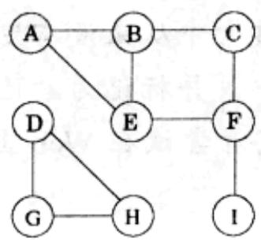
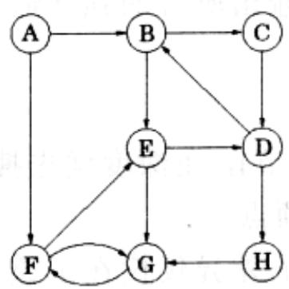
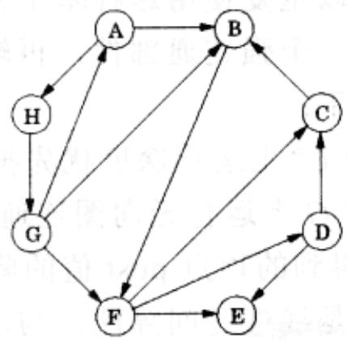
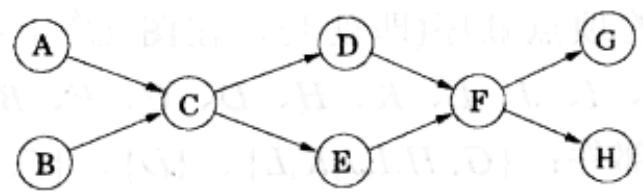
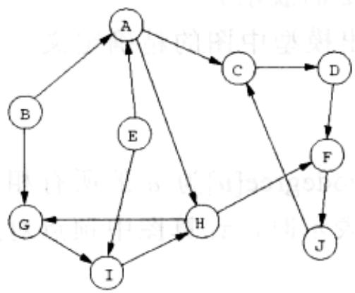
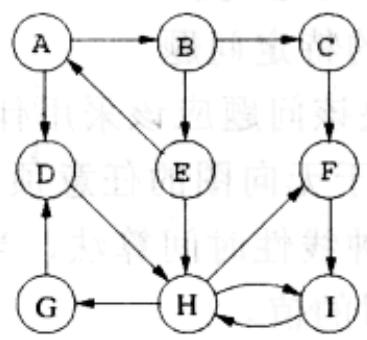
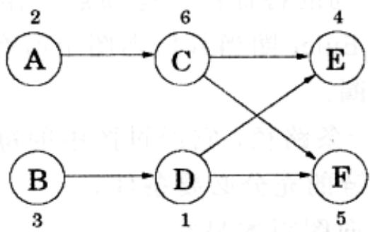
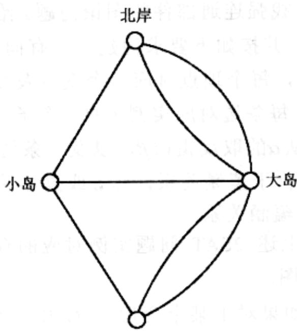
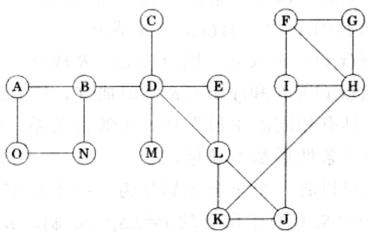

import Guide from '@/components/Guide.astro';
import Knowledge from '@/components/Knowledge.astro';
import Example from '@/components/Example.astro';
import Analysis from '@/components/Analysis.astro';
import Solution from '@/components/Solution.astro';
import Variant from '@/components/Variant.astro';
import Note from '@/components/Note.astro';
import Block from '@/components/Block.astro';
import Method from '@/components/Method.astro';
import Exercise from '@/components/Exercise.astro';
import Algorithm from '@/components/Algorithm.astro';

## 第3章 习题

<Exercise title="习题 3.1">

在下图上运行深度优先搜索；如果遇到需要在多个顶点间进行选择的情况，按照顶点的字母序进行。给出每条边是树边还是回边的分类，并给出每个顶点的 pre 和 post 值。

</Exercise>

<Exercise title="习题 3.2">

在以下两个图上分别运行深度优先搜索；如果遇到需要在多个顶点间进行选择的情况，按照顶点的字母序进行。给出每条边是树边、前向边、回边还是横跨边的分类，并给出每个顶点的 pre 和 post 值。

  
(a)

  
(b)

</Exercise>

<Exercise title="习题 3.3">

在下图上运行基于 DFS 的拓扑排序算法。如果遇到需要在多个顶点间进行选择的情况，按照顶点的字母序进行。

(a) 给出每个顶点的 pre 和 post 值。

(b) 该图的源点和汇点分别是哪个顶点？

(c) 该算法生成的拓扑排序什么？

(d) 该图含有几个拓扑排序？

</Exercise>

<Exercise title="习题 3.4">

在以下两个有向图 $G$ 上分别运行强连通部件算法。当在 $G^R$ 上运行DFS时：如果遇到需要在多个顶点间进行选择的情况，按照顶点的字母序进行。

针对每个图回答以下问题。

(a) 强连通部件(SCCs)生成的顺序是什么？

(b) 源点 SCCs 和汇点 SCCs 分别是什么？

(c) 画出图 G 的 “超图” (超图的每个节点是 G 的一个 SCC)。

(d) 要使得图 $G$ 强连通，您至少应该向图 $G$ 中添加几条边？

  
(i)

  
(ii)

</Exercise>

<Exercise title="习题 3.5">

有向图 $G = (V, E)$ 的反转是一个新的有向图 $G^R = (V, E^R)$ ，图 $G^R$ 与图 $G$ 具有相同的顶点集合，不过图 $G^R$ 把图 $G$ 所有边的方向反转过来；即有， $E^R = \{(v, u): (u, v) \in E\}$ 。

请给出一种线性时间算法，当图用邻接表表示时，给出图的反转。

</Exercise>

<Exercise title="习题 3.6">

在无向图中，顶点 $u$ 的度 $d(u)$ 是 $u$ 具有的相邻顶点数，同时也等于与 $u$ 关联的边的数目。在有向图中，我们又进一步将其细分为入度(indegree) $d_{in}(u)$ 和出度 $d_{out}(u)$ ，前者是指向 $u$ 的边的数目，后者是离开 $u$ 的边的数目。

(a) 证明在无向图中， $\sum_{u\in V}d(u) = 2|E|$ 。

(b) 利用(a)的结论证明在无向图中，度为奇数的顶点数目一定为偶数。

(c) 在有向图中，度为奇数的顶点数目仍然是偶数吗？

</Exercise>

<Exercise title="习题 3.7">

二部图是这样的图 $G = (V, E)$ ，其顶点集合可以被划分为两个子集 $(V = V_{1} \cup V_{2}$ 且 $V_{1} \cap V_{2} = \phi)$ ，并且子集内部的顶点之间没有边相连（例如，如果 $u, v \in V_{1}$ ，那么 $u$ 和 $v$ 之间没有边相连）。

(a) 请给出一种线性时间算法，确定一个无向图是否是二部图。

(b) 以下这条性质有很多种表述方式。例如，一种表述方式是：无向图是二部图当且仅当仅用两种颜色就可以为它着色。

证明以下表述：无向图是二部图当且仅当它不包含长度为奇数的环。

(c) 当一个无向图仅有一个长度为奇数的环时，为它着色最多需要多少种颜色？

</Exercise>

<Exercise title="习题 3.8">

注水问题。现有三个容器，容积分别为 10 品脱，7 品脱和 4 品脱。其中，7 品脱和 4 品脱的容器是满的，正开始向外排水，而 10 品脱的容器此时是空的。当前我们只能进行一种操作：将一个容器的水注入另一个容器，注水操作只能在源容器已空或目标容器已满的情况下停止。我们想要知道，是否存在一个合理的注水顺序，使得 7 品脱或 4 品脱的容器中恰好剩余 2 品脱水。

(a) 将该问题建模成一个图的问题：给出模型中图的精确定义，并给出针对该图需要解决的特定问题。

(b) 解决该问题应该采用什么算法？

</Exercise>

<Exercise title="习题 3.9">

对于无向图的任意顶点 $u$ ，定义twodegree $[u]$ 为 $u$ 的所有相邻顶点的度之和。给出一种线性时间算法，当图用邻接表表示时，计算图中顶点对应的整个数组twodegree[·]的值。

</Exercise>

<Exercise title="习题 3.10">

用非递归的方式(即显式地使用一个堆栈)重写 explore 过程(见图 3-3)。对 previsit 和 postvisit 操作的调用应置于适当位置，以使得重写后的过程与原有递归版本的效果一致。

</Exercise>

<Exercise title="习题 3.11">

给定一个无向图 $G$ 和其中的一条边 $e$ ，设计一个线性时间算法，确定 $G$ 中是否含有一个包含 $e$ 的环。

</Exercise>

<Exercise title="习题 3.12">

判断以下结论是否正确，正确就证明之，否则就给出一个反例。如果 $\{u, v\}$ 是无向图中的一条边，且在执行深度优先搜索的过程中有 post(u)&lt;post(v)，则在 DFS 生成树中，v 是 u 的祖先。

</Exercise>

<Exercise title="习题 3.13">

无向图连通性和有向图连通性。

(a) 证明在任意的连通无向图 $G = (V, E)$ 中，存在这样一个顶点 $v \in V$ ，删除它， $G$ 仍然连通。(提示：考虑 $G$ 的 DFS 搜索树。)

(b) 给出一个满足如下要求的强连通有向图 $G = (V, E)$ ，对于任意的 $v \in V$ ，将 $v$ 从 $G$ 中删除后，新产生的图不再强连通。

(c) 在一个包含 2 个连通部件的无向图中，通常可以通过添加一条边使得该无向图连通。给出一个满足如下要求的有向图，它包含两个强连通部件，一条边都不

用添加，就可以使得该图强连通。

</Exercise>

<Exercise title="习题 3.14">

本章提供了一种对图进行线性化(拓扑排序)的算法, 它通过从图中不断删除源点实现(见 3.3.2 节)。证明该算法可以在线性时间内实现。

</Exercise>

<Exercise title="习题 3.15">

Computopia 市警察局为该市制定的交通规则是所有的街道都是单行的。而市长认为从市内的任一十字路口到另一十字路口之间应该还要有另一条合法的路线才行，不过该主张还未能谋求到反对派的支持。需要设计一个计算机程序，以确定市长的主张是否正确。然而，市内选举在即，所剩时间无几，只能允许设计一个线性时间算法。

(a) 从图论的观点描述该问题，并说明为什么该问题能够在线性时间内解决。

(b) 假定现在事实证明市长最初的观点是错误的。她随后又提出了一个妥协方案：如果您驱车从市政厅出发，沿着单行街道前进，那么不管您要到哪里，总会有一条路线让您合法地驶回市政厅。将该妥协方案描述成一个图论问题，并详细证明能在线性时间内确定该方案的正确性。

</Exercise>

<Exercise title="习题 3.16">

假定一个 CS 所选的全部课程包含 $n$ 门课，而且它们都是必修课。图 $G$ 中的每个顶点代表一门课程，从课程 $\nu$ 到课程 $w$ 存在一条边当且仅当 $\nu$ 是 $w$ 的先决课程。设计一个算法，使其能够直接在该图上运行，并计算完成全部课程所需的最小学期数(假设一个学生可以在一个学期内选任意门课)。该算法的运行时间必须为线性时间。

</Exercise>

<Exercise title="习题 3.17">

无穷路径。令 $G = (V, E)$ 表示一个有向图，并指定一个“起始顶点” $s \in V$ ，一个“优等”顶点集合 $V_G \subseteq V$ ，以及一个“劣等”顶点集合 $V_B \subseteq V$ 。图 $G$ 的一条无穷路径 $p$ 是一个含有无穷多个顶点的序列 $v_0 v_1 v_2 \cdots$ ，其中 $v_i \in V$ ，并满足以下条件(1) $v_0 = s$ ，(2)对于所有的 $i \geqslant 0, (v_i, v_{i+1}) \in E$ 。这意味着， $p$ 是 $G$ 中的一条从顶点 $s$ 开始的无穷路径。由于集合 $V$ 中边的数目是有限的，则 $G$ 中的每条无穷路径一定访问了某些顶点无穷多次。

(a) 如果 $p$ 是一条无穷路径，令 $\operatorname{Inf}(p) \subseteq V$ 表示满足以下条件的顶点的集合，它们在 $p$ 中出现了无穷多次。证明 $\operatorname{Inf}(p)$ 是 $G$ 中一个强连通部件的子集。

(b) 给出一个算法，确定 $G$ 中是否含有一条无穷路径。

(c) 给出一个算法，确定 $G$ 中是否含有一条满足以下条件的无穷路径，它访问了 $V_{G}$ 中的某些优等顶点无穷多次。

(d) 给出一个算法，确定 $G$ 中是否含有一条满足以下条件的无穷路径，它访问了 $V_{G}$ 中的某些优等顶点无穷多次，但却没有访问过 $V_{B}$ 中的任何劣等顶点无穷多次。

</Exercise>

<Exercise title="习题 3.18">

给定一个二叉树 $T = (V, E)$ (用邻接表表示)，并指定其根节点 $r \in V$ 。回顾讲述过的内容，有以下结论成立：在树中 $u$ 被称为是 $v$ 的祖先，当在 $T$ 中从 $r$ 到 $v$ 的路径经过 $u$ 。

您想要通过对树进行预处理操作，使得形如“u 是否是 v 的祖先”的问题可以在常量时间内得到解答。预处理操作自身应该在线性时间内完成。预处理操作该如何进行？

</Exercise>

<Exercise title="习题 3.19">

在上一个问题中，给定一个指定了根节点的二叉树 $T = (V, E)$ 。另外，对 $V$ 中的所有节点维护了一个数组 $x[\cdot]$ 。对每个节点 $u \in V$ ，定义一个新数组 $z[\cdot]$ 如下：

$z[u]=u$ 的所有后裔节点关联的 x 值的最大值。

给出一个线性时间算法，计算整个 z 数组的值。

</Exercise>

<Exercise title="习题 3.20">

给定一个树 $T = (V, E)$ ，并指定其根节点 $r \in V$ 。任意节点 $v \neq r$ 的父节点，记为 $p(v)$ ，定义为从 $r$ 到 $v$ 的路径上与 $v$ 相邻的节点。通常令 $p(r) = r$ 。对于 $k > 1$ ，定义 $p^k(v) = p^{k-1}(p(v))$ 以及 $p^1(v) = p(v)$ （因此 $p^k(v)$ 是 $v$ 的第 $k$ 个祖先）。

树的每个节点拥有一个相关的非负整数标签 $l(v)$ 。给出一个线性时间算法，按照以下规则更新 $T$ 中所有节点的标签值： $l_{new}(v) = l(p^{l(v)}(v))$ 。

</Exercise>

<Exercise title="习题 3.21">

给出一个线性时间算法，找出有向图中一条路径长度为奇数的环。(提示：首先假设该图是强连通的，尝试求解相应的问题。)

</Exercise>

<Exercise title="习题 3.22">

给出一个高效算法，以有向图 $G = (V, E)$ 为输入，确定图中是否存在一个顶点 $s \in V$ ，从该顶点到图中的其他所有顶点都是可达的。

</Exercise>

<Exercise title="习题 3.23">

给出一个高效算法，以有向无环图 $G = (V, E)$ 为输入，以及两个顶点 $s, t \in V$ ，输出 $G$ 中从 $s$ 到 $t$ 的不同有向路径的数目。

</Exercise>

<Exercise title="习题 3.24">

针对以下任务，给出一个线性时间算法：

输入：一个有向无环图 $G$

问题： $G$ 中是否存在一条有向路径，它恰好访问每个顶点一次？

</Exercise>

<Exercise title="习题 3.25">

给定一个有向图，其中每个顶点 $u \in V$ 都有一个相关价格 $p_u$ ，该价格是一个正整数。定义如下成本 cost 数组：对于每个顶点 $u \in V$ ，

$\mathrm{cost}[u] =$ 从 $u$ 可达的价格最低的顶点对应的价格(也包含 $\pmb{u}$ 自身)。

例如，在下图中(每个顶点的价格已标示出)，顶点 A、B、C、D、E 各自的 cost 值分别为 2、1、4、1、4、5。

设计一个算法，计算整个 cost 数组的取值(也就是计算每个顶点的 cost 值)。

(a) 给出一个针对有向无环图的线性时间算法。(提示：可以尝试按照一种特定的顺序处理顶点。)

(b) 将上一问的算法推广至所有有向图的情况。(提示：回忆一下本章曾经讲过的有向图的“两个层次”的连通结构。)

</Exercise>

<Exercise title="习题 3.26">

无向图中的一个 Eular 圈是这样一个环，它可以经过图中的每个顶点多次，但是只能经过图中的每条边恰好一次。

这一简单的概念由 Euler 在 1736 年提出，用以解决著名的哥尼斯堡七桥问题，该问题开辟了图论这一研究领域。哥尼斯堡城(现在俄罗斯北部的加里宁格勒)位于一条河流的两岸以及河中的大小两个小岛上。有七座桥横跨这条河流和这两个小岛，当时一个广为人知的有趣问题是：是否存在这样一条路线，某人从某地出发，每座桥恰好走过一次，最后返回出发地点。

Euler 将上述问题描述成一个图, 图中有 4 个顶点(代表陆地)以及七条边(代表桥梁), 如下图所示:

  
南岸

请留意该图的一个与众不同的特征：某些顶点间存在多条边相连。

(a) 证明一个无向图含有 Euler 圈当且仅当图中所有的顶点的度为偶数。并证明哥尼斯堡七桥问题没有 Euler 圈。

(b) 一个 Euler 链是这样一条路径，它经过图中的每条边恰好一次。您能否相应地给出一个无向图含有 Euler 链的充分必要条件？

(c) 您能解决问题(a)的有向图版本吗？

</Exercise>

<Exercise title="习题 3.27">

一个图中的两条路径之间称为是边分离的，如果它们之间没有公共边。证明在任意无向图中，可以将度为奇数的顶点配对，并能在每一对顶点间找到若干路径，使得这些路径是边分离的。

</Exercise>

<Exercise title="习题 3.28">

在 2SAT 问题中，给定一个子句的集合，其中每个子句是两个文字(一个文字是一个布尔变量或是一个布尔变量的取反)间的或(OR)操作。寻找一种方法，赋给每个变量 true 或者 false，使得所有的子句都被满足——也就是说，使得在每个子句中至少存在一个取值为 true 的文字。例如，以下这个 2SAT 问题的实例：

$$
\left(x _ {1} \vee \overline {{x _ {2}}}\right) \wedge \left(\overline {{x _ {1}}} \vee \overline {{x _ {3}}}\right) \wedge \left(x _ {1} \vee x _ {2}\right) \wedge \left(\overline {{x _ {3}}} \vee x _ {4}\right) \wedge \left(\overline {{x _ {1}}} \vee x _ {4}\right)
$$

该实例有一个如下的满意赋值：分别将 $x_{1}, x_{2}, x_{3}$ 和 $x_{4}$ 赋值为 true、false、false 和 true。

(a) 该 2SAT 问题实例是否存在其他的满意赋值？如果存在，找到它们。

(b) 给出一个含有 4 个变量的 2SAT 问题实例，使得该实例不存在满意赋值。

本题的意图在于引导您找到一种求解 2SAT 问题的有效方法，该方法将原问题归约成一个在有向图中寻找强连通部件的图论问题。给出一个含有 n 个变量和 m 个子句的 2SAT 问题实例 I，并按如下要求构建一个有向图 $G_{I}=(V,E)$ :

\- $G_{I}$ 含有 $2n$ 个顶点，每个顶点对应一个变量及变量的取反。

\- $G_{I}$ 含有 $2m$ 条边，每条边对应实例 $I$ 的一个子句 $(\alpha \vee \beta)$ (其中 $\alpha$ 和 $\beta$ 是文字)，

$G_{I}$ 中含有一条边从 $\alpha$ 的取反指向 $\beta$ ，以及一条边从 $\beta$ 的取反指向 $\alpha$ 。

注意到子句 $(\alpha \vee \beta)$ 等价于蕴涵关系 $\overline{\alpha} \Rightarrow \beta$ 或蕴涵关系 $\overline{\beta} \Rightarrow \alpha$ 。从这个意义上讲， $G_I$ 记录了实例 $I$ 中的所有蕴涵关系。

(c) 构建本题给出的上述 2SAT 问题实例对应的有向图，并构建(b)问题中构建的 2SAT 实例对应的有向图。

(d) 证明如下结论：如果对于某个变量 $x$ ， $G_I$ 中含有一个包含 $x$ 和 $x$ 的强连通部件，那么实例 $I$ 没有满意赋值。

(e) 证明(d)的逆命题：即如果不存在 $G_I$ 的一个强连通部件含有一个文字及该文字的取反，则该实例 $I$ 一定是可满足的。(提示：按照如下方式为变量赋值：重复地选取 $G_I$ 的一个汇点强连通部件。将该汇点强连通部件中的所有文字赋值为 true，将其中所有文字的取反赋值为 false，并删除这些文字。证明该过程最终将以发现一个满意赋值而终止。)

(f) 证明存在一个求解 2SAT 问题的线性时间算法。

</Exercise>

<Exercise title="习题 3.29">

令 $S$ 为一个有限集合。 $S$ 上的一个二元关系即为有序对 $(x, y) \in S \times S$ 组成的集合 $R$ 。例如， $S$ 可以是人的集合，每个有序对 $(x, y) \in R$ 意味着“ $x$ 认识 $y$ ”。

一个等价关系是一个满足以下三条性质的二元关系：

\- 自反性：对于所有的 $x \in S$ ，有 $(x, x) \in R$ 成立

\- 对称性：如果有 $(x,y) \in R$ 成立，则有 $(y,x) \in R$ 成立

\- 传递性：如果有 $(x,y) \in R$ 和 $(y,z) \in R$ 同时成立，则有 $(x,z) \in R$ 成立

例如，二元关系“具有相同的生日”是一个等价关系，而“父亲关系”不是等价关系，因为后者上述三条性质都不满足。

证明一个等价关系可以将一个集合 S 划分为一些不相交的子集 $S_{1}, S_{2}, \cdots, S_{k}$ (不相交即指 $S = S_{1} \cup S_{2} \cup \cdots \cup S_{k}$ 且对于所有的 $i \neq j, S_{i} \cap S_{j} = \phi$ )，并满足以下要求：

\- 任一子集中的任意两个元素间满足等价关系，即有，对任意的 $i$ ，任意的 $x, y \in S_i$ ， $(x, y) \in R$ 。

\- 不同子集中的元素间不满足等价关系，即有，对于 $i \neq j$ ，任意 $x \in S_i$ 且 $y \in S_j$ ， $(x, y) \notin R$ 。

(提示：用一个无向图表示等价关系。)

</Exercise>

<Exercise title="习题 3.30">

在本书 3.4.1 节，我们在有向图的顶点集合上定义了一个二元“连通”关系。证明它是一个等价关系(参见习题 3.29)，并证明它将顶点集合划分为不相交的强连通部件对应的子集。

</Exercise>

<Exercise title="习题 3.31">

双连通部件。令 $G = (V, E)$ 表示一个无向图。对于任意两条边 $e$ 、 $e' \in E$ ，我们称 $e \sim e'$ ，当或者有 $e = e'$ ，或者存在一个(简单)的环包含 $e$ 和 $e'$ 。

(a) 证明～是一个关于边的等价关系(参见习题3.29)。

该等价关系将边的集合划分成的等价类称为 $G$ 的双连通部件。桥是这样的一条边, 它自身构成了一个双连通部件。

一个孤立顶点是这样一个顶点，删除它将会导致图不再连通。

(b) 将下图中的边划分至不同的双连通部件，并指出其中的桥和孤立顶点。

双连通部件不仅能够划分图中边的集合，在以下情况下，它甚至差不多可以划分顶点集合：

(c) 每个双连通部件的顶点集合即为其中的边的端点对应的所有顶点组成的集合。证明两个不同双连通部件的顶点集合要么不相交，要么相交元素为一个孤立顶点。

(d) 将每个双连通部件缩减为一个单独的超级节点，每个孤立顶点保持不变。(因此，在每个双连通部件对应的超级节点和孤立顶点之间存在边相连。)证明经过以上变换后的图是一棵树。

DFS 可以被用来在线性时间内确定一个图中的双连通部件、桥和孤立顶点。

(e) 证明以下结论：DFS 树的根节点是一个孤立顶点当且仅当该根节点在树中含有不止一个子节点。

(f) 证明以下结论：DFS 树的一个非根节点 v 是一个孤立顶点当且仅当该节点含有这样一个子节点 $v'$ ，该子节点的所有后裔节点(包含它自己)都不关联有一条指向 v 的祖先的回边。

(g) 对每个顶点 $u$ ，作如下定义：

$$
l o w (u) = \min \left\{ \begin{array}{l l} p r e (u) \\ p r e (w) & \text {其中} (v, w) \text {是} u \text {的某个后裔节点} v \text {关联的回边} \end{array} \right.
$$

证明整个 low 数组的值可以在线性时间内求得。

(h) 给出一个线性时间算法，求出一个图所有的孤立顶点，桥和双连通部件。(提示：使用 low 数组确定孤立顶点，运行另一个 DFS 过程用于一次移除一个双连通部件，同时维护一个额外的堆栈，其中存储边。)

</Exercise>

