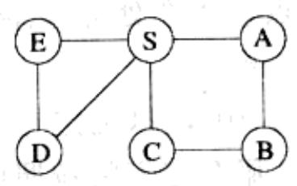
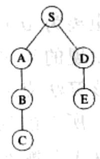
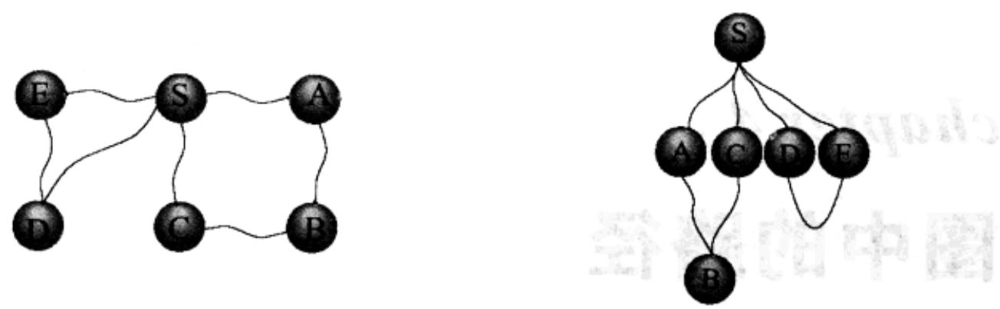

import Guide from '@/components/Guide.astro';
import Knowledge from '@/components/Knowledge.astro';
import Example from '@/components/Example.astro';
import Analysis from '@/components/Analysis.astro';
import Solution from '@/components/Solution.astro';
import Variant from '@/components/Variant.astro';
import Note from '@/components/Note.astro';
import Block from '@/components/Block.astro';
import Method from '@/components/Method.astro';
import Exercise from '@/components/Exercise.astro';
import Algorithm from '@/components/Algorithm.astro';

## 第4章 图中的路径

## 4.1 距离

利用深度优先搜索(DFS)能够很方便地确定从图中任一位置(起始点)出发可达的顶点集合。同时，它也明确地给出了从起始点到所有目标顶点的路径，并将这些路径组织在一个深度优先搜索树中(如图4-1所示)。然而，这些路径本身可能并不是最经济的。如在图4-1中，由 $S$ 只需经过一条边即可到达顶点 $C$ ，而DFS树却提供了一条长度为3的路径。就此问题，本章将主要讨论寻找图中最短路径的算法。

路径长度的概念使得我们可以定量化地讨论一张图中不同顶点间彼此分离的程度。

两个顶点之间的距离是指两者间最短路径的长度。

下面我们给出关于这个概念的一种更直观解释；考虑一张图的一个实物模型，模型中用一个球代表一个顶点，一根绳子代表一条边。如果您抓住顶点 $s$ 对应的球，并且提的足够高，在这个球下吊着的其他球即为从 $s$ 可达的顶点。要想知道从 $s$ 到达这些顶点的距离，您只需测量它们在 $s$ 下面吊着的长度即可。

  
(a)

  
(b)  
图4-1 (a)一个简单的图 (b)该图的深度优先搜索树

  
图4-2 图的一个实物模型

在图4-2的例子中，顶点 $B$ 和 $S$ 之间的距离是2，并且从 $B$ 到 $S$ 有两条最短路径。当 $S$ 被提起时，经过各条路径的绳子被拉紧了。另一方面，边 $(D,E)$ 不在任何一个最短路径中，所以它对应的绳子保持松弛状态。
