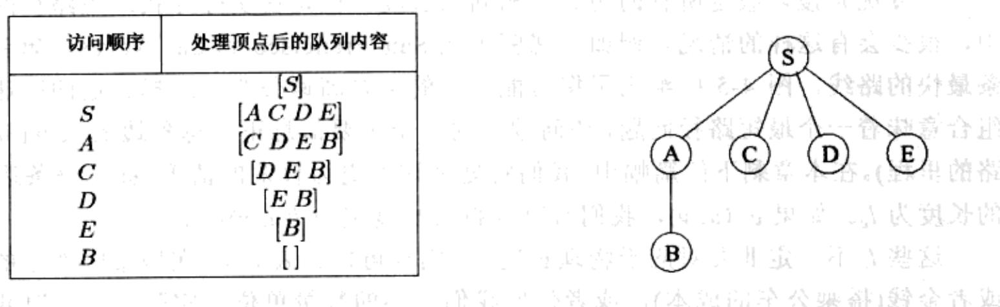

import Guide from '@/components/Guide.astro';
import Knowledge from '@/components/Knowledge.astro';
import Example from '@/components/Example.astro';
import Analysis from '@/components/Analysis.astro';
import Solution from '@/components/Solution.astro';
import Variant from '@/components/Variant.astro';
import Note from '@/components/Note.astro';
import Block from '@/components/Block.astro';
import Method from '@/components/Method.astro';
import Exercise from '@/components/Exercise.astro';
import Algorithm from '@/components/Algorithm.astro';

## 4.2 广度优先搜索

在图4-2中，提起 $s$ 将图划分成了不同的层次： $s$ 本身作为一个层次、表示与 $s$ 间距为1的顶点、接下来是与 $s$ 间距为2的顶点等。计算从 $s$ 到其他顶点的距离的一种便捷方式是按照层次逐层处理。一旦选出了与 $s$ 间距为0、1、2、...、 $d$ 的顶点，则距离为 $d + 1$ 的顶点就能很容易地确定：它们就是那些还未发现、并且与距离为 $d$ 的层次上的顶点相邻的顶点。这就提供了一种迭代算法，算法中始终有两个层次处于活跃状态：某个层次 $d$ ，该层次上的顶点已经被发现，以及层次 $d + 1$ ，其上的顶点有待于通过扫描层次 $d$ 上顶点的邻居被发现。

广度优先搜索(BFS)直接实现了这一简单推理过程(如图4-3所示)。起初队列 $Q$ 中只含有 $s$ ，即距离为0的顶点。对于每个后续的距离 $d = 1, 2, 3, \ldots, Q$ 中分别曾经一度只包含距离为 $d$ 的顶点。随着这些顶点被逐个处理(从队列的顶端删除)，这些顶点的未被发现的邻居将被插入到队列的末尾。

让我们将该算法应用于之前的例子(图 4-1 中)，以确定它的运行是否正确。如果 S 是起始点，所有的顶点按照字母序排列，那么它们将按照图 4-4 所示的顺序被逐个访问。图 4-4 右侧的广度优先搜索树包含了这些边，它们是每个顶点最初被发现时经过的边。与我们之前看到的 DFS 树不同，广度优先搜索树具有这样一个性质：它含有的从 S 出发的所有路径都是最短路径。因此它也被称为最短路径树。

```python
procedure bfs(G,s)
Input: Graph G=(V,E), directed or undirected; vertex s∈V
Output: For all vertices u reachable from s, dist(u) is set to the distance from s to u.

for all u∈V:
    dist(u)=∞

dist(s)=0
Q=[s] (queue containing just s)
while Q is not empty:
    u=eject(Q)
    for all edges (u,v)∈E:
    if dist(v)=∞:
    inject(Q,v)
    dist(v)=dist(u)+1
```  
图 4-3 广度优先搜索

## 正确性和效率

我们已经建立了广度优先搜索的基本思路。为了检验算法运行的正确性，我们需要确认该算法是否忠实地执行了这一思路。我们期望的算法行为是这样的：

对于每个 $d = 0$ 、1、2、...、都曾经有一个时刻，满足以下条件：(1)所有与 $s$ 之间的距离小于等于 $d$ 的顶点被正确设定了距离；(2)其他顶点的距离都被设定为 $\infty$ ；(3)队列中只含有与 $s$ 距离为 $d$ 的顶点。

  
图4-4 在图4-1给出的图上运行广度优先搜索的结果

对于该算法正确性的验证，我们借助了归纳思维。我们已经讨论了归纳的基准情况和归纳推理的步骤，您能自己完善其他细节吗？

与深度优先搜索相同，该算法的整体运行时间是线性的，即 $O(|V| + |E|)$ 。每个顶点进入队列恰好一次，进入队列发生在该顶点最先被发现的时候，所以有2|V次队列操作。算法的其他工作都在其最内层的循环中进行。在循环执行的过程中，该循环访问每条边一次(有向图的情况)或两次(无向图的情况)，从而花费了 $O(|E|)$ 的时间。

现在 BFS 和 DFS 同时摆在了我们面前: 如何对它们各自的探索风格进行比较? 深度优先搜索向着图的尽可能深的方向搜索, 仅当没有新的顶点可以访问时才回退。如同我们在第 3 章所见, 这种策略赋予了它一些奇妙、精巧同时又非常有用的特性。但是这也意味着 DFS 可能会选择一条漫长曲折的路径到达某一顶点, 颇有点舍近求远的味道, 正如图 4-1 所示, 两个顶点的距离实际上是很近的。广度优先搜索则可以确保按照从起始点到其他顶点距离的升序逐个访问顶点, 它是一种更宽广、更扁平的搜索过程, 与水波的传播过程有些相似。此外, 广度优先搜索的代码与 DFS 的几乎一样——只是用一个队列取代了堆栈。

另外需要注意的是 DFS 的一个风格差异: 由于我们只对从 s 出发的距离感兴趣, 我们将不会在图的其他连通部件中重新开始搜索。因此, 从 s 不可达的顶点都被直接忽略了。
