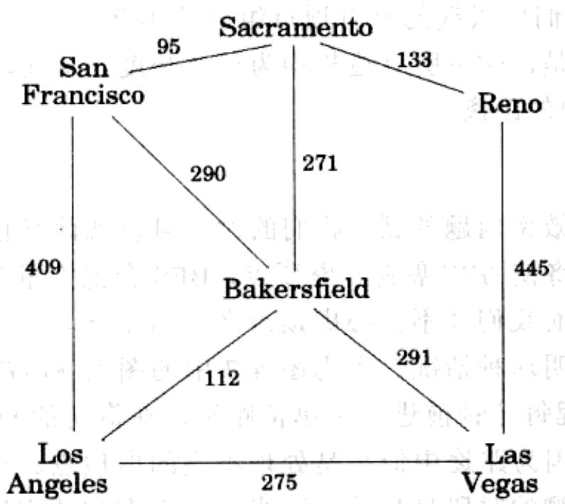

import Guide from '@/components/Guide.astro';
import Knowledge from '@/components/Knowledge.astro';
import Example from '@/components/Example.astro';
import Analysis from '@/components/Analysis.astro';
import Solution from '@/components/Solution.astro';
import Variant from '@/components/Variant.astro';
import Note from '@/components/Note.astro';
import Block from '@/components/Block.astro';
import Method from '@/components/Method.astro';
import Exercise from '@/components/Exercise.astro';
import Algorithm from '@/components/Algorithm.astro';

## 4.3 边的长度

广度优先搜索假定所有的边具有相同的长度。但是在实际寻找最短路径的应用中，很少会有这样的情况。例如，您驱车从 San Francisco 到 Las Vegas，想要找一条最快的路线。图 4-5 中给出了您可能行经的主要高速公路。选择合适的高速公路组合意味着一个最短路径问题，该问题中的一个重要信息正是每条边的长度(高速公路的里程)。在本章剩下的篇幅中，我们将处理这类更为普遍的情形。标记每条边 $e \in E$ 的长度为 $l_e$ 。如果 $e = (u, v)$ ，我们有时也将其长度记为 $l(u, v)$ 或 $l_{uv}$ 。

这些 $l_{e}$ 不一定非要对应于物理长度。它们也可以代表时间(在城市间驾车的时间)或者金钱(搭乘公车的成本)，或者任何我们关心的数量单位。实际上，有时我们还需要处理边的长度为负数的情况，不过我们暂时忽略这类特殊的应用。

  
图 4-5 边的长度通常举足轻重
