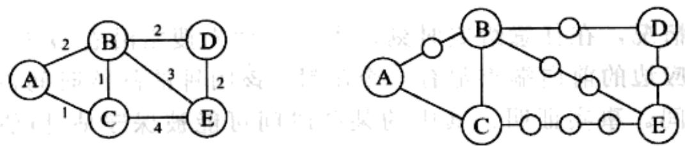
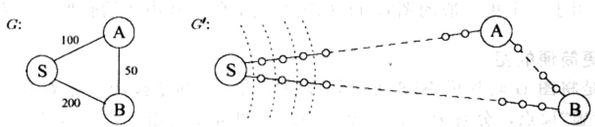
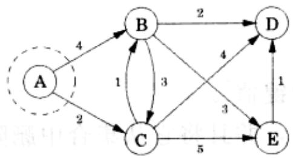
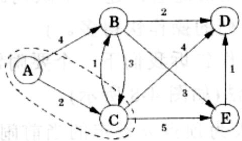
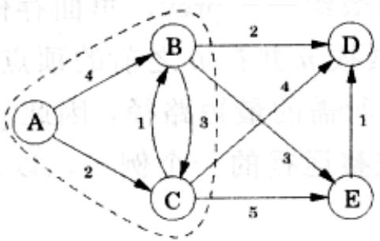
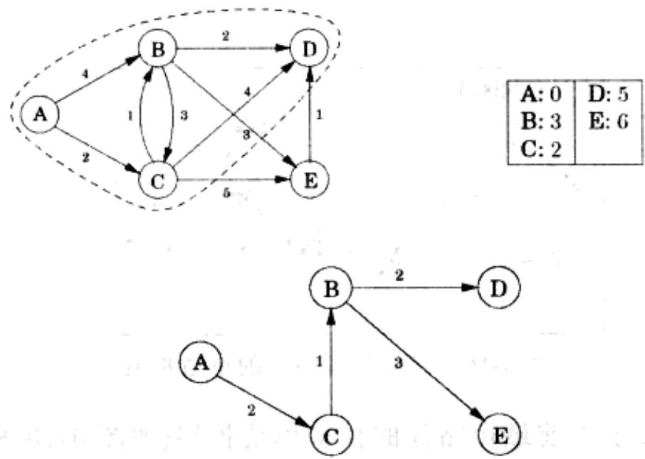
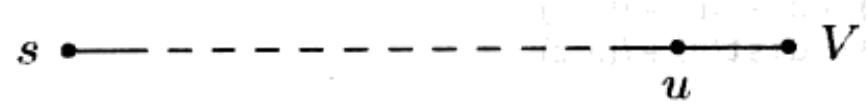
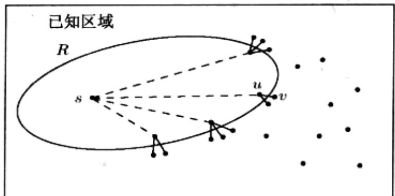

import Guide from '@/components/Guide.astro';
import Knowledge from '@/components/Knowledge.astro';
import Example from '@/components/Example.astro';
import Analysis from '@/components/Analysis.astro';
import Solution from '@/components/Solution.astro';
import Variant from '@/components/Variant.astro';
import Note from '@/components/Note.astro';
import Block from '@/components/Block.astro';
import Method from '@/components/Method.astro';
import Exercise from '@/components/Exercise.astro';
import Algorithm from '@/components/Algorithm.astro';

## 4.4 Dijkstra 算法

## 4.4.1 广度优先搜索的一个改进

广度优先搜索可以在任何边均为单位长度的图中找到最短路径。我们能否改进它，使它应用于一个更一般的图 $G = (V, E)$ 呢？这里假定其中边的长度 $l_{e}$ 均为正整数？

## 一个更简便的图

以下是将图 $G$ 转换成BFS可以处理的图的一种简单技巧：将 $G$ 中比较长的边通过引入“虚”顶点，分解为单位长度的小段。图4-6给出了一个转换的例子。按以下方式构建新的图 $G'$ ：

  
图 4-6 将边分解为单位长度的小段

对于 $E$ 中的任意边 $e = (u, v)$ ，通过在 $u$ 和 $v$ 之间增加 $l_e - 1$ 个虚顶点，将它替换成 $l_e$ 个长度为 1 的边。

图 $G'$ 中含有我们感兴趣的所有顶点组成的集合 $V$ ，并且顶点之间的距离与 $G$ 中一致。更为重要的是， $G'$ 中所有边长均为单位长度，从而，我们可以通过在 $G'$ 上运行 BFS 来计算 $G$ 中的距离。

## 闹钟

如果不用考虑效率问题的话，我们的讨论可以就此终止。但是当 $G$ 中含有很长的边时，上述方法将使 $G'$ 中塞满了虚顶点，BFS会把大量时间耗费在计算这些虚顶点之间的距离上，而我们并不关心虚顶点之间的距离。

为了直观地说明这种情况，考虑图4-7中的图 $G$ 和 $G'$ ，假定BFS开始于 $G'$ 中的顶点 $s$ ，搜索过程每分钟前进一个单位距离。在最初的99分钟，BFS沿着 $S - A$ 和 $S - B$ 乏味地进行，因为路途中似乎是处理不完的虚顶点。也许有这样一种方法，让我们可以在这些无聊的时段打打盹，而当有什么有趣的事情发生——比如搜索到达某个真实顶点(原图 $G$ 中的顶点)时，有一个闹钟能够叫醒我们。

我们通过在初始时设定两个闹钟做到这一点。一个闹钟为顶点 $A$ 而设，设定其在时间 $T = 100$ 时闹铃，另一个为顶点 $B$ 而设，设定其在时间 $T = 200$ 时闹铃。上述两个时间是顶点的预计到达时间，它们基于当前访问的边的情况而确定。我们先小睡一会，然后在 $T = 100$ 时醒来，看到 $A$ 已经被发现。这时，顶点 $B$ 的预计到达时间就调整为 $T = 150$ ，同时相应地修改闹铃的时间。

  
图 4-7 在 $G'$ 上的 BFS 过程大部分时间平淡无奇。虚线表示一些早先到达的“波阵面”

更一般的情况，在任意给定时刻，当广度优先搜索沿着 $G$ 的某些边进行时，沿搜索方向对应边的前向端点都有一个闹钟，该闹钟的闹铃时间被设定为该顶点的预计到达时间。事实证明，其中的某些时间可能被保守估计(估计的值比实际的要大)，因为BFS随后可能会发现一些捷径，所以相应顶点的未来到达时间可能会发生变化。在前述例子中，当到达 $A$ 时，就会发现一条到达 $B$ 的更快捷路线。无论怎样，在一个闹钟闹铃之前，不会有任何令我们感兴趣的事情发生。下一个闹铃响起的时刻预示BFS到达了一个真实的顶点 $u \in V$ 。在该顶点处，BFS可能会继续沿着从 $u$ 发出的新的边前进，因此这些边的前向端点的闹铃时刻需要重新设定。

以下的“闹钟算法”如实模拟了在 $G'$ 上执行 BFS 的过程。

\- 在时刻0为顶点 $s$ 设定一个闹钟。

\- 重复以下过程直至没有闹铃为止：

假定针对顶点 u 的下一个闹钟闹铃的时刻为 T。那么：

— 从 s 到 u 的距离是 T。

— 对于 G 中 u 的每个邻居 v:

\* 如果还未给 v 设定闹钟，则为其设定闹铃时刻 $T+l(u,v)$ 。

\* 如果 v 的闹铃时刻设定的比 $T+l(u,v)$ 要晚，则将它设定为 $T+l(u,v)$ 。

Dijkstra 算法 闹钟算法可以应用于任何边长为正整数的图。除了需要将闹钟这个思想实现以外，它可以直接用来解决一些实际问题。而实现闹钟思想的一个恰当的数据结构是一个优先队列(常常通过堆实现)，优先队列维护了一个元素(表示顶点)集合，每个元素有一个数字类型的键值(表示闹铃的时刻)，该数据结构支持以下操作：

插入：向集合中添加一个新的元素。

减小键值：用来减少某个特定元素的键值 $^{1}$ 。

删除最小元素：返回键值最小的元素，并且将它从集合中删除。

构造队列：用给定的元素以及给定的元素键值构建一个队列。(相比很多其他的实现方式，该操作要比将元素逐个插入队列的操作快得多。)

前两项操作用来设定闹钟，第三个操作告诉我们下一个要闹铃的闹钟。将这些操作结合起来，我们就得到了Dijkstra算法(如图4-8所示)。

在 Dijkstra 算法的代码中， $\mathrm{dist}(u)$ 代表为顶点 $u$ 设定的当前闹铃时刻。 $\infty$ 意味着该顶点的闹铃还未设定。还有一个额外的数组——prev，里面存储关于顶点 $u$ 的一些重要信息：在从 $s$ 到 $u$ 的最短路径上，紧挨 $u$ 并在 $u$ 之前的顶点的名称。通过 prev 中的这些后向指针，我们可以方便地重建所需的最短路径，因此 prev 数组是关于已发现的所有路径的一份简要记录。算法完整运行的一个例子，以及算法最终生成的最短路径树，都在图 4-9 中给出。

```python
procedure dijkstra(G,l,s)
Input: Graph G=(V,E), directed or undirected;
    positive edge lengths {le:e∈E}; vertex s∈V
Output: For all vertices u reachable from s, dist(u) is set to the distance from s to u.

for all u∈V:
    dist(u)=∞
    prev(u)=nil
dist(s)=0

H=makequeue(V) (using dist-values as keys)
while H is not empty:
    u=deletemin(H)
    for all edges (u,v)∈E:
    if dist(v)>dist(u)+l(u,v):
    dist(v)=dist(u)+l(u,v)
    prev(v)=u
    decreasekey(H,v)
```  
图4-8 Dijkstra最短路径算法



<table><tr><td>A:0</td><td>D:∞</td></tr><tr><td>B:4</td><td>E:∞</td></tr><tr><td>C:2</td><td></td></tr></table>



<table><tr><td>A:0</td><td>D:6</td></tr><tr><td>B:3</td><td>E:7</td></tr><tr><td>C:2</td><td></td></tr></table>



<table><tr><td>A:0</td><td>D:5</td></tr><tr><td>B:3</td><td>E:6</td></tr><tr><td>C:2</td><td></td></tr></table>

图4-9 Dijkstra算法的一个完整运行过程，算法以顶点 $A$ 作为起始点。同时给出了相应的各个顶点的dist值以及最终生成的最短路径树



$\sum_{i=1}^{n} \frac{d_{i}}{d_{i}} = \left\{ \begin{array}{c:c:c} 1 & 0 & 0 \\ 0 & 0 & 0 \\ 0 & 0 & 0 \\ 0 & 0 & 0 \end{array} \right.$

<table><tr><td>A: 0</td><td>D: 5</td></tr><tr><td>B: 3</td><td>E: 6</td></tr><tr><td>C: 2</td><td></td></tr></table>

图4-9 (续)

综上所述，我们可以将 Dijkstra 算法简单地视为一个 BFS，只是该算法使用优先队列取代了常规队列，以便能够结合边长因素决定顶点的处理顺序。从这个角度理解该算法，可以使我们得到一个关于该算法如何工作以及它为何能有效工作的直观认识。然而，还有一种不依赖于 BFS 的更直接也更抽象的算法解释，以下我们将从头开始对其进行详细阐述。

## 4.4.2 另一种解释

以下是计算最短路径的一种方案：从起始顶点 $s$ 开始向外扩张，持续不断地将生成的图扩张到已知距离和最短路径的区域。扩张过程按照如下顺序进行：先加入最近的顶点，然后加入更远一些的顶点。更准确地说，若“已知区域”是包含 $s$ 的某个顶点子集 $R$ ，下一个加入该子集的顶点应该是在 $R$ 之外同时离 $s$ 最近的顶点。我们记该顶点为 $\nu$ ；问题是：如何确定该顶点？

为了回答该问题，考虑顶点 $u$ ，它是恰在 $\pmb{\nu}$ 之前，并位于从 $s$ 到 $\pmb{\nu}$ 的最短路径上的顶点：



由于我们假设所有边的长度都是正数，因此 $u$ 一定比 $\nu$ 距离 $s$ 更近，这意味着 $u$ 在 $R$ 中——否则将与 $\nu$ 是 $R$ 之外且与 $s$ 距离最近的顶点这一假设相矛盾。因此，从 $s$ 到 $\nu$ 的最短路径即为这样的一条路径，它是基于一条已知最短路径中的某条边

的扩展路径。

  
图4-10 已知最短路径的单边扩展

但是通常会有关于当前最短路径的很多单边扩展(如图4-10所示)；其中哪一条确定了 $\nu$ 呢？应该是这些扩展路径中的最短路径。这是因为，如果存在一条更短的单边扩展路径，又将再次与 $\nu$ 为 $R$ 之外且是与 $s$ 距离最近的顶点的假设相矛盾。因此，很容易就能找到 $\nu$ ：它是 $R$ 之外的这样一个顶点，当 $\pmb{u}$ 在 $R$ 的范围内变动时，该顶点使得 $(s,u) + l(u,v)$ 的值最小。换言之，检查当前已知最短路径的所有单边扩展路径，找到这些扩展路径的最短路径，该路径的端点即为加入 $R$ 的下一个顶点。

我们现在得到一个扩展 $R$ 的算法，该算法通过检查当前最短路径集合的扩展路径实现。如果我们注意到以下事实并采取相应措施，将能够提高算法的执行效率：在算法的任意迭代步骤中，仅有的新扩展路径是那些连接最近加入到区域 $R$ 中的顶点的路径；其他所有路径的长度之前已计算过，无需重新计算。在以下的伪代码中， $\mathrm{dist}(\nu)$ 代表指向 $\nu$ 的当前最短单边扩展路径的长度；对于与 $R$ 不相邻的顶点，dist取值为 $\infty$ 。

```python
Initialize dist(s) to 0, other dist(·) values to ∞
R = { } (the "known region∫)
while R ≠ V:
    Pick the node v∉R with smallest dist(·)
    Add v to R
    for all edges (v,z) ∈ E:
    if dist(z) > dist(v) + l(v,z):
    dist(z) = dist(v) + l(v,z)
```

如果在上述伪代码的基础上增加优先队列操作, 就又回到了我们熟悉的 Dijkstra 算法(如图 4-8 所示)。

为了对该算法的正确性进行严格证明，我们采用在广度优先搜索正确性证明中使用过的归纳法。以下是归纳假设：

在每次 while 循环迭代的末尾，有以下条件成立：(1) 存在一个值 $d$ ，使得从 $s$ 到 $R$ 中所有顶点的距离小于等于 $d$ ，同时使得从 $s$ 到 $R$ 外所有顶点的距离大于等于 $d$ ；(2) 对于每个顶点 $u$ ， $\text{dist}(u)$ 表示一条从 $s$ 到 $u$ 的最短路径的长度，该路径经过的顶点均在 $R$ 中 (如果不存在这样的路径， $\text{dist}$ 值设为 $\infty$ )。

归纳的基本情况显然成立(此时 d=0)，通过前述讨论可以完善归纳步骤的其他细节。

## 4.4.3 运行时间

在图 4-8 所示的抽象层次上，Dijkstra 算法的结构与广度优先搜索相同。但是前者的运行速度要慢一些，因为其中的优先队列操作相对于 BFS 中常量时间的队列插入和删除操作，所需时间要长得多。由于 makequeue 操作最多执行 |V| 次插入操作，我们总共需要 |V| 次 deletemin 操作和 |V| + |E| 次 insert/decreasekey 操作。以上这些操作所需的时间因实现过程而异；例如，如果采用一个二分堆数据结构，则以上操作总的运行时间为 $O((|V| + |E|)\log|V|)$ 。
