import Guide from '@/components/Guide.astro';
import Knowledge from '@/components/Knowledge.astro';
import Example from '@/components/Example.astro';
import Analysis from '@/components/Analysis.astro';
import Solution from '@/components/Solution.astro';
import Variant from '@/components/Variant.astro';
import Note from '@/components/Note.astro';
import Block from '@/components/Block.astro';
import Method from '@/components/Method.astro';
import Exercise from '@/components/Exercise.astro';
import Algorithm from '@/components/Algorithm.astro';

## 4.6 含有负边的图的最短路径

## 4.6.1 负边

Dijkstra 算法之所以能够运行，有一部分原因在于：从起始点 $s$ 到任意顶点 $\nu$ 的最短路径一定会经过比 $\nu$ 距离 $s$ 更近的顶点。而当边的长度可以为负值时，这一论断将不再成立。比如在图4-12中，从 $S$ 到 $A$ 的最短路径经过 $B$ ，而 $B$ 却比 $A$ 距离 $S$ 更远！

(a)  
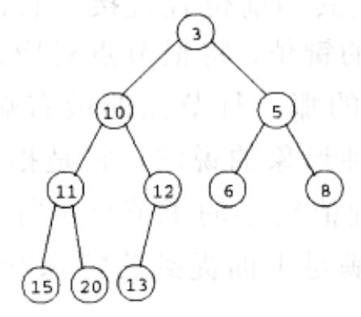

(b)  
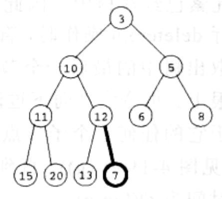

(c)  
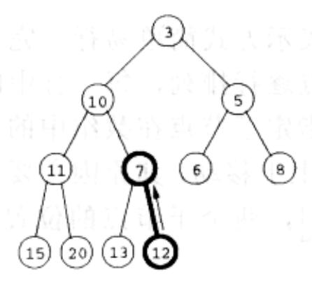

(d)  
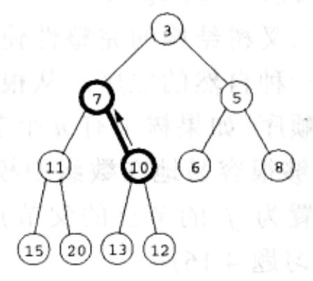

(e)  
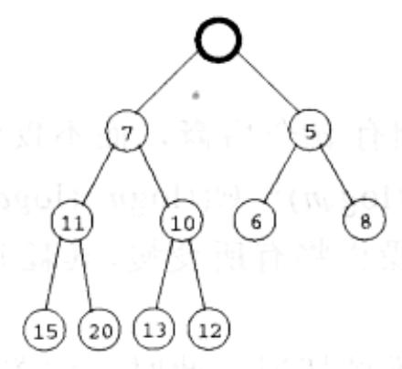

(f)  
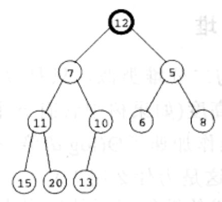

(g)  
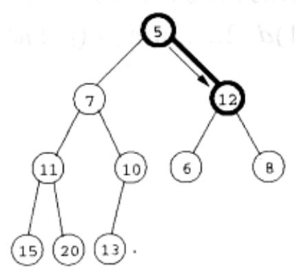

(h)  
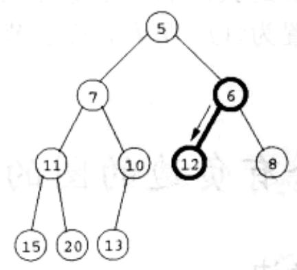  
图 4-11 (a)一个含有 10 个元素的二分堆，图中只标记了键值。(b)-(d)插入键值为 7 的元素经历的中间“冒泡”步骤。(e)-(g)在 delete-min 操作中经历的“向下过滤”步骤

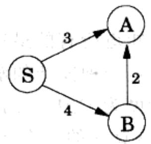  
图 4-12 如果图中含有负边，Dijkstra 算法将不再适用

为了应对这一新的复杂性，原有算法应该做出什么样的调整呢？要回答这一问题，首先让我们从一个较高的层次上重新审视Dijkstra算法。其中一个不变的重要事实是：算法维护的dist值在被准确设定之前常常被高估。它们初始时刻被设为 $\infty$ ，之后算法只会沿着图中的一条边对它们进行更新：

$$
\begin{array}{l} \text {procedure update} ((u, v) \in E) \\ \text {dist} (v) = \min \{\text {dist} (v), \text {dist} (u) + l (u, v) \} \end{array}
$$

这一更新意味着这样一个事实：从起始点到 $\pmb{v}$ 的距离不可能超过到 $\pmb{u}$ 的距离加上 $l(u, v)$ 。更新操作具有以下性质：

1. 以下情况才能保证更新操作正确设定了从起始点到 v 的距离，即：当 u 是从起始点到 v 的最短路径上的倒数第二个顶点，且 $\text{dist}(u)$ 被正确设定时。

2. 更新操作保证了 $\mathrm{dist}(\nu)$ 的值不会很小，从这一意义上讲，该操作是安全的 (safe)。事实上，其它顶点 dist 值的 update 操作即使略有偏差，也不会对整个算法产生重大影响。

因此，更新操作是及其有用的：它没有副作用，如果使用得当，将能够正确地设定距离。实际上，Dijkstra算法可以被简单地视为是一个update操作序列。我们已经知道，这一特殊操作序列针对含有负边的图将不再适用，但是是否存在其它的操作序列能够处理含有负边的情况呢？为了形象地说明这种操作序列应该具备什么样的性质，让我们选择一个顶点 $t$ ，查看从 $s$ 到 $t$ 的最短路径。

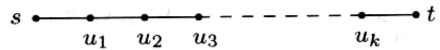

该路径最多含有 $|V|-1$ 条边(您知道其中的原因吗？)。如果执行的更新操作序列按照以下顺序 $(s,u_1)$ 、 $(u_{1},u_{2})$ 、 $(u_{2},u_{3})$ 、…、 $(u_{k},t)$ ，（虽然不必一定连续）进行，那么按照前述的第一条性质，到达 $t$ 的距离将被正确地设定。至于其它更新操作是否在这些边上进行则无关紧要，同样，图上其它部分进行的操作也不对其产生影响，

因为更新操作是安全的。

但问题是，如果我们预先并不知道所有的最短路径，我们又如何能确保按照正确的顺序更新了正确的边呢？以下是一种简便的解决方案：更新所有的边，每条边更新 $|V| - 1$ 次！这样产生的时间复杂度为 $O(|V|\cdot |E|)$ 的过程被称为Bellman-Ford算法，算法在图4-13中给出，图4-14为该算法的一个运行示例。

```python
procedure shortest-paths(G,l,s)
Input: Directed graph G=(V,E);
    edge lengths {le:e∈E} with no negative cycles;
    vertex s∈V
Output: For all vertices u reachable from s, dist(u) is set to the distance from s to u.
for all u∈V:
    dist(u)=∞
    prev(u)=nil
dist(s)=0
repeat |V|-1 times:
    for all e∈E:
    update(e)
```  
图 4-13 Bellman-Ford 算法应用于一般图的单源最短路径问题

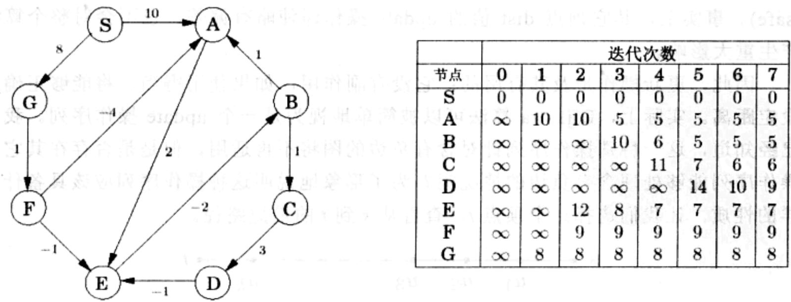

<table><tr><td></td><td colspan="8">迭代次数</td></tr><tr><td>节点</td><td>0</td><td>1</td><td>2</td><td>3</td><td>4</td><td>5</td><td>6</td><td>7</td></tr><tr><td>S</td><td>0</td><td>0</td><td>0</td><td>0</td><td>0</td><td>0</td><td>0</td><td>0</td></tr><tr><td>A</td><td>∞</td><td>10</td><td>10</td><td>5</td><td>5</td><td>5</td><td>5</td><td>5</td></tr><tr><td>B</td><td>∞</td><td>∞</td><td>∞</td><td>10</td><td>6</td><td>5</td><td>5</td><td>5</td></tr><tr><td>C</td><td>∞</td><td>∞</td><td>∞</td><td>∞</td><td>11</td><td>7</td><td>6</td><td>6</td></tr><tr><td>D</td><td>∞</td><td>∞</td><td>∞</td><td>∞</td><td>∞</td><td>14</td><td>10</td><td>9</td></tr><tr><td>E</td><td>∞</td><td>∞</td><td>12</td><td>8</td><td>7</td><td>7</td><td>7</td><td>7</td></tr><tr><td>F</td><td>∞</td><td>∞</td><td>9</td><td>9</td><td>9</td><td>9</td><td>9</td><td>9</td></tr><tr><td>G</td><td>∞</td><td>8</td><td>8</td><td>8</td><td>8</td><td>8</td><td>8</td><td>8</td></tr></table>

图4-14 以一个图例来说明Bellman-Ford算法的流程

关于 Bellman-Ford 算法实现的一个附注：对许多图而言，任意最短路径中的边数实际上都小于 $|V|-1$ ，这使得并不需要很多的更新操作。因此，针对最短路径算法增加一个额外的检查就显得很有意义了，它可以使得在没有任何更新操作发生时，立即终止算法。

## 4.6.2 负环

如果图4-14中的边 $(E,B)$ 的长度变为-4，则图中将出现一个负环 $A\to E\to B\to A$ 。在这种情况下，寻找最短路径是没有任何意义的。比如，从 $A$ 到 $E$ 存在一条长为2的路径。但是沿着上面的负环，从 $A$ 到 $E$ 还存在一条长为1的路径，同时沿着这个环绕行多次，我们将得到长度为0、-1、-2直到- $\infty$ 的其它路径。

可见，图中一旦出现了负环，最短路径问题本身就不再有意义。我们也可以预想到，4.6.1节中给出的算法只适用于没有负环的情况。我们不禁要问，难道将该算法进行推广后，仍然需要图中没有负环的假设吗？答案如下：当我们能够确保从 $s$ 到 $t$ 确实存在一条最短路径时，就不再需要该假设了。

幸运的是，很容易就能检测到负环的存在，一旦检测到负环，就要适时地发出警告。若不发出警告，并采取相应措施，负环将可能使我们永无休止地进行 update 操作，并不断减少 dist 的估计值。因此，我们需要在 $|V|-1$ 次迭代之后再多执行一次迭代过程。图中存在一个负环当且仅当在这最后一次迭代中有某个 dist 的值被减少。
