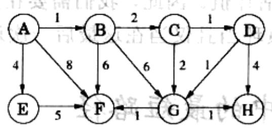
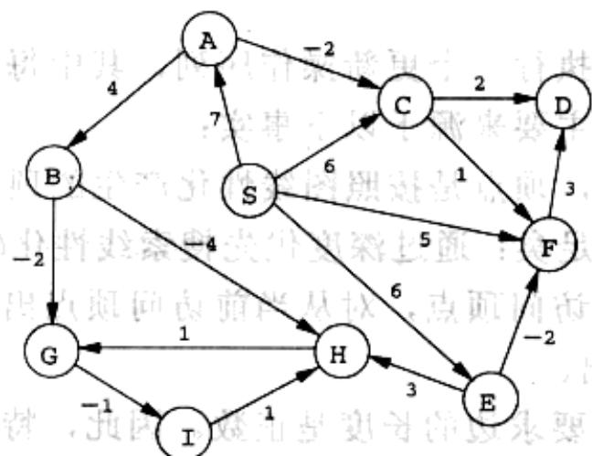
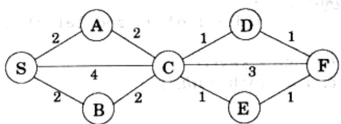

import Guide from '@/components/Guide.astro';
import Knowledge from '@/components/Knowledge.astro';
import Example from '@/components/Example.astro';
import Analysis from '@/components/Analysis.astro';
import Solution from '@/components/Solution.astro';
import Variant from '@/components/Variant.astro';
import Note from '@/components/Note.astro';
import Block from '@/components/Block.astro';
import Method from '@/components/Method.astro';
import Exercise from '@/components/Exercise.astro';
import Algorithm from '@/components/Algorithm.astro';

## 第4章 习题

<Exercise title="习题 4.1">

应用 Dijkstra 算法于下图之上，从顶点 A 开始。

(a) 绘制一张表格，记录在算法执行中的每个迭代步骤下的所有顶点的中间距离值。

(b) 给出最终生成的最短路径树。

</Exercise>

<Exercise title="习题 4.2">

本题的应用背景跟上一题类似，只是要求使用 Bellman-Ford 算法。

指出年，我视前破
跌倒思尽意棘返，使

题题不对普通，故因
字则点即的怪兽题词然
出舍中21-4图者去取的应

$^{-1}$ I $^{1}$

</Exercise>

<Exercise title="习题 4.3">

正方形。设计并分析这样一个算法：以一个无向图 $G = (V, E)$ 为输入，确定 $\mathbf{G}$ 中是否含有一个简单环(即一个不与自身交叉的环)，环的长度为4。算法的运行时间最差情况下为 $O(|V|^3)$ 。

您可以随意选择输入图的表示方式：邻接矩阵或是邻接表，只要能使您的算法更简单就好。

</Exercise>

<Exercise title="习题 4.4">

给出一种如何在无向图中找出最短环的长度的方法，该无向图中边的长度均为单位长度。

当在深度优先搜索中遇到一条回边，如 $(v, w)$ ，则由该回边与其它一些树边能够组成一个从 $w$ 到 $v$ 的环。环的长度是 level $[v] - \text{level}[w] + 1$ ，其中一个顶点的 level 是指在 DFS 树中，从根顶点到该顶点的距离。以上思想可以表述成下面的算法：

\- 执行一次深度优先搜索，记录每个顶点的 level 值。

\- 每当遇到一条回边，计算此时得到的环的长度，如果它比当前最小的环的长度还要小，则更新当前最小环长度为该长度。

通过给出一个反例来证明以上算法并不能保证总是正确，并给出一个简要的说明(一两行文字就可以了)。

</Exercise>

<Exercise title="习题 4.5">

通常在图中的两个顶点之间存在不止一条最短路径。针对以下任务给出一个线性时间算法：

输入：无向图 $G = (V,E)$ ，边的长度为单位长度；顶点 $\pmb{u}$ 、 $\nu \in V$

输出：从 u 到 v 的不同最短路径的数目。

</Exercise>

<Exercise title="习题 4.6">

证明：对于 Dijkstra 算法计算得到的 prev 数组，边 $\{u, \text{prev}[u]\}$ (对于所有的顶点 $u \in V$ ) 形成了一棵树。

</Exercise>

<Exercise title="习题 4.7">

给定一个有向图 $G = (V, E)$ ，其中的边具有权重(权值可以为负)，以及一个特定的顶点 $s \in V$ 和一棵树 $T = (V, E')$ ， $E' \subseteq E$ 。给出一个算法，判断 $T$ 是否是图 $G$ 中从顶点 $s$ 出发的一个最短路径树。该算法的运行时间应为线性的。

</Exercise>

<Exercise title="习题 4.8">

F. Lake 教授给出了一种在含负边有向图中，求顶点 $s$ 到顶点 $t$ 最短路径的算法：给图中每条边的权重加上一个足够大的常数，使得所有边的权值均为正数，然后从起始点 $s$ 运行 Dijkstra 算法，返回到达顶点 $t$ 的最短路径。

该算法是否正确？如果正确，证明之；否则，给出一个反例。

</Exercise>

<Exercise title="习题 4.9">

考虑这样的一个有向图，其中所有的负边都是从 $s$ 发出的边；除此之外的其它边权值都为正。以顶点 $s$ 作为起始点，Dijkstra算法能否适用于本题的情形？证明您的结论。

</Exercise>

<Exercise title="习题 4.10">

给定一个有向图 $G = (V, E)$ ，其中的边具有权重(权值可以为负)，并且任意两个顶点之间的最短路径最多含有 $k$ 条边。给出一个算法，在 $O(k|E|)$ 时间内找出顶点 $u$ 和 $v$ 之间的最短路径。

</Exercise>

<Exercise title="习题 4.11">

给出一个算法，以边长度为正的有向图为输入，输出图中的最短环的长度(如果该图是无环的，则输出该图不含环的结论)。该算法的运行时间最差情况下为 $O(|V|^3)$ 。

</Exercise>

<Exercise title="习题 4.12">

给出一个运行时间为 $O(|V|^2)$ 的算法，使其完成以下任务：

输入：一个无向图 $G = (V,E)$ ；边的长度 $l_{e} > 0$ ；一条边 $e \in E$

输出：含有边 $e$ 的最短环的长度

</Exercise>

<Exercise title="习题 4.13">

给定一组城市, 它们之间以高速公路相连, 以无向图 $G = (V, E)$ 的形式表示。每条高速公路 $e \in E$ 连接两个城市, 高速公路的长度以英里记, 记为 $l_e$ 。您想要从城市 $s$ 到城市 $t$ 。存在一个问题: 您的汽车油箱容量有限, 在加满的情况下只能行驶 $L$ 英里。每个城市都有加油站, 但城市之间的高速公路上并没有加油站。因此, 您选择的路径中的每条边(两个城市间的高速公路)的长度应该满足 $l_e \leqslant L$ 。

(a) 在给定汽车油箱容量限制的情况下，怎样在线性时间内判断从 $s$ 到 $t$ 之间是否存在一条可行路径。

(b) 您现在打算买一辆新车，需要知道从 $s$ 旅行至 $t$ 所需的油箱最小容量。给出一个时间复杂度为 $O((|V| + |E|)\log |V|)$ 的算法，计算从 $s$ 旅行至 $t$ 所需的油箱最小容量。

</Exercise>

<Exercise title="习题 4.14">

给定一个强连通有向图 $G = (V, E)$ ，其中每条边的权重都是正数，以及一个特定的顶点 $\nu_0 \in V$ 。给出一个高效算法，找出任意一对顶点间的最短路径，还有一个额外的限制：这些路径都必须经过顶点 $\nu_0$ 。

</Exercise>

<Exercise title="习题 4.15">

最短路径通常都不唯一：有时对于一个最短路径长度可能会有两条或多条不同的路径。给出一个时间复杂度为 $O((|V| + |E|)\log |V|)$ 的算法，解决以下问题：

输入：无向图 $G = (V,E)$ ；边的长度 $l_{e} > 0$ ；起始顶点 $s \in V$

输出：一个布尔变量数组 $\mathbf{usp}[\cdot]$ ：对于每个顶点 $u$ ，数组元素 $\mathbf{usp}[u]$ 取值为真当且仅当从 $s$ 到 $u$ 存在唯一的最短路径。(提示： $\mathbf{usp}[s] = \mathbf{true}$ )

</Exercise>

<Exercise title="习题 4.16">

4.5.2 节中描述了怎样在数组中存储包含 $n$ 个顶点的完全二叉树，其中树的顶点用数组下标 1、2、…、 $n$ 来索引。

(a) 考虑在数组下标为 $j$ 处的顶点。证明，该顶点的父顶点在下标 $\lfloor j / 2 \rfloor$ 处，其子顶点分别在 $2j$ 和 $2j + 1$ 处(前提是这些下标值要小于等于 $n$ )。

(b) 当数组中存储的是完全 $d$ 叉树时，某个顶点的父顶点和子顶点的下标值又是多少？

图4-16中给出了针对二分堆的伪代码，基于R.E.Tarjan²的算法思想。二分堆被存储于一个数组 $h$ 中，该数组需要支持以下两种常量时间的操作：

procedure insert(h, x)
bubbleup(h, x, |h| + 1)

procedure decreasekey(h, x)
bubbleup(h, x, h$^{-1}$(x))

function deletemin(h)
if |h| = 0:
    return null
else:
    x = h(1)
    siftdown(h, h(|h|), 1)
    return x

function makeheap(S)
h = empty array of size |S|
for x ∈ S:
    h(|h| + 1) = x
for i = |S| downto 1:
    siftdown(h, h(i), i)
return h

procedure bubbleup(h, x, i)
(place element x in position i of h, and let it bubble up)
p = [i/2]
while i ≠ 1 and key(h(p)) &gt; key(x):
    h(i) = h(p); i = p; p = [i/2]
h(i) = x

procedure siftdown(h, x, i)
(place element x in position i of h, and let it sift down)
c = minchild(h, i)
while c ≠ 0 and key(h(c)) &lt; key(x):
    h(i) = h(c); i = c; c = minchild(h, i)
h(i) = x

function minchild(h, i)
(return the index of the smallest child of h(i))
if 2i &gt; |h|
    return 0 (no children)
else:
    return argmin&#123;key(h(j)): 2i ≤ j ≤ min&#123;|h|, 2i + 1&#125;&#125;

图4-16 二分堆上的操作

\- $|h|$ ，返回数组中当前的元素数目；

\- $h^{-1}$ , 返回数组中某个元素的位置。

后一个操作常常通过维护一个存储着 $h^{-1}$ 值的辅助数组来实现。

(c) 证明当以包含 $n$ 个元素的集合为输入进行调用时，makeheap 流程需要 $O(n)$ 时间。该流程最差情况对应的输入是什么？(提示：先证明该流程的运行时间最差情况下为 $\sum_{i=1}^{n} \log(n/i)$ )

(d) 要使该伪代码能够适用于 $d$ 堆，需要做出哪些调整？

</Exercise>

<Exercise title="习题 4.17">

假定在这样的一个图上运行 Dijkstra 算法：边的权重都是整数，且在 0,1,...,W 的范围内，其中 W 是一个相对较小的数字。

(a) 证明 Dijkstra 算法的运行时间可以达到 $O(W|V| + |E|)$ 。

(b) 证明存在另一种算法实现，其运行时间只有 $O((|V| + |E|)\log W)$ 。

</Exercise>

<Exercise title="习题 4.18">

当两个顶点间存在多条不同的最短路径(其中，边的长度也不相同)，而您需要在其中做出抉择时，最简便的一种方法就是选择一条边数最少的路径。例如，如果用顶点代表城市，边的长度代表在城市间飞行的成本，在同样的成本额度下，从城市 $s$ 到城市 $t$ 一定存在很多种飞行方案。从中择一的最简便方式就是选择一种中转最少的。因此，对于一个特定的起始顶点 $s$ ，定义以下指标：

best[u] = 从 s 到 u 的含边最少的最短路径的边的数目。

在下图所示的例子中，顶点 S、A、B、C、D、E、F 的 best 值分别为 0、1、1、1、2、2、3。

给出一个针对以下问题的高效算法：

输入：图 $G=(V,E)$ ；边的长度 $l_{e}>0$ ；起始顶点 $s\in V$ 。

输出：给出所有顶点 $u \in V$ 的 best[u] 值。

</Exercise>

<Exercise title="习题 4.19">

推广的最短路径问题。在 Internet 路由问题中，不仅在网路上存在延迟，更重要的，在路由器上也存在延迟。这一背景引出了一个推广的最短路径问题。

假定一个图除了它的边具有长度 $\{l_e: e \in E\}$ 之外，其顶点还具有顶点成本 $\{c_v: v \in V\}$ 。现在定义一条路径的成本为其上所有边的长度加上其上所有顶点(包含路径的端点)的成本。给出一个针对以下问题的高效算法：

输入：有向图 $G = (V,E)$ ；边的长度 $l_{e} > 0$ ，顶点成本 $c_{v} > 0$ ；起始顶点 $s \in V$ 。

输出：一个数组 $\cos t[\cdot]$ ，针对每个顶点 $u$ ， $\cos t[u]$ 是从 $s$ 到 $u$ 的所有路径的最小成本（即最经济的路径的成本），其中，路径成本的定义如题设中所述。

需要注意的是， $\cos t[s]=c_{s}$ 。

</Exercise>

<Exercise title="习题 4.20">

一组城市(城市构成顶点集合 $V$ )之间由一个公路网 $G = (V, E)$ 彼此互相连通。集合 $E$ 中的每条边对应于一条公路，公路有一个相应的长度 $l_e$ 。现在需要在该公路网中建设一条新的公路，而新的公路建于两个不同的城市之间。所有可以修建新的公路的两个城市的组合构成一个列表 $E'$ 。列表 $E'$ 中可能会修建的每条公路 $e' \in E'$ 具有一个相应的长度。作为公共事业部门的一个设计者，您被要求决定建设哪一条公路 $e' \in E'$ ，使得在公路网 $G$ 中新建了这条公路之后，两个给定的城市 $s$ 和 $t$ 之间的距离得到最大的缩短。给出一个高效算法以解决上述问题。

</Exercise>

<Exercise title="习题 4.21">

最短路径算法可以应用于货币交易领域。令 $c_{1}, c_{2}, \ldots, c_{n}$ 为 $n$ 种不同的货币；例如， $c_{1}$ 表示美元， $c_{2}$ 表示英镑， $c_{3}$ 表示里拉。对于任意两种货币 $c_{i}$ 和 $c_{j}$ ，存在一个汇率 $r_{i,j}$ ；它意味着您可以以 1 个单位的货币 $c_{i}$ 获取 $r_{i,j}$ 单位的货币 $c_{j}$ 。这些汇率满足条件 $r_{i,j} \cdot r_{j,i} < 1$ ，该条件确保了以下事实：起初您手头上有 1 个单位的货币 $c_{i}$ ，然后将它兑换成货币 $c_{j}$ ，再将其兑换回货币 $c_{i}$ ，您最终手头上的货币 $c_{i}$ 应该少于 1 个单位(差额即为兑换的交易成本)。

(a) 给出一个高效算法，解决以下问题：给定一组汇率 $r_{i,j}$ ，以及两种货币 $s$ 和 $t$ ，找到一个最有利的货币兑换序列，以把货币 $s$ 最终兑换成货币 $t$ 。为了实现这个目标，您得先把货币和汇率表示成一张图，图中边的长度是实数。

汇率是不断波动的，反映了市场上对于不同货币的供求变化。偶尔汇率会满足以下性质：存在一系列货币 $c_{i_1}$ 、 $c_{i_2}$ 、…、 $c_{i_k}$ ，使得 $r_{i_1,i_2}\cdot r_{i_2,i_3}\cdots r_{i_{k-1},i_k}\cdot r_{i_k,i_1}>1$ 。这意味着从手头上的1个单位的货币 $c_{i_1}$ ，然后连续地兑换成货币 $c_{i_2}$ 、 $c_{i_3}$ 、…、 $c_{i_k}$ ，最后再兑换回货币 $c_{i_1}$ ，您手头上的货币 $c_{i_1}$ 将超过1个单位。这样的异常情形在货币交易市场上稍纵即逝，但是一旦把握住它，则无需冒任何风险就能得到收益。

(b) 给出一个高效算法，检测是否存在这样的异常情形。使用(1)中的图论表示法。

</Exercise>

<Exercise title="习题 4.22">

货船巡航问题。您是一艘货船的船主，该货船可以在一组港口城市(城市组成顶点集合 $V$ )间巡航。您在每个港口都能赚到钱：访问港口 $i$ 将为您带来 $p_i$ 美元的收益。同时，从港口 $i$ 到港口 $j$ 的运输费用为 $c_{ij} > 0$ 。您想要找到一个巡航的环状

路线，使得收益与成本的比率最大。

为了这个目的，考虑一个有向图 $G = (V,E)$ ，其中顶点代表港口，任意两个顶点(港口)间存在一条边(水路)。对于该图中的任意一个环 $C$ ，收益与成本的比率定义如下：

$$
r (C) = \frac {\sum_ {(i , j) \in C} p _ {j}}{\sum_ {(i , j) \in C} c _ {i j}}
$$

令 $r^*$ 为一个简单环能够达到的最大比率。一种确定 $r^*$ 的方法是通过二分搜索：首先猜测一个可能比率 $r$ ，然后检验它是偏大还是偏小。

考虑任意正数 $r > 0$ 。为每条边 $(i,j)$ 赋予一个权重 $w_{ij} = rc_{ij} - p_j$ 。

(a) 证明：如果存在一个环具有负的权重，那么 $r < r^*$ 。

(b) 证明：如果图中所有的环的权重都严格大于0，那么 $r > r^{*}$ 。

(c) 给出一个高效算法，以一个要求的精度 $\varepsilon > 0$ 为输入，输出一个简单环 $C$ 满足 $r(C) \geqslant r^{*} - \varepsilon$ 。验证该算法的正确性，并分析其运行时间，以 $|V|$ 、 $\varepsilon$ 和 $R = \max_{(i,j)} \in_{E}(p_j / c_{ij})$ 表示。

（1）在“中国”“美国”“日本”“法国”“德国”“印度”“巴西”“美国”“英国”“日本”“法国”“印度”“巴西”“美国”“日本”“法国”“印度”“巴西”“日本”“法国”“印度”“巴西”“日本”“法国”“印度”“巴西”“日本”“法国”“印度”“巴西”“日本”“法国”“印度”“巴西”“日本”“法国”“印度”“巴西”“日本”“法国”“印度”“巴西”“日本”“法国”“印度”“巴西”“日本”“法国”“印度”“巴西”“日本”，

图 1. 一个函数的值是 $\frac{1}{2}$ ，故 $x \in [0,1]$ ，且 $x \in [1,2]$ ，且 $x \in [2,3]$ 。

虽然不是有10个，因为这3个是2个，但是，由于其内容则下录举出
信息，但是，但是，但是，但是，但是，但是，但是，但是，但是，但是，但是，但是，但是，但是，但是，但是，但是，但是，但是，但是，但是，但是，但是，但是，但是，但是，但是，但是，但是，但是，但是，但是，但是，但是，但是，但是，但是，但是，但是，但是，但是，但是，但是，但是，但是，但是，但是，但是，但是，但是，

(1) 2017年1月1日，中国银行股份有限公司上海市分行（以下简称“上海银行”）向中国银行股份有限公司上海分行（以下简称“上海农商行”）申请的综合授信额度为人民币4.5亿元。

在满足条件时，可以将条件分为两个类别：一个条件为“不满足”或“满足”，另一个条件为“满足”。

1. 2. 3. 4. 5. 6. 7. 8. 9. 10. 11. 12. 13. 14. 15. 16. 17. 18. 19. 20. 21. 22. 23. 24. 25. 26. 27. 28. 29. 30. 31. 32. 33. 34. 35. 36. 37. 38. 39. 40. 41. 42. 43. 44. 45. 46. 47. 48. 49. 50. 51. 52. 53. 54. 55. 56. 57. 58. 59. 60. 61. 62. 63. 64. 65. 66. 67. 68. 69. 70. 71. 72. 73. 74. 75. 76. 77. 78. 79. 80. 81. 82. 83. 84. 85. 86. 87. 88. 89. 90. 91. 92. 93. 94. 95. 96. 97. 98. 99.

</Exercise>

