import Guide from '@/components/Guide.astro';
import Knowledge from '@/components/Knowledge.astro';
import Example from '@/components/Example.astro';
import Analysis from '@/components/Analysis.astro';
import Solution from '@/components/Solution.astro';
import Variant from '@/components/Variant.astro';
import Note from '@/components/Note.astro';
import Block from '@/components/Block.astro';
import Method from '@/components/Method.astro';
import Exercise from '@/components/Exercise.astro';
import Algorithm from '@/components/Algorithm.astro';

## 第5章 贪心算法

想要赢得象棋这类博弈游戏的胜利就必须要想在对手前面，只在乎眼前利益往往很容易被打败。可是对于其他的许多游戏，比如 Scrabble 这个拼字游戏，即使只简单地选择眼前最佳的行动，根本不操心以后的种种可能，结果也可能相当不错。

这类短视的行为总是简单易行，而这使之成为了一种具有吸引力的算法策略。贪心算法采取步步逼近的方式构造问题的解，其下一步的选择总是在当前看来收效最快和效果最明显的那一个。虽然这一方法在某些任务(例如前面提到的下棋)中可能导致灾难性的后果，但是对于其他的许多任务，它却可能是最优的。在此，我们以最小生成树(MST)问题作为第一个例子。

## 5.1 最小生成树

假设您需要将一组计算机两两相连构成一个网络。转换成图论的问题就是，以节点表示计算机，无向边表示可能的连接，我们需要从后者中选出足够多的边，使得所有的节点都被连接(到同一个网络中)。不过这样还不够，通常每条网络连接都有一定的维护成本，在此表示为边的权重。最后，我们需要考虑的是怎样才能得到一个最经济的网络？

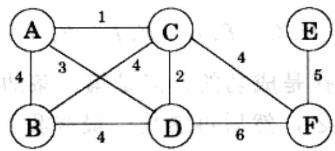

显然，最佳的边集合不可能包含环。因为不难发现，移除环中的任何一条边都

会降低代价，而同时不破坏其连通性。

性质 1 移除环中的任意一条边不会破坏图的连通。

由此可知以上问题的解应该是一个连通且无环的图——这类无向图称为树。在此，我们要求的是一个具有最小代价(总权重)的树，即所谓最小生成树。该问题的形式化定义如下。

输入：无向图 $G=(V,E)$ ；边权重 $w_{e}$ 。

输出：树 $T = (V, E')$ ，其中 $E' \subseteq E$ ，使得权重 $\operatorname{weight}(T) = \sum_{e \in E'} w_e$ 最小。

对于前面图中的例子，最小生成树的权重为16：

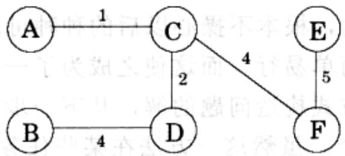

不过，这并不是唯一的最优解。您还能找到另一个MST吗？

## 5.1.1 一个贪心方法

Kruskal的最小生成树算法起始于一个空的图，并按照以下的规则从 $E$ 中选择边：

不断重复地选择未被选中的边中权重最轻且不会形成环的一条。

换句话说，这一算法通过逐条增加边来构造最小生成树。在保证不出现环的同时，它总简单地选择当前所余的权重最轻的边。这是一个典型的贪心算法，即每次决策都对应于最明显的即时利益。

图5-1显示了一个例子。我们从一个空的图开始，按照边权重的升序依次增加边(同等权重的边任选其一即可)，得到：

$$
B - C, C - D, B - D, C - F, D - F, E - F, A - D, A - B, C - E, A - C
$$

不难看出，前两条边选择是成功的。但是第三条边，B-D，如果将其加入将导致环的出现。因此我们放弃之，然后再继续。最终我们得到了一个代价为14的树，正是我们所求的最小生成树。

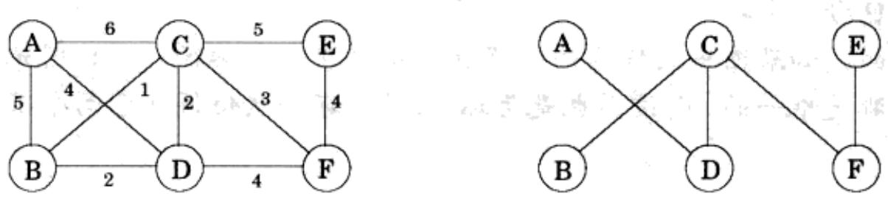  
图5-1 基于Kruskal算法得到的最小生成树

<Knowledge title="专栏: 树">

树是一个连通且无环的无向图。它之所以如此有用，很大程度上是因为其简单的结构。例如：

性质2 具有 $n$ 个节点的树的边数为 $n - 1$ 。

从空的图开始，每次给树增加一条边，我们将很容易证明这一性质。首先，最初的 $n$ 个节点都是互不相连的，因此可将每个节点视为一个独立的连接部件 (connected component)。随着边数的增加，这些部件不断相互合并。注意到每条新增的边都将连接两个不同的部件，因此恰好当增加到第 $n - 1$ 条边时，完成了整个树的构造。

说得更具体些，当某条边 $\{u, v\}$ 被加入时，我们可以断定 $u$ 和 $v$ 分别处于两个独立的连接部件中，否则由连接部件的定义，必然已存在连接两者的一条路径，增加 $\{u, v\}$ 将导致出现环。 $\{u, v\}$ 的加入将使这两个部件合并在一起，从而使得总的连接部件数减少了1。遵循这一过程，连接部件的总数将从 $n$ 一步步减小到1，这也表明在此过程中，一共增加了 $n-1$ 条边。

以上的逆命题同样成立。

性质3 任何一个连通无向图 $G = (V, E)$ ，若满足 $|E| = |V| - 1$ ，则其为树。

我们只须证明 $G$ 是无环的。为证明之运行如下的递归过程：如果 $G$ 中包含一个环，则移除该环上的任意一条边；不断继续，直到得到一个无环的图 $G' = (V, E')$ ， $E' \subseteq E$ 。由性质 1， $G'$ 是连通的，因此 $G'$ 是树。由性质 2， $|E'| = |V| - 1$ 。故 $E' = E$ ，也即实际上我们没有移除 $G$ 中的任意一条边，这说明它一开始就是树。

换句话说，对于任意一个连通图，我们可以仅仅通过计算其边数来判断它是否为树。以下是树的另一个特征：

性质 4 一个无向图是树，当且仅当在其任意两个节点间仅存在唯一路径。

在树中，任意两个节点间仅可能有一条路径。因为如果存在两条路径，将其合

并后必然会包含一个环。

另一方面，如果图中的任意两个节点间都存在一条路径，则该图是连通的。如果这些路径都是唯一的，则该图也是无环的(因为环必然使得任意两个节点间存在两条路径)。

Kruskal 方法的正确性源自所谓的分割性质。而对于现存的林林总总的最小生成树算法，分割性质都可以作为其正确性判断的基础。

</Knowledge>
## 5.1.2 分割性质

假设为了构造最小生成树，我们已经选出了一些边，并且这些选择都是正确的(都属于某个MST)。那么，我们该如何选择下一条可以加入的边呢？以下引理将给我们的选择带来很大的灵活性。

分割性质 设边集 $X$ 是 $G = (V, E)$ 的某个最小生成树的一部分。选定任一节点集合 $S \subset V$ ，使得 $X$ 中没有跨越 $S$ 和 $V - S$ 的边。若 $e$ 是跨越 $S$ 和 $V - S$ 的权重最轻的边，则 $X \cup \{e\}$ 也是某个 MST 的一部分。

所谓分割，即一个将节点集合一份为二的划分，例如以上的 $S$ 和 $V - S$ 。上述性质说明，对任意的分割，在 $X$ 不含跨越分割的边(即该边的一个端点属于 $S$ ，而另一个属于 $V - S$ )这一前提下，增加跨越该分割的权重最轻的边总是正确的。

让我们来研究一下这是为什么。假设 $X$ 是某个MST $T$ 的一部分。如果新增加的边 $e$ 恰好也在 $T$ 中，则无须证明。因此假定 $e$ 不属于 $T$ 。我们通过改变 $T$ 中的一条边可以构造一个与之不同的MST $T'$ ，使得 $T'$ 包含 $X \cup \{e\}$ 。

将 e 加入 T。由于 T 是连通的，在 T 中必然存在一条路径连接 e 的两个端点，故增加 e 将形成一个环。显然，这个环中应该包含另外某条跨越分割 $\{S, V-S\}$ 的边 $e'$ (如图 5-2 所示)。将其移除，得到 $T' = T \cup \{e\} - \{e'\}$ ，我们将证明 $T'$ 是树。由性质 1 可知，由于 $e'$ 是环上的边，故 $T'$ 是连通的。由于 $T'$ 和 T 的边数相同，故由(灰色方框中的)性质 2 和性质 3 可知， $T'$ 也是树。

更进一步地， $T'$ 是一个 MST。其代价与 T 的关系为：

$$
\operatorname{weight} \left(T ^ {\prime}\right) = \operatorname{weight} (T) + w (e) - w \left(e ^ {\prime}\right)
$$

注意到 $e$ 和 $e'$ 都跨越分割 $\{S, V - S\}$ ，且 $e$ 是此类边中的最轻(权重最小)者，因此有 $w(e) \leqslant w(e')$ 。从而， $\mathrm{weight}(T') \leqslant \mathrm{weight}(T)$ 。 $T$ 是MST，故此时必然为$weight(T')=weight(T)$ ，由此可知 $T'$ 也是 MST。

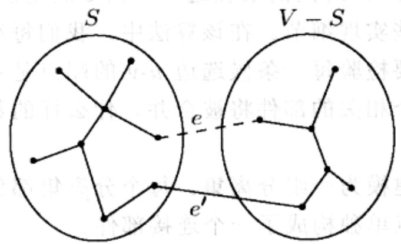  
图 5-2 $T \cup \{e\}$ 。将 e(虚线)增加到 T(实线)中产生了一个环。该环至少包含另一条跨越分割 $\{S, V-S\}$ 的边，图中为 $e'$

图 5-3 为分割性质的示例。其中哪条边是 $e'$ 呢？

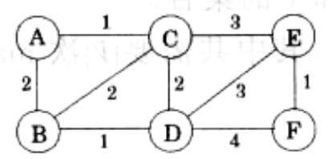

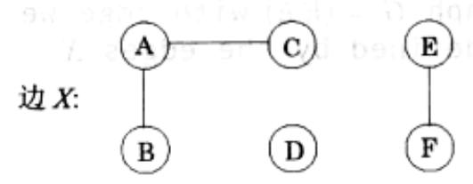

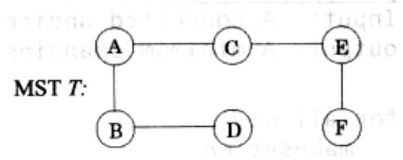

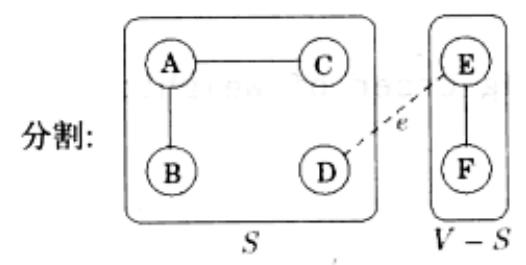

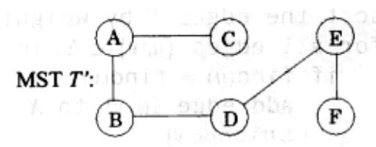  
图 5-3 分割性质示例。(a)为一个无向图。(b)中的边集 X 有三条边，且 X 被包含于右侧的 MST T。(c)中 $S=\{A, B, C, D\}$ ，一条跨越分割 $\{S, V-S\}$ 的最轻边为 $e=\{D, E\}$ 。 $X \cup \{e\}$ 被包含于右侧的另一个 MST T'

## 5.1.3 Kruskal算法

现在我们可以验证 Kruskal 算法了。在任一给定时刻，该算法选出的边构成了一个部分解，这个部分解由一堆连接部件构成，每个部件都具有树结构。下一条将要加入的边将其中的某两个部件，将它们分别记为 $T_{1}$ 和 $T_{2}$ 。由于 $\pmb{e}$ 是不会形成环的最轻边，它当然也是 $T_{1}$ 和 $V - T_{1}$ 间的最轻边，从而 $\pmb{e}$ 满足以上的分割性质。

下面我们来给出一些实现细节。在该算法中，我们每次选择一条边加入到现有的部分解中。为此，需要检验每一条候选边 $u - v$ 的端点是否分属不同的连接部件。一旦选定了某条边，两个相关的部件将被合并。什么样的数据结构能支持这样的操作呢？

我们将算法的状态建模为一组分离集。每个分离集都包含对应于某连接部件的所有节点。最初每个节点单独构成了一个连接部件。

makeset(x): 创建一个仅包含 x 的独立集合。

我们不断重复地检验节点对，判断其是否属于同一个集合。

find(x): $x$ 属于哪个集合？

每当增加了一条边，将与之相关的两个部件进行合并。

union(x, y): 合并包含 x 和 y 的集合。

最终的算法如图 5-4 所示。其中共需要 $|V|$ 次 makeset、2|E| 次 find 和 $|V|-1$ 次 union 操作。

```python
procedure kruskal (G, w)
Input: A connected undirected graph G = (V, E) with edge weights we
output: A minimum spanning three defined by the edges X

for all u ∈ V:
    makeset (u)

X = {}
sort the edges E by weight
for all edges {u, v} ∈ E, in increasing order of weight:
    if find(u) ≠ find(v):
    add edge {u, v} to X
    union(u, v)
```  
图 5-4 Kruskal 的最小生成树算法

## 5.1.4 一种用于分离集的数据结构

基于等级的合并：

存储集合的方法之一是采用有向树(如图 5-5 所示)。树的节点对应于集合中的元素。节点在组织上不强调一定的顺序，但是每个节点都包含一个父指针。父指针使得节点一级级相连并最终指向树的根。树根的元素自然成为集合的代表(或者集合的名字)。与其他元素不同，树根的父指针指向该元素自身。

除了父指针 $\pi$ ，每个节点还有一个等级信息。就目前而言，我们可以将节点的等级解释为其下悬挂的子树的高度。

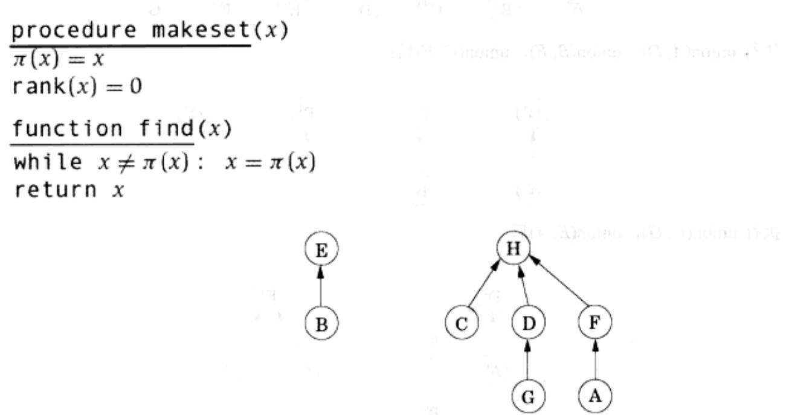  
图5-5 代表集合 $\{B, E\}$ 和 $\{A, C, D, F, G, H\}$ 的有向树

显然，makeset 是一个常数时间的操作。另一方面，find 循着节点的父指针找到树的根，其所需时间应该和树的高度成正比。由于树的构造事实上是由第三个操作 union 操作实现的，因此，在该操作中，我们应该尽量使树的高度保持较低。

合并两个树的过程很简单，只需将一个树的根(的父指针)指向另一个树的根。在此我们面临一个选择：假设两个集合的根分别是 $r_x$ 和 $r_y$ ，我们是该让 $r_x$ 指向 $r_y$ 呢，还是相反？注意到树的高度对计算效率具有决定性的影响，因此一个好的策略是：让较低的树的根指向较高的树的根。这样一来，除非将要合并的树等高，否则将不会出现合并后总高度增加的情形。不过，这里我们将不直接计算树的高度，而代之以比较树根的等级——为此，我们称该操作为基于等级的合并。

<div class="mineru-algorithm">
procedure union(x, y)
 $r_{x} = \text{find}(x)$ $r_{y} = \text{find}(y)$ 
if  $r_{x} = r_{y}$ : return
if  $\text{rank}(r_{x}) > \text{rank}(r_{y})$ :
 $\pi(r_{y}) = r_{x}$ 
else:
 $\pi(r_{x}) = r_{y}$ 
if  $\text{rank}(r_{x}) = \text{rank}(r_{y})$ :  $\text{rank}(r_{y}) = \text{rank}(r_{y}) + 1$
</div>

## 示例如图 5-6 所示。

$\int_{a}^{b} |t| = \int_{a}^{b} |t| = \int_{a}^{b} \cdots \int_{a}^{b} |t| = \int_{a}^{b} e^{-b}$

执行 makeset(A), makeset(B), ..., makeset(G)后:

执行 union(A, D)，union(B, E)，union(C, F)后：

执行 union(C, G), union(E, A)后:

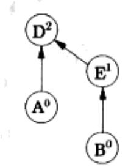

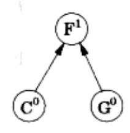

执行 union(B, G)后：

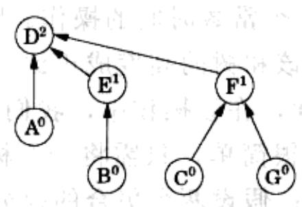  
图 5-6 分离集操作的过程。图中节点上标为其等级

根据设计，节点的等级事实上就是以该节点为根的子树的高度。这意味着，当沿着一条路径向根节点前进时，途经节点的等级是严格递增的。

性质 1 对任意 x， $\text{rank}(x) < \text{rank}(\pi(x))$ 。

两个根等级同为 $k - 1$ 的树的合并后将出现一个等级为 $\pmb{k}$ 的根节点。由归纳法，可以证明(请自行尝试证明)。

性质2 任一根节点等级为 $k$ 的树至少包含 $2^{k}$ 个节点。

该性质可以扩展到树的内部节点(非根节点)的情况，即一个等级为 $k$ 的节点最少有 $2^{k}$ 个子孙(descendant)。任一内部节点都可能曾经是某个树的根，而自其转变为内部节点后，其等级和子孙就都不会再发生任何改变了。更进一步地，等级为 $k$ 的不同节点不可能拥有同样的子孙，其原因在于性质1决定了任意元素最多有一个等级为 $k$ 的祖先。因此：

性质3 如果共有 $n$ 个元素，则最多有 $n / 2^{k}$ 个等级为 $k$ 的节点。

该性质说明，节点的最大等级值为 $\log n$ 。因此，所有树的高度均小于等于 $\log n$ ，这恰好就是运行 find 和 union 的时间上限。

## 路径压缩：

给出了以上的数据结构，可以估算出 Kruskal 算法总的运行时间，它等于用于边排序的 $O(|E|\log |V|)$ (注意， $\log |E|\approx \log |V|)$ 加上其余用于运行 union 和 find 操作的 $O(|E|\log |V|)$ 。就此看来，仍然有进一步改进该算法效率的必要。

考虑一下如果我们所得到的边是已经排序好的，情况会怎样？或者如果所有边的权重值都较小(比如 $O(|E|))$ ，从而排序能在线性时间内结束，又会如何？所以说，在此，数据结构成为了一个性能瓶颈。因此引入某种数据结构上的改进，使每次操作的时间在 $\log n$ 的基础上有所降低，将是非常有意义的。同样地，这一数据结构上的改进对于其他许多算法应用也会带来帮助。

但是，怎样才能使 union 和 find 的操作时间比 $\log n$ 更短呢？答案是，通过增加少量特殊的维护操作，使数据结构始终保持一种良好的形态。这正如许多家庭主妇所了解的，在日常生活中付出一点防患于未然的代价，往往能在长期内不断收到回报。受其启发，为了使树的高度有所降低，我们构造了一个针对 union-find 数据结构的额外维护操作——在每次 find 操作中，当循着一系列的父指针最终找到树的根后，改变所有这些父指针的目标，使其直接指向树根(如图 5-7 所示)。这种称为路径压缩的方法仅仅稍许增加了 find 操作的时间，同时其编码是非常简单的：

<div class="mineru-algorithm">
function find(x)
if  $x \neq \pi(x)$ :  $\pi(x) = \text{find}(\pi(x))$ 
return  $\pi(x)$
</div>

这一小小改变所带来的好处，更多地表现为长期的性能改善，而非眼前的利益。因此，对其进行分析也需要采用一些特殊的方法：我们需要从算法之初的空数据结构开始，对发生过的一系列 find 和 union 操作进行观察，并计算其平均的操作时间。结果是，总的代价分摊后由此前的 $O(\log n)$ 下降到了仅仅略微超过 $O(1)$ 。

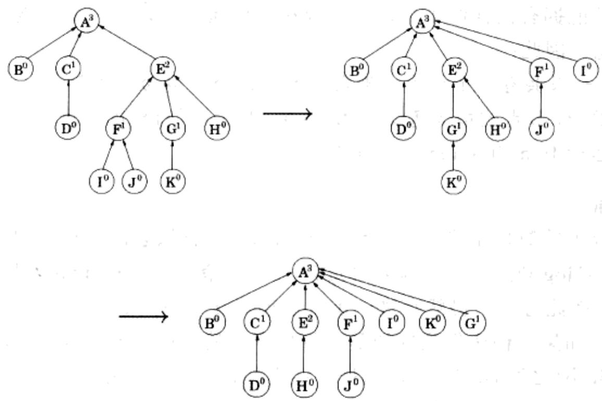  
图 5-7 路径压缩的作用：在 find(K)之后执行 find(I)

以上的数据结构可以视为由包含根节点的“顶层”和其下方树的内部所组成。这恰好对应于以下的分工，即 find 操作(不论是否采用路径压缩)仅仅触及树的内部，而 union 则只关注树的顶层。因此，路径压缩不会对 union 操作产生任何影响，它将保持树的顶层不变。

至此可知，对于根节点而言，通过路径压缩，其等级不会发生任何改变。但是，对于不是树根的节点呢？注意到一旦某个节点由树根转变为内部节点，将不再可能转变回来，因此其等级也就固定了。这意味着，通过路径压缩，所有节点的等级都不会发生改变。显然，此时节点的等级已经不再能解释为其下方子树的高度。不过，幸运的是，此前的性质1至性质3都仍然成立。

如果有 n 个元素，则由性质 3，其等级的范围将为 $0 \sim \log n$ 。我们将该范围内的非零值划分为如下的区间(为什么这样划分，很快就会清楚):

$$
\{1 \} 、 \{2 \} 、 \{3, 4 \} 、 \{5, 6, \dots , 1 6 \} 、 \{1 7, 1 8, \dots , 2 ^ {1 6} = 6 5 5 3 6 \} 、 \{6 5 5 3 7, 6 5 5 3 8, \dots , 2 ^ {6 5 5 3 6} \}, \dots
$$

每个区间形如 $\{k + 1, k + 2, \ldots, 2^k\}$ ，其中 $k$ 为 2 的幂。区间的总数为 $\log^{*} n$ ，其定义为：由 $n$ 开始，连续进行取对数操作，使得最终结果小于等于 1 所需的操作次数。例如：由于 $\log \log \log \log 1000 \leqslant 1$ ，故 $\log^{*} 1000 = 4$ 。以上我们共列出了 5 个区间，除非 $n \geqslant 2^{65536}$ ，否则这些就足够了。

在一系列的 find 操作中，每次操作所需时间长短可能各不相同。在此，我们通过一种颇有创意的方法来估算其总的运行时间上限。首先，我们给每个节点一定数量的“零花钱”，使得总的发放数额不超过 $n \log^{*} n$ 。然后我们将说明，每个 find 操作需要 $O(\log^{*} n)$ 步，外加一些额外的处理时间。这些额外的时间将由节点花钱购得——每单位时间一元。因此，m 次 find 操作的总时间为 $O(m \log^{*} n)$ 加上最多 $O(n \log^{*} n)$ 。

具体来说，当某个节点不再为根时，将收到以上这类“补贴”，此时其等级已经固定了。如果该节点的等级属于 $\{k + 1, k + 2, \dots, 2^k\}$ ，它将收到 $2^k$ 元。由性质3，等级大于 $k$ 的节点的数量上限为

$$
\frac {n}{2 ^ {k + 1}} + \frac {n}{2 ^ {k + 2}} + \dots \leq \frac {n}{2 ^ {k}}
$$

因此，给等级同处于该区间的节点的总钱数最多为 $n$ 元。注意到共有 $\log^{*} n$ 个区间，因此发给所有节点的钱数小于等于 $n \log^{*} n$ 。

至此，某一次 find 操作的时间将简单地等于指向其的指针数。考虑到沿着节点组成的链条上溯到根的过程中途径节点的等级在不断提高，因此链上的任意节点 $x$ 必然属于如下两类之一：要么 $\pi(x)$ 的等级所在区间高于 $x$ 等级所在区间，要么两者为相同的区间。最多有 $\log^{*} n$ 个节点属于前一类(您知这是为什么吗？)，因此对这类节点的处理共需要 $O(\log^{*} n)$ 的时间。剩余的节点——其父辈的等级与该节点的等级同在一个区间——不得不从口袋里掏钱购买其处理所需时间。

以上方法发挥作用的前提是，每个节点 $x$ 都有足够多的补贴用于在一系列 find 操作中的开支。一个重要的观察结论是：每当 $x$ 支付 1 元，其父辈的等级将至少加 1。因此，如果 $x$ 的等级位于 $\{k + 1, k + 2, \ldots, 2^k\}$ 中，其最多需要支付 $2^k$ 元以保证其父辈的等级进入一个更高的区间。此外就没有进一步支付的必要了。

## 5.1.5 Prim算法

让我们回到最小生成树的算法上来。从最一般的意义上，分割性质告诉我们，任意遵循以下贪心模式的算法都一定是有效的：

<div class="mineru-algorithm">
$X = \{ \}$ (edges picked so far)
repeat until $|X| = |V| - 1$:
pick a set $S \subset V$ for which $X$ has no edges between $S$ and $V - S$
let $e \in E$ be the minimum-weight edge between $S$ and $V - S$ $X = X \cup \{e\}$
</div>

Kruskal算法的一个流行变体是所谓的Prim算法。在该算法中，算法中间阶段的边集 $X$ 总是构成了一个子树，以下以 $S$ 表示该子树顶点的集合。

在 Prim 算法的每一步迭代中，由 X 定义的子树将生长一条边，具体来说，我们将选择 S 中顶点与 S 外顶点之间的最轻边加入 X(参见图 5-8)。换句话说，我们可以认为 S 生长的方式是要以最小的代价将所有原本不属于 S 的顶点 v 包含进来：

$$
\operatorname{cost} (v) = \min _ {u \in S} w (u, v)
$$

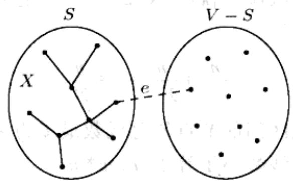  
图5-8 Prim算法：边集 $X$ 构成了一棵树， $S$ 是其顶点集合

这立刻让人回想起 Dijkstra 算法。事实上，这两个算法的伪代码(如图 5-9 所示)是基本一致的，仅有的不同在于优先级队列排序所使用的键值。在 Prim 算法中，键值为节点与集合 S 中顶点间的最轻边的权重，而在 Dijkstra 算法中，键值为由起始点到某节点的完整路径长度。除此以外，这两个算法确实非常相似，它们甚至具有相同的运行时间，而该时间仅取决于特定的优先级队列实现。

```python
procedure prim (G, w)
Input: A connected undirected graph G = (V, E) with edge weights we
output: A minimum spanning tree defined by the array prev
for all u ∈ V:
    cost(u) = ∞
    prev(u) = nil
pick any initial node u0
cost(u0) = 0
H = makequeue (V) (priority queue, using cost-values as keys)
while H is not empty:
    v = deletemin (H)
    for each {v, z} ∈ E:
    if cost(z) > w(v, z):
    cost(z) > w(v, z)
    prev(z) = v
```

图5-9为Prim算法在一个仅包含6个节点的图上的运行过程。请留意其中是如

· 何使用 prev 数组完整描述最终得到的 MST 的。

  
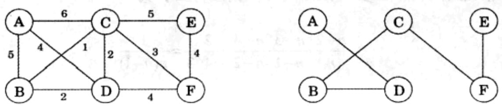

<table><tr><td>集合S</td><td>A</td><td>B</td><td>C</td><td>D</td><td>E</td><td>F</td></tr><tr><td>&#123;&#125;</td><td>0/nil</td><td>∞/nil</td><td>∞/nil</td><td>∞/nil</td><td>∞/nil</td><td>∞/nil</td></tr><tr><td>A</td><td></td><td>5/A</td><td>6/A</td><td>4/A</td><td>∞/nil</td><td>∞/nil</td></tr><tr><td>A,D</td><td></td><td>2/D</td><td>2/D</td><td></td><td>∞/nil</td><td>4/D</td></tr><tr><td>A,D,B</td><td></td><td></td><td>1/B</td><td></td><td>∞/nil</td><td>4/D</td></tr><tr><td>A,D,B,C</td><td></td><td></td><td></td><td></td><td>5/C</td><td>3/C</td></tr><tr><td>A,D,B,C,F</td><td></td><td></td><td></td><td></td><td>4/F</td><td></td></tr></table>

图5-9 顶部：Prim的最小生成树算法。底部：Prim算法的过程，由节点 $A$ 开始。同时给出了cost/prev值的表格，以及最终的MST

<Knowledge title="专栏: 最小分割的一个随机算法">

我们已经了解到生成树与分割是密切相关的。以下是它们的另一种联系。我们将 Kruskal 算法中最后加入生成树的边移除，这样树就被分成了两个部分，从而在图中定义了一个分割 $(S, \overline{S})$ 。关于这一分割我们能说些什么呢？设想我们所关注的图是没有边权重的，并且为了利用 Kruskal 算法对其进行处理，已采用某种随机的方式对其中的边进行了排序。在此有一个值得注意的事实是： $(S, \overline{S})$ 为图中最小分割的概率至少为 $1/n^{2}$ ，这里 $(S, \overline{S})$ 的规模定义为跨越 S 和 $\overline{S}$ 的边的数量。这意味着，对于图 G，重复以上过程 $O(n^{2})$ 次并找出其中的规模最小者，将能以很高的概率得到 G 的最小分割——总体上，这是一个求无权重图最小分割的复杂度为 $O(mn^{2} \log n)$ 的随机算法。对该算法的进一步改造能够使其复杂度达到 $O(n^{2} \log n)$ ，该方法由 David Kargar 发明，是目前所知针对最小分割这一重要问题的最快的算法。

下面来看看为什么说在每次迭代中得到最小分割的概率至少为 $1/n^2$ 。在 Kruskal 算法的任一阶段，顶点集 $V$ 被划分为多个连通部件。能够加入到生成树中的边的两个端点必须分别处于不同的部件中。注意到与每个部件相连的跨越其边界的边的数量至少为 $C$ ，也即 $G$ 的最小分割的大小（我们可以认为每个部件基于一个分割与图的其他部分相分离）。因此，如果在图中有 $k$ 个部件，则可选的边数将至少有 $kC/2$ 条（每个部件都有至少包含 $C$ 条跨越边界的边，且由于每条边都有两个端点，因此每条边都被重复计数了 1 次）。由于边是随机排序的，列表中下一条可选的边来自最小分割的概率最多为 $C/(kC/2)=2/k$ 。因此，至少有 $1-2/k=(k-2)/k$ 的概率，使得新选择的边不会触及最小分割(即该边不属于最小分割)。于是，在 Kruskal 算法的运行过程中，直到增加最后一条边前仍然不触及最小分割的概率至少为

$$
\frac {n - 2}{n} \cdot \frac {n - 3}{n - 1} \cdot \frac {n - 4}{n - 2} \dots \frac {2}{4} \cdot \frac {1}{3} = \frac {1}{n (n - 1)}
$$

</Knowledge>
