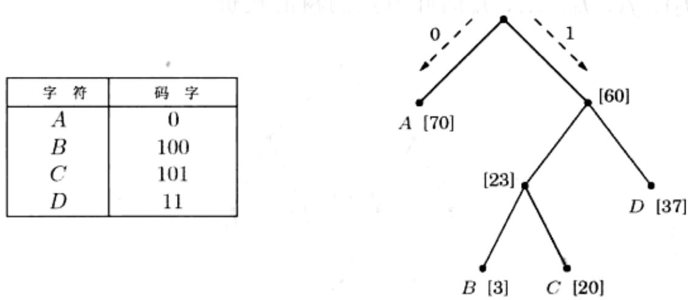
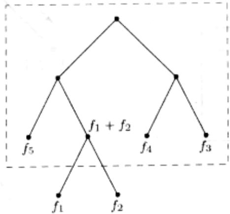

import Guide from '@/components/Guide.astro';
import Knowledge from '@/components/Knowledge.astro';
import Example from '@/components/Example.astro';
import Analysis from '@/components/Analysis.astro';
import Solution from '@/components/Solution.astro';
import Variant from '@/components/Variant.astro';
import Note from '@/components/Note.astro';
import Block from '@/components/Block.astro';
import Method from '@/components/Method.astro';
import Exercise from '@/components/Exercise.astro';
import Algorithm from '@/components/Algorithm.astro';

## 5.2 Huffman 编码

在 MP3 音频压缩中，声音信号的编码分为三步：

1. 通过周期间隔的采样，将信号数字化为一个实数序列 $s_1$ 、 $s_2$ 、 $\ldots$ 、 $s_T$ 。例如，以每秒44100次的频率进行采样，一个50分钟的交响乐产生的数据量为 $T = 50 \times 60 \times 44100 \approx 130M$ ( $1M = 1000000$ ) $^1$ 。

2. 对以上实数采样值进行量子化(quantize)，即将其逐一替换为某个有限集 $\Gamma$ 中与之最相近的数。集合 $\Gamma$ 的选择参考了人类的听觉感知极限，仅凭人耳将无法分辨出近似值序列与真实 $s_1, s_2, \ldots, s_T$ 之间的差别。

3. 对以 $\Gamma$ 中字符表示的长度为 $T$ 的字符串进行二进制编码。

以上最后一步中将用到Huffman编码。为了解其作用，让我们先观察一个小例子，其中 $T$ 等于130M，字符集Γ中仅有4个不同的值，分别记为 $A$ 、 $B$ 、 $C$ 、 $D$ 。怎样才能以最经济的方法记录下这样一个很长的字符串呢？一个显而易见的选择是2位的字符编码，即以00表示 $A$ ，01表示 $B$ ，10表示 $C$ ，以及11表示 $D$ 。这样下来共需要260Mb(1Mb即1M位)。还有比这更好的编码方式吗？

为了寻找灵感，我们对这段特定的字符序列做了更细致的观察，结果发现其中的4个字符存在着出现频度上的差异。

<table><tr><td>字符</td><td>频度</td></tr><tr><td>A</td><td>70 000 000</td></tr><tr><td>B</td><td>3 000 000</td></tr><tr><td>C</td><td>20 000 000</td></tr><tr><td>D</td><td>37 000 000</td></tr></table>

是否存在某种可变长度编码，其中仅使用一个位表示频繁出现的字符 $A$ ，而可

能的代价的是对于那些不常见的字符会需要3位或者更多的位呢？

使用这类可变长度编码的一个危险在于编码的结果可能无法被唯一解码。例如，假设 $A$ 、 $B$ 、 $C$ 、 $D$ 对应的码字(codeword)分别为 $\{0,01,11,001\}$ ，则对字串001的解码将存在AAA、AB以及 $D$ 等多种可能。为避免这个问题，在编码中，我们强调如下的无前缀特性，即任一个码字都不应该是其他码字的前缀。

任一无前缀编码都可以表示为一个完全二叉树。完全二叉树的特点在于其节点要么无后代要么一定有2个直接后代。无前缀编码中每个字符对应于树的一个叶节点，而其码字由树根到该叶节点的路径决定。具体来说，编码从左至右，每一位对应于路径上的一步，如果叶节点处于对应分枝节点的左侧则该位为0，否则为1(参见习题5.29)。图5-10给出了对4个字符 $A, B, C, D$ 的一种无前缀编码。基于这一编码，解码的方式是统一的：对于要解码的位串，由二叉树的根部开始，一边从左至右地读入位，一边根据读入的位值沿树的分枝向下，直到到达某个叶节点；然后将叶节点对应的字符输出，并返回树的根部继续以上过程。这一方法对于我们所举的小例子有很好的处理效果(参照图5.10的编码)，编码后二进制串的长度较之前的等长度编码缩短为 $213\mathrm{Mb}$ ，改进幅度达 $17\%$ 。

  
图5-10 一个无前缀编码。方括号内为每个字符的出现频度

对于一般的情形，如果给定了 $n$ 个字符的出现频度 $f_{1}, f_{2}, \ldots, f_{n}$ ，我们该如何找到最优的编码树呢？说得更精确些，我们需要找到这样一个树，不仅其每个叶节点对应于一个要编码的字符，同时这种对应能够使得最终的编码结果总长度最短。为此，我们定义：

$$
\text { 树的代价 } (\mathrm{cost}) = \sum_ {i = 1} ^ {n} f _ {i} \cdot (\text { 第 } i \text { 个字符在树中的深度 })
$$

(一个字符的编码长度就是其在树中对应节点的深度)。

以上的代价函数还有另一种很有用的表示方法。给定叶节点的出现频度，我们可以进一步定义树中任意一个内部节点的出现频度为其所有子孙节点的出现频度之和。事实上，该频度对应于编码或解码过程中历经该节点的次数。在编码过程中，当我们沿着树下移，每经过一个非根的节点就输出1比特。因此，树的总代价——也即总共输出的比特数——也可以表示为：

树的代价就是不包含根节点在内的所有树叶节点和内部节点的频度之和。

以上的第一个代价公式告诉我们，具有最低频度的两个字符必然处于最优树的底部，也即其对应的叶节点是树中位置最低的内部节点的直接后代(由于该树是满的，因此任一内部节点都有两个直接后代)。如果不是这样，将这两个字符和任意其他字符交换位置都能使得编码效果得到改善(因此当前的编码就不是最优的)。

现在我们可以用一种贪心的方式来构造最优树：首先，找出两个出现频度最低的字符，例如 $i$ 和 $j$ ，将其作为某个节点的后代，记该节点的频度为 $f_{i} + f_{j}$ 。为了便于陈述，不妨将以上符号记为 $f_{1}$ 和 $f_{2}$ 。由代价函数的第二种表示，任一包含 $f_{1}$ 和 $f_{2}$ 为同胞叶节点(即 $f_{1}$ 和 $f_{2}$ 具有共同的父节点)的树代价为： $f_{1} + f_{2}$ 加上一个包含 $n - 1$ 个频度分别为 $(f_{1} + f_{2})$ 、 $f_{3}$ 、 $f_{4}$ 、…、 $f_{n}$ 的叶节点的树的代价。



接下来的工作相当于我们上一步开始时对应问题的一个规模稍小的版本。为此，我们将 $f_{1}$ 和 $f_{2}$ 从频度序列中清除，然后将 $f_{1} + f_{2}$ 插入，并重新开始循环。最终的算法可以用优先级队列操作(参见4.4.1节Dijkstra算法中的介绍)进行描述。如果在其中使用二分堆(参见4.5.2节)，其运行时间仅为 $O(n\log n)$ 。

<div class="mineru-algorithm">
procedure Huffman(f)
Input: An array  $f[1\cdots n]$  of frequencies
Output: An encoding tree with n leaves
</div>

```python
let H be a priority queue of integers, ordered by f
for i=1 to n: insert(H,i)
for k=n+1 to 2n-1:
    i=deletemin(H), j=deletemin(H)
    create a node numbered k with children i,j
    f[k]=f[i]+f[j]
    insert(H,k)
```

回到之前的那个小例子：您能判断出我们在图5-10中给出的编码是否为最优吗？

## 熵

国家年度赛马会引进了三匹从未一起比赛过的纯种马。令人兴奋的是，您研究了它们各自参加过的200场比赛，并总结出对于它们分别位列一、二、三名或其他靠后名次的概率分布：

<table><tr><td>排名</td><td>Aurora</td><td>Whirlwind</td><td>Phantasm</td></tr><tr><td>第一</td><td>0.15</td><td>0.30</td><td>0.20</td></tr><tr><td>第二</td><td>0.10</td><td>0.05</td><td>0.30</td></tr><tr><td>第三</td><td>0.70</td><td>0.25</td><td>0.30</td></tr><tr><td>其他</td><td>0.05</td><td>0.40</td><td>0.20</td></tr></table>

那么，哪匹马的成绩最可预测呢？一种定量的方法是评估所谓的可压缩性。将每匹赛马的比赛历史记录为一个长度200的值(对应第一、第二、第三和其他)串。通过Huffman算法可以计算出将这些比赛记录进行编码最少需要多少位。结果依次是：Aurora: 290位，Whirlwind: 380位，Phantasm: 420位(请您自行检验)。Aurora的编码最短，因此我们说其成绩是最可预测的。

某个概率分布内在的不可预测性，或者说随机性，可以通过该分布所产生数据可被压缩的程度进行度量，也即：

$$
\text { 压缩比越高 } \equiv \text { 随机性越低 } \equiv \text { 可预测性越好 }
$$

考虑存在 $n$ 个可能输出的情况，对应概率分别为 $p_1, p_2, \ldots, p_n$ 。假设存在由该分布生成的包含 $m$ 个值的序列，则第 $i$ 个输出总的出现次数约为 $mp_{i}$ (假设 $m$ 足够大)。为了简化，假设这些恰好就是实际观察到的频度，并且 $p_i$ 都是2的幂(形如 $1 / 2^k$ )。通过归纳(参见习题5.19)可知，编码该序列所需的比特数为 $\sum_{i=1}^{n} mp_i \log(1 / p_i)$ 。因此，对于该分布生成的每个值，编码所需的平均比特数为

$$
\sum_ {i = 1} ^ {n} p _ {i} \log \frac {1}{p _ {i}}
$$

它被称为该分布的熵，是对其中包含的随机性的一种度量。

举例来说，一个均匀的硬币抛落后每一面朝上的概率各为 $1 / 2$ 。因此其熵为

$$
\frac {1}{2} \log 2 + \frac {1}{2} \log 2 = 1
$$

一种更自然的说法是：抛硬币包含了1比特的随机性。但如果这个硬币本身不均匀呢，例如我们假设其中某一面朝上的概率为3/4？则：

$$
\frac {3}{4} \log \frac {4}{3} + \frac {1}{4} \log 4 = 0. 8 1
$$

显然，较之一个均匀的硬币，偏向一边的硬币的落地结果将更容易预测，因此其熵更低。且随着这种偏向不断加剧，其熵将不断下降并趋于0。

对以上概念的进一步探讨请参见习题 5.18 和 5.19。
