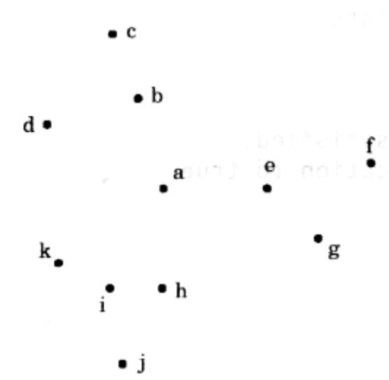
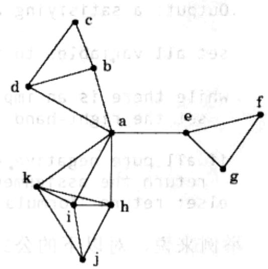
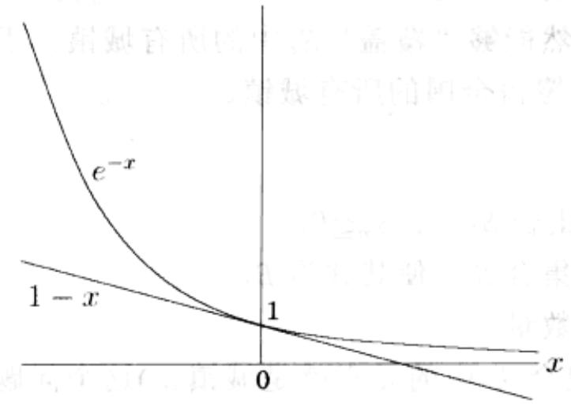

import Guide from '@/components/Guide.astro';
import Knowledge from '@/components/Knowledge.astro';
import Example from '@/components/Example.astro';
import Analysis from '@/components/Analysis.astro';
import Solution from '@/components/Solution.astro';
import Variant from '@/components/Variant.astro';
import Note from '@/components/Note.astro';
import Block from '@/components/Block.astro';
import Method from '@/components/Method.astro';
import Exercise from '@/components/Exercise.astro';
import Algorithm from '@/components/Algorithm.astro';

## 5.4 集合覆盖

图5-11中的点代表一组城镇。在国家建设规划的初期，需要决定在什么地方建设一些新的学校。这里有两个具体的要求：一是所有的学校都必须建在城镇上，二是从任意一个城镇出发，都应该可以在30英里的范围到到达其中的某一所学校。那么，最少需要建多少所学校呢？

(a)  

(b)  
  
图 5-11 (a)11 个城镇；(b)相互距离在 30 英里内的城镇

这是一个典型的集合覆盖问题。对每个城镇 $x$ ，令 $S_x$ 为在其30英里范围内的城镇集合。建在 $x$ 的学校显然能够“覆盖” $S_x$ 中的所有城镇。于是我们的问题就是，需要多少个这样的 $S_x$ 才能覆盖全国的所有城镇。

## 集合覆盖问题

输入：元素集合 B。集合 $S_{1}, \ldots, S_{m} \subseteq B$ 。

输出：选出的一部分集合 $S_{i}$ ，使其并为 $B$ 。

成本：所选出的集合数量。

(在我们的例子中，集合 $B$ 中的元素就是城镇。)这个问题本身很自然地引出了如下的贪心解法。

不断重复：直到 $B$ 中的所有元素都被覆盖：

选取包含未被覆盖元素的最大集合 $S_{i}$ 。

这是极其自然和符合直觉的。让我们看看它如何处理此前的那个小例子。首先它会在城镇 $a$ 建立一所学校，因为这样能覆盖最多的城镇。此后，它将进一步选择 $c, j$ 以及 $f$ 和 $g$ 之一建立另三所学校。这样最终所需的学校总数为4。不幸的是，实际上还存在一个更好的解，那就是将学校分别建在 $b, e$ 和 $i$ ，如此只需要三所学校就可以覆盖所有城镇。在这里贪心方法并不是最优的！

幸运的是，贪心算法的解与最优解的距离其实并不遥远。

断言 设 B 有 n 个元素，且其最优覆盖共包含 k 个集合，则贪心算法所得结果最多包含 $k \ln n$ 个集合 $^{2}$ 。

设 $n_t$ 为贪心算法中经过 $t$ 次迭代后仍未覆盖的元素数量(显然 $n_0 = n$ )。由于这些剩余的元素能被最优的 $k$ 个集合覆盖，因此，当前一定存在某个包含其中 $n_t / k$ 个元素的集合。这意味着，贪心策略能够使得

$$
n _ {t + 1} \leq n _ {t} - \frac {n _ {t}}{k} = n _ {t} \left(1 - \frac {1}{k}\right)
$$

从而 $n_t \leqslant n_0(1 - 1 / k)^t$ 。进一步，由

“对任意 $x$ ， $1 - x\leqslant e^{-x}$ ，当且仅当 $x = 0$ 时等号成立”

(以上不等式的正确性如图 5-12 可证),

  
图5-12 不等式的正确性

國向嘉醫合案

可得

$$
n _ {t + 1} \leq n _ {0} \left(1 - \frac {1}{k}\right) ^ {t} <   n _ {0} (e ^ {- 1 / k}) ^ {t} = n e ^ {- t / k}
$$

因此当 $t = k\ln n$ 时， $n_t$ 严格小于 $ne^{-\ln n} = 1$ ，即再也没有未被覆盖的元素了。

贪心算法的解与实际的最优解的规模之比可能因问题输入的不同而不同，但是总小于 $\ln n$ 。对于某些特定的输入，这一比例会非常接近于 $\ln n$ (参见习题5.34)。我们称这一最大比值为该贪心算法的逼近因子。看起来对这样的结果应该还有很大的改进余地，但事实上这中改进的空间并不存在。目前已知的结论是，在某些广泛成立的复杂性假设(这些假设在我们达到第8章时将变得更加清晰)之下，可以证明对以上问题不存在具有更小逼近因子的多项式时间算法。
