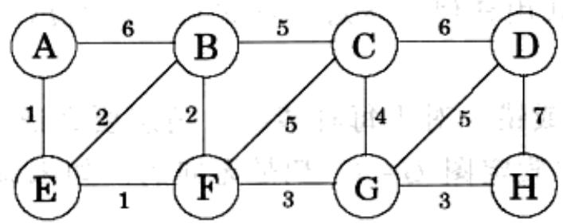
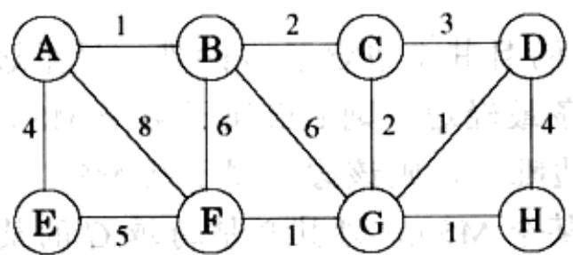

import Guide from '@/components/Guide.astro';
import Knowledge from '@/components/Knowledge.astro';
import Example from '@/components/Example.astro';
import Analysis from '@/components/Analysis.astro';
import Solution from '@/components/Solution.astro';
import Variant from '@/components/Variant.astro';
import Note from '@/components/Note.astro';
import Block from '@/components/Block.astro';
import Method from '@/components/Method.astro';
import Exercise from '@/components/Exercise.astro';
import Algorithm from '@/components/Algorithm.astro';

## 第5章 习题

<Exercise title="习题 5.1">

考虑如下的图

(a) 其最小生成树的代价是多少？

(b) 它共有几个最小生成树？

(c) 在其上运行 Kruskal 算法。边加入 MST 的顺序是怎样的？对于每一条边的加入，给出可验证其正确性的分割。

(2) 一个个共数 0
, 额面不等

如：会不过 0？

</Exercise>

<Exercise title="习题 5.2">

求下图的最小生成树

$\frac{1}{2} \left( 1 - \frac{1}{2} \right) = \frac{1}{2} \left( 1 - \frac{1}{2} \right) = \frac{1}{2} \left( 1 - \frac{1}{2} \right) = \frac{1}{2} \left( 1 - \frac{1}{2} \right) = \frac{1}{2} \left( 1 - \frac{1}{2} \right) = \frac{3}{4} \left( 1 - \frac{3}{4} \right) = \frac{3}{4} \left( 1 - \frac{3}{4} \right) = \frac{3}{4} \left( 1 - \frac{3}{4} \right) = \frac{3}{4} \left( 1 - \frac{3}{4} \right) = \frac{3}{4} \left( 1 - \frac{3}{4} \right).$

(a) 运行 Prim 算法。每当需要选择节点时，总是参考其字母顺序(例如，从节点 A 开始)。画出 cost 数组的中间值表格。

(b) 运行 Kruskal 算法。假设我们使用了路径压缩，请给出每一中间阶段的分离集数据结构(包括有向树的结构)。

</Exercise>

<Exercise title="习题 5.3">

请为如下任务设计一个线性时间的算法：

输入：一个连通的无向图 G。

问题：是否可以从 $G$ 中移除一条边，使 $G$ 仍然保持连通？

能否将算法时间压缩在 $O(|V|)$ 内。如何做？

</Exercise>

<Exercise title="习题 5.4">

证明如果某个包含 $n$ 个顶点的无向图由 $k$ 个连接部件构成，则其至少有 $n - k$ 条边。

</Exercise>

<Exercise title="习题 5.5">

考虑无向图 $G = (V, E)$ ，其边权重 $w_{e} \geqslant 0$ 。假设我们已经得到了 $G$ 的一个最小生成树，以及由某个节点 $s \in V$ 到其他所有节点的最短路径。

现在将所有边的权重加1，即：新的边权重 $w_{e}^{\prime}=w_{e}+1$ 。

(a) 最小生成树会发生变化吗？如果变化了，给出一个例子，否则请证明其不变。

(b) 最短路径会发生变化吗？如果变化了，给出一个例子，否则请证明其不变。

</Exercise>

<Exercise title="习题 5.6">

设 $G = (V, E)$ 是一个无向图。证明如果 $G$ 所有边的权重都各不相同，则其最小生成树唯一。

</Exercise>

<Exercise title="习题 5.7">

如何寻找一个图的最大生成树，也即总权重最大的生成树？

</Exercise>

<Exercise title="习题 5.8">

给定一个加权的图 $G = (V, E)$ 。 $G$ 中包含一个特殊顶点 $s$ ，与其相连的所有边的权重都为正，且值各不相同。是否存在某种可能，使得 $s$ 的一个最短路径树与

$G$ 的某个最小生成树不共用任何一条边？如果可能，给出一个例子，否则请说明为什么不可能。

</Exercise>

<Exercise title="习题 5.9">

以下叙述或对或错。对于每种情况，请您要么证明之(如果正确)，要么给出反例(如果错误)。其中假定图 $G = (V, E)$ 是无向的。如未说明，不假定边权重各不相同。

(a) 若 $G$ 有超过 $|V| - 1$ 条边，且有唯一一条最重边，则这条边必不属于 $G$ 的任意最小生成树。

(b) 若 $G$ 中存在一个环, 且其上包含了 $G$ 的唯一最重边 $e$ , 则 $e$ 不属于任何 MST。

(c) 设 $e$ 是 $G$ 中的一条最轻边。则 $e$ 必属于某个MST。

(d) 如果图中的最轻边唯一，则该边必属于某 MST。

(e) 如果 $e$ 属于 $G$ 的某个MST，则其必是跨越 $G$ 的某个分割的最轻边。

(f) 若 $G$ 中存在一个环，且其中包含 $G$ 的唯一最轻边 $e$ ，则 $e$ 必属于每个 MST。

(g) Dijkstra 算法所得的最短路径树必定是一个 MST。

(h) 两个节点间的最短路径必定是某个 MST 的一部分。

(i) 当存在负权重的边时，Prim 算法仍然有效。

(j) (对任意 $r > 0$ ，定义 $r$ -路径为一条由权重都小于 $r$ 的边构成的路径)若 $G$ 包含一条由 $s$ 到 $t$ 的 $r$ -路径，则 $G$ 的每个MST中都包含一条由 $s$ 到 $t$ 的 $r$ -路径。

</Exercise>

<Exercise title="习题 5.10">

设 $T$ 为图 $G$ 的一个MST。给定 $G$ 的一个连通子图 $H$ ，证明 $T \cap H$ 是 $H$ 的某个MST的一部分。

</Exercise>

<Exercise title="习题 5.11">

请从单元素集 $\{1\} 、\ldots ,\{8\}$ 开始，依序给出以下每次操作后分离集数据结构的状态。其中：使用路径压缩；同等情况下，总是将编号较小的根指向编号较大的。

union(1,2)、union(3,4)、union(5,6)、union(7,8)、

union(1,4)、union(6,7)、union(4,5)、find(1)

</Exercise>

<Exercise title="习题 5.12">

假设我们已经在不使用路径压缩的前提下利用基于等级的合并实现了分离集数据结构。给出一个在 $n$ 个元素上由 $m$ 个union和find操作构成的时间为 $\Omega(m\log n)$ 的操作序列。

</Exercise>

<Exercise title="习题 5.13">

设有一个包含 4 个字母 A、C、G、T 的长字串，其中每个字母的出现频率依次为 31%、20%、9% 和 40%，请给出其 Huffman 编码。

</Exercise>

<Exercise title="习题 5.14">

假设字母 $a, b, c, d, e$ 的出现频率分别为 1/2、1/4、1/8、1/16、1/16。

(a) 以上每个字母的 Huffman 的编码分别是什么？

(b) 若将该编码应用于一个具有以上频率的包含 1 000 000 个字母的文件，编码后的文件长度是多少？

</Exercise>

<Exercise title="习题 5.15">

假设已经使用Huffman算法对出现频率分别为 $f_{a}, f_{b}, f_{c}$ 的字母 $\{a, b, c\}$ 进行了编码。对于以下各种情况，请给出对应于编码结果的 $\{f_{a}, f_{b}, f_{c}\}$ 实例，或者，如果该结果不可能编码得到，说明其原因。

(a) Code: &#123;0, 10, 11&#125;

(b) Code: $\{0, 1, 00\}$

(c) Code: &#123;10, 01, 00&#125;

</Exercise>

<Exercise title="习题 5.16">

请证明 Huffman 编码具有如下性质：

(a) 若某个字母的出现频率高于 2/5，则其对应的码字长度一定是 1。

(b) 如果每个字母的出现频率都低于 1/3，则没有长度为 1 的码字。

</Exercise>

<Exercise title="习题 5.17">

对于出现频率分别为 $f_{1}, f_{2}, \ldots, f_{n}$ 的 $n$ 个符号，可能的最长码字是什么？请给出一个具体的例子。

</Exercise>

<Exercise title="习题 5.18">

下表给出了英文字母(包括用于分割单词的空格)在某文集中的出现频率。

$$
\begin{array}{c c c c c c} \text {空格} & 1 8.3 \% & r & 4.8 \% & y & 1.6 \% \\ e & 10.2 \% & d & 3.5 \% & p & 1.6 \% \\ t & 7.7 \% & l & 3.4 \% & b & 1.3 \% \\ a & 6.8 \% & c & 2.6 \% & v & 0.9 \% \\ o & 5.9 \% & u & 2.4 \% & k & 0.6 \% \\ i & 5.8 \% & m & 2.1 \% & j & 0.2 \% \\ n & 5.5 \% & w & 1.9 \% & x & 0.2 \% \\ s & 5.1 \% & f & 1.8 \% & q & 0.1 \% \\ h & 4.9 \% & g & 1.7 \% & z & 0.1 \% \end{array}
$$

(a) 这些字母的最优 Huffman 编码是什么？

(b) 每个字母的编码平均需要多少位？

(c) 假设我们对以上的频率表计算其熵

$$
H = \sum_ {i = 0} ^ {2 6} p _ {i} \log \frac {1}{p _ {i}}
$$

. 预计总图出错 (8)

(熵的定义参见 5.3 节前的灰色方框)。您认为该值会比以上的计算结果大还是小？为什么？

(d) 您是否认为这就是英文文本压缩的下限？除了字母及其出现频率，还有哪些英文本身的特征需要在文本压缩中被重点考虑？

</Exercise>

<Exercise title="习题 5.19">

熵。假设 $n$ 种不同输出的出现概率分别为 $p_1, p_2, \ldots, p_n$ 。

(a) 假设 $p_i$ 都是 2 的幂(也即形如 $1/2^k$ )。考虑由该分布产生的一个长度为 $m(m$ 很大)的输出序列。在该序列中，对应于所有 $1 \leqslant i \leqslant n$ ，第 $i$ 种输出出现的次数恰为 $mp_i$ 。请证明若对该序列使用 Huffman 编码，所得结果的长度为

$$
\sum_ {i = 1} ^ {n} m p _ {i} \log \frac {1}{p _ {i}}
$$

(b) 考虑任意的分布——即不再假设 $p_i$ 一定都是 2 的幂。对于一个概率分布蕴涵的随机程度，最为常见的度量是其熵

$$
\sum_ {i = 1} ^ {n} p _ {i} \log \frac {1}{p _ {i}}
$$

在什么样的概率分布(关于 $n$ 个输出的)下，熵最大？何时又会最小呢？

</Exercise>

<Exercise title="习题 5.20">

请给出一个针对以下任务的线性时间算法：输入一个树，判断其是否存在一个完美匹配——恰好到达每个节点一次的边集合。

</Exercise>

<Exercise title="习题 5.21">

无向图 $G = (V, E)$ 的反馈边集 $E'$ 是边集 $E$ 的一个子集，该子集与图中所有的环相交。因此，移除 $E'$ 中的边将使得 $G$ 无环。

请对如下问题给出一个高效的算法。

输入：具有正边权重 $w_{e}$ 的无向图 $G=(V,E)$ 。

输出：一个反馈边集 $E' \subseteq E$ ，使其总权重 $\sum_{e \in E'} w_e$ 最小。

</Exercise>

<Exercise title="习题 5.22">

在此我们基于以下性质给出一个新的最小生成树算法：

选择图中任一个环，假设 $e$ 是该环中的最重边，则必存在某个不包含 $e$ 的最小生成树。

(a) 请证明该性质。

(b) 以下是新的 MST 算法。输入为某个无向图 $G = (V, E)$ (采用邻接表格式)，边权重为 $\{w_e\}$ 。

sort the edges according to their weights for each edge $e \in E$, in decreasing order of $w_e$: if $e$ is part of a cycle of $G$: $G = G - e$ (that is, remove $e$ from $G$) return $G$

请证明该算法的正确性。

(c) 在迭代的每一步，算法需要检查是否存在包含某个边 $e$ 的环。请给出针对该任务的线性时间算法，并说明其正确性。

(d) 以 $|E|$ 为变量，估算该算法总的运行时间。

</Exercise>

<Exercise title="习题 5.23">

给定一个具有正边权重的图 $G = (V, E)$ ，以及与之对应的一个最小生成树 $T = (V, E')$ 。假定 $G$ 和 $T$ 都用邻接表给出。此时若将某条边 $e \in E$ 的权重由 $w(e)$ 修改为 $\hat{w}(e)$ 。您需要在不重新计算整个最小树的前提下，通过更新 $T$ 得到新的最小生成树。请针对以下4种情况，分别给出线性时间的更新算法：

(a) $e \notin E'$ 且 $\hat{w}(e) > w(e)$ 。

(b) $e \notin E'$ 且 $\hat{w}(e) < w(e)$ 。

(c) $e \in E'$ 且 $\hat{w}(e) < w(e)$ 。

(d) $e \in E'$ 且 $\hat{w}(e) > w(e)$ 。

</Exercise>

<Exercise title="习题 5.24">

有时我们希望得到一些具有特别性质的“轻”的生成树。以下是一个例子。

输入：无向图 $G = (V,E)$ ，边权重 $w_{e}$ ，顶点子集 $U\subset V$

输出：使得 $U$ 中节点为树叶(可能还有其他树叶节点不是 $U$ 中节点)的最轻的生成树

(结果不一定是最小生成树。)

给出针对该问题的时间为 $O(|E|\log |V|)$ 的算法。(提示：将 $U$ 中节点从最优解中移除时，会剩下什么？）

</Exercise>

<Exercise title="习题 5.25">

不定长度的二进制计数器支持以下两个操作：increment(值加1)和reset(值归0)。请证明，从一个最初为0的计数器开始，任意长度为 $n$ 的increment和reset操作序列需要时间 $O(n)$ 。也即，其中每个操作的平均时间为 $O(1)$ 。

</Exercise>

<Exercise title="习题 5.26">

以下是程序自动分析中的一个问题。对于一组变量 $x_{1}, \ldots, x_{n}$ ，给定一些形如“ $x_{i} = x_{j}$ ”的等式约束和形如“ $x_{i} \neq x_{j}$ ”的不等式约束。这些约束是否能同时满足？

例如，如下一组约束

$$
x _ {1} = x _ {2}, x _ {2} = x _ {3}, x _ {3} = x _ {4}, x _ {1} \neq x _ {4}
$$

是无法同时满足的。请给出一个有效的算法，判断关于 $n$ 个变量的 $m$ 个约束是否可同时满足。

</Exercise>

<Exercise title="习题 5.27">

指定度序列的图。给定 $n$ 个正整数的列表 $d_{1}, d_{2}, \ldots, d_{n}$ ，我们需要判断是否存在一个无向图 $G = (V, E)$ ，其节点的度恰为 $d_{1}, d_{2}, \ldots, d_{n}$ 。也即，若 $V = \{v_{1}, v_{2}, \ldots, v_{n}\}$ $v_{n}\}$ ，则 $v_{i}$ 的度为 $d_{i}$ 。我们称 $(d_{1}, d_{2}, \ldots, d_{n})$ 为 G 的度序列。这里要求 G 中不能包含自回路（以同一节点为两端点的边）或多条连接两个相同节点的边。

(a) 请给出一组整数 $d_{1}, d_{2}, d_{3}, d_{4}$ ，满足 $d_{i} \leqslant 3$ 且 $d_{1} + d_{2} + d_{3} + d_{4}$ 为偶数，使得不存在以 $(d_{1}, d_{2}, d_{3}, d_{4})$ 为度序列的图。

(b) 假设 $d_{1} \geqslant d_{2} \geqslant \ldots \geqslant d_{n}$ 且存在以 $(d_{1}, d_{2}, \ldots, d_{n})$ 为度序列的图 $G = (V, E)$ 。我们需要说明存在一个同样以之为度序列的图，其中 $v_{1}$ 的邻居为 $v_{2}, v_{3}, \ldots, v_{d_{1} + 1}$ 。基本思路是将 $G$ 逐渐转换为一个满足以上附加条件的图。

i. 假设在 $G$ 中 $\nu_{1}$ 的邻居不是 $\nu_{2}, \nu_{3}, \ldots, \nu_{d_{1} + 1}$ 。请说明存在 $i < j \leqslant n$ 以及 $u \in V$ 使得 $\{\nu_{1}, \nu_{i}\}, \{\boldsymbol{u}, \nu_{j}\} \notin E$ 且 $\{\nu_{1}, \nu_{j}\}, \{\boldsymbol{u}, \nu_{i}\} \in E$ 。

ii. 对 $G$ 进行变换得到一个与之具有相同度序列的图 $G' = (V, E')$ ，使得 $\{v_1, v_i\} \in E'$ 。

iii. 说明必然存在一个图，具有给定的度序列且在其中 $v_{1}$ 的邻居为 $v_{2}, v_{3}, \ldots, v_{d_{1} + 1}$ 。

(c) 利用(b)中的结论，描述一个以 $d_{1}, d_{2}, \ldots, d_{n}$ (不必是排序好的)为输入的算法，用于判断是否存在以之为度序列的图。该算法应该运行在 $\pmb{n}$ 的多项式时间内。

</Exercise>

<Exercise title="习题 5.28">

Alice 想要举办一个舞会，为此需要决定邀请什么人参加。目前共有 $n$ 个人可供选择，Alice 根据他们之间是否相识列出了一个相互配对的列表。她希望邀请尽可能多的人参加，但同时必须考虑以下两点：在舞会上，每个人至少可以各找到 5 个相识和 5 个不相识的人。

请就此问题给出一个高效的算法，以 $n$ 个人的列表及其相识配对列表为输入，输出最优的被邀请客人名单。并基于变量 $n$ 估算其运行时间。

</Exercise>

<Exercise title="习题 5.29">

有限字母表 $\Gamma$ 的一个无前缀编码为 $\Gamma$ 中的每个字符指定了对应的二进制码字，且使得所有码字相互都不是对方的前缀。称一个无前缀编码是最小的，是指不可能通过对其中某些关键字的压缩得到另一个(关于相同字母表的)无前缀编码。例如编码 $\{0,101\}$ 不是最小的，因为101可以被压缩为1，而同样保持无前缀的性质不变。

请证明，一个最小的无前缀编码可以表示为一个完全二叉树，其中每个叶节点与 $\Gamma$ 中的某个元素唯一对应，相应地，该元素的对应码字可以通过翻译由树根到该叶节点的路径产生(将路径上的左分枝翻译为0，右分枝翻译为1)。

</Exercise>

<Exercise title="习题 5.30">

三进制 Huffman。Trimedia Disks 公司开发了一种“三进制”硬盘。磁盘上的每个单元都可以存储 0, 1, 2 三个不同的值(而不是常见的 0 和 1)之一。为了更好地应用该技术，请给出一种修改过的 Huffman 算法，实现对由出现频率分别为 $f_1$ , $f_2$ , ..., $f_n$ 的 $n$ 个不同符号组成的序列的压缩编码。该算法应该使用以 0, 1, 2 值构成的可变长度的码字，且任意码字都不是其他码字的前缀，以此保证最大的压缩。最后请证明该算法的正确性。

</Exercise>

<Exercise title="习题 5.31">

Huffman 算法的基本思想是，出现频繁的块编码应该较短，而出现较少的则编码相对较长。这一思想同样适用于英语，其中诸如 I、you、is、and、to、from 等一些常见词汇都很短，而类似 velociraptor 这样的生僻词则较长。

然而有些词汇，比如 fire!、help! 和 run!，之所以短并不是因为它们很常用，而是因为其只有在某些特定的场合出现。

从理论的角度，假设我们有一个由 $n$ 个不同单词构成的文件，每个单词对应的出现频度分别为 $f_{1}, f_{2}, \ldots, f_{n}$ 。同时假设对于第 $i$ 个单词，其每比特的编码成本为 $c_{i}$ 。因此，如果我们找到了一种无前缀的编码，使得第 $i$ 个单词的码字长为 $l_{i}$ ，则编码的总成本将为 $\sum_{i} f_{i} \cdot c_{i} \cdot l_{i}$ 。

请说明如何才能找到总成本最低的无前缀编码。

</Exercise>

<Exercise title="习题 5.32">

一台服务器当前有 $n$ 个等待服务的顾客。假设我们事先已经掌握了每个顾客所需的服务时间，记顾客 $i$ 所需的服务时间为 $t_i$ 分钟。于是若，举例来说，顾客是按照 $i$ 的数字升序接受服务的，则第 $i$ 个顾客在得到服务前必须等待 $\sum_{j=1}^{i} t_j$ 分钟。

我们希望能够使得总的等待时间

$$
T = \sum_ {i = 1} ^ {n} (\text {第} i \text {个顾客的等待时间})
$$

最小。请给出一个有效的算法计算顾客接受服务的最优顺序。

</Exercise>

<Exercise title="习题 5.33">

请说明如何实现一个关于公式长度(其中所有文字总的出现次数)为线性时间的 Horn 公式可满足性问题(参见 5.3 节)吝啬算法。

</Exercise>

<Exercise title="习题 5.34">

请说明对于任意是 2 的幂的正整数 $n$ ，存在一个具有如下性质的覆盖问题(参见 5.4 节)实例：

i. 基本集包含 $n$ 个元素。

ii. 最优覆盖仅包含两个集合。

iii. 贪心算法最少会选出 $\log n$ 个集合。

从而证明我们在本章中给出的近似比例是紧的。

</Exercise>

<Exercise title="习题 5.35">

证明一个具有 $n$ 个节点的无权重图最多有 $n(n - 1)$ 个不同的最小分割。

夏丁氏。一 $S(1\text{味}0$ 的瓜常虽不而)直向同不个三 $s,1,0$ 漏等且亦略示单个异的土八次限分率微距出由权愿矣，载算 $msm\mathrm{fl}\mu \mathrm{H}$ 的区域则一出余断，朱封新用立此数如两阶 $s,1,0$ 处因势形动去翼态。回藏能组的原氧的如座是价同不个 $n$ 的 $n,\ldots,s$ 最。能且的大量五别处以，微前的字四阶其虽不略字四意卧且，完四的奥分变回的。到画五的去翼态即亚散司

处辣则出面，就好多的四藏典的繁健赋出，虽感恩本基的善章 nemthuH 18.2 moH ,ot ,bns ,zi ,uvv ,I 吠留中其，部英干鼠蛋并同恩思一反。分辣饮肺两瓣圆的。分辣圆同输主的并复 notstiofoy 烧类而，就别备飞同见常些一等

而，用常易所定因是不作或划和，!nui 味!qleif，!siif 成出，且同些官而然
则出合意的宝钟些某者官只其式因是

的边协同单个数，将文的如例同单同不个，由个一首例变则，更前例多里从。故本如图藏的解出验其，同单个；象于次方则切同。……，代限令更缺度出西藏圆，1次分半圆的同单个；策器则，四藏的题前大将一个胜则例结果时，由因。

。西藏樊前天的别量本如总隆封指大回吹即尹青

个数丁勤草登凸步革田赴安则。客则的丧则善者个，官前当器丧则合一。56.2则，尚来同举，君是于。特令，以回加丧则的需预；客则后，回恒丧则的需预容则。特令，1=∑卦葬康必前丧则应阶五客则个；第项，的丧则受斜和任宇袭的；熙进显容

回扣费等团总费用附加指量单价

$$
(\text { 回扣套管客额个 } \text { 1   策 }) \sum_ {i = 1} ^ {n} = T
$$

。在测分景的齿眼受斜容则算书去算的齿官个一出合断。小景

卦封伏(遷寢廬出的总字文育讯中其)劉斗发公于关个一庭実回时即斬衛 88.2
。志尊高客(可 8.2 见参)靈同卦虽斷回失公 mol 的回切

向盖器的面针不吸音具个一五首，B 燃蓬五团幕的 S 晟意丑干依即影寄 A E.2
：阅实(苷 A.2 见参)题

。素近个n合时某本基.i

。合巢个两舍时又盖器分量 .ii

的蒙县阿州姚武南出合中章本齐齐齐即亚而从

</Exercise>

