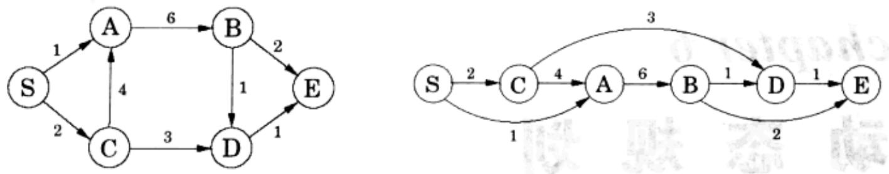

import Guide from '@/components/Guide.astro';
import Knowledge from '@/components/Knowledge.astro';
import Example from '@/components/Example.astro';
import Analysis from '@/components/Analysis.astro';
import Solution from '@/components/Solution.astro';
import Variant from '@/components/Variant.astro';
import Note from '@/components/Note.astro';
import Block from '@/components/Block.astro';
import Method from '@/components/Method.astro';
import Exercise from '@/components/Exercise.astro';
import Algorithm from '@/components/Algorithm.astro';

## 第6章 动态规划

通过前面的章节,我们已经看到了一些非常优美的算法设计原则——诸如分治、图探索以及贪心选择——基于它们为大量重要的计算任务构造了最终的算法。这些方法的不足在于它们通常只对某些特定的任务有效。从现在开始,我们将转向两种更为强有力的算法技术,所谓动态规划和线性规划。对于更为广泛的应用问题,这两种方法往往能在以上那些特定方法失效时发挥作用。不难预见的是,这种普适性的提高也会伴随着一些效率上的损失。

## 6.1 重新审视有向无环图的最短路径问题

作为对最短路径问题(参见第4章)的一个研究结论，我们注意到对于有向无环图(dag)的情况，问题是非常容易解决。由于这一结论在动态规划思想中的核心地位，在此我们将对其进行重新审视。

dag 的一个独特之处是其节点可被线性化，也即其中的节点可以被排列在一条直线上，且使得所有的边都保持由左至右的方向(如图 6-1)。为了说明这一点对求解最短路径带来的帮助，我们考虑求节点 S 到其它节点的距离的问题。具体来说，让我们关注某个目标节点 D。如图 6-1，到达 D 仅有的途径是经过其前驱，也即 B 或 C。因此，为了求 S 到 D 的最短路径，我们只需对以上的两条路径进行比较：

$$
\operatorname{dist} (D) = \min \left\{\operatorname{dist} (B) + 1, \operatorname{dist} (C) + 3 \right\}
$$

对于每个节点，我们都可以写出类似的关系式。如果我们按照图6-1中从左至右的顺序计算出所有这些dist值，则可以肯定的是，当我们考虑某个节点 $\nu$ 时，总是已经得到了计算 $\mathrm{dist}(\nu)$ 所需的全部信息。因此，我们可以按照如下方式，只需一遍就能计算出所有的距离值。算法示意如下：

  
图 6-1 一个 dag 及其线性化(拓扑排序)

initialize all dist(·) values to  $\infty$ 
dist(s) = 0
for each  $v \in V \setminus \{s\}$ , in linearized order:
dist(v) = min_&#123;u,v)∈E&#123;dist(u) + l(u,v)&#125;

注意到该算法求解了这样一组子问题： $\{\mathrm{dist}(u): u \in V\}$ 。我们从其中最小的子问题 $\mathrm{dist}(s)$ (显然易见，其值为 0) 开始。接下来依次逐步解决一些“较大”的子问题——这些子问题在线性化表示中对应的节点与起点的距离将越来越远——这里如果在达到某个子问题前必须已经解决了许多其它的子问题，则我们认为该子问题是较大的。

这是一种通用性很强的技术。在每个节点上，我们计算关于其(所有)前驱节点的某个函数值。对于以上的问题，该函数是一个求和后的最小值。当然，该函数同样可能是其求最大值的，这样将恰好对应于dag的最长路径问题。或者，我们也可以用乘法代替其中的加法，从而将对应的问题转变为计算具有最小边乘积的路径问题。

动态规划是一种功能非常强大的计算模式，其解决问题的方式是首先定义它的一组子问题，然后按照由小到大，以小问题的解答支持大问题求解的模式，依次解决所有的子问题，并最终得到原问题(最大的子问题)的解答。动态规划针对的对象可以不是一个dag，但dag的思想却总是隐含在其求解的过程中。在这个隐含的dag中，节点对应于我们定义的子问题，边表示子问题间的依赖关系，即：如果求解子问题B必须依赖子问题A的解答，则(概念上)存在一条由A到B的边。此时，A被视为相对B较小的一个子问题——很明显，这种大小关系总是正确的。

现在可以来看一个具体的例子了。
