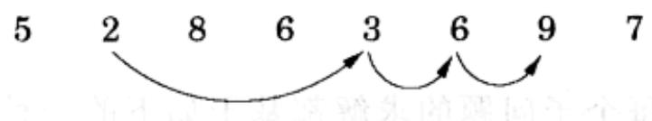
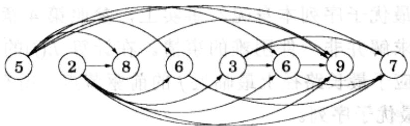
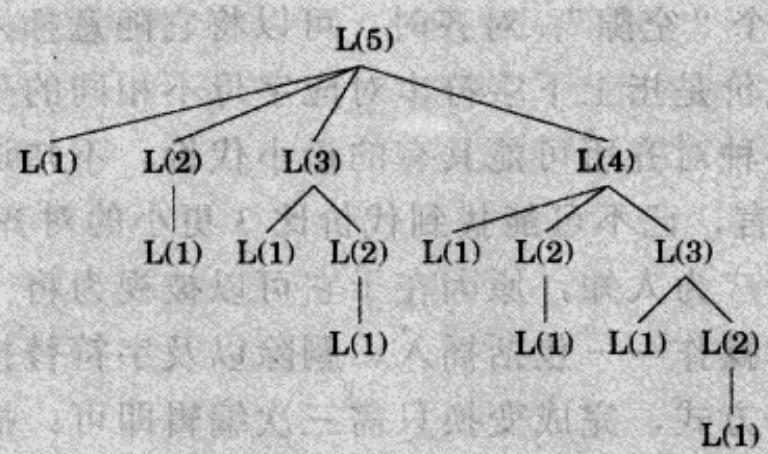

import Guide from '@/components/Guide.astro';
import Knowledge from '@/components/Knowledge.astro';
import Example from '@/components/Example.astro';
import Analysis from '@/components/Analysis.astro';
import Solution from '@/components/Solution.astro';
import Variant from '@/components/Variant.astro';
import Note from '@/components/Note.astro';
import Block from '@/components/Block.astro';
import Method from '@/components/Method.astro';
import Exercise from '@/components/Exercise.astro';
import Algorithm from '@/components/Algorithm.astro';

## 6.2 最长递增子序列

最长递增子序列问题的输入是一个数字序列 $a_1, \ldots, a_n$ 。所谓子序列，是指从以上序列中按顺序选出的一个子集，形如 $a_{i_1}, a_{i_2}, \ldots, a_{i_n}$ ，其中 $1 \leqslant i_1 < i_2 < \ldots < i_k \leq n$ 。如果子序列中的数字都是严格单调递增的，则称其为一个递增子序列。我们的任务是要找出原序列的一个最长的递增子序列。举例来说，序列 5、2、8、6、3、6、9、7 的最长递增子序列是 2、3、6、9：

在这个例子中，箭头表示最优解中相邻元素间的递进关系。更一般地，为了能更好地理解该问题的解空间，我们可以在图上标出所有可能的递进关系：首先为每个元素 $a_{i}$ 建立一个对应的节点 $i$ ，然后，对于任意两个可能在某递增子序列中存在递进关系的元素 $a_{i}$ 和 $a_{j}$ （即，同时满足 $i < j$ 且 $a_{i} < a_{j}$ )，增加一条连接二者对应节点的有向边 $(i,j)$ (如图6-2)。

注意到：(1)由于对每条边 $(i,j)$ ，有 $i < j$ ，故图 $G = (V,E)$ 是一个dag；(2)递增子序列和dag中的路径之间存在一一对应关系。因此，我们的目标现在就变成了寻找dag中的最长路径！

  
图 6-2 递增子序列的 dag

以是相关的算法：

for $j = 1,2,\ldots ,n$:  
$L(j) = 1 + \max \{L(i):(i,j)\in E\}$  
return $\max_jL(j)$

$L(j)$ 是以 $j$ 为终点的最长路径——对应于最长递增子序列——的长度(在此，记所有边的权重均为1，因此只需计算该路径经过的节点数)。和最短路径的分析方法类似，可以看到，所有到达 $j$ 的路径必然经过 $j$ 的某个前驱节点，因此 $L(j)$ 应该等于$j$ 所有前驱对应的 $L(\bullet)$ 中的最大值加1。而如果没有可以到达 $j$ 的边，我们只需取 $\cdot L(j)$ 为空集对应的最大值，也即0。这样一来，由于考虑了所有可能的路径终点，最终我们将求得最大的 $L(j)$ 。

这是一个动态规划。为了解决最初的问题，我们定义了一组子问题 $\{L(j): 1 \leqslant j \leqslant n\}$ 。由于这些子问题具有的如下性质，因此它们能够在一遍计算中全部得到求解：

(\*)存在子问题间的一种排序以及如下的关联关系：对于任意一个子问题，这种关联关系说明了如何在给定(在排序中)相对其“较小”的子问题的解的前提下，求得该子问题的解。

在我们的例子中，每个子问题的求解都基于如下的一种关联关系：

$$
L (j) = 1 + \max \left\{L (i): (i, j) \in E \right\},
$$

显然，该表达式的计算仅仅与相对(等式左端)较小的子问题的解有关。那么，这一步骤需要花费多少时间呢？为此我们首先需要知道 $j$ 的所有前驱，过去的经验(参见习题3.5)告诉我们，求反转图 $G^{R}$ 的邻接表并不困难，只需花费线性时间。此外，计算 $L(j)$ 的时间与 $j$ 的入度(即达到 $j$ 的边数)成正比，所以其相对于 $|E|$ 是线性的。因此，如果所输入的数组已经按升序排列好，则以上计算所需的时间最多为 $O(n^{2})$ 。看来动态规划是一种既简单又高效的方法。

最后需要说明的是，以上所求得的 $L$ 值只是告诉了我们最优子序列的长度，我们该如何得到相应的最优子序列本身呢？事实上，参照第4章最短路径问题中的记录方法，相应地进行求解并非一件困难的事情。在计算 $L(j)$ 的同时，我们将 $\mathrm{prev}(j)$ 也记录下来，其值对应于最长路径上最临近 $j$ 的前驱节点。所有计算完成后，由这些记录即可得到所求的最优子序列。

## 递归？不！

回到对最长递增子序列的讨论： $L(j)$ 的公式实际上蕴涵了一种不同的算法选择递归。那么，这种方法会更加简单吗？

实际情况是，递归是非常糟糕的想法，其引出的求解过程将需要指数时间！为什么是这样呢？假设对所有的 $i < j$ ，边 $(i,j)$ 都属于dag——也即给定的数列 $a_1, a_2, \ldots, a_n$ 已经排序好了。此时，子问题 $L(j)$ 的公式变为

$$
L (j) = 1 + \max \{L (1), L (2), \dots , L (j - 1) \} 。
$$

下面是对 $L(5)$ 递归过程的图解。我想您一定也注意到了，其中的相同子问题会

被一遍遍地反复求解！

于是对于 $L(n)$ ，对应的树将包含指数多的节点(您能给出其上界吗？)。显然，递归求解是一个灾难。

那么，为什么在分治算法中递归方法又能高效的工作呢？关键在于分治算法总是将问题被分解为一些相对来说更小的子问题，有时子问题的规模可能只有原问题的一半。比如，mergesort对规模为 $n$ 的数组进行排序就是通过递归地排序两个规模为 $n / 2$ 的子数组实现的。由于在问题规模上具有如此巨大的反差，整个递归树的深度也就仅为对数级，从而其中所包含的节点数最多是多项式规模的。

相比之下，在典型的动态规划公式中，一个问题通常被归纳为一些仅比较自身规模小一点的子问题——例如， $L(j)$ 依赖于 $L(j-1)$ 。因此，其整个递归树通常具有多项式深度，从而节点规模也就是指数级的了。不过，由于大多数节点会重复出现，故其中所包含的不同子问题数量其实上并不很多。相比之下，动态规划的算法效率更多地来自于其显式地枚举不同的子问题，并采取了恰当的顺序对其进行逐个求解。
