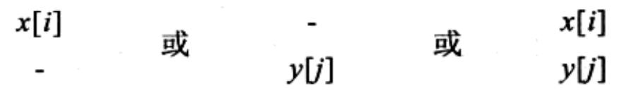
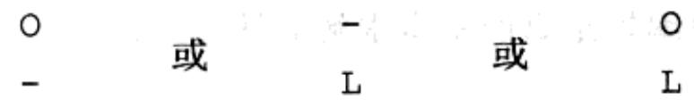
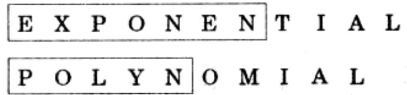
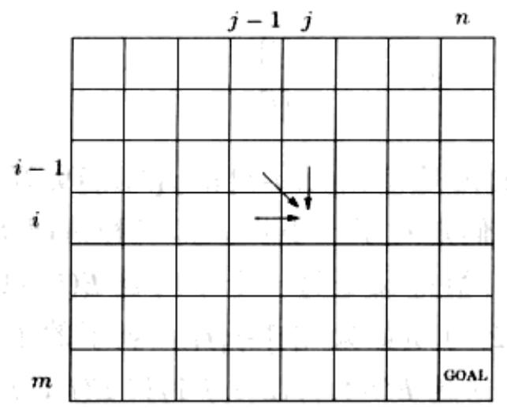
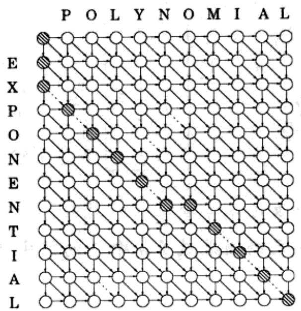
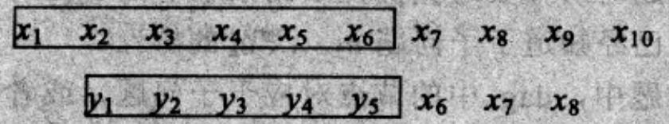
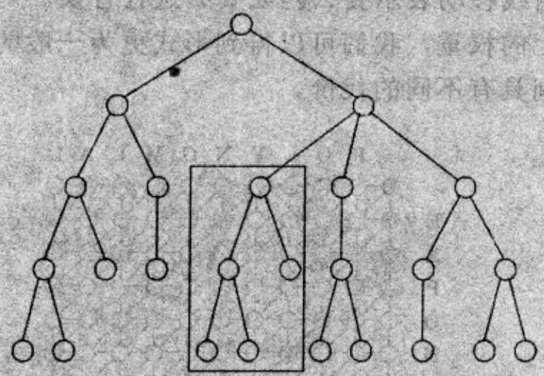

import Guide from '@/components/Guide.astro';
import Knowledge from '@/components/Knowledge.astro';
import Example from '@/components/Example.astro';
import Analysis from '@/components/Analysis.astro';
import Solution from '@/components/Solution.astro';
import Variant from '@/components/Variant.astro';
import Note from '@/components/Note.astro';
import Block from '@/components/Block.astro';
import Method from '@/components/Method.astro';
import Exercise from '@/components/Exercise.astro';
import Algorithm from '@/components/Algorithm.astro';

## 6.3 编辑距离

当拼写检查工具遇到一个可能的拼写错误时，它将在自己的词典中查找与之相近的单词。那么，这里所谓的“距离相近”是个什么概念呢？

关于两个字符串的距离，一种自然的度量是看它们能在多大程度上相互对齐，或者说，看它们相互匹配的程度如何。单纯从技术的角度，对齐就是在一个字符串上方书写另一个字符串。例如，对于 SNOWY 和 SUNNY，有两种不同的对齐方式：

$$
\begin{array}{c c c c c c} \text {S} & - & \text {N} & \text {O} & \text {W} & \text {Y} \\ \text {S} & \text {U} & \text {N} & \text {N} & - & \text {Y} \end{array} \qquad \begin{array}{c c c c c c} - & \text {S} & \text {N} & \text {O} & \text {W} & - & \text {Y} \\ \text {S} & \text {U} & \text {N} & - & - & \text {N} & \text {Y} \end{array}
$$

## 代价：3

其中，“-”表示一个“空隙”；对齐时，可以将它随意插入到每个字符串中。对于一种对齐方式，其代价是指上下字符串对应字母不相同的列数。而所谓的编辑距离是指两个字符串的各种对齐所可能具有的最小代价。不知道您是否已经发现，对SNOWY和SUNNY而言，已不可能找到代价比3更小的对齐了。

编辑距离之所以会广为人知，原因在于它可以被视为将一个字符串变换为另一个字符串所需最小编辑操作——包括插入、删除以及字符替换的次数。举例来说，对于上例中左侧的对齐方式，完成变换只需三次编辑即可：插入 U、替换 O→N 和删除 W。

一般情况下，对于两个字符串，由于可能存在非常多的对齐方式，因此简单遍历搜索其中的最优(代价最小)者常常会变成非常可怕的任务。以下我们将转而使用动态规划来解决这一问题。

## 一种动态规划解法

使用动态规划进行问题求解，首当其冲的问题是如何定义子问题？如我们所知，子问题的定义必须满足此前所述的性质(\*)见6.2节。有了这个基础，求解算法所要做的仅仅是按照子问题规模递增的顺序逐个求解。

## 规划？

动态规划(dynamic programming)的原意与编写程序代码几乎没有什么关系。Richard Bellman 在 1950 年代提出这一概念时，计算机编程还是一项仅由极少数人参与的非常深奥的活动，因此这一新的方法当时并没有得到一个恰当的名称。在那个年代，编程通常意味着“规划、计划”，而“动态规划”构思的初衷正在于对一些多阶段的处理给出最优的计划。图 6-2 中的 dag 可以视为描述此类处理的演化过程的一种途径，其中：每个节点对应于一个状态，最左侧的节点为起始点，离开某个状态的边表示可能的动作，这些动作将在下一时刻导出其它的状态。

从词源含义出发，本书第7章的主题，线性规划，也具有以上类似的特点。

我们的目标是寻找两个字符串 $x[1\dots m]$ 与 $y[1\dots n]$ 之间的编辑距离。什么才是一个好的子问题呢？当然，它必须是解决整个问题的道路上的一部分。试着考虑一下这两个字符串的前缀(prefix) $x[1\dots i]$ 与 $y[1\dots j]$ 的编辑距离如何？我们记该子问题为 $E(i,j)$ (参见图6-3)。这样，我们最终的目标就变成了计算 $E(m,n)$ 。

继续以上的工作，我们需要将 $E(i,j)$ 表示为较之更小的子问题的表达式。来看一下我们关于 $x[1\dots i]$ 与 $y[1\dots j]$ 的最佳对齐都能知道些什么。显然，该对齐中最右侧的列只可能为如下三种情况之一：

第一种情况下，该列产生的代价为1，余下的则是使 $x[1\dots i - 1]$ 和 $y[1\dots j]$ 更好地对齐的问题，这正对应于子问题 $E(i - 1,j)$ ！看来我们走对了一小步。第二种情况下，仍然产生代价1，剩下的是对齐 $x[1\dots i]$ 和 $y[1\dots j - 1]$ ，恰好又是另一个子问题 $E(i,j - 1)$ 。最后一种情况下，代价要么为1(如果 $x[i] \neq y[j]$ )要么为0(如果 $x[i] = y[j]$ )，剩下的子问题为 $E(i - 1,j - 1)$ 。一句话，我们现在已能用较小的子问题 $E(i - 1,j), E(i,j - 1)$ 和 $E(i - 1,j - 1)$ 来表示 $E(i,j)$ 了。由于我们并不知道三个子问题之中哪个才是正确的选择，因此需要对其逐个尝试并选择其中的最优者：

$$
E (i, j) = \min \{1 + E (i - 1, j), 1 + E (i, j - 1), \text { diff } (i, j) + E (i - 1, j - 1) \}
$$

其中，为方便起见，我们令 $\mathrm{diff}(i,j)$ 当 $x[i] = y[j]$ 时取0，否则取1。

举例来说，计算 EXPONENTIAL 和 POLYNOMIAL 的编辑距离，子问题 $E(4,3)$ 对应于前缀 EXPO 和 POL。其最佳对齐的最右一列必为以下三种情况之一

因此， $E(4,3)=\min\{1+E(3,3),1+E(4,2),1+E(3,2)\}$ 。

  
图6-3 子问题 $E(7,5)$

所有子问题 $E(i,j)$ 的解构成了一个二维的表，如图6-4。对于这些子问题，求解顺序应该是怎样的呢？事实上，只要保证 $E(i - 1,j), E(i,j - 1)$ 和 $E(i - 1,j - 1)$ 总是在 $E(i,j)$ 之前求解，怎样的顺序都可以。例如，我们可以从高到低地每次填写表中的一行，然后按照由左至右的顺序依次填满每一行。或者换一下，每次先填满一列，然后再逐行填满。这两种方法都能保证当我们需要计算某个单元格的值时，所有需要用到

的单元格都已经填好了。

  
(b)

$$
\begin{array}{c c c c c c c c c c c c} \hline & & \text {P} & \text {O} & \text {L} & \text {Y} & \text {N} & \text {O} & \text {M} & \text {I} & \text {A} & \text {L} \\ \hline & 0 & 1 & 2 & 3 & 4 & 5 & 6 & 7 & 8 & 9 & 1 0 \\ \text {E} & 1 & 1 & 2 & 3 & 4 & 5 & 6 & 7 & 8 & 9 & 1 0 \\ \text {X} & 2 & 2 & 2 & 3 & 4 & 5 & 6 & 7 & 8 & 9 & 1 0 \\ \text {P} & 3 & 2 & 3 & 3 & 4 & 5 & 6 & 7 & 8 & 9 & 1 0 \\ \text {O} & 4 & 3 & 2 & 3 & 4 & 5 & 5 & 6 & 7 & 8 & 9 \\ \text {N} & 5 & 4 & 3 & 3 & 4 & 4 & 5 & 6 & 7 & 8 & 9 \\ \text {E} & 6 & 5 & 4 & 4 & 4 & 5 & 5 & 6 & 7 & 8 & 9 \\ \text {N} & 7 & 6 & 5 & 5 & 5 & 4 & 5 & 6 & 7 & 8 & 9 \\ \text {T} & 8 & 7 & 6 & 6 & 6 & 5 & 5 & 6 & 7 & 8 & 9 \\ \text {I} & 9 & 8 & 7 & 7 & 7 & 6 & 6 & 6 & 6 & 7 & 8 \\ \text {A} & 1 0 & 9 & 8 & 8 & 8 & 7 & 7 & 7 & 7 & 6 & 7 \\ \text {L} & 1 1 & 1 0 & 9 & 8 & 9 & 8 & 8 & 8 & 8 & 7 & 6 \end{array}
$$

图 6-4 (a) 子问题表。填写 $E(i, j)$ 时需要用到 $E(i-1, j)$ 、 $E(i, j-1)$ 和 $E(i-1, j-1)$ 。

(b) 按照动态规划计算所得的最终表格

给出了所有的子问题及其求解次序，可以说我们几乎已经完成了任务。余下要做的就是确定动态规划的“基准情形”，也即最小子问题了。这些问题是 $E(0,.)$ 和 $E(.,0)$ ，它们都很好解决。 $E(0,j)$ 是 $\pmb{x}$ 的长度为0的前缀——也即空串与 $\pmb{y}$ 的前j个字母的编辑距离：显然，其值为 $j$ 。类似地， $E(i,0) = i$ 。

至此，可以写出编辑距离的基本求解算法如下：

for $i = 0,1,2,\ldots,m$:
    $E(i,0) = i$
for $j = 1,2,\ldots,n$:
    $E(0,j) = j$
for $i = 1,2,\ldots,m$:
    for $j = 1,2,\ldots,n$:
    $E(i,j) = \min\{E(i-1,j) + 1,E(i,j-1) + 1,E(i-1,j-1) + \text{diff}(i,j)\}$
return $E(m,n)$

该过程逐行地填写表格，在每一行中采取由左到右的顺序进行。其填写每个单元格的时间都是常数，因此总的运行时间恰为表格的规模，即 $O(mn)$ 。

对于我们此前的例子，最终的编辑距离为6：

$$
\begin{array}{c c c c c c c c c c c c} \text {E} & \text {X} & \text {P} & \text {O} & \text {N} & \text {E} & \text {N} & - & \text {T} & \text {I} & \text {A} & \text {L} \\ - & - & \text {P} & \text {O} & \text {L} & \text {Y} & \text {N} & \text {O} & \text {M} & \text {I} & \text {A} & \text {L} \end{array}
$$

## 隐含的dag

每个动态规划都隐含着一个dag结构：试想用每个节点表示一个子问题，而每条边表示解决子问题时所需要遵循的先后约束。节点 $u_{1},\ldots ,u_{k}$ 指向 $\pmb{\nu}$ 意味着“求解子问题 $\pmb{\nu}$ 的前提是已经知道了子问题 $u_{1},\dots,u_{k}$ 的解”。

在编辑距离问题中，dag 中的节点对应于子问题，或者，等价地说，对应于表格中的位置 $(i, j)$ 。其边为先后关系的约束，形如 $(i-1, j) \rightarrow (i, j)$ 、 $(i, j-1) \rightarrow (i, j)$ 和 $(i-1, j-1) \rightarrow (i, j)$ （图 6-5）。实际上，我们可以更进一步，在边上赋予一定的权值，于是求编辑距离就变成了求 dag 中的最短路径！为了看清这一点，除了令 $\{(i-1, j-1) \rightarrow (i, j): x[i] = y[j]\}$ （在图中为点状线）中边的长度都为 0 外，我们设其它所有边的长度均为 1。编辑距离的最终答案就是点 $s = \{0, 0\}$ 与 $t = \{m, n\}$ 之间的距离。而一个可能的最短路径也可以由我们此前得到的最佳对齐方式生成。在该路径上，向下的移动表示删除，向右为插入，而对角线移动表示要么匹配要么进行替换。

通过改变dag上的权重，我们可以得到形式更为一般的编辑距离问题，其中插入、删除和替换分别具有不同的代价。

  
图6-5 隐含的dag，以及长度为6的路径

<Knowledge title="专栏: 公共子问题">

定义恰当的子问题通常要很强的创造力和反复的实验。不过，在动态规划中也有一些经常出现的子问题模式。

i. 输入为 $x_{1}, x_{2}, \ldots, x_{n}$ ，子问题为 $x_{1}, x_{2}, \ldots, x_{i}$ 。

$$
\boxed {x _ {1} \quad x _ {2} \quad x _ {3} \quad x _ {4} \quad x _ {5} \quad x _ {6}} \quad x _ {7} \quad x _ {8} \quad x _ {9} \quad x _ {1 0}
$$

最终子问题的数量将是线性的。

ii. 输入为 $x_{1}, x_{2}, \ldots, x_{n}$ 和 $y_{1}, y_{2}, \ldots, y_{n}$ ，子问题为 $x_{1}, x_{2}, \ldots, x_{i}$ 和 $y_{1}, y_{2}, \ldots, y_{j}$ 。

最终子问题数量为 $O(mn)$ 。

iii. 输入为 $x_{1}, x_{2}, \ldots, x_{n}$ ，子问题为 $x_{i}, x_{i+1}, \ldots, x_{j}$ 。

$$
x _ {1} \quad x _ {2} \boxed {x _ {3} \quad x _ {4} \quad x _ {5} \quad x _ {6}} \quad x _ {7} \quad x _ {8} \quad x _ {9} \quad x _ {1 0}
$$

最终子问题数量为 $O(n^{2})$ 。

iv. 输入为树。子问题为其子树。

若树有 $n$ 个节点，它有多少个子问题呢？

前面的两种情况我们都已经遇见过了，余下的很快也将看到。

</Knowledge>
<Knowledge title="专栏: 人与鼠">

我们的身体是无与伦比的机器，它同时具有灵活的功能、良好的适应性以及非凡的交互和复制再生能力。所有这一切都源于我们每个人都具有的一种特殊程序。它由四个基本字母 $\{A, C, G, T\}$ 构成，包含了多达30亿个字符，这就是我们的DNA.

两个人的 DNA 序列的差异仅仅约 0.1%。然而，这仍然意味着其中约有 300 万个位置不同，可以说远远超过了人类自身的多样性。这些差异对于科学和医药研究是非常重要的——举例来说，我们也许可以通过它们来预测某人对于某种疾病的易受性。

DNA看起来像是一个令人费解的庞大程序，但是它也可以被分解为一些小的单元。这些单元各自具有其特定的角色和功能，正如我们所熟知的子程序。我们称这些单元为基因。计算机是我们理解人类基因以及其他官能必不可少的工具，与之相关地，出现了计算基因学(computational genomics)这样一个独立的新兴研究领域。以下是其所研究的一些典型问题：

1. 当我们发现了一种新的基因，一个深入了解其功能的途径是寻找与之相近的已知基因。通过和一些熟知物种(比如老鼠)基因信息的对比，能够使我们更好地理解自身基因的特点。

开展这一研究的基础之一，是定义一种判断两个字符串匹配程度的高效的计算方法。生物学中就此给出了一种经过推广的编辑距离概念，并采用动态规划的方法进行求解。

接下来就是在海量的已知基因数据(GenBank 基因数据库的总数据长度已经超过了 $10^{10}$ ，并且仍在快速增长)中进行搜索了。目前采用的工具称为 BLAST，它巧妙结合了多种算法技巧和大量的生物学知识，是在计算生物学领域应用最为广泛的软件工具。

2. DNA 测序(即判断其字符串组成)通常能确定一些由 500-700 个字符组成的片段。在一个 DNA 中可能随机分布着成千上万的这种片段，它们是按什么样的次序组装的呢？最初，任意一个片段在序列中的位置都是未知的，因此只能通过与序列中相匹配片段的覆盖检查来进行查找。

与之相关的一项代表性工作是所谓的人类 DNA 图谱计划。该计划已在 2001 年由人类基因组联盟和私立的 Celera 基因公司分别同时完成了。

3. 对于一个特定的基因，一旦在多个物种中都对其完成了测序，将面临一个新的问题，那就是能否利用这些信息重建物种的进化史。

在本章最后的习题中，我们将进一步探讨这些问题。对于包括它们在内的许多更具普遍性的计算生物学问题，可以说动态规划都是价值不可估量的重要工具。

</Knowledge>
