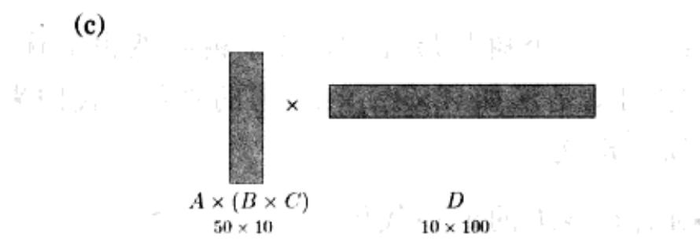
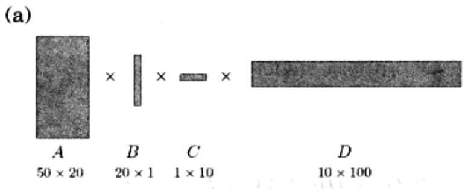
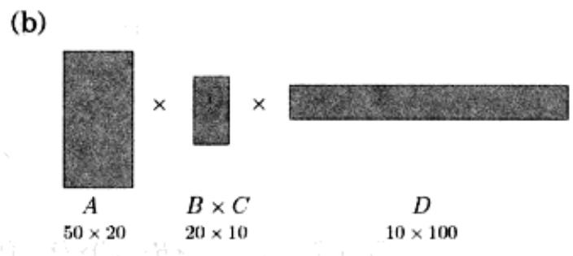
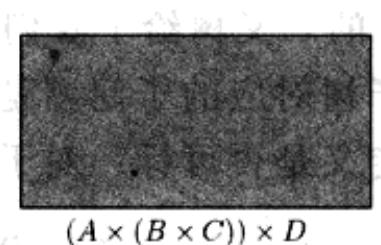
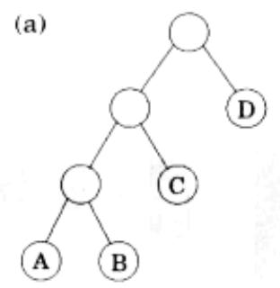
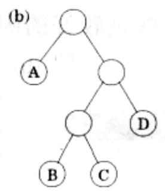
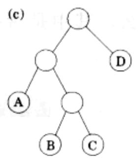

import Guide from '@/components/Guide.astro';
import Knowledge from '@/components/Knowledge.astro';
import Example from '@/components/Example.astro';
import Analysis from '@/components/Analysis.astro';
import Solution from '@/components/Solution.astro';
import Variant from '@/components/Variant.astro';
import Note from '@/components/Note.astro';
import Block from '@/components/Block.astro';
import Method from '@/components/Method.astro';
import Exercise from '@/components/Exercise.astro';
import Algorithm from '@/components/Algorithm.astro';

## 6.5 矩阵链式相乘

假设我们要求四个矩阵的乘积，记为 $A \times B \times C \times D$ ，其中每个矩阵的维度依次是 $50 \times 20, 20 \times 1, 1 \times 10$ 和 $10 \times 100$ （如图6-6）。在计算过程中，我们每次将两个矩阵相乘。

矩阵的乘法不满足交换律(通常情况下， $A \times B \neq B \times A$ )，但具有结合率，例如 $A \times (B \times C) = (A \times B) \times C$ 。因此，通过在公式的不同位置上插入括弧，我们可以得到很多不同的计算方式。那么，其中是否有一些是较好的呢？

  
(d)

  
图 6-6 $A \times B \times C \times D = (A \times (B \times C)) \times D$

一个 $m \times n$ 的矩阵与一个 $n \times p$ 的矩阵相乘，约需要进行 $mnp$ 次乘法。按照这一公式，我们可以对比一下几种不同的计算 $A \times B \times C \times D$ 的方式的代价：

<table><tr><td>结合规则</td><td>代价公式</td><td>代价</td></tr><tr><td>A×((B×C)×D)</td><td>20·1·10+20·10·100+50·20·100</td><td>120,200</td></tr><tr><td>(A×(B×C))×D</td><td>20·1·10+50·20·10+50·10·100</td><td>60,200</td></tr><tr><td>(A×B)×(C×D)</td><td>50·20·1+1·10·100+50·1·100</td><td>7,000</td></tr></table>

由此可见，乘法次序的不同会导致最终运行时间的巨大差异！并且，其中比较简单和自然的贪心方法(如以上的第二个结合规则)，即每次选择代价最小的矩阵相乘式，最终导致了较差的结果。

那么，我们应该如何确定最优的计算次序呢？这里假设我们需要计算 $A_{1} \times A_{2} \times \ldots \times A_{n}$ ，其中每个矩阵的维数分别为 $m_{0} \times m_{1}, m_{1} \times m_{2}, \ldots, m_{n-1} \times m_{n}$ 。不难发现，每个特定的结合规则都可以很自然地表示为一个满二叉树，其中每个矩阵对应一个叶节点，树根为最终的乘积，而树的内部节点表示中间过程的部分乘积(如图6-7)。各种可能的乘法次序对应于不同的满二叉树。每个树中包含 $n$ 个节点，因此可能的树的总数为 $n$ 的指数(参见习题2.13)。我们当然不可能尝试所有的树，这种莽撞盲目的做法根本不在考虑之列，我们将再一次用到动态规划。

  
图6-7 (a) $((A\times B)\times C)\times D$ ；(b) $A\times ((B\times C)\times D)$ ；(c) $(A\times (B\times C))\times D$

图6-7的二叉树给了我们一些启发：如果一个树是最优的，其子树必然也最优。那么与其子树对应的子问题是什么呢？它们就是形如 $A_{i} \times A_{i + 1} \times \ldots \times A_{j}$ 的乘积。我们来看看这种定义是否可行：对于 $1 \leqslant i \leqslant j \leqslant n$ ，定义

$$
C (i, j) = \text { 计算 } A _ {i} \times A _ {i + 1} \times \ldots \times A _ {j} \text { 的最小代价。 }
$$

这个子问题的规模等于其中矩阵乘法的次数，即 $|j - i|$ 。 $i = j$ 对应于最小的子问题，此时没有需要做乘法的矩阵，因此 $C(i,j) = 0$ 。对于 $j > i$ 的情形，考虑对应于 $C(i,j)$ 的最优树。处于该树顶端的第一个分枝将问题分割为两个乘积片段，形如 $A_{i} \times \ldots \times A_{k}$ 和 $A_{k + 1} \times \ldots \times A_{j}$ ，其中 $k$ 的取值位于 $i$ 和 $j$ 之间。这样一来该子树的代价就等于两个乘积片段的乘积加上将其组合在一起的代价，即 $C(i,k) + C(k + 1,j) + m_{i - 1} \cdot m_k \cdot m_j$ 。我们所需要做的就是找到相应的分割点 $k$ ，使得以下的值最小：

$$
C (i, j) = \min _ {i \leq k <   j} \left\{C (i, k) + C (k + 1, j) + m _ {i - 1} \cdot m _ {k} \cdot m _ {j} \right\} 。
$$

现在可以写代码了！以下 $s$ 表示子问题的规模。

for i=1 to n:  $C(i,i)=0$ 
for s=1 to n-1:
    for i=1 to n-s:
    $j=i+s$ $C(i,j)=\min\{C(i,k)+C(k+1,j)+m_{i-1}\cdot m_k\cdot m_j:i\leq k<j\}$ 
return  $C(1,n)$

以上的所有子问题构造出了一个二维表格，其中每个单元格需要的计算时间为 $O(n)$ 。因此，总的计算时间就是 $O(n^3)$ 。
