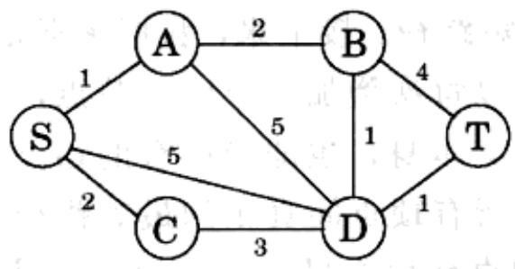
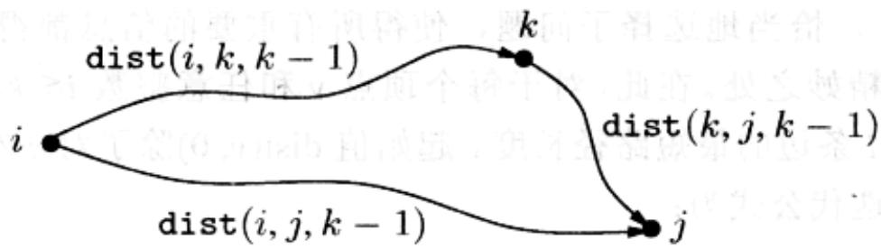
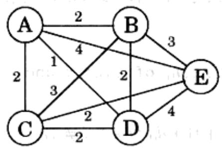

import Guide from '@/components/Guide.astro';
import Knowledge from '@/components/Knowledge.astro';
import Example from '@/components/Example.astro';
import Analysis from '@/components/Analysis.astro';
import Solution from '@/components/Solution.astro';
import Variant from '@/components/Variant.astro';
import Note from '@/components/Note.astro';
import Block from '@/components/Block.astro';
import Method from '@/components/Method.astro';
import Exercise from '@/components/Exercise.astro';
import Algorithm from '@/components/Algorithm.astro';

## 6.6 最短路径问题

本章之初我们通过dag中的最短路径问题引入了动态规划的概念。接下来，我们将讨论一些更为复杂的最短路径问题，并介绍这一强有力的算法技术是如何应用于这些问题的。

## 最短可靠路径

应用的情况常常是复杂难测的，基于图、边长和最短路径的抽象有时并不能反映问题的全部。例如，在一个通信网络中，即使边的长度能够完全可靠地反映传输延迟，选定一条路径可能也还需要考虑一些其他的因素。说的更具体些，路径中的每条边可能都意味着一个充满了不确定和潜在数据丢失风险的跳步。这使得我们应该尽量避免在路径中包含过多的边。图6-8是对该问题的示意，其中从 $S$ 到 $T$ 的最短路径上有四条边，同时还存在一条只包含两条边的稍长的路径。如果四条边意味着在可靠性方面已变得不可接受，我们将不得不选择这第二条路径。

  
图6-8 求一条由 $s$ 到 $t$ 较短且边数较少的路径

假设给定了一个图 $G$ ，其中每条边都有一定的长度(记为 $l(u, v)$ ，其中 $u, v$ 为边的两端点)，同时给定节点 $s$ 和 $t$ 以及一个整数 $k$ ，我们需要求从 $s$ 到 $t$ 的最多经过 $k$ 条边的最短路径。

有没有一种快捷的方式改造 Dijkstra 算法，使其适应这一新任务的要求呢？恐怕没有。事实上，Dijkstra 算法集中于关注每条最短路径的长度，没有留下任何关于其中跳步数的“记录”，而这一信息对于我们当前的问题却是至关重要的。

在动态规划中，恰当地选择子问题，使得所有重要的信息都得以保存并便于今后使用，是其最为精妙之处。在此，对于每个顶点 $\nu$ 和任意整数 $i \leqslant k$ ，我们定义 $\operatorname{dist}(\nu, i)$ 为由 $s$ 到 $\nu$ 经过 $i$ 条边的最短路径长度。起始值 $\operatorname{dist}(\nu, 0)$ 除了对 $s$ 本身为 0 外，均取 $\infty$ 。于是，对应的迭代公式为：

$$
\operatorname{dist} (v, i) = \min _ {(u, v) \in E} \left\{\operatorname{dist} (u, i - 1) + \ell (u, v) \right\}
$$

剩下的我想就不必多说了吧？

## 所有顶点间的最短路径

如果我们要求的不仅仅是某对节点 $s$ 和 $t$ 之间，而是所有顶点间的最短路径呢？一个办法是每次以一个顶点为起点，运行4.6.1节的最短路径算法(由于可能存在负的边) $|V|$ 遍。这样下来总的运行时间将是 $O(|V|^2 E)$ 。不过事实上我们有一种稍好的选择，所谓基于动态规划的Floyd-Warshall算法，其运行时间为 $O(|V|^3)$ 。

对于计算图上所有顶点间最短路径的问题，是否有比较好的子问题定义呢？在求解过程中，简单地增加顶点对或出发点的数量是没有用的，因为这些最终都会导致算法时间达到 $O(|V|^2 E)$ 。

我们脑海间所浮现的想法是这样的：我们知道 u 和 v 间的最短路径 $u \rightarrow w_{1} \rightarrow \cdots \rightarrow w_{l} \rightarrow v$ 通常需要用到一些中间节点——虽然也可能不。假设不允许路径上出现任何的中间节点，则我们可以立即求得所有节点间的最短路径：只要边 $(u, v)$ 存在，则它就是 u, v 间的最短路径。接下来，我们逐渐地扩展可用的中间节点集合，会出现什么情况呢？我们可以每次增加一个中间节点，然后不断地更新所有的最短路径。一旦该集合扩展到了 V 本身，也即当所有的顶点都可以作为路径上的中间节点出现时，我们也就得到了所有顶点间真正的最短路径。

具体来说，将 $V$ 中的顶点标记为 $\{1,2,\dots,n\}$ ，记 $\operatorname{dist}(i,j,k)$ 为仅仅允许使用 $\{1,2,\dots,k\}$ 作为中间节点时 $i$ 到 $j$ 的最短路径长度。初始状态下，当存在直接连接 $i$ 和 $j$ 的边时， $\operatorname{dist}(i,j,0)$ 为该边的长度，否则为 $\infty$ 。

当我们在中间节点集中加入一个新的顶点 $k$ 时，会发生什么情况呢？我们需要对所有的节点对 $i, j$ 检查是否使用 $k$ 为中间节点会得到更短的路径。这是非常简单的事情： $i$ 到 $j$ 的使用了 $k$ 和其他编号较小中间节点的最短路径最多经过 $k$ 一次（为什么？因为我们假设没有负的环）。而我们已经计算得到了 $i$ 到 $k$ 和 $k$ 到 $j$ 的使用了较小编号顶点的最短路径长度：



因此，使用 $k$ 能够在 $i$ 和 $j$ 间得到一条更短的路径，当且仅当

$$
\operatorname{dist} (i, k, k - 1) + \operatorname{dist} (k, j, k - 1) <   \operatorname{dist} (i, j, k - 1)
$$

上式若满足，则利用左侧结果更新 $\mathrm{dist}(i,j,k)$ 的值。

以下是 Floyd-Warshall 算法——不难看出，其运行时间为 $O(|V|^{3})$ 。

```python
for i=1 to n:
    for j=1 to n:
    dist(i, j, 0) = ∞
for all (i, j) ∈ E:
    dist(i, j, 0) = ℓ(i, j)
for k=1 to n:
    for i=1 to n:
    for j=1 to n:
    dist(i, j, k) = min{dist(i, k, k-1) + dist(k, j, k-1), dist(i, j, k-1)}
```

## 旅行商问题

一个旅行商人已经准备好上路做一次大的销售旅行。从他的家乡出发，提着手提箱，他需要计划好旅行的路线，以保证在回家前能够到达所有的城市恰好一次。在给定两两城市间距离的前提下，现在需要确定一个最佳的访问次序，使他总的旅行距离最短(这意味着旅行的花费最低)。

用数字 1、…、n 标记所有的城市，其中商人的家乡为 1，记 $D=(d_{ij})$ 为城市间距离构成的矩阵。我们的目标是设计一个由 1 出发并最终回到 1 的旅行线路，要求其经过所有其它的城市各一次，且总长度最短。图 6-9 是一个包含 5 个城市的例子。您能找出其中的最佳旅行路线吗？您会发现，即使在这样一个很小的例子里，要找到最终的答案都非常困难。那么，不妨想想如果我们面对的是成百上千的城市又会如何。

  
图 6-9 商人的最佳旅行路线长度为 10

这个问题对计算机也同样不简单。事实上，旅行商问题(TSP)是最声名狼藉的计算问题之一。长期以来，人们一直在尝试解决该问题，其中包含了数不胜数的失败和少得可怜的局部成功。求解这一问题的历程见证了算法和复杂性理论研究领域的许多重大进展。在所有关于TSP的坏消息中，最广为人知的一条就是其极有可能无法在多项式时间内解决。第8章的介绍将使我们更好地理解这一点。

那么，求解一个TSP需要多少时间呢？显然，最简单的蛮力方法就是计算所有可能的旅行线路长度，然后选择其中最短的一条。由于存在 $(n - 1)!$ 种可能性，该方法最终将耗费 $O(n!)$ 的时间。我们下面要看到的是，动态规划方法可以给出一个相对而言快得多的解答，虽然它仍然不是多项式时间的。

对于 TSP，恰当的子问题定义是什么呢？子问题意味着某个部分解，而最显而易见的部分解是旅行路线最初的部分。假设我们按照要求从城市 1 出发，已经经过了几座城市，现在位于城市 j。扩展这个部分旅行路线(解)还需要哪些信息呢？我们当然需要知道 j，因为它将决定下一个最近便访问到的城市在哪。同时我们需要知道已经访问过哪些城市，以避免重复访问同一个座城市。这样，就有了一个比较恰当的子问题：

对于包含城市1的子集 $S \subseteq \{1, 2, \ldots, n\}$ ，以及 $j \in S$ ，令 $C(S, j)$ 为由1出发终点为 $j$ 的经过 $S$ 中所有节点恰好1次的最短路径长度。

当 $|S|>1$ 时，由于路径不可能同时由1出发和结束，我们令 $C(S,1)=\infty$ 。

现在，我们用较小的子问题来表示 $C(S, j)$ 。我们要从 1 出发并在 $j$ 结束，其余的哪座城市将是商人倒数第二个要达到的呢？它必然是某个 $i \in S$ ，因此总的路径长度应该等于 1 到 $i$ 的距离，也即 $C(S - \{j\}, i)$ ，加上最后一条边的长度 $d_{ij}$ 。我们需要选出其中最优的 $i$ ，满足：

$$
C (S, j) = \min _ {i \in S: i \neq j} C (S - \{j \}, i) + d _ {i j}
$$

所有的子问题是依据 $|S|$ 的大小排列的。以下是相应的算法：

<div class="mineru-algorithm">
$C(\{1\}, 1) = 0$   
for $s = 2$ to $n$: for all subsets $S \subseteq \{1, 2, \ldots, n\}$ of size $s$ and containing 1: $C(S, 1) = \infty$ for all $j \in S, j \neq 1$: $C(S, j) = \min\{C(S - \{j\}, i) + d_{ij} : i \in S, i \neq j\}$ return $\min_j C(\{1, \ldots, n\}, j) + d_{j1}$
</div>

其中最多有 $2^{n} \cdot n$ 个子问题，解决每个子问题的时间是线性的。因此算法总的运行时间为 $O(n^{2}2^{n})$ 。

<Knowledge title="专栏: 时间和空间">

一个动态规划算法所需的时间很容易基于其子问题构成的dag进行计算：很多情况下，它恰好就是dag中边的数量！我们所要做的只是按照线性化得到的次序访问所有的节点，对每个节点的所有进入边做相关的计算。大多数情况下，每条边的计算只需常数时间即可完成。最终，dag中的每条边都被检验了一次。

但是，这样将需要多少计算机内存呢？在dag中没有任何能够反映这一点的相关变量。当然，利用数量与顶点(子问题)规模成正比的内存完成以上工作总是可能的，但事实上我们常常并不需要那么多。这是因为对于某个特定子问题的解，一旦依赖它的较大子问题已经解决，其值就不再有继续保存的必要了。因此，它们所占用的内存可以被释放并重复使用。

举例来说，在Floyd-Warshall算法中，一旦计算得到了 $\mathrm{dist}(\cdot, \cdot, k + 1)$ 的值，就没有必要再保存之前的 $\mathrm{dist}(i, j, k)$ 了。因此，我们仅需要两个 $|V| \times |V|$ 规模的数组来存储所有的dist值，分别对应于奇数和偶数 $k$ 值的计算结果：计算 $\mathrm{dist}(i, j, k)$ 时，我们将覆盖 $\mathrm{dist}(i, j, k - 2)$ 的值。

(需要指出的是，在动态规划中，我们通常都需要一个特别的数组， $\text{prev}(i,j)$ ，用于存储由 i 到 j 的最短路径上紧邻最后顶点的节点，而这个值必须由 $\text{dist}(i,j,k)$ 决定。在动态规划算法中，我们省略了这个平凡但却重要的记录步骤。)

您知道为什么图6-5中编辑距离子问题的dag仅仅需要数量与最短字符串长度成正比的内存吗？

</Knowledge>
