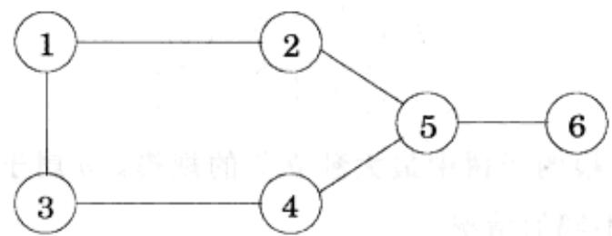
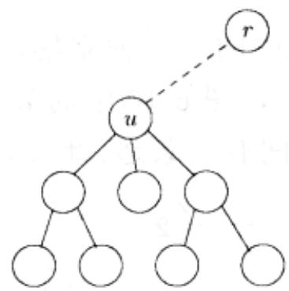

import Guide from '@/components/Guide.astro';
import Knowledge from '@/components/Knowledge.astro';
import Example from '@/components/Example.astro';
import Analysis from '@/components/Analysis.astro';
import Solution from '@/components/Solution.astro';
import Variant from '@/components/Variant.astro';
import Note from '@/components/Note.astro';
import Block from '@/components/Block.astro';
import Method from '@/components/Method.astro';
import Exercise from '@/components/Exercise.astro';
import Algorithm from '@/components/Algorithm.astro';

## 6.7 树中的独立集

节点集 $S \subset V$ 称为图 $G = (V, E)$ 中的一个独立集，是指对于其中任意两个节点，在 $E$ 中都不存在将其相连的边。例如，图6-10中的节点 $\{1, 5\}$ 就构成了一个独立集，而 $\{1, 4, 5\}$ 却不是，原因是4和5之间有一条边。此外，该图中最大的独立集是 $\{2, 3, 6\}$ 。

  
图 6-10 该图中，最大的独立集规模为 3

和本章的其它几个问题(背包问题，旅行商问题)类似，寻找一个图的最大独立集是非常困难的。然而，如果该图恰好是一个树，利用动态规划，该问题将能够在线性时间内求解。其中的子问题是怎样定义的呢？在矩阵的链式相乘中，我们发现，一旦某个节点被标记为树的根，则利用树的层次式结构可以很自然地定义出相应的子问题。

于是可以构造如下的算法：首先选择任意节点 $r$ 为树根。对应于下方悬挂的子树，每个节点恰好可定义一个子问题：

$$
I (u) = u \text { 下悬挂子树的最大独立集规模。 }
$$

我们的最终目标是求 $I(r)$ 。

动态规划总是从小到大地推进求解过程，也就是说，对于我们的问题，将自底向上地求解整个树。对于某个节点 $u$ ，假设我们已知其下方所有子树的最大独立集。也即，对于 $u$ 的所有后裔节点 $w$ ， $I(w)$ 已知。该如何计算 $I(u)$ 呢？这里将分为两种情况：独立集包含 $u$ 和不包含 $u$ (如图6-11)。

$$
I (u) = \max \left\{1 + \sum_ {w \text {为} u \text {孩子的子孙}} I (w), \sum_ {w \text {为} u \text {的孩子}} I (w) \right\}.
$$

显然，若独立集包含 $u$ ，则其中不可能包含 $u$ 的子节点(直接后继)，也即其中的其它节点都应该是 $u$ 子节点的后裔(后继)；而如果独立集不包含 $u$ ，则其子节点可能属于该独立集。

子问题的数量等于树的顶点数。稍加分析不难发现，该算法总的运行时间应该是线性的，即 $O(|V| + |E|)$ 。

  
图6-11 $I(u)$ 是以 $\pmb{u}$ 为根的子树中最大独立集的规模。 $\pmb{u}$ 属于或不属于该独立集，对应于两种不同的情况
