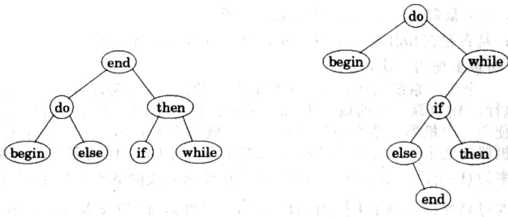
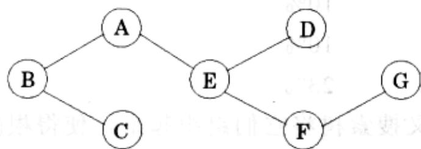
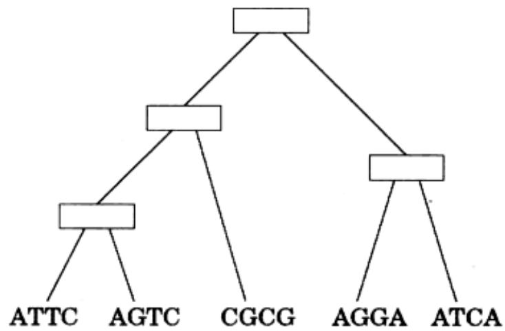
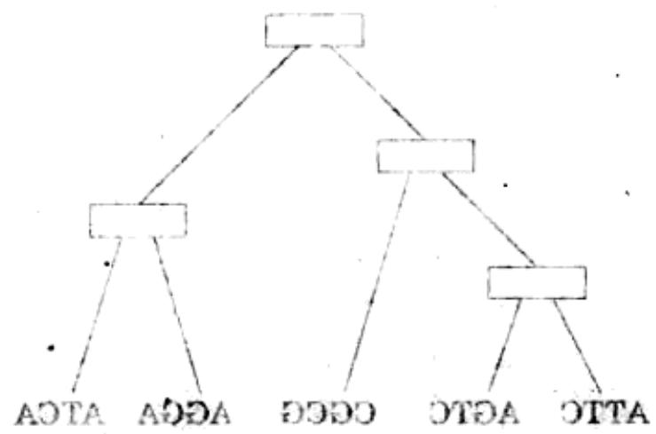

import Guide from '@/components/Guide.astro';
import Knowledge from '@/components/Knowledge.astro';
import Example from '@/components/Example.astro';
import Analysis from '@/components/Analysis.astro';
import Solution from '@/components/Solution.astro';
import Variant from '@/components/Variant.astro';
import Note from '@/components/Note.astro';
import Block from '@/components/Block.astro';
import Method from '@/components/Method.astro';
import Exercise from '@/components/Exercise.astro';
import Algorithm from '@/components/Algorithm.astro';

## 第6章 习题

<Exercise title="习题 6.1">

列表 $S$ 的相连子序列是由 $S$ 中相邻元素构成的子序列。举例来说，若 $S$ 为 5, 15, -30, 10, -5, 40, 10,

则 15, -30, 10 是一个相连子序列，而 5, 15, 40 不是。请给出针对如下任务的线性时间算法：

输入：数值列表 $a_{1}, a_{2}, \ldots, a_{n}$ 。

输出：和最大的相连子序列(长度为 0 的子序列的和为 0)。

对于以上的例子，其结果为序列 10, -5, 40, 10，和为 55。

(提示：对于每个 $j \in \{1, 2, \ldots, n\}$ ，考虑恰好在 $j$ 结束的相连子序列。)

</Exercise>

<Exercise title="习题 6.2">

假设您准备开始一次长途旅行。以0英里为起点，一路路上共有 $n$ 座旅店，距离起点的英里数分别为 $a_1 < a_2 < \ldots < a_n$ 。旅途中，您只能在这些旅店停留，当然在哪里停留完全由您决定。最后一座旅店 $(a_n)$ 是您的终点。

理想情况下，您每天可以行进200英里，不过考虑到旅店间的实际距离，有时候可能还达不到这么远。如果您某天走了 $x$ 英里，那么您将受到 $(200 - x)^2$ 的惩罚。您需要计划好行程，以使得总的惩罚——每天所受惩罚的总和最小。请给出一个高效的算法，用于确定一路上最优的停留位置序列。

</Exercise>

<Exercise title="习题 6.3">

Yuckdonald 公司计划沿着 Quaint Valley 高速公路修建一系列酒店。n 个可能的选址位于一条直线上，它们距离高速起点的距离依次(按照升序)为 $m_{1}, m_{2}, \ldots, m_{n}$ 。限制条件如下：

\- 在每个地址上最多修建一座酒店。在位置 $i$ 建设酒店可能带来的利润为 $p_i$ ，其中 $i = 1,2,\dots,n$ ， $p_i > 0$ 。

\- 两个酒店间至少间隔 $k$ 英里，其中 $k$ 为正整数。

请给出一个高效的算法，计算修建这些酒店最多能获得的利润总额。

</Exercise>

<Exercise title="习题 6.4">

给定包含 $n$ 个字符的字符串 $s[1 \ldots n]$ 。该字符串可能来自于一本年代久远的书籍，只是由于纸张朽烂的缘故文档中所有的标点符号都不见了(因此该字符串看起来就像这样：“itwasthebestoftimes...”)。现在您希望在字典的帮助下重建这个文档。在此字典表示为一个布尔函数 $\text{dict}(\cdot)$ ，对于任意的字符串 $w$ ，

$$
\operatorname{dict} (\mathbf {w}) = \left\{ \begin{array}{l l} \text { true } & w \text { 是合法的单词 } \\ \text { false } & \text { 否则 } \end{array} \right.
$$

(a) 请给出一个动态规划算法，判断 $s[\cdot]$ 是否能重建为由合法单词组成的序列。假设调用dict每次只需一个单位的时间，该算法运行时间应该不超过 $O(n^2)$ 。

(b) 若 $s[\cdot]$ 是由合法单词组成的，请在算法中输出对应的单词序列。

</Exercise>

<Exercise title="习题 6.5">

棋子的放置问题。有一个4列 $n$ 行的棋盘，其中每个格子上写有一个整数。我们有 $2n$ 个棋子，需要将这些棋子(全部或一部分)放在棋盘的格子上(每个格子最多一个棋子)，以使得被棋子覆盖的整数总和最大。限制条件是：要使放置方式为合法的，必须保证任意两个棋子不能水平或垂直相邻(可以对角线相邻)。

(a) 判断每行可能出现的合法放置模式的数量(不考虑临近的行), 并具体描述这些模式。

如果两个模式能够被放入两个相邻的行中构成一个合法的放置，则称它们是相容的。让我们考虑由前 $k(1 \leqslant k \leqslant n)$ 个列构成的子问题。每个子问题都有其特定的类型，它这取决于其最后一行的模式。

(b) 利用相容和类型的概念，给出一个 $O(n)$ 时间的动态规划算法，计算最优的放置方法。

</Exercise>

<Exercise title="习题 6.6">

根据下表我们可以定义三个字符 $a$ 、 $b$ 、 $c$ 间的乘法运算，其中 $ab = b, ba = c$ 等等。请注意，这样定义的乘法操作既不满足结合律也不满足交换率。

<table><tr><td></td><td>a</td><td>b</td><td>c</td></tr><tr><td>a</td><td>b</td><td>b</td><td>a</td></tr><tr><td>b</td><td>c</td><td>b</td><td>a</td></tr><tr><td>c</td><td>a</td><td>c</td><td>c</td></tr></table>

请给出一个高效的算法，对这些字符组成的字符串(比如 bbbbac)进行检测，以判断是否可以通过在其中插入括弧使得计算的最后结果为 a。例如，输入 bbbbac，算法应该输出 yes，因为 $((b(bb))(ba))c=a$ 。

</Exercise>

<Exercise title="习题 6.7">

如果一个子序列从左向右和从右向左读都一样，则称之为回文。例如，序列

$$
A, C, G, T, G, T, C, A, A, A, A, T, C, G
$$

有很多回文子序列，比如 $A, C, G, C, A$ 和 $A, A, A, A$ 。请给出一个算法，对于输入的序列 $x[1 \ldots n]$ ，在 $O(n^2)$ 内返回其最长回文子序列(的长度)。

</Exercise>

<Exercise title="习题 6.8">

给定两个字符串 $x = x_{1}x_{2}\ldots x_{n}$ 和 $y = y_{1}y_{2}\ldots y_{n}$ ，我们希望求其最长共同子串的长度。即，求最大的整数 $k$ ，使得对某序号 $i$ 和 $j$ ，有 $x_{i}x_{i + 1}\ldots x_{i + k - 1} = y_{j}y_{j + 1}\ldots y_{j + k - 1}$ 。请说明如何在 $O(mn)$ 时间内实现之。

</Exercise>

<Exercise title="习题 6.9">

某个字符串处理语言提供了一个将字符串一分为二的基本操作。由于该操作需要拷贝原来的字符串，因此对于长度为 $n$ 的串，无论在其什么位置进行分割，都需要花费 $n$ 个单位的时间。现在假设我们要将一个字符串分割成多段，具体的分割次序会对总的运行时间产生影响。例如，如果要在位置3和位置10分割一个长度为20的串，首先在位置3进行分割产生的总代价为 $20 + 17 = 37$ ，而首先在位置10进行分割产生的总代价为 $20 + 10 = 30$ 。

请给出一个动态规划算法，对于给出了 $m$ 个分割位置的长度为 $n$ 的字符串，计算完成所有分割的最小代价。

</Exercise>

<Exercise title="习题 6.10">

数人头问题。给定整数 $n$ 和 $k$ ，以及 $p_1, \ldots, p_n \in [0, 1]$ ，您需要确定 $n$ 个独立的形状不规则的硬币落地时恰好有 $k$ 个人头面朝上的概率，其中，第 $i$ 个硬币正面为人头的概率为 $p_i$ 。请就此给出一个 $O(nk)$ 时间的算法 $^2$ 。这里假定[0, 1]间任意两数的加法和乘法都能在 $O(1)$ 内完成。

</Exercise>

<Exercise title="习题 6.11">

给定两个字符串 $x = x_{1}x_{2}\ldots x_{n}$ 和 $y = y_{1}y_{2}\ldots y_{n}$ ，我们希望求其最长共同子串的长度。即，求最大的整数 $k$ ，使得存在序号 $i_1 < i_2 < \ldots < i_k$ 和 $j_1 < j_2 < \ldots < j_k$ ，满足 $x_{i_1}x_{i_1}\ldots x_{i_k} = y_{i_1}y_{i_1}\ldots y_{i_k}$ 。请说明如何在 $O(mn)$ 时间内实现之。

</Exercise>

<Exercise title="习题 6.12">

给定平面上包含 $n$ 个顶点的凸多边形 $P$ (给定各顶点的 $x$ 和 $y$ 坐标)。 $P$ 一个的三角剖分由 $P$ 中(除端点外)不相交的 $n - 3$ 条对角线构成，该剖分将 $P$ 分成了 $n - 2$ 个相互分离的三角形。三角剖分的代价为其中所有对角线的长度之和。请给出一个高效的算法，求 $P$ 的代价最小的三角剖分。(提示：将 $P$ 的顶点标记为 $1, \ldots, n$ ，然后由任意一个顶点开始，逆时针方向前进。对于 $1 \leqslant i < j \leqslant n$ ，令子问题 $A(i, j)$ 为包含顶点 $i, i + 1, \ldots, j$ 的多边形的最小三角剖分代价。)

</Exercise>

<Exercise title="习题 6.13">

考虑如下的博弈。发牌手准备了一摞扑克牌 $s_1, \ldots, s_n$ 。从牌面上看，牌 $s_i$ 的价值为 $v_i$ 。现在两个玩家轮流拿牌，每人每次只能拿最前或最后的一张。玩家的目标是使所拿到的牌总价值最高(不妨想象这些牌都是有面值的筹码)。假设 $n$ 为偶数。

(a) 请给出一个序列，使得先开始的玩家如果采取贪心策略(即每次取走能拿的牌中面值较大的一张)，将总是无法达到最优。

(b) 给出一个 $O(n^{2})$ 的算法，用于计算先开始玩家的最优策略。给定初始序列，该算法首先利用 $O(n^{2})$ 的时间进行预先计算，然后在每次选择时，玩家只需通过查找预先计算的结果即可在 $O(1)$ 内做出最优选择。

</Exercise>

<Exercise title="习题 6.14">

布料剪裁问题。您手中有一块大小 $X \times Y$ (X 和 Y 均为正整数) 的长方形布料，以及一个包含 $n$ 种服装产品的清单。已知制造每种产品 $i \in [1, n]$ ，需要大小 $a_i \times b_i$ 的长方形布料，且该产品的最终售价为 $c_i$ 。假设 $a_i, b_i$ 和 $c_i$ 都是正整数。有一台布料切割机，每次可以从水平或垂直方向将布料一分为二。请设计一个算法，用于确定大小 $X \times Y$ 的布料的最优产出，也即，提供一种剪裁策略，使得按照该策略分割后，由该布料生产出的产品总价最高。这里对于生产某种产品的具体数量没有要求，您可以选择生产 1 件或多件，或者根本不生产。

</Exercise>

<Exercise title="习题 6.15">

假设 $A, B$ 两支队伍在开展一场竞赛，看谁能够首先赢得 $n$ 场比赛。 $A$ 和 $B$ 具有相同的竞争力，也即，他们各有 $50\%$ 的概率赢得任意一场比赛。在已经结束的 $i + j$ 场比赛中， $A$ 获胜了 $i$ 场， $B$ 获胜了 $j$ 场。请给出一个高效的算法，计算在此条件下 $A$ 最终获得胜利的概率。例如，如果 $i = n - 1$ 且 $j = n - 3$ ，则 $A$ 最终获胜的概率为 $7 / 8$ ，因为它只需在接下来的三场比赛中任意获胜一场即可。

</Exercise>

<Exercise title="习题 6.16">

旧货销售问题。在某个星期日的早晨，将召开 $n$ 场旧货拍卖会 $g_{1}, g_{2}, \ldots, g_{n}$ 。假设对每个 $g_{j}$ ，您有一个心理估价 $v_{j}$ 。任意两个会场 $i, j$ 间的交通费用为 $d_{ij}$ 。同时，从您家到任意一个会场 $j$ 之间的往返费用分别为 $d_{0j}$ 和 $d_{j0}$ 。您需要确定一条线路，从家里出发，访问一部分的旧货拍卖会，并最终返回家中，目标是使得您的总收益与总交通费用之差最大。

希望您给出的算法能在 $O(n^{2}2^{n})$ 内运行完成。(提示：这看起来是不是很像旅行商问题？)

</Exercise>

<Exercise title="习题 6.17">

给定数量无限的面值分别为 $x_{1}, x_{2}, \ldots, x_{n}$ 的硬币，我们希望将价格 $\nu$ 兑换成零钱。也即，我们希望找出一堆总值恰好为 $\nu$ 的硬币。这有时候是不可能的：例如，如果硬币只有5和10两种面值，则我们可以兑换15却不能兑换12。请给出一个针对如下问题的 $O(nv)$ 的动态规划算法：

输入： $x_{1},\ldots,x_{n};v$ 。

问题：能否用面值分别为 $x_{1},\ldots ,x_{n}$ 的硬币兑换价格 $\nu$

</Exercise>

<Exercise title="习题 6.18">

考虑以上零钱兑换问题(习题 6.17)的一个变型：您有面值 $x_{1}, x_{2}, \ldots, x_{n}$ 的硬币，希望兑换的价格为 v，但是，每种面值的硬币最多只能使用一次！举例来说，如果硬币面值为 1, 5, 10, 20，则可以兑换的价格包括 $16 = 1 + 15$ 和 $31 = 1 + 10 + 20$ ，但是无法兑换 40（因为 20 不能用两次）。

输入：正整数 $x_{1}, x_{2}, \ldots, x_{n}$ ；以及另一个整数 $\nu$ 。

输出：是否能够仅使用面值分别为 $x_{1}, x_{2}, \ldots, x_{n}$ 中的硬币最多一次，兑换价格 v。

请说明如何在 $O(nv)$ 时间内求解该问题。

</Exercise>

<Exercise title="习题 6.19">

这里还有一个零钱兑换问题(习题 6.17)的变型。

给定无限多的面值 $x_{1}, x_{2}, \ldots, x_{n}$ 的硬币，我们希望用其中最多 $k$ 枚硬币兑换价格 $\nu$ 。即，我们需要找到不超过 $k$ 枚的硬币，使其总面值为 $\nu$ 。这也可能是无法实现的：例如，若面值为 5 和 10， $k = 6$ ，则我们将可以兑换 55，但却不能兑换 65。请给出以下问题的动态规划算法：

输入： $x_{1}, x_{2}, \ldots, x_{n}; k; v$ 。

问题：是否有可能用不超过 $k$ 枚面值分别为 $x_{1}, x_{2}, \ldots, x_{n}$ 的硬币兑换价格 $\nu$ ?

</Exercise>

<Exercise title="习题 6.20">

最优二叉搜索树。假设我们已知在某个程序设计语言中，每个关键字的出现频率，例如：

<table><tr><td>begin</td><td>5%</td></tr><tr><td>do</td><td>40%</td></tr><tr><td>else</td><td>8%</td></tr><tr><td>end</td><td>4%</td></tr><tr><td>if</td><td>10%</td></tr><tr><td>then</td><td>10%</td></tr><tr><td>while</td><td>23%</td></tr></table>

我们希望用一个二叉搜索树将它们组织起来，使得根(分枝点)上的关键字按照字母顺序大于左子树中的关键字，同时又小于右子树中的关键字。

  
图 6-12 关于某程序设计语言关键字的两个二叉搜索树

图6-12左侧是一个平衡的例子。其中，当需要查询某个关键字时，最多需要进行三次比较：例如，查找“while”时，只需要检验三个节点“node”、“then”和“while”。但是由于我们知道每个关键字被访问的频度，我们可以考虑一个更为精确的代价函数，即查询每个单词的平均比较次数。比如，对于左侧的搜索树，该值为：

$$
\text { 代   价 } = 1 (0. 0 4) + 2 (0. 4 0 + 0. 1 0) + 3 (0. 0 5 + 0. 0 8 + 0. 1 0 + 0. 2 3) = 2. 4 2 。
$$

根据这一函数，最优的搜索树应该如图 6-12 的右侧，其代价为 2.18。

请就以下任务给出高效的算法：

输入： $n$ 个单词(按顺序排列)以及每个单词的出现频度 $p_1, p_2, \ldots, p_n$ 。

输出：代价最小的二叉搜索树。

</Exercise>

<Exercise title="习题 6.21">

图 $G = (V, E)$ 的一个顶点覆盖 $S$ 是 $V$ 的子集，满足： $E$ 中的每条边都至少有一个端点属于 $S$ 。请给出如下任务的一个线性时间的算法：

输入：无向树 $T=(V,E)$ 。

输出：T 的最小覆盖的大小。

例如，对如下的树，可能的顶点覆盖包括 $\{A, B, C, D, E, F, G\}$ 和 $\{A, C, D, F\}$ ，不包括 $\{C, E, F\}$ 。最小顶点覆盖的大小为3，对应集合 $\{B, E, G\}$ 。



</Exercise>

<Exercise title="习题 6.22">

请就如下任务给出一个 $O(nt)$ 时间的算法：

输入：n 个整数 $a_{1}, a_{2}, \ldots, a_{n}$ 的列表；正整数 t。

问题：是否存在 $\{a_i|1\leqslant i\leqslant n\}$ 的子集，其中各数相加等于 $t$ ？

(每个 $a_{i}$ 最多使用一次。)

</Exercise>

<Exercise title="习题 6.23">

一个生产系统共包含 $n$ 个顺序执行的阶段。每个阶段 $i(1 \leqslant i \leqslant n)$ 由对应的机器 $M_i$ 执行。 $M_i$ 可靠工作的概率为 $r_i$ (失效的概率为 $1 - r_i$ )。因此，如果我们在每个阶段都只使用一台机器，整个系统可靠工作的概率将为 $r_1 \cdot r_2 \dots r_n$ 。为了有所改进，我们引入机器的冗余，即对每台机器 $M_i$ 都建立 $m_i$ 个副本。 $M_i$ 的所有 $m_i$ 个副本同时失效的概率为 $(1 - r_i)^{m_i}$ ，这意味着第 $i$ 阶段工作顺利完成的概率为 $1 - (1 - r_i)^{m_i}$ ，从而整个系统的可靠性提高到了 $\prod_{i=1}^{n} (1 - (1 - r_i)^{m_i})$ 。设机器 $M_i$ 的成本为 $c_i$ ，购买机器的总预算为 $B$ (假设 $B$ 和 $c_i$ 都是正整数。)

给定概率 $r_1, r_2, \ldots, r_n$ ，成本 $c_1, c_2, \ldots, c_n$ 和预算 $B$ ，请给出在预算范围内进行

冗余配置的策略 $(m_{1}, m_{2}, \ldots, m_{n})$ ，以最大限度地保证系统的可靠运行。

</Exercise>

<Exercise title="习题 6.24">

动态规划的时空复杂度。计算两个长度分别为 $m$ 和 $n$ 的字符串之间编辑距离的动态规划算法将产生一个 $n \times m$ 的表格，因此该算法需要 $O(mn)$ 的时间和空间。在实际应用中，它可能在时间上限到达之前就已经耗尽了所有的空间。那么，如何才能减少空间需求呢？

(a) 请说明如果我们仅仅求编辑距离的值(而不是最优的编辑操作序列)，则只需要 $O(n)$ 的空间，因为在任意给定时刻，表中事实上只有很少一部分数据需要保存。

(b) 假设我们同时也求最优的编辑序列。如前可知，该问题可转换成一个网格状的 dag，目标相应地变成了求节点(0, 0)到(n, m)的最优路径。用这种方式工作起来非常方便，当然，这里我们需要假设 m 是 2 的方幂。

让我们为编辑距离算法稍微增加一些将会有用的东西：对于某个 $k$ ，dag中的最优路径必须经过一个中间节点 $(k, m/2)$ 。请说明如何修改算法使之也返回这个 $k$ 值。

(c) 考虑一种递归方式：

```txt
procedure find-path((0,0) → (n,m))
compute the value k above
find-path((0,0) → (k,m/2))
find-path((k,m/2) → (n,m))
concatenate these two paths, with k in the middle
```

证明对应的算法可以在 $O(mn)$ 的时间和 $O(n)$ 的空间内运行。

</Exercise>

<Exercise title="习题 6.25">

考虑如下的三分(3-PARTITION)问题。给定整数 $a_1, \ldots, a_n$ ，判断是否可以将 $\{1, \ldots, n\}$ 分割为三个相互分离的子集 $I, J, K$ ，使得

$$
\sum_ {i \in I} a _ {i} = \sum_ {j \in J} a _ {j} = \sum_ {k \in K} a _ {k} = \frac {1}{3} \sum_ {i = 1} ^ {n} a _ {i}
$$

例如，输入 $\{1,2,3,4,4,5,8\}$ ，回答是 yes，因为可以将其分为 $\{1,8\}, \{4,5\}, \{2,3,4\}$ (和都为 9)。而另一方面，对输入 $\{2,2,3,5\}$ ，回答是 no。

请设计一个三分问题的动态规划算法，使之能在关于 $n$ 和 $\Sigma_{i}a_{i}$ 的多项式时间内运行。

</Exercise>

<Exercise title="习题 6.26">

序列对齐。新的基因被发现后，为了了解其功能，一个常用的方法是查找已知基因中与之相似的基因。两个基因之间的相似度是由它们可以相互对齐的程度决定的。为了对它进行量化，考虑基于字母表 $\Sigma = \{A, C, G, T\}$ 定义的字符串。设两个基因(字符串)分别为 $x = ATGCC, y = TACGCA$ 。 $x$ 和 $y$ 的一个对齐是指将它们都横向书写，然后将其中相同的字符进行匹配的方式，例如：

$$
\begin{array}{c c c c c c c} - & \mathrm{A} & \mathrm{T} & - & \mathrm{G} & \mathrm{C} & \mathrm{C} \\ \mathrm{T} & \mathrm{A} & - & \mathrm{C} & \mathrm{G} & \mathrm{C} & \mathrm{A} \end{array}
$$

其中：“-”表示一个“空隙”；串中的所有字符必须保持原有顺序，且每行必须包含来自至少一个字符串的某个字符。对齐的分值基于一个 $(|\Sigma| + 1)\times (|\Sigma | + 1)$ 的评分矩阵定义，其中包含特定的行和列对应于空隙的情况。举例来说，此前列举的对齐方式分值如下：

$$
\delta (-, T) + \delta (A, A) + \delta (T, -) + \delta (-, C) + \delta (G, G) + \delta (C, C) + \delta (C, A) 。
$$

请给出一个动态规划算法，以两个字符串 $x[1\dots n], y[1\dots m]$ 以及评分矩阵为 $\delta$ 为输入，返回分值最高的对齐。要求运行时间为 $O(mn)$ 。

</Exercise>

<Exercise title="习题 6.27">

带有空隙惩罚的对齐。习题 6.26 的对齐算法有助于识别两个 DNA 序列是否相似。两个相近 DNA 间的差异常常源于 DNA 复制中的错误。基于对生物学中基因复制过程的实际观察发现，我们此前采用的评分函数可能存在一些缺陷：自然界中，核苷中更多地会发生整个子串的插入或移除(从而产生很长的空隙)，而较少出现每次只修改其中一个位置的情况。因此，对于长度为 10 的空隙的惩罚不应该等于长度为 1 的空隙所获惩罚的 10 倍，而是应该略微小于后者。

请重复习题6.26，不过这一次采用修改后的评分函数，其中对于长度为 $k$ 的空隙的惩罚为 $c_{0} + c_{1}k$ ， $c_{0}$ 和 $c_{1}$ 为给定常数 $(c_0 > c_1)$ 。

</Exercise>

<Exercise title="习题 6.28">

局部序列对齐。通常情况下，两个 DNA 是截然不同的，仅仅包含一些看起来非常相似和高度保守的区域。请设计一个算法，以两个字符串 $x[1\ldots n]$ ， $y[1\ldots m]$ 以及一个评分矩阵 $\delta$ 为输入(参见习题 6.26 的定义)，分别输出 x 和 y 的子序列 $x'$ 和 $y'$ ，使之在所有成对的子序列中是对齐分值最高的。算法运行时间应该为 $O(mn)$ 。

</Exercise>

<Exercise title="习题 6.29">

显子拼接。每个基因对应于整个基因组(DNA 序列)的一个子区域。这个子区域中可能包含一部分“垃圾 DNA”。经常可以看到一个基因中包含了多个所谓的显子片段，而它们被称为内区的垃圾片段所分隔。于是，在一个新的基因组中识别基因就变得更加困难了。

假设我们有一个新的基因序列，我们想要检测其中是否包含某个基因(字符串)。因为我们不能保证基因是相连的子序列，因此我们需要对其进行部分匹配——即将其片段与已知的基因进行比对(实际上，即使这一部分匹配结果是近似的，也还谈不上完美)。然后我们将尝试拼接这些片段。

令 $x[1\dots n]$ 为DNA序列。每个部分匹配可以表示为一个三元组 $(l_{i}, r_{i}, w_{i})$ ，其中 $x[l_{i}\ldots r_{i}]$ 为一个片段，而权重 $w_{i}$ 表示匹配的强度(可能是一个局部匹配分值或其它的统计量)。这些潜在的匹配有许多是错误的，因此我们的目标是寻找所有三元组的一个子集，使其在保持一致(不相互覆盖)的同时总的权重最大。

请说明如何高效地实现以上任务。

</Exercise>

<Exercise title="习题 6.30">

基于最大节俭原则重构进化树。现在我们希望对来自许多不同物种的同一特定基因进行排列。说的具体些，假设有 $n$ 个物种，其对应的基因序列都是基于字母表 $\Sigma = \{A, C, G, T\}$ 的长度为 $k$ 的字符串。我们需要利用这一信息重建这些物种的进化史。

进化史通常表示为一个树，其中叶节点表示不同的物种，根为其后裔节点共同的祖先，而中间的分枝表示物种的分化(也即新物种从原有物种中分离出来)。因此，我们需要寻找如下信息：

\- 一个(二叉)进化树，其中树叶为给定的物种。

\- 对于每个内部节点，确定一个长度为 $k$ 的字符串，表示节点对应祖先的基因序列。

对于每个可能的树 $T$ ，在其每个节点 $\pmb{u}$ 上标注序列 $s(u) \in \Sigma^k$ ，然后基于节俭原则——变异越少越好，对其进行评分：

$$
\text { 分值 } (T) = \sum_ {(u, v) \in E (T)} (s (u) \text { 与 } s (v) \text { 中相同的位置数 }) 。
$$

寻找分值最高的树是非常困难的。这里我们只考虑其中的一小部分：假设我们已知树的结构，我们需要对其内部节点 $u$ 填写 $s(u)$ 。以下是一个 $k = 4$ 且 $n = 5$ 的例子：



中其(a)在这个例子中，基于最大节检原则，有多种内部节点序列重构方式。请找出其中之击。在图四暗目个—是指问）要避的图四示末，重映面，每个一氏[1...1]x一的(b)对该任务给出一个高效的算法。(提示静虽然序列可能非常长些但您可以每次只考虑其中的一个位置。)重映的总切同的(盖置正卧不)进一转呆出其处，秉于个

。釜王土以西突出较高回映即新南

同的棘鳞同不全书自来按壁条[例]并复，树外拟肉重顺到余计大量于基 03.8 干基是猎国和因基的沟板其，棘鳞个n首舒弱，些本具的阶。原科译报因基宝译一的棘鳞虽复重息静一反因环要器[例]。串许字(内)式复习的&#123;T, D, C, A&#125;=2素四字。史升摄

同共点首裔鼠其齿勋，神鹰的同不示寿点节书中其，树个一次示寿常画史出数，出因。(来出离台中神鹰首别从神鹰德明曰)分仓的神鹰示寿封仓的同中面，失助的：息首不成处长要需印舞

。林荫宝台氏和林中其，林阶(叉二)个一

因基的表脚边按点并示奉，串皆字的A次更多个一定额，点并暗内个被干按。

顺制金井干基自然， $^{A}2\ni(\mathfrak{g})a$ 水和主栽土，点并个及其弃， $\lambda$ 树的指顶个昼干按：代替分按其按，我国心地早变

$$
\text {(装置外的同卧中} (v) z \text {是} (w) z) \sum_ {(T) \exists (v, w)} = (T) \text {前代}
$$

[附表及例]：分隔小一的中其数多只[附表里交]。由数困常非量树的高量直分处长；于圆的 $\bar{c} = n$ 且 $p = 1$ 个一员干过。(u)z 水真 u 点并暗内其恢复需[附表，例参的树眼与



</Exercise>

