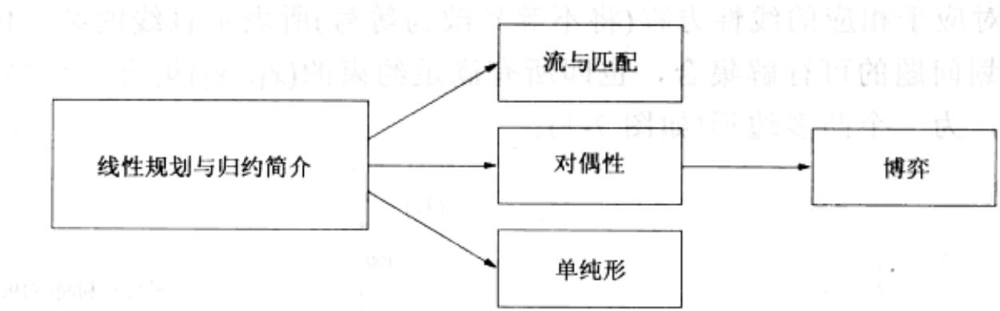
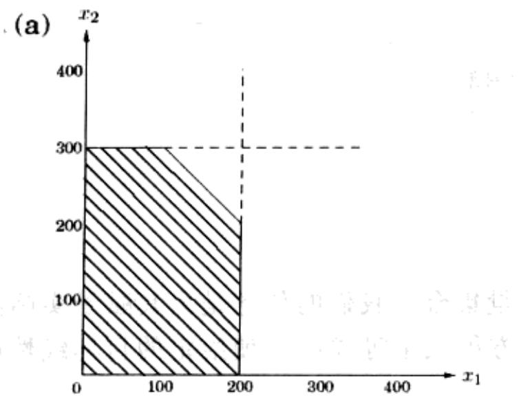
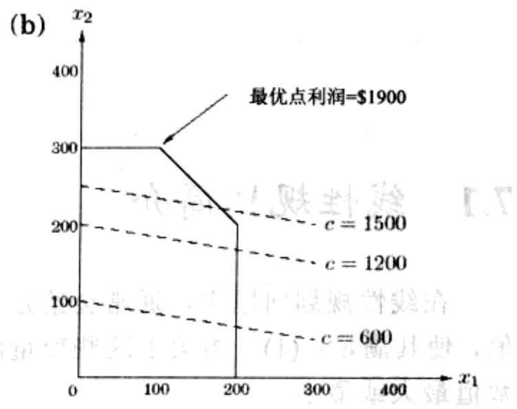
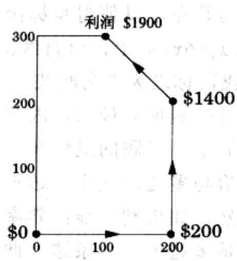
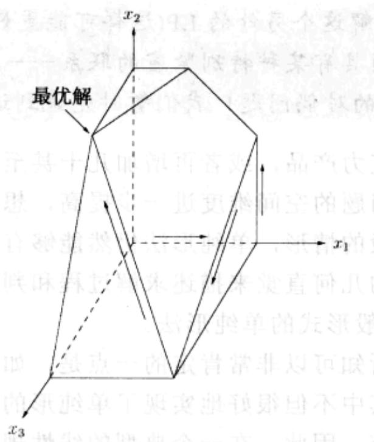
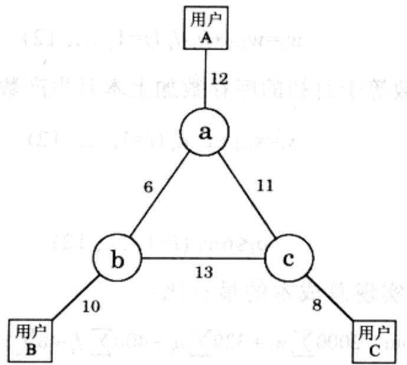
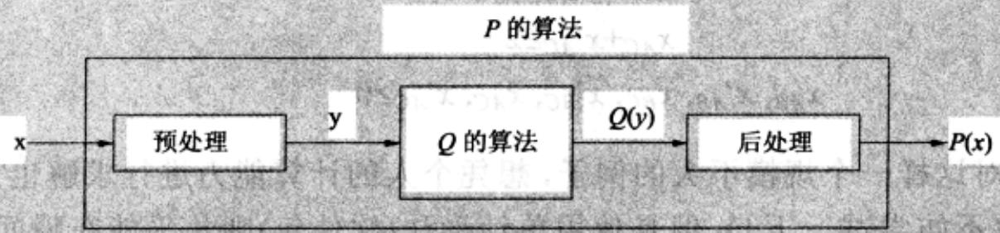
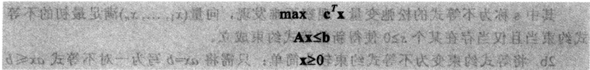

import Guide from '@/components/Guide.astro';
import Knowledge from '@/components/Knowledge.astro';
import Example from '@/components/Example.astro';
import Analysis from '@/components/Analysis.astro';
import Solution from '@/components/Solution.astro';
import Variant from '@/components/Variant.astro';
import Note from '@/components/Note.astro';
import Block from '@/components/Block.astro';
import Method from '@/components/Method.astro';
import Exercise from '@/components/Exercise.astro';
import Algorithm from '@/components/Algorithm.astro';

## 第7章 线性规划与归约

我们关注的很多算法设计问题都以某种优化为目的：最短路径、最低代价生成树、最长递增子序列诸如此类。对于这类问题，我们力求找到这样的解：(1)满足一定的约束条件(例如路径必须由指定的边 $s$ 到 $t$ 构成，树必须包含图上所有的节点，子序列必须是递增的等等)；(2)在所有满足约束的可能解中，根据某个定义良好的评判标准，该解是最优的。

线性规划描述了一大类这样的优化任务，这些任务的共同特征是约束条件和优化准则都可以表示为线性函数。在现实生活中，这样的问题数量非常庞大。

由于本章论题的庞杂，以下我们将其分为几个部分，其中每一部分都可作为一个独立专题进行阅读。

(8)

## 7.1 线性规划简介

在线性规划问题中，通常会给定一个变量集合，我们的任务是为其赋予实际的值，使其满足：(1)一组关于这些变量的线性方程或不等式；(2)使给定的目标线性函数值最大或最小。

## 7.1.1 示例：利润最大化

某家巧克力作坊生产两种产品：一种是其旗舰产品，称为Pyramide的三角形巧克力，还有一种是较为奢华高级的Pyramide Nuit(简称Nuit)。我们关心的是这两种产品各生产多少能使该作坊的利润最高。假设每天生产 $x_{1}$ 盒Pyramide和 $x_{2}$ 盒Nuit，已知前者每盒的利润为\$1，而后者利润要高得多，每盒\$6。我们需要确定 $x_{1}$ 和 $x_{2}$ 的值。当然还有一些约束条件是必须满足的(当然，最明显的是 $x_{1}, x_{2} \geqslant 0$ )。首先是市场对于这家作坊生产的巧克力的需求量，每日最多为200盒Pyramide和300盒Nuit。同时，根据巧克力作坊现有的条件，每天最多能生产400盒(各类)巧克力。试问最优的生产方案是什么？

我们将该问题表述为如下的线性规划

$$
\begin{array}{r l r} {\text {目标函数}} & & {\max x _ {1} + 6 x _ {2}} \\ {\text {约束条件}} & & {x _ {1} \leq 2 0 0} \\ & & {x _ {2} \leq 3 0 0} \\ & & {x _ {1} + x _ {2} \leq 4 0 0} \\ & & {x _ {1}, x _ {2} \geq 0} \end{array}
$$

关于 $x_{1}$ 和 $x_{2}$ 的线性方程定义了二维平面上的一条直线，线性不等式则定义了一个半平面，对应于相应的线性方程(将不等号改为等号)所表示直线的某一侧。因此，以上线性规划问题的可行解集合，也即所有满足约束的 $(x_{1}, x_{2})$ 集合，就等于五个半平面的交集，为一个凸多边形(如图7-1)。

  
图7-1 (a)线性规划的可行区域。(b)对于不同的利润值 $c$ ，目标函数 $x_{1} + 6x_{2} = c$ 对应的利润等高线

我们需要找到该多边形中的某点，以使得目标函数——总利润的值最大。如图7-1，利润为 $c$ 的点都位于直线 $x_{1} + 6x_{2} = c$ 上，该直线的斜率为-1/6，图中用虚线画出了一些特定 $c$ 值对应的直线，我们称之为“利润线”。当 $c$ 增加时，对应的利润线将向图的右上方平行移动。由于目标是使 $c$ 最大，因此在保持这条线与可行区域接触的同时，应该使其位置尽可能靠上。问题的最优解应该就位于其中位置最高的利润线上，如图所示，此时该直线恰与多边形交于多边形的一个顶点，该顶点对应的坐标就是我们所求的最优解。当然，如果利润线的斜率稍有不同，它与多边形的最后交集也可能不是一个顶点，而是多边形的一条边。此时，最优解将是不唯一的，不过其中一定也包含至少一个最优的顶点。

在可行区域的顶点上寻找最优解，是线性规划中的一条通用规则。唯一的例外是最优解不存在，这对应于两种可能：

1. 该线性规划本身不可行，也即，约束条件过紧，导致所有的约束不可能全部同时满足(可行区域为空)。例如

$$
x \leq 1, x \geq 2
$$

2. 约束条件过松，导致可行区域无界，目标函数可能得到任意大(或小)的值。例如

$$
\begin{array}{l} \max x _ {1} + x _ {2} \\ x _ {1}, x _ {2} \geq 0. \end{array}
$$

## 求解线性规划

线性规划(LPs)都可以用单纯形法求解(7.6节将对其做详细介绍)。该方法1947年由George Dantzig提出。简单地说，算法从一个顶点开始，例如在我们的例子中可能是(0,0)，不断重复地寻找利润(目标函数)值较高的邻居顶点(该顶点与原顶点由可行区域的一条边相连)，并向其移动。通过一种历经多边形顶点的爬山方法，从一个邻居到下一个邻居，算法将沿路不断提高利润。以下是一条可能的轨迹：

一旦再也找不到利润更高的邻居，单纯形法将得出结论，宣布当前顶点为最优解，同时结束计算。为什么基于这种局部测试的方法能够得到全局的最优解呢？通过简单的几何分析不难说明这一点。请回想一下我们之前分析指出的利润线的移动特征。由于最终相交顶点的所有邻居都位于该直线之下，因此可行多边形中的剩余部分也必然都位于该直线的下方(请注意可行区域是一个凸多边形！)。

## 更多产品

鉴于顾客的积极响应，巧克力作坊决定推出一种新产品，Pyramide Luxe(简称 Luxe)。每盒 Luxe 的利润为\$13。用 $x_1$ 、 $x_2$ 、 $x_3$ 分别表示每天生产三种巧克力的数量，其中 $x_3$ 对应于 Luxe。仍然保持关于 $x_1$ 和 $x_2$ 的约束条件，同时原来存在的加工能力限制在增加 $x_3$ 后同样有效——三种巧克力每天最多生产 400 盒。此外，由于 Nuit 和 Luxe 需要使用相同的包装设备，而且每个 Luxe 的包装需要使用三次该设备，从而引出了一个新的约束 $x_2 + 3x_3 \leqslant 600$ 。这样一来，最优的生产计划应该又是怎样的呢？

以下是修改后的线性规划：

$$
\begin{array}{l} \max x _ {1} + 6 x _ {2} + 1 3 x _ {3} \\ x _ {1} \leq 2 0 0 \\ x _ {2} \leq 3 0 0 \\ x _ {1} + x _ {2} + x _ {3} \leq 4 0 0 \\ x _ {2} + 3 x _ {3} \leq 6 0 0 \\ x _ {1}, x _ {2}, x _ {3} \geq 0 \end{array}
$$

现在，解空间由二维变成了三维。每个线性方程定义了一个3D平面，而每个不等式对应于平面某一侧的半个空间。可行区域变成了七个半空间的交集，也即一个多面体(参见图7-2)。对于该图，你能指出其中每个面都分别和哪个不等式对应吗？

在图中，总利润 c 对应于平面 $x_{1}+6x_{2}+13x_{3}=c$ 。当 c 增加时，该“利润平面”将向着正象限(三个坐标值都大于零的象限)的方向平行移动，并最终与可行多面体不再相交。利润平面与可行多面体最后的交点即为最优解对应的顶点，其坐标为(0,300,100)，此时总利润 c=\$3100。

  
图 7-2 三变量线性规划问题的可行多面体

对于修改后的问题，单纯形法是怎样工作的呢？和之前一样，它仍然不断沿着多面体的边由一个顶点移向另一个顶点，在此过程中不断提高利润值。图7-2中标出了一条可能的求解轨迹，其对应的顶点和利润序列如下：

$$
\begin{array}{c} (0, 0, 0) \\ \text {   0   } \end{array} \longrightarrow \begin{array}{c} (2 0 0, 0, 0) \\ \text {   200   } \end{array} \longrightarrow \begin{array}{c} (2 0 0, 2 0 0, 0) \\ \text {   1400   } \end{array} \longrightarrow \begin{array}{c} (2 0 0, 0, 2 0 0) \\ \text {   2800   } \end{array} \longrightarrow \begin{array}{c} (0, 3 0 0, 1 0 0) \\ \text {   3100   } \end{array}
$$

一旦到达了某个找不到利润更高邻居的顶点，算法将停止并宣布找到了最优解。对以上过程有效性的解释仍然可以依赖于简单的几何学，因为如果该顶点的所有邻居都位于利润平面的另一侧，则整个(凸)多面体也应该位于与它们相同的一侧。

<Knowledge title="专栏: 对偶性，一个魔术">

下面解释一下为什么我们可以确信(0,300,100)(总利润\$3100)就是最优解。我们将约束条件中的第二和第三个不等式相加，再将其结果与第四个不等式两边乘四后的结果相加，可得到

$$
x _ {1} + 6 x _ {2} + 1 3 x _ {3} \leq 3 1 0 0 。
$$

显而易见,这个不等式说明不可能有哪个可行解能够获得比\$3100更高的利润。所以以上的解当然就是最优解!唯一的问题是,关于这四个不等式的乘法因子(0,1,1,4)是如何得到的呢?

在7.4节中，我们将说明通过求解另一个LP，总是能够求得这些乘法因子。当然，也存在某种不需要求解这个另外的LP(这样可能更好)的情况，此时两个问题(原LP和“另外的”LP)之间具有某种特别紧密的联系——我们称之为对偶，它意味着解决原LP也就解决了它的对偶问题！我们暂时先说到这里，详细情况请见后文。

如果增加第四种巧克力产品，或者再增加几十甚至上百种类似的新产品，情况又会如何呢？这将使得问题的空间维度进一步提高，想要对其进行图形化也会越来越困难。对于这些更一般的情形，单纯形法仍然能够有效地发挥作用，只是我们已经无法完全依赖于简单的几何直觉来描述求解过程和判定结果的正确性。为此，在7.6节中我们将研究更一般形式的单纯形法。

另一方面，就我们所知可以非常肯定的一点是，如今已经出现了许多专业化和工业级的应用软件包，其中不但很好地实现了单纯形的通用算法，同时也兼顾了数值精度等方面的工程细节。因此，在一个典型的线性规划应用中，我们主要的任务通常就只是考虑如何正确地将问题描述为一个线性规划，剩下的工作交给软件包自动完成就可以了。

有了这些认识，下面我们来看一个高维的例子。

</Knowledge>
## 7.1.2 示例：生产计划

本例中某公司生产手工编制的地毯，这是一种季节性极强的产品。分析师已就下一年度每个月的需求量进行了估算，依次为 $d_{1}$ 、 $d_{2}$ 、...、 $d_{12}$ 。正如我们所担心的，这些数值间的差异非常之大，从440到920不等。

公司的基本情况如下：现有30名员工，员工每人每月能够织造20条地毯，月工资\$2,000。公司最初没有任何产品库存。

我们应该如何应对起伏不定的需求呢？一般有以下三种途径：

1. 加班。相对于正常工时，加班的成本是昂贵的，每小时需多支付工人 $80\%$ 的工资。此外，每个工人的加班时间不能超过正常工时的 $30\%$ 。

2. 聘用和解雇。对应的一次性费用分别为每人次\$300 和 \$400。

3. 仓储囤积。每条地毯的月仓储费用为\$8。目前我们手上没有需要存储的过剩产品，到年底时也应该如此。

这样一个看起来有些棘手的问题也可以用线性规划来描述。

我们首先定义一些变量：

$w_{i}=$ 第 i 个月时的工人数，其中 $w_{0}=30$ 。

$x_{i}=$ 第 i 个月正常工时生产的地毯数。

$o_{i}=$ 第 i 个月加班生产的地毯数。

$h_{i}, f_{i}=$ 第 i 个月开始时新聘用和解雇的工人数。

$s_{i}=$ 第 i 个月底库存的地毯数，其中 $s_{0}=0$ 。

最终统计下来，共有72个变量(如果算上 $w_{0}$ 和 $s_{0}$ 则为74个)。

现在来写约束条件。首先，所有的变量都应该是非负的：

$$
w _ {i}, x _ {i}, o _ {i}, h _ {i}, f _ {i}, s _ {i} \geq 0, i = 1, \dots , 1 2
$$

每月生产的地毯数包含了正常工时和加班时间生产的总量：

$$
x _ {i} = 2 0 w _ {i} + o _ {i} (i = 1, \dots , 1 2)
$$

每月初工人的数量可能会发生一些变化：

$$
w _ {i} = w _ {i - 1} + h _ {i} - f _ {i} (i = 1, \dots , 1 2)
$$

每月底库存的地毯数等于月初的库存数加上本月生产数再减去销售(需求)的数量：

$$
s _ {i} = s _ {i - 1} + x _ {i} - d _ {i} (i = 1, \dots , 1 2)
$$

以及加班的限制：

$$
o _ {i} \leq 6 w _ {i} (i = 1, \dots , 1 2)
$$

最后，目标函数是实现总成本的最小化：

$$
\min \quad 2 0 0 0 \sum_ {i} w _ {i} + 3 2 0 \sum_ {i} h _ {i} + 4 0 0 \sum_ {i} f _ {i} + 8 \sum_ {i} s _ {i} + 1 8 0 \sum_ {i} o _ {i}
$$

它是一个线性函数。利用单纯形法软件包求解该问题可能只需要不到一秒的时间，所获得的输出正是该公司所需要的最佳生产策略。

当然，很多时候最优解中可能会包含一些小数部分。例如，以上实例的最优解中就包含了在三月初雇用10.6个工人这样的情况。在实际操作中，常常需要将这样的值进行四舍五入(用10或者11代替10.6)，而这将导致最终成本有所增加。在我们的例子中，多数变量的值都是相当大(两位以上)的，因此这种四舍五入并不会对结果造成很实质性的影响。不过，总有一些其它的LP，对其结果中分数部分的取舍必须要非常小心谨慎，原因就在于要保证最终所得的解仍然具有可接受的质量。

通常情况下，简单求解线性规划解所得到的分数值和人们所期望得到的整数值之间往往存在一定的差距。正如我们在第8章中将要看到的，寻求LP的最优整数解构成了一类非常重要且具有挑战性的问题，所谓的整数线性规划。

## 7.1.3 示例：最优带宽分配

下面的问题对于网络服务提供商来说是常常会碰到的，只不过我们将讨论的问题规模较实际而言要稍小一些。

假设我们管理着一个网络，其中每条线路的带宽如图 7-3 所示。我们需要在三个用户 A、B、C 间两两建立连接。每个连接至少需要两个单位的带宽，当然多了也无所谓。A-B、B-C 和 A-C 的连接中每单位带宽的收益分别为 \$3、\$2 和 \$4。

每个连接都有两种可能的基本路由方式，长路径的和短路径的，有时有可能是两者的结合：例如两个单位的带宽使用短路由，而另一个单位的带宽使用长路由。我们的问题是，应该如何规划连接的路由以使得网络的收益最高呢？

  
图 7-3 用户 A, B, C 之间的通信网络，图中标注了相应的带宽

这也是一个线性规划问题。其中每个连接和每条路径(不论是长的还是短的)都有对应的变量。例如，记 $x_{AB}$ 为 $A$ 、 $B$ 之间为短路径路由分配的带宽，而 $x'_{AB}$ 为其为长路径路由分配的带宽。约束条件是任意一条边分配的带宽不超过其容量，并且每个连接至少要分配2个单位的带宽。

$$
\begin{array}{r l r} {\max} & {3 x _ {A B} + 3 x _ {A B} ^ {\prime} + 2 x _ {B C} + 2 x _ {B C} ^ {\prime} + 4 x _ {A C} + 4 x _ {A C} ^ {\prime}} \\ & {x _ {A B} + x _ {A B} ^ {\prime} + x _ {B C} + x _ {B C} ^ {\prime} \leq 1 0} & {[ \text {边} (b, B) ]} \\ & {x _ {A B} + x _ {A B} ^ {\prime} + x _ {A C} + x _ {A C} ^ {\prime} \leq 1 2} & {[ \text {边} (a, A) ]} \\ & {x _ {B C} + x _ {B C} ^ {\prime} + x _ {A C} + x _ {A C} ^ {\prime} \leq 8} & {[ \text {边} (c, C) ]} \\ & {x _ {A B} + x _ {B C} ^ {\prime} + x _ {A C} ^ {\prime} \leq 6} & {[ \text {边} (a, b) ]} \end{array}
$$

$$
x _ {A B} ^ {\prime} + x _ {B C} + x _ {A C} ^ {\prime} \leq 1 3
$$

[边 $(b,c)]$

$$
x _ {A B} ^ {\prime} + x _ {B C} ^ {\prime} + x _ {A C} \leq 1 1
$$

[边 $(a, c)]$

$$
x _ {A B} + x _ {A B} ^ {\prime} \geq 2
$$

$$
x _ {B C} + x _ {B C} ^ {\prime} \geq 2
$$

$$
x _ {A C} + x _ {A C} ^ {\prime} \geq 2
$$

$$
x _ {A B}, x _ {A B} ^ {\prime}, x _ {B C}, x _ {B C} ^ {\prime}, x _ {A C}, x _ {A C} ^ {\prime} \geq 0
$$

就算是对这样一个规模不大的例子，想凭个人的计算能力进行求解也几乎是不可能的(其实你不妨尝试一下！)，但是使用单纯形法(软件包)则几乎能在瞬间得到答案：

$$
x _ {A B} = 0, x _ {A B} ^ {\prime} = 7, x _ {B C} = x _ {B C} ^ {\prime} = 1. 5, x _ {A C} = 0. 5, x _ {A C} ^ {\prime} = 4. 5
$$

该解中的数值不全是整数，但是好在当前的问题并不强调这一点，因此我们不需要做任何的四舍五入。回到最初的网络中，我们可以看到，除了线路 $a - c$ ，网络中其它线路的容量都已得到了充分利用。

不难发现，我们的 LP 对用户间的所有可能路径都设置了变量。对于更大规模的网络，其中的路径数量可能是指数级的，以上的这种方式这将导致所定义的 LP 面临难以扩展的问题。7.2 节中，我们将看到一种更为精巧且具有良好可扩展性的问题描述方法。

此外，这里还有一个小小的问题留给您思考。假设我们移除每个连接必须分配最少两个单位带宽这一约束条件，最优解会发生变化吗？

归约

有时候一个计算任务可能非常具有代表性，使得其求解程序能被应用于其它许多类型各异的问题。当然，这些问题之间的联系看起来并不总是那么明显的。例如，在第6章中，我们已经看到了一个求解dag中最长路径的算法是如何被应用于求解最长递增子序列的。对于这一现象我们有一个特别的称呼——归约(reduce)。我们说最长递增子序列问题可以归约到某个dag的最长路径问题；而dag的最长路径问题又可以归约到某个dag的最短路径问题。下面的代码说明如何利用针对以上最后一个问题的子程序求解我们原先的问题：

function LONGEST PATH(G)

negate all edge weights of G

return SHORTEST PATH(G)

现在来看看更加规范的归约概念。如果解决某个计算任务 $Q$ 的算法可以用于求解计算任务 $P$ ，则我们说 $P$ 可被归约到 $Q$ 。很多时候，解决 $P$ 只需调用求解 $Q$ 的子程序，这意味着 $P$ 的任意一个实例 $x$ 都可以被转换为 $Q$ 的某个实例 $y$ ，对此我们称之为 $P(x)$ 被归约到了 $Q(y)$ :

(我想你应该发现了, 将以上的 $P =$ “最长路径问题”归约到 $Q =$ “最短路径问题”的归约过程正符合该模式。)如果其中的预处理和后处理过程都是高效可计算的, 则我们将可以基于解决问题 $Q$ 的任意算法构造出解决问题 $P$ 的同样高效的算法。

归约增强了算法的能力，因为一旦我们得到了某个问题 $Q$ (比如最短路径问题)的求解算法，则可以利用其解决其它的许多问题。在本书中，我们所讨论的大多数计算问题在计算科学中都具有某种核心地位。这意味着在实际应用中，许多问题都可以最终被归约为这些问题。对于线性规划来说这一点是尤为重要的。

## 7.1.4 线性规划的变体

通过前面的示例我们可以看到，一个普通的线性规划形式上往往具有很大的自由度：

1. 它可能是最大化问题也可能是最小化问题；

2. 约束条件可能是等式也有可能是不等式；

3. 变量通常非负，但事实上它们也可以具有任意符号。

以下我们要说明的是，这些不同形式的 LP 都可以通过简单的归约实现相互转化。具体的方法如下：

1. 目标函数两边同时乘以-1，将最大值问题转变为最小值问题(或者反之);

2a. 引入新的参数 $s$ ，将条件中的不等式(形如 $\sum_{i=1}^{n} a_i x_i \leqslant b$ )转变为等式，形如

$$
\sum_ {i = 1} ^ {n} a _ {i} x _ {i} + s = b
$$

其中 s 称为不等式的松弛变量。观察不难发现，向量 $(x_{1},\ldots,x_{n})$ 满足最初的不等式约束当且仅当存在某个 $s\geq0$ 使得新的等式约束成立。

2b. 将等式约束变为不等式约束较为简单：只需将 $ax = b$ 写为一对不等式 $ax \leqslant b$ 和 $ax \geqslant b$ 。

3. 最后，对于不确定符号的变量 x:

\- 引入两个非负的变量， $x^{+}, x^{-} \geqslant 0$ 。

\- 用 $x^{+} - x^{-}$ 替代 $x$ 。这里不必理会 $x$ 是出现在约束条件中还是目标函数中。

这样一来，通过适当添加新的变量，可以使 $x$ 取到任意的实数值。更准确地说，原LP的任意包含 $x$ 的可行解均可以映射为新LP的包含 $x^{+}$ 和 $x^{-}$ 的某个可行解，反之也是一样。

有了这些变换，我们可以将任意 LP(不论是最大化还是最小化问题，采用不等式约束还是等式约束，变量非负还是具有任意符号)归约到具有某种特定形式的 LP。这种形式称为 LP 的标准型，其中所有的变量非负，采用等式约束条件，并且都以目标函数最小化为目标。

矩阵与向量符号

形如 $x_{1}+6x_{2}$ 的线性函数可以写为如下两个向量的点积：

$$
\mathbf {c} = \binom{1}{6} \text {和} \mathbf {x} = \binom{x _ {1}}{x _ {2}}
$$

形如 $\mathbf{c} \cdot \mathbf{x}$ 或 $\mathbf{c}^T\mathbf{x}$ 。类似地，线性的约束条件也可以转换为矩阵和向量的形式：

$$
\begin{array}{l} x _ {1} \leq 2 0 0 \\ x _ {2} \leq 3 0 0 \\ x _ {1} + x _ {2} \leq 4 0 0 \end{array} \Rightarrow \underbrace {\left( \begin{array}{c c} 1 & 0 \\ 0 & 1 \\ 1 & 1 \end{array} \right)} _ {\mathbf {A}} \left( \begin{array}{c} x _ {1} \\ x _ {2} \end{array} \right) \leq \underbrace {\left( \begin{array}{c} 2 0 0 \\ 3 0 0 \\ 4 0 0 \end{array} \right)} _ {\mathbf {b}}
$$

其中矩阵 $\mathbf{A}$ 的每一行对应于一个约束条件：该行与 $\mathbf{x}$ 的点积不超过 $\mathbf{b}$ 中相应行的值。换句话说，如果将 $\mathbf{A}$ 中的每行对应地记为向量 $\mathbf{a}_1, \ldots, \mathbf{a}_m$ ，则表达式 $\mathbf{Ax} < \mathbf{b}$ 等价于

$$
\mathbf {a} _ {i} \cdot \mathbf {x} \leq b _ {i} (i = 1, \dots , m) 。
$$

有了这样一种便利的记法，通常的LP都可以简单地表示为

  
$d \leqslant x_{0}$ 味

举例来说，我们的第一个线性规划可以重写为

$$
\max x _ {1} + 6 x _ {2}
$$

$$
\min - x _ {1} - 6 x _ {2}
$$

$$
x _ {1} \leq 2 0 0
$$

$$
x _ {1} + s _ {1} = 2 0 0
$$

$$
x _ {2} \leq 3 0 0
$$

$$
x _ {2} + s _ {2} = 3 0 0
$$

$$
x _ {1} + x _ {2} \leq 4 0 0
$$

$$
x _ {1} + x _ {2} + s _ {3} = 4 0 0
$$

$$
x _ {1}, x _ {2} \geq 0
$$

$$
x _ {1}, x _ {2}, s _ {1}, s _ {2}, s _ {3} \geq 0
$$

当然，我们最初使用的LP形式——基于特定的不等式约束求某目标函数的最大值，也是非常有用的。利用归约法则，同样也可以将任意的LP转换为该形式。
