import Guide from '@/components/Guide.astro';
import Knowledge from '@/components/Knowledge.astro';
import Example from '@/components/Example.astro';
import Analysis from '@/components/Analysis.astro';
import Solution from '@/components/Solution.astro';
import Variant from '@/components/Variant.astro';
import Note from '@/components/Note.astro';
import Block from '@/components/Block.astro';
import Method from '@/components/Method.astro';
import Exercise from '@/components/Exercise.astro';
import Algorithm from '@/components/Algorithm.astro';

## 7.2 网络流

## 7.2.1 石油运输

图 7-4(a)的有向图代表一个输送石油的管道网络。我们的目标是利用这一网络由源点 s 向汇点 t 输送尽可能多的石油。每条管线都有自身的容量，并且在输送过程中原油无法被存储。图 7-4(b)表示由 s 到 t 的一个流，总输送量为 7 个单位。它是最优的吗？

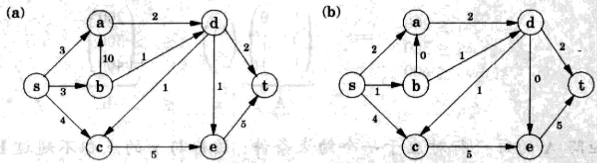  
图7-4 (a)一个限定容量的网络。(b)网络中的一个流

## 7.2.2 最大流

我们所关注的网络包含了一个有向图 $G = (V, E)$ ; $G$ 中有两个特殊节点 $s, t \in V$ ,

分别称为 G 中的源点和汇点；最后，G 中每条边的容量 $c_{e}>0$ 。

在不超过每条边容量的前提下，我们希望由 $s$ 向 $t$ 输送尽可能多的石油。所谓流是指一种特定的输送方式，其中对每条边赋予一个变量 $f_{e}$ ，使其满足如下性质：

1. 不超过边的容量，即对所有 $e \in E$ ， $0 \leqslant f_e \leqslant c_e$ 。

2. 对于 $s$ 和 $t$ 之外的任意节点 $\pmb{u}$ ，流入 $\pmb{u}$ 的流量等于流出 $\pmb{u}$ 的流量：

$$
\sum_ {(w, u) \in E} f _ {w u} = \sum_ {(u, z) \in E} f _ {u z}
$$

换句话说，流量是守恒的。

流的规模为由 s 流向 t 的总流量。由守恒律，其等于离开 s 的流量：

$$
\text { 规   模 } (f) = \sum_ {(s, u) \in E} f _ {s u}  .
$$

简单地说，我们的目的就是为 $\{f_e: e \in E\}$ 赋予恰当的值，使之满足一定的线性约束，同时使某个线性目标函数的取值最大。这是一个线性规划问题。或者换句话说，最大流问题被归约成了一个线性规划问题。

举例来说，图7-4的网络的LP共有11个变量，每条边一个；目标是使 $f_{sa} + f_{sb} + f_{sc}$ 的值最大；有27个约束条件，包括11个非负性条件(比如 $f_{sa} \geqslant 0$ )，11个容量条件(比如 $f_{sa} \leqslant 3$ )，以及5个流守恒条件(除了s和t，每个节点一个，比如 $f_{sc} + f_{dc} = f_{ce}$ )。利用单纯形法可以非常快速地求解该问题，这里需要说明的是，以上问题的最大流量恰好就是7。

## 7.2.3 对算法的深入观察

目前我们对于单纯形法的认识主要还停留在其直观的几何特征方面：该方法沿着凸可行区域的表面移动，不断改进(提高或降低)目标函数值，最终找到最优解。一旦我们对其中的细节有所掌握(7.6节)，将能够对其如何处理流的LP问题获得更为深刻的理解，而这正是提出直接最大流算法的思想出发点之一。

单纯形法的求解过程可以被分解为如下的基本操作：

由最小的流(流量为 0)开始。

重复如下动作：选择由 $s$ 到 $t$ 的一条可能路径，然后尽可能地提高该路径上的流量。

图7-5(a)-(d)是一个较为简单的单纯形法实例，仅用两次迭代就完成了求解。最

终的流规模为2，而且很容易验证它是最优的。

有一种更复杂的情况。如果我们起初选择了不同的路径，如图7-5(e)。该路径最多仅允许规模为1的流，并且它阻断了所有的其它路径。单纯形法对于该问题的处理方式是允许撤销路径上的某些流。在我们的例子中，它将随后选择图7-5(f)的路径。该路径上的边 $(b, a)$ 并不在最初的网络中，加入该边产生的一个效果是取消了原来分配给边 $(a, b)$ 的流。

(a)  
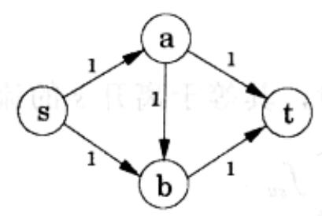

(b)  
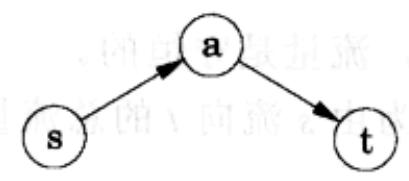

(c)  
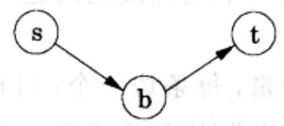

(d)  
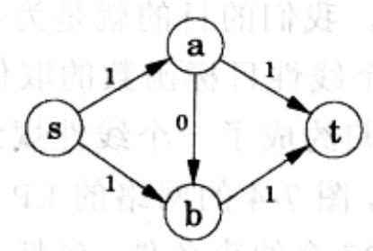

(e)  
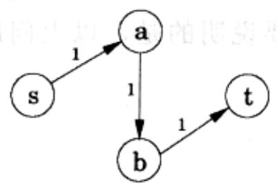

(f)  
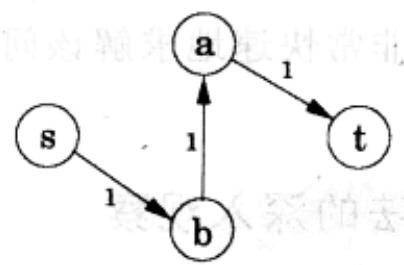

图7-5 最大流算法示意。(a)一个网络示例。(b)选定的第一条路径。(c)选定的第二条路径。(d)最终的流。(e)我们可以首先选择该路径。(f)在什么情况下，我们会选择该路径为第二条路径

总结一下，在每次迭代中，单纯形法寻找 $s$ 到 $t$ 的一条路径，其中的任意边 $(u, v)$ 可能为如下两种类型之一：

1. $(u, v)$ 包含在最初的网络中，并且未达到最大流量；

2. 其反向边 $(v, u)$ 在最初的网络中，并且其中已存在一定的流量。

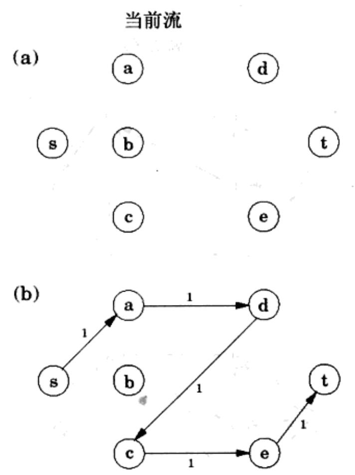

如果当前的流为 $f$ ，则对于第一种情况，边 $(u, v)$ 最多还能接受 $c_{uv} - f_{uv}$ 的多余流量；而在第二种情况下，最多增加的流量为 $f_{vu}$ (取消 $(v, u)$ 上的全部或部分流量)。这类增加流量的机会可以由剩余网络 $G^f = (V, E^f)$ 来判定，该网络包含了所有的以上两类边，并标出了其剩余流量 $c^f$ ：

$$
c ^ {f} = \left\{ \begin{array}{l l} c _ {u v} - f _ {u v} & \text {若} (u, v) \in E \text {且} f _ {u v} <   c _ {u v} \\ f _ {v u} & \text {若} (v, u) \in E \text {且} f _ {v u} > 0 \end{array} \right.
$$

因此，我们可以等价地认为单纯形法就是要在剩余网络中寻找一条 $s$ 到 $t$ 的路径。

通过模拟单纯形法的行为，我们得到了一个解决最大流问题的直接算法。该算法采取迭代的方式进行，每次先构造一个 $G^{f}$ ，然后利用线性时间的广度优先搜索在 $G^{f}$ 中寻找 $s$ 到 $t$ 的一条可行的(能够继续提高流量的)路径，找不到任何这样的路径时算法停止。

图 7-6 是该算法在石油运输问题上的应用。

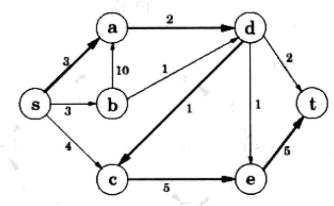

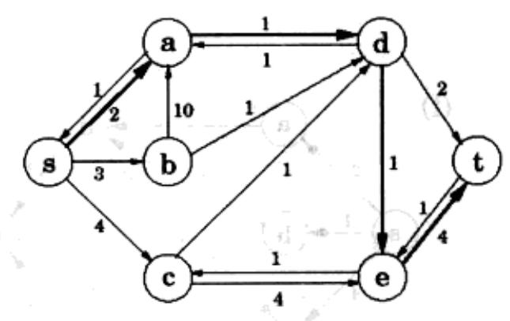  
图7-6 最大流算法应用于图7-4的网络。对应于每次迭代，左侧为当前的流，右侧为对应的剩余网络。选定路径加粗表示

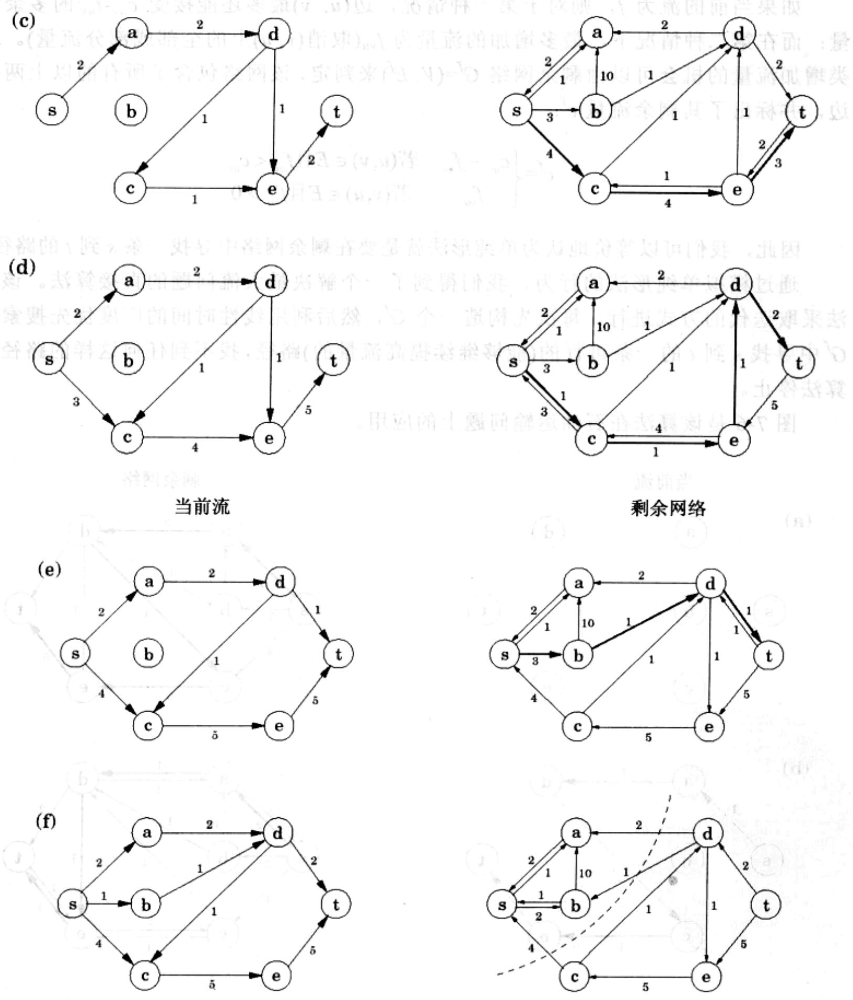

当前流

剩余网络

附言，他的简言也揭示了外貌关系

图 7-6 (续)

## 7.2.4 最优性的保证

现在我们将关注一个非常重要的事实：单纯形法不仅正确地找到了一个最大流，它同时也给出了该流最优性的一个简单证明！

让我们通过一个例子来解释这句话的含义。将石油网络(图7-4)中的节点分为两组： $L=\{s,a,b\}$ 和 $R=\{c,d,e,t\}$ :

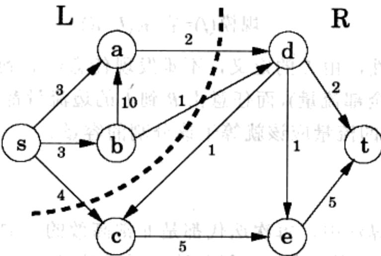

显然，任意一次石油传输都必须经过 $L$ 到达 $R$ 。因此，没有哪个流的规模能够超过 $L$ 到 $R$ 的边的总容量(7)。而这恰恰说明了我们之前找到的(规模为7的)流是最优的。

更一般地，一个 $(s, t)$ 分割将所有节点分为两个不相交的集合 $L$ 和 $R$ ，并使 $s$ 和 $t$ 分别属于 $L$ 和 $R$ 。我们定义该分割的容量为 $L$ 到 $R$ 的所有边的容量之和。由刚才的讨论可知，该值应该是所有流规模的上界，即：

对于任意流 f 和任意 $(s, t)$ 分割 $(L, R)$ 。规模 $(f) \leq$ 容量 $(L, R)$ 。

有些分割给出的上界是较大的，例如分割 $(\{s, b, c\} 、 \{a, d, e, t\})$ 的容量为19。但是也存在容量为7的分割，而这恰恰就是所求得流的最优性的保证。显然，这一性质不仅对于石油运输这一问题有效，对于所有的最大流问题也都同样成立。

最小分割最大流定理 网络中最大流的规模等于其中 $(s,t)$ 分割的最小容量。

更进一步地，最小分割可以作为我们算法中的副产品自然地得到。

我们来看看为什么是这样。假设 $f$ 为算法终止时得到的流。我们知道此时在剩余网络 $G^{f}$ 中已无法找到任何由 $s$ 到 $t$ 的路径。记 $L$ 为 $G^{f}$ 中可由 $s$ 出发到达的所有节点集合， $R = V - L$ 为剩余的节点。于是 $(L, R)$ 构成了图 $G$ 的一个分割：

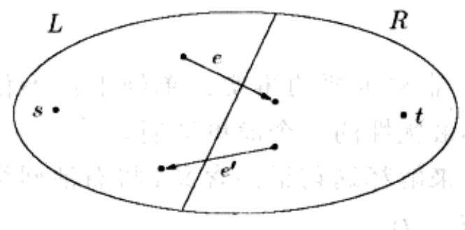

我们断言

规模(f)=容量(L,R)。

为了证明其正确性，由 L 的定义，不难发现任意由 L 到 R 的边必然都是“满”的(当前流 f 使用了其全部流量)，而任意由 R 到 L 的边流量都为 0。也即 $f_{e}=c_{e}$ 且 $f_{e}=0$ 。由此可知，跨越 $(L,R)$ 的流量应该就等于该分割的容量。

## 7.2.5 算法的效率

在我们的最大流算法中，每次迭代都是非常高效的。如果使用了深度优先或广度优先搜索来寻找 $s$ 到 $t$ 的路径，则每此迭代所需时间仅为 $O(|E|)$ 。因此我们主要关心进行了多少次迭代。

假设在最初的网络中所有边的容量都是一个不大于 $C$ 的整数。由归纳法可以证明，在算法的每次迭代中，流的规模总是一个整数。因此，注意到最大流量最多为 $C|E|$ (为什么？)，迭代的次数应该也最多为 $C|E|$ 。但是仅有这样一个上界显然是无法令人满意的(因为 $C$ 可能非常大)。

关于这一问题我们将在习题7.31中作进一步讨论。其中的例子说明确实存在某种很糟糕的情况，如果不能选择恰当的路径，最终的迭代次数将与 $C$ 成正比。还好的是，如果采取某种更加明智的策略进行路径选择——例如，采用广度优先搜索将使得找到的路径包含最少的边，则不论边的容量如何，最终的迭代次数将不超过 $O(|V|\cdot |E|)$ 。而该上界保证了对最大流来说算法总的运行时间为 $O(|V|\cdot |E|^2)$ ！
