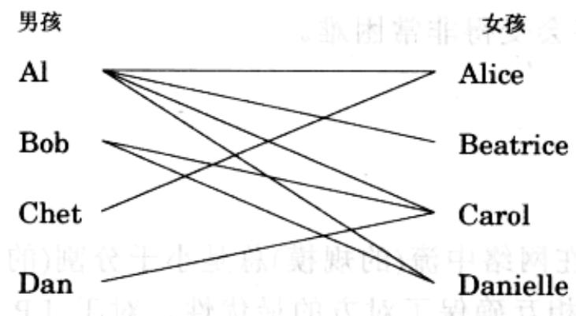
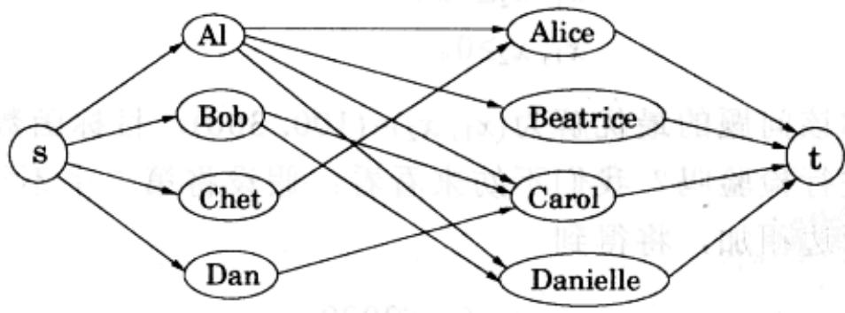

import Guide from '@/components/Guide.astro';
import Knowledge from '@/components/Knowledge.astro';
import Example from '@/components/Example.astro';
import Analysis from '@/components/Analysis.astro';
import Solution from '@/components/Solution.astro';
import Variant from '@/components/Variant.astro';
import Note from '@/components/Note.astro';
import Block from '@/components/Block.astro';
import Method from '@/components/Method.astro';
import Exercise from '@/components/Exercise.astro';
import Algorithm from '@/components/Algorithm.astro';

## 7.3 二部图的匹配

在图 7-7 中，左侧四个节点代表男孩，右侧四个节点代表女孩。 $^{1}$ 如果在某一对男孩和女孩之间存在相连的边，则意味着他们彼此喜欢(例如，Al 喜欢所有的女孩)。

是否可能使得所有的男孩女孩都两两配对，并且配对双方总是相互喜欢呢？在图论中，这样的配对称为一个完美匹配。

  
图7-7 两人之间存在一条边则意味着他们彼此喜欢。有没有一个使得所有人都满意的配对方式呢

以上的配对游戏可以被归约到最大流问题，因此它也是一个线性规划问题！定义一个拥有流向所有男孩的边的源节点s；一个拥有从所有女孩流出的边的汇节点t；同时对应于原图中的所有(男孩女孩之间的)边在新图中加入由男孩流向女孩的边(图7-8)。最后，赋予所有的边容量1。于是存在一个男孩女孩间完美匹配的充分必要条件就是，新定义的图中存在一个规模与最终配对数相等的最大流。你能在这个例子中找到该流吗？

  
图7-8 一个配对网络。其中每条边的容量为1

实际上，我们这里的情形比刚才所说的要稍微复杂一些：容易看到最优的整数容量流对应于最优的配对。但是在我们的例子中，如果出现AI到Carol流量为0.7的边，就会有些难以解释了。幸运的是，最大流问题具有如下的性质：

性质：如果所有边的容量为整数，则由我们的算法得到的最大流的规模也为整数。这一点可以由算法直接得出，因为在其每次迭代中我们给流增加的都是一个整数值的流量。

这样一来，在最大流问题中流量的整数性就得到了保证。但是，并不是所有的线性规划问题都具有这样的性质，在第8章中我们将看到，如果要求解必须由整数值组成，则对于大多数较为一般的线性规划问题，找到最优解(有时甚至只是找到任意一个普通的可行解)将会变得非常困难。
