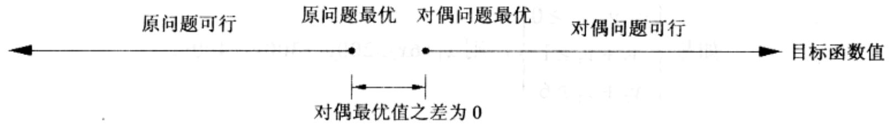
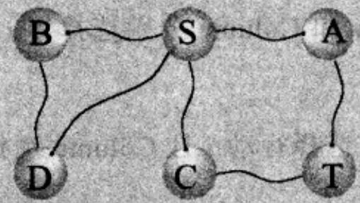

import Guide from '@/components/Guide.astro';
import Knowledge from '@/components/Knowledge.astro';
import Example from '@/components/Example.astro';
import Analysis from '@/components/Analysis.astro';
import Solution from '@/components/Solution.astro';
import Variant from '@/components/Variant.astro';
import Note from '@/components/Note.astro';
import Block from '@/components/Block.astro';
import Method from '@/components/Method.astro';
import Exercise from '@/components/Exercise.astro';
import Algorithm from '@/components/Algorithm.astro';

## 7.4 对偶

我们已经了解到，在网络中流(的规模)总是小于分割(的容量)，只有最大流和最小分割完全一致，并且相互确保了对方的最优性。对于LP而言，这一现象非常重要，我们以下将着手把它由最大流问题推广到能够用线性规划解决的任意问题！最终我们将说明，每个线性的最大化问题都有一个对偶的最小问题，而且前后两个问题之间的关系非常类似于流与分割之间的关系。

为了理解什么是对偶性，可以回忆一下介绍LP概念时关于巧克力作坊的例子：

$$
\begin{array}{l} \max x _ {1} + 6 x _ {2} \\ x _ {1} \leq 2 0 0 \\ x _ {2} \leq 3 0 0 \\ x _ {1} + x _ {2} \leq 4 0 0 \\ x _ {1}, x _ {2} \geq 0. \end{array}
$$

单纯形法声称该问题的最优解为 $(x_{1}, x_{2}) = (100, 300)$ ，目标函数值1900。这个答案能用其它方法进行检验吗？我们不妨来看看：假设将第二个不等式两边同时乘6后与第一不等式两边相加，将得到

$$
x _ {1} + 6 x _ {2} \leq 2 0 0 0
$$

这看起来很有趣，因为它告诉我们不可能获得比2000更高的利润。我们能够再通过类似的乘法和加法，将LP的约束条件组合成一个更接近于1900的上界吗？通过一些实验，我们找到了如下的乘法因子：0、5和1，三个不等式分别与这些因子相乘后不等号两边相加得到

$$
x _ {1} + 6 x _ {2} \leq 1 9 0 0
$$

因此1900的确是最优的可能值！这里乘法因子(0,5,1)扮演了最优性保证的角色。对于这个LP，这一点非常重要。现在的问题是，即使我们能够确知这样的保证存在，又如何能以一种比较系统的方法找到它呢？

为了就此进行研究，我们首先需要描述一下对这些乘法因子的预期。在此，不妨将这些乘法因子分别记为 $y_{1}$ 、 $y_{2}$ 和 $y_{3}$

$$
\begin{array}{r l r} {\text { 乘法因子 }} & & {\text { 不等式 }} \\ {y _ {1}} & & {x _ {1} \leq 2 0 0} \\ {y _ {2}} & & {x _ {2} \leq 3 0 0} \\ {y _ {3}} & & {x _ {1} + x _ {2} \leq 4 0 0} \end{array}
$$

显然，这些 $y_{i}$ 必须都是非负的，否则将无法用其与约束不等式相乘再把结果相加(不等式两边乘以负数将导致不等号方向反转)。根据其定义，我们得到如下公式：

$$
(y _ {1} + y _ {3}) x _ {1} + (y _ {2} + y _ {3}) x _ {2} \leq 2 0 0 y _ {1} + 3 0 0 y _ {2} + 4 0 0 y _ {3}
$$

我们希望上式的左侧与目标函数 $x_{1} + 6x_{2}$ 一致，这样就能保证该式的右侧值恰为最优解的一个上界。也即我们需要 $y_{1} + y_{3} = 1$ 且 $y_{2} + y_{3} = 6$ 。更进一步地，如果 $y_{1} + y_{3}$ 大于1显然也具有以上性质，只不过其得到的上界会更大。因此，我们得到如下的上界约束：

$$
\text {如果} \left\{ \begin{array}{l l} {y _ {1}, y _ {2}, y _ {3} \geq 0} \\ {y _ {1} + y _ {3} \geq 1} \\ {y _ {2} + y _ {3} \geq 6} \end{array} \right., \text {则} x _ {1} + 6 x _ {2} \leq 2 0 0 y _ {1} + 3 0 0 y _ {2} + 4 0 0 y _ {3}
$$

对于以上的不等式组，不难找到满足约束的 $y$ 值，因为只需简单地使所有的 $y$ 值都较大即可，比如 $(y_{1}, y_{2}, y_{3}) = (5, 3, 6)$ 。但是这样的组合能告诉我们的只是LP的最优解上界为 $200 \cdot 5 + 300 \cdot 3 + 400 \cdot 6 = 4300$ ，显然它过于松弛了。我们需要的上界应该越紧越好，因此我们要做的是在有关的不等式约束下求 $200y_{1} + 300y_{2} + 400y_{3}$ 的最小值。这恰好又是一个新的线性规划问题！

于是，寻找能够得到原LP最优上界的乘法因子等价于求解如下的新LP：

$$
\begin{array}{r l} & \min 2 0 0 y _ {1} + 3 0 0 y _ {2} + 4 0 0 y _ {3} \\ & y _ {1} + y _ {3} \geq 1 \\ & y _ {2} + y _ {3} \geq 6 \\ & Y _ {1}, y _ {2}, y _ {3} \geq 0 \end{array}
$$

根据以上的设计，这一对偶LP的可行目标函数值为原LP问题目标函数值的一个上界。因此，如果我们能够使得原问题和对偶问题具有相同的目标函数值，则其对应于两个问题的一对解各自都应该是最优的。以下是与前面例子对应的解：

$$
\text { 原问题: } (x _ {1}, x _ {2}) = (1 0 0, 3 0 0); \quad \text { 对偶问题: } (y _ {1}, y _ {2}, y _ {3}) = (0, 5, 1) 。
$$

其目标函数值都是1900，从而对于各自的LP都是最优的(如图7-9)。

令人惊奇的是，这并不是唯一一个幸运的例子，事实上以上的现象对于LP具有普遍性。具体来说，首先我们要为每个约束条件指定一个乘法因子；然后，对原问题中的每个变量，写出对偶问题中相应的约束，使得不等式约束的右侧值总是大于原问题目标函数中该变量的系数；最后，对以原问题约束条件右侧值为系数的对偶问题目标函数求最优解。LP对偶问题的基本形式如图7-10，显然，任意LP都可以有一个对偶问题。图7-11给出的是对偶问题更为一般的形式。关于该图，需要特别说明的是：如果原问题中有一个等式约束，则该约束对应的乘法因子(对偶问题中的变量)无需为非负的。原因很简单，等式两边乘以负数仍然为一个等式，因此等式约束的乘法因子可以是任意值。此外，在两个LP之间可能存在一种简单的对称关系，即存在某个矩阵 $A = (a_{ij})$ ，其行和列分别对应于原问题和对偶问题中的约束系数。

  
图7-9 根据设计，对偶问题的可行值总是大于等于原问题的可行值。对偶定理在告诉我们这一点的同时，也指出了其可行值一致时双方的最优性

由构造方法可知，对偶问题的任意目标函数值都是原问题目标函数值的一个上界。同时，二者的最优值相等。

对偶定理：如果一个线性规划的最优目标函数值有界，则其对偶的最优目标函数值也有界，并且二者相等。

当原 LP 为最大流问题时，我们可以将其对偶问题解释为最小分割问题(参见习题 7.25)。因此，流和分割之间的关系可以说是对偶定理的一次实例化。不过，类似于最小分割最大流定理超出了最大流算法分析的范围，对该定理的证明也已经超出了单纯形算法的研究范畴。

原LP:

对偶LP:

$$
\max \mathbf {c} ^ {T} \mathbf {x}
$$

$$
\mathbf {A} \mathbf {x} \leq \mathbf {b}
$$

$$
\min \mathbf {y} ^ {T} \mathbf {b}
$$

$$
\mathbf {y} ^ {T} \mathbf {A} \geq \mathbf {c} ^ {T}
$$

$$
\mathbf {x} \geq 0
$$

$$
\mathbf {y} \geq 0
$$

图 7-10 用矩阵-向量形式表示的原 LP 及其对偶

原LP:

对偶LP：

$$
\max c _ {1} x _ {1} + \dots + c _ {n} x _ {n}
$$

$$
\min b _ {1} y _ {1} + \dots + b _ {m} y _ {m}
$$

$$
a _ {i 1} x _ {1} + \dots + a _ {i n} x _ {n} \leq b _ {i} \quad \text { for } i \in I
$$

$$
a _ {1 j} y _ {1} + \dots + a _ {m j} y _ {m} \geq c _ {j} \quad \text { for } j \in N
$$

$$
a _ {i 1} x _ {1} + \dots + a _ {i n} x _ {n} = b _ {i} \quad \text { for } i \in E
$$

$$
a _ {1 j} y _ {1} + \dots + a _ {m j} y _ {m} = c _ {j} \quad \text { for } j \not \in N
$$

$$
x _ {j} \geq 0 \quad \text { for } j \in N.
$$

$$
y _ {i} \geq 0 \quad \text { for } i \in I
$$

图7-11 最一般形式的线性规划。其中包含 $n$ 个变量(其中的 $N$ 个非负)，以及由关于这些变量的不等式集合 $I$ 和等式集合 $E(m = |I| + |E|)$ 组成的约束条件。对偶问题包含 $m$ 个变量，其中只有与 $I$ 中约束对应的变量必须是非负的

<Knowledge title="专栏: 对偶的图形化">

最短路径问题存在一种“模拟”的求解方法：给定一个加权有向图，首先为其建造一个对应的“物理模型”，其中用线(可能是棉的或塑料的随便什么线)代表图中的边，且使线的长度恰好等于对应边的权重；所有的线根据图中的连接关系将端点绑在一起，形成的结代表图中的节点。于是，求 $s$ 到 $t$ 的最短路径，就只需简单地提起 $s$ 和 $t$ 对应的结，将其分别向相反方向移动。直到出现一条连接 $s$ 和 $t$ 的绷紧的直线时(假设我们使用的线没有任何弹性)，该直线所对应的(原图中的)路径就是我们所求的最短路径。

以上方法令人大开眼界，不过其原理其实非常简单。注意到我们所求的最短路径问题是一个最小化问题，而将 $s$ 和 $t$ 向相反方向移动的动作将使得其间的距离不断增大(最大化！)。因此，以上动作事实上解决了最短路径问题的对偶问题！该对偶问题的形式非常简单(参见习题7.28)，令变量 $x_{u}$ 对应于节点u:

$\max x_{s} - x_{t}$ 对所有的边 $\{u, v\}$ ，有 $|x_{u} - x_{v}| \leq w_{uv}$ 。

简单地说，该对偶问题就是要将 $s$ 和 $t$ “拉”的尽可能远，而只需满足任意边 $\{u, v\}$ 对应线的端点距离不超过线的长度 $w_{uv}$ 即可。

</Knowledge>
