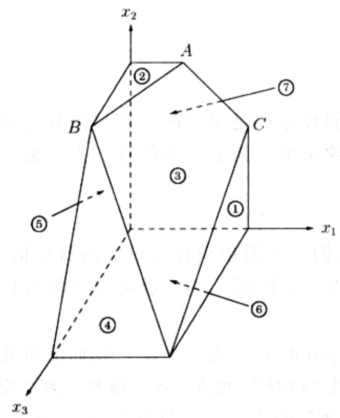
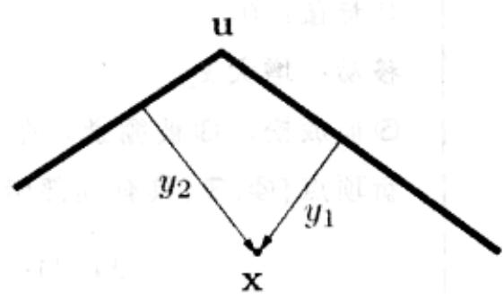
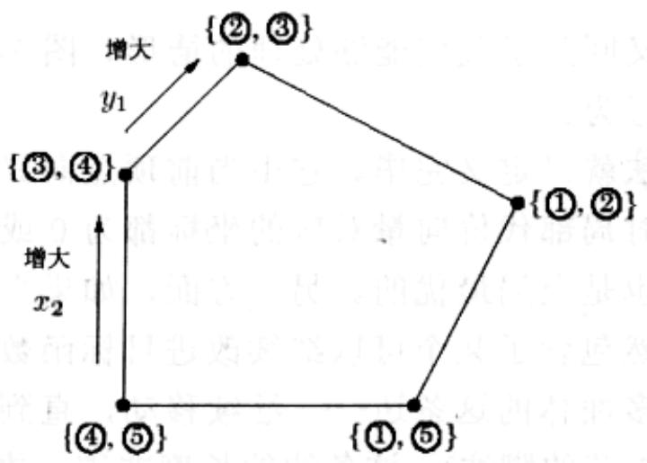

import Guide from '@/components/Guide.astro';
import Knowledge from '@/components/Knowledge.astro';
import Example from '@/components/Example.astro';
import Analysis from '@/components/Analysis.astro';
import Solution from '@/components/Solution.astro';
import Variant from '@/components/Variant.astro';
import Note from '@/components/Note.astro';
import Block from '@/components/Block.astro';
import Method from '@/components/Method.astro';
import Exercise from '@/components/Exercise.astro';
import Algorithm from '@/components/Algorithm.astro';

## 7.6 单纯形算法

线性规划强大的功能给人留下了深刻的印象，然而如果缺乏有效的求解方法，所有的一切都将毫无意义。这正是单纯形算法的任务。

从较高层次来说，单纯形算法以一组线性不等式以及一个线性的目标函数为输入，采取如下的策略求最优的可行点(optimal feasible point):

let v be any vertex of the feasible region
while there is a neighbor  $v'$  of v with better objective value:
set  $v = v'$

对于我们曾经给出的2维和3维示例(参见图7-1与图7-2)，能够比较容易地得到直观形象的几何描述。但是，如果有 $n$ 个变量(例如： $x_{1}, \ldots, x_{n}$ )呢？

无论各个 $x_{i}$ 是如何构造的，我们都可以将问题的变量表示为一个实数值的 $n$ 元组，并将其描绘在 $n$ 维空间 $\mathbf{R}^n$ 中。关于 $x_{i}$ 的线性方程(等式)定义了 $\mathbf{R}^n$ 上的一个超平面，与其对应的线性不等式则定义了一个半空间，几何上正好对应于超平面某一侧的所有点。最后，线性规划的可行区域就是由多个约束不等式定义的半空间的交集，即一个凸多面体。

但是，在这种更一般的几何描述中，顶点和邻居的含义又是什么呢？

## 7.6.1 $n$ 维空间中的顶点和邻居

图 7-12 回顾了我们此前列举的一个例子。仔细观察可以发现，其中每个顶点都是多个超平面的唯一交汇点。例如：顶点 A 就是约束②、③和⑦对应(等式定义的)超平面的唯一共同交点；而对应于约束④和⑥的超平面却无法确定一个顶点，因为其交集是一条直线而不是一个点。

以下是一个精确的定义。

选择约束不等式的一个子集。如果存在唯一的点满足其对应的所有等式，且该点恰好也是可行的，则其为一个顶点。

唯一确定一个点需要多少个等式？当存在 $n$ 个变量时，如果要求解唯一，则至少需要 $n$ 个线性方程。另一方面，当解唯一时，超过 $n$ 个的线性方程也是不必要的。因为其中至少会有一个方程可以表示为其它方程的线性组合，因此可以被忽略。总之，

  
图7-12 由7个不等式定义的多面体

$$
\max x _ {1} + 6 x _ {2} + 1 3 x _ {3}
$$

$$
x _ {1} \leq 2 0 0\tag{①}
$$

$$
x _ {2} \leq 3 0 0\tag{②}
$$

$$
x _ {1} + x _ {2} + x _ {3} \leq 4 0 0\tag{③}
$$

$$
x _ {2} + 3 x _ {3} \leq 6 0 0
$$

$$
x _ {1} \geq 0\tag{④}
$$

⑤

$$
x _ {2} \geq 0\tag{⑥}
$$

$$
x _ {3} \geq 0\tag{⑦}
$$

每个顶点都是由 n 个不等式所定义的。 $^{3}$

于是可以比较自然地得到邻居的概念。

若两个顶点对应的所有不等式中有 n-1 个相同，则它们互为邻居。

例如，图7-12中，顶点 $A$ 和 $C$ 对应的不等式中都包含&#123;③，⑦&#125;，因此它们是邻居。

## 7.6.2 算法

在每次迭代中，单纯形法需要完成如下两项任务：

1. 检查当前顶点是否最优(如果是，则退出)。

2. 决定向哪里移动。

我们将看到，如果当前顶点恰为原点，则以上两项任务都很容易完成。而如果顶点在别处，我们将通过坐标变换将其移动到原点！

首先，让我们看看为什么原点的情况是很简单的。假设我们面临一个一般的LP其中 $\mathbf{x} = (x_{1},\dots ,x_{n})$ 为所有变量组成的向量。假设原点是可行的。则显然其为顶点，因为其恰好是 $n$ 个不等式 $\{x_{1}\geqslant 0,\dots ,x_{n}\geqslant 0\}$ 约束全部为紧约束的唯一点。然后我们来解决以上的两个任务。任务1：

原点最优当且仅当所有的 $c_{i} \leqslant 0$ 。

如果所有的 $c_{i} \leq 0$ ，则注意到约束 $\mathbf{x} \geqslant 0$ ，显然我们已不能指望存在更好的目标值。反之，如果有某个 $c_{i} > 0$ ，则原点不可能最优，因为只需提高 $x_{i}$ 的值就可以使得目标值更大。

因此，对任务2，我们可以通过增大对应于 $c_{i} > 0$ 的 $x_{i}$ 来进行移动。我们能将其增大多少呢？可以一直增大到与其它某个约束发生“碰撞”。也即，我们放松已经“绷紧”的约束 $x_{i} \geqslant 0$ ，让 $x_{i}$ 增大，直到某个原来“松弛”的约束被“绷紧”。在该点上，我们再次得到了恰好 $n$ 个紧的不等式，故我们到达的是一个新的顶点。

举例来说，假设我们要处理如下的线性规划：

$$
\begin{array}{r l r} \max & 2 x _ {1} + 5 x _ {2} \\ 2 x _ {1} - x _ {2} & \leq 4 & \text {①} \\ x _ {1} + 2 x _ {2} & \leq 9 & \text {②} \\ - x _ {1} + x _ {2} & \leq 3 & \text {③} \\ x _ {1} & \geq 0 & \text {④} \\ x _ {2} & \geq 0 & \text {⑤} \end{array}
$$

对该问题，单纯形法可以从原点开始，该点对应于约束④和⑤。开始移动时，我们放松约束 $x_{2}\geqslant0$ 。随着 $x_{2}$ 逐渐增大，其首先进入约束 $-x_{1}+x_{2}\leqslant3$ 的范围，并最终在 $x_{2}=3$ 时停止，此时恰好使得该不等式变紧。新的顶点由约束③和④给出。

这样一来我们就知道了处于原点时该如何做。但如果当前的顶点 $\mathbf{u}$ 在别处呢？巧妙之处在于可以通过坐标变换将通常的坐标 $(x_{1},\ldots ,x_{n})$ 变换到 $\mathbf{u}$ 的“局部视图”，从而使得 $\mathbf{u}$ 成为新的坐标原点。这类重新定义的局部坐标包含了其中的点到 $n$ 个超平面的距离(经过适当放缩后) $y_{1},\ldots ,y_{n}$ ，而这 $n$ 个超平面定义和包围了 $\mathbf{u}$ ：

特别地，如果包围 $\mathbf{u}$ 的一堵“墙”(超平面)对应的不等式为 $\mathbf{a}_i\cdot \mathbf{x}\leqslant b_i$ ，则由一个点 $\mathbf{x}$ 到这堵“墙”的距离为

$$
y _ {i} = b _ {i} - \mathbf {a} _ {i} \cdot \mathbf {x}
$$

类似的，包围 $\mathbf{u}$ 的每堵墙对应一个方程，一共有 $n$ 个方程，将 $y_{i}$ 定义成了关于所有 $x_{i}$ 的线性函数。同样，也可以通过反转，将 $x_{i}$ 表示为所有 $y_{i}$ 的线性函数。于是，我们可以基于变量 $y$ 重写原LP。这并不会从根本上改变该问题(比如最优值仍然是相同的)，只不过将其在一个不同的坐标框架下进行了重新表示。“修改”后的LP具有如下三点性质：

1. 包含不等式 $\mathbf{y} \geqslant 0$ ，而它仅仅是定义 $\mathbf{u}$ 的不等式的一个变换后的版本。

2. u 自身为 y-空间中的原点。

3. 代价函数变为 $\max c_{\mathbf{u}} + \tilde{\mathbf{c}}^{T}\mathbf{y}$ ，其中 $c_{\mathbf{u}}$ 为 $\mathbf{u}$ 处的目标函数值， $\tilde{\mathbf{c}}$ 是一个变换代价向量。

简单地说，我们又回到了我们能够处理的情形！图7-13延续我们此前的例子，展示了该算法的具体行为。

至此，单纯形算法就已定义完毕。它由当前顶点向其邻居移动，当目标函数为局部最优时停止，此时局部代价向量对应的坐标都为0或负值。如我们所知，具有以上性质的顶点必然也是全局最优的。另一方面，如果当前顶点不是局部最优的，则其局部坐标系统必然包含了某个可以继续改进目标函数值的维度，于是我们沿着其正向——也即沿着多面体的这条边——继续移动，直到达到一个邻居顶点。根据非退化假定(参见7.6.1节的脚注)，这条边的长度非零，故这一行为将严格增大目标函数的值。因此，以上过程最终将能够终止。

<table><tr><td>初始LP: max 2x1+5x22x1-x2≤4 1x1+2x2≤9 2-x1+x2≤3 3x1≥0 4x2≥0 5</td><td>当前顶点:&#123;4,5&#125;(原点)。目标值:0。移动:增大x2。5被放松,3被绷紧。在x2=3停止。新顶点&#123;4,3&#125;具有局部坐标(y1,y2): y1=x1, y2=3+x1-x2</td></tr><tr><td>重写后的LP: max 15+7y1-5y2y1+y2≤7 13y1-2y2≤3 2y2≥0 3y1≥0 4-y1+y2≤3 5</td><td>当前顶点:&#123;4,3&#125;。目标值:15。移动:增大y1。4被放松,2被绷紧。在y1=1停止。新顶点&#123;2,3&#125;具有局部坐标(z1,z2): z1=3-3y1+2y2, z2=y2</td></tr><tr><td>重写后的LP: max 22-7/3z1-1/3z2-1/3z1+5/3z2≤6 1z1≥0 2z2≥0 31/3z1-2/3z2≤1 41/3z1+1/3z2≤4 5</td><td>当前顶点:&#123;2,3&#125;。目标值:22。最优:所有c1&lt;0。(在原LP中)解2,3得到最优解(x1,x2)=(1,4)。</td></tr><tr><td colspan="2"></td></tr></table>

  
图 7-13 单纯形法的求解过程

## 7.6.3 补遗

单纯形算法中，还有一些重要的问题我们尚未提及。

起始顶点：

如何为单纯形算法寻找一个起始的顶点？在2维和3维的示例中，我们总是从原点开始，之所以可以这样做是因为对应的线性规划恰好包含了右端为正数的不等式。在一个一般的LP中，我们不可能总是那么幸运。不过还好，寻找一个起始顶点的问题总可以被归约为一个LP并用单纯形法求解！

来看看我们是如何做到这一点的。我们知道所有的LP都可写成某个标准形式(参见7.1.4节)，因此我们从如下的线性规划开始：

$\min c^{T}x$ ，满足 Ax=b 且 $x\geq0$ 。

首先我们保证所有等式的右端均非负：如果 $b_{i} < 0$ ，则在第 $i$ 个等式两边同时乘以-1。

然后我们如下生成一个新的LP：

\- 增加 $m$ 个新的人工变量 $z_{1}, \ldots, z_{m} \geqslant 0$ ，其中 $m$ 为方程的总数。

\- 将 $z_{i}$ 加入第 $i$ 个方程的左端。

\- 令目标函数为求 $z_{1} + z_{2} + \ldots + z_{m}$ 的最小值。

对于这个新的 LP，容易找到一个起始顶点，即对所有 i 满足 $z_{i}=b_{i}$ 且其它变量都为 0 的点。因此我们可以用单纯形法求得其最优解。

存在两种情况。如果 $z_{1} + z_{2} + \ldots + z_{m}$ 的最优值为 0，则由单纯形法求得的所有 $z_{i}$ 都为 0。由新 LP 的这一最优顶点可知，我们只需忽略所有的 $z_{i}$ ，即可得到原 LP 的一个可行的起始顶点。然后我们就可以开始运行单纯形法了！

但是，如果以上的最优值是正的呢？让我们想一想。我们尝试使 $z_{i}$ 的和最小，但是单纯形法决定了其不可能为0。这意味着原线性规划是不可行的：它需要几个非零的 $z_{i}$ 使之变成可行的。这就是单纯形法如何发现和报告一个LP是不可行的途径。

退化：

在图7-12的多面体中，顶点 $B$ 是退化的。几何上，这意味着它是该多面体超过 $n = 3$ 个表面(此时为②，③，④，⑤)的交集。从代数的角度，这意味着我们任意选择四个包含三个不等式的集合（&#123;②，③，④&#125;, &#123;②，③，⑤&#125;, &#123;②，④，⑤&#125;, &#123;③，④，⑤&#125;)之一，求解其对应的线性方程组，所得的解都是一样的，同为 $\{0,300,100\}$ 。这是个不容忽视的问题：单纯形法可能返回一个次优的顶点，仅仅由于该顶点的所有邻居与其目标值相同，因此无法再进一步提高目标值。并且，假设我们修改单纯形法，使之能够检测到退化，并在发生退化时采取由一个顶点跳到另一个顶点的措施以使其继续运行，这种脱离次优的措施的初衷是好的，它期望以短期内成本得不到改进为代价换得长期的目标值增大，但结果却可能事与愿违，导致单纯性法最终陷入无限循环。

修正的途径之一是引入一个扰动：为 $b_{i}$ 引入某个随机的微小改变 $\varepsilon_{i}$ ，使之变为 $b_{i} \pm \varepsilon_{i}$ 。由于 $\varepsilon_{i}$ 很小，这并不会改变 LP 的本质特征，但是却能够起到区分各线性方程组解的作用。从几何上解释，可以将其想象为四个平面②,③,④,⑤都发生了微小的位置偏移。你知道为什么顶点 $B$ 不会分裂为 2 个相互非常靠近的顶点吗？

## 无界性：

有些情况下 LP 是无界的, 此时目标函数能够取任意大的值(如果是最小化问题, 则为任意小)。如果存在这样的情况, 单纯形法将会发现它: 在探索某个顶点的邻居时, 单纯形法会注意到移除一个不等式并加入一个新的不等式后, 新的线性方程组将没有确定的解(也即其有无穷多的解)。并且事实上(这是一个简单的测试)其解空间包含了一整条直线, 沿着该直线能够使得目标函数值变得越来越大, 直到 $\infty$ 。此时单纯形法将会退出并报告该情况。

## 7.6.4 单纯形法的运行时间

单纯形法的运行时间是怎样呢？考虑一个普通的线性规划

$$
\max \mathbf {c} ^ {T} \mathbf {x}, \text { 满足 } \mathbf {A} \mathbf {x} {\leq} 0 \text { 且 } \mathbf {x} {\geq} 0,
$$

其中共有 $n$ 个变量且 $\mathbf{A}$ 中包含了 $m$ 个不等式约束。由于单纯形法是一个由顶点到顶点的迭代过程，因此，让我们从计算每次迭代的时间开始。设当前顶点为 $\mathbf{u}$ 。根据定义，它是使 $n$ 个不等式约束中等号同时满足的唯一点。其邻居与其共享其中的 $n - 1$ 个不等式，因此 $\mathbf{u}$ 最多可能有 $n \cdot m$ 个邻居——考虑到可能移除和可能加入的最大不等式数量。

在每次迭代中，一种朴素的作法是逐个检查所有的邻居，看其是否是多面体的一个顶点并计算其代价。计算代价的过程是非常快的，只需进行一次点乘运算即可，但是检验一个点是否为顶点则包含了求解包含 $n$ 个未知数的方程组(也即验证是否恰好能使 $n$ 个不等式都同时取等号)和检验其结果是否可行这两个步骤。利用高斯消去法(Gaussian elimination)这需要 $O(n^{3})$ 的时间，从而最终每次迭代的时间约为 $O(mn^{4})$ ，实在有点不尽如人意。

<Knowledge title="专栏: 高斯消去法">

从代数学的角度讲，在求解关于某个顶点的线性方程组时，很少需要写出该顶

点的坐标。这是如何做到的呢？

设 $n = 4$ ，给定关于 $\pmb{n}$ 个未知数的 $\pmb{n}$ 个线性方程如下：

$$
\begin{array}{r l r} {x _ {1}} & {- 2 x _ {3}} & {= 2} \\ & {x _ {2} + x _ {3}} & {= 3} \\ {x _ {1} + x _ {2}} & {- x _ {4}} & {= 4} \\ & {x _ {2} + 3 x _ {3} + x _ {4}} & {= 5} \end{array}
$$

高中时，求解以上方程组的基本方法是反复地使用如下规则：将某个方程两边乘以相同倍数后与另一个方程相加，新的方程组与原方程组等价。例如，第一个方程两边同乘-1后与第三个方程相加，我们将得到等价的方程组：

$$
\begin{array}{r l r l r l} x _ {1} & - 2 x _ {3} & = 2 \\ x _ {2} + x _ {3} & = 3 \\ x _ {2} + 2 x _ {3} - x _ {4} & = 2 \\ x _ {2} + 3 x _ {3} + x _ {4} & = 5 \end{array}
$$

这种变换从以下意义上说是非常明智的：它消去了第三个方程中的变量 $x_{1}$ ，使得最终只剩下一个包含 $x_{1}$ 的方程。换句话说，忽略第一个方程，我们将得到一个由包含3个未知数的3个方程构成的方程组，也即：我们使 $n$ 减小了1！我们可以先求解这个关于 $x_{2}, x_{3}$ 和 $x_{4}$ 的较小的方程组，然后将其结果代入第一个方程求得 $x_{1}$ 。由此引入一个算法——它的发明将再一次被归功于高斯。

proceduregauss (E, X)

Input: A system  $E = \{e_1, \ldots, e_n\}$  of equations in n unknowns  $X = \{x_1, \ldots, x_n\}$ ;

 $e_1 : a_{11}x_1 + a_{12}x_2 + \cdots + a_{1n}x_n = b_1; \cdots; e_n : a_{n1}x_1 + a_{n2}x_2 + \cdots + a_{nn}x_n = b_n$ 

Output: A solution of the system, if one exists

If all coefficients  $a_{i1}$  are zero:

halt with message "either infeasible or not linearly independent"

if n = 1: return  $b_1/a_{11}$ 

choose the coefficient  $a_{p1}$  of largest magnitude, and swap equations  $e_1, e_p$ 

for i = 2 to n:

 $e_i = e_i - (a_{i1}/a_{11}) \cdot e_i$ $(x_2; \ldots, x_n) = \text{gauss}(E - \{e_1\}, X - \{x_1\})$ $x_1 = (b_1 - \Sigma_{j>1} a_{1j}x_j)/a_{11}$ 

return  $(x_1, \ldots, x_n)$

(当要选择方程替换到第一个位置时，出于数值精度的考虑，我们挑选具有最大 $|a_{p1}|$ 的方程，然后，我们将使用 $a_{p1}$ 作为除数。)

高斯消去法将一个问题由规模 $n$ 减至 $n - 1$ 需要 $O(n^2)$ 次算术运算，因此其总体上共需进行 $O(n^3)$ 次操作。为了说明该结果是对总运行时间的一个较好的估计，我们必须证明其中涉及的数字都保持多项式有界——举例来说，解 $(x_{1},\dots,x_{n})$ 中的数字并不要求具有比原有系数 $a_{i}$ 和 $b_{i}$ 高出许多的精度。你知道这是为什么吗？

幸运的是，还有一种比这好得多的方法，且因子 $mn^4$ 能被改进为 $mn$ ，从而使得单纯形法得以成为一个具有实用价值的算法。请回忆我们此前关于顶点 $\mathbf{u}$ 局部视图的讨论(7.6.2节)。我们能够使得每次迭代在新的局部坐标下重写LP的开销仅为 $O((m + n)n)$ ；其原因在于很好地利用了两次迭代间局部视图仅仅发生微小改变——仅有一个不等式被替代这一事实。

其次，为了选择最优的邻居，我们回忆(局部视图下)形如“ $\max c_{\mathbf{u}} + \tilde{\mathbf{c}}^{T}\mathbf{y}$ ”的目标函数，其中 $c_{\mathbf{u}}$ 为 $\mathbf{u}$ 处的目标函数值。它立即告诉了我们一种可靠的移动方向，即选取任意 $\tilde{c}_i > 0$ 的方程加入(如果没有满足该条件的方程，则说明当前顶点已经是最优的，从而算法退出)。由于LP的剩余部分已经在y-坐标系下进行了重写，因此我们总能够在其它某个不等式约束被破坏前很容易地判断出 $y_{i}$ 能够被增大的幅度。(如果我们能将 $y_{i}$ 无穷地增大，则可知LP是无界的。)

如此一来单纯形法每次迭代的运行时间就仅为 $O(mn)$ 了。但是又会有多少次迭代呢？很显然，该值不可能超过 $\binom{m+n}{n}$ ，也即顶点数的一个上界。但是这个上界是 $n$ 的指数。事实上也确实存在这样的 LP，其上的单纯形法需要指数次的迭代。换句话说，单纯形法是一个指数时间的算法。然而，这种指数的例子在实际应用中很少出现，也正是这一点使得单纯形法被认为深具价值并被广泛使用。

</Knowledge>
<Knowledge title="专栏: 多项式时间的线性规划">

单纯形法不是一个多项式时间的算法。在求解过程中，其总是由可行区域的一角(顶点)移动到目标值稍好的另一角，然后继续移动到一个更好的。对于某些不常见的线性规划，这种方式最终意味着指数次的移动(迭代)。因此，很长时间以来，线性规划被认为是一个悖论，一个在实际中可行，却在理论上说不通的怪物！

直到1979年,一个来自前苏联的年轻数学家Leonid Khachiyan提出了椭圆算法,一个完全不同于单纯形法,概念上极其简单(但其证明过程极其复杂)且能在多项式时间内求解任意线性规划的算法。不同于单纯形法从多面体的一个角移动到另一个角以寻找解的方式，Khachiyan 的算法将多面体限制在越来越小的椭球体(歪斜的高维球体)内。该算法被公布之初，曾被视作一个“数学上的 Sputnik(前苏联的人造地球卫星)”，一个惹人注目，却令美国军方忧心忡忡的成就。它甚至曾被提到了冷战的高度，被认为暗示着前苏联在科学领域所潜在具备的优势。最终椭圆算法还是被认定为一个重要的理论成就，但在实际应用中它却没有和单纯形法形成过什么真正的对抗。它的出现使得关于线性规划的悖论被进一步加深：在该问题的两种算法中，一个拥有了理论上的成功，另一个却在应用中非常高效！

几年之后，Narendra Karmarkar，一个来自UC Berkeley的研究生，提出了一种与过去截然不同的思路，从而引出了关于线性规划的另一个可证明为多项式时间的算法。Karmarkar的算法称为内点法，之所以这样称呼它，仅仅是因为它奔向最优角的过程不再像单纯形法那样沿着多面体的表面逐个角地迂回前进，而是在多面体内切割出一条非常巧妙的路径。在实际应用中该算法也有着很好的表现。

但是，也许线性规划研究中最伟大的成就既不是Khachiyan的理论突破也不是Karmarkar的创造性方法，而是来自后者引发的一个意外收获：由于单纯形法和内点法之间的惨烈竞争，最终发展出了极其高效的线性规划求解程序。

</Knowledge>
