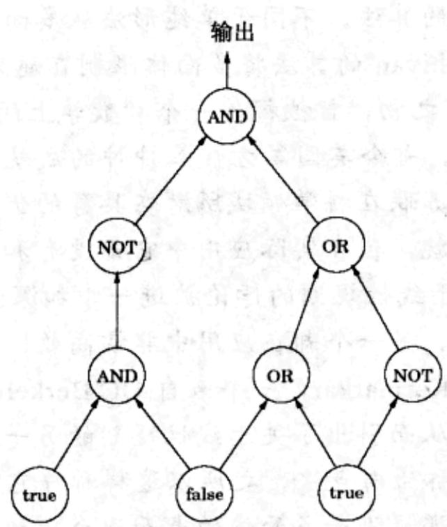
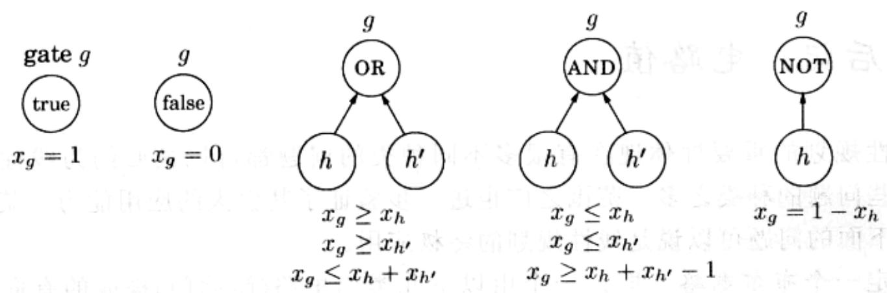

import Guide from '@/components/Guide.astro';
import Knowledge from '@/components/Knowledge.astro';
import Example from '@/components/Example.astro';
import Analysis from '@/components/Analysis.astro';
import Solution from '@/components/Solution.astro';
import Variant from '@/components/Variant.astro';
import Note from '@/components/Note.astro';
import Block from '@/components/Block.astro';
import Method from '@/components/Method.astro';
import Exercise from '@/components/Exercise.astro';
import Algorithm from '@/components/Algorithm.astro';

## 7.7 后记：电路值

线性规划的重要性体现在有很多不同种类的问题都可以被归约为线性规划问题，这些问题的种类之多，范围之广也进一步验证了其强大的应用能力。某种意义上说，下面的问题可以说是线性规划的终极应用。

给定一个布尔电路，即：一个由以下几类门电路(简称门)构成的有向无环图(dag):

\- 输入门(input gate): 入度为 0，值为 true 或 false。

\- 与门(AND gate): 入度为 2。

\- 非门(NOT gate): 入度为 1。

此外，某一个门被指定为输出。以下是一个例子：

所谓电路值问题是这样的：如果将布尔逻辑按照门的拓扑顺序加以应用，输出是否为 true?

有一种简单且自动的途径可以将该问题转换为一个线性规划。首先为每个门 $g$ 指定一个变量 $x_{g}$ ，满足 $0 \leqslant x_{g} \leqslant 1$ 。然后参照下图为各类门增加不同的约束：

这些约束要求所有的门都必须取正确的值——0代表false，1代表true。我们不必求最大值或最小值，而只需从对应于输出门的变量 $x_{o}$ 中读取结果。

这是一个到线性规划的直截了当的归约，而其最初的问题看起来似乎并不那么有趣。电路值问题某种意义上说是能在多项式时间内求解的最普通问题！毕竟任意算法最终都要在计算机上运行，而计算机最终不过是刻录在某个芯片上的一堆布尔电路而已。如果算法能运行在多项式时间内，则它就能被视为是一个包含了多项式数量的计算机电路拷贝的布尔电路。这些电路拷贝每单位时间一个，其中包含着下一次计算所需的所有门电路值。因此，电路值问题能够被归约到线性规划的事实意味着：所有能在多项式时间内求解的问题也都可以这样做！

在我们的下一个主题——NP 完全性(NP-completeness)——中，我们将看到，很多困难的问题都可以采取非常相近的方式被归约为线性规划的一个同胞兄弟，即所谓的整数规划问题。

题外话：求解电路值问题是否还有其它途径？让我们想一想——电路是一个dag。哪种算法技术最适合求解关于dag的问题呢？对，动态规划！在现实应用中，动态规划和线性规划一起，并称为世界上最具通用性的算法技术。
