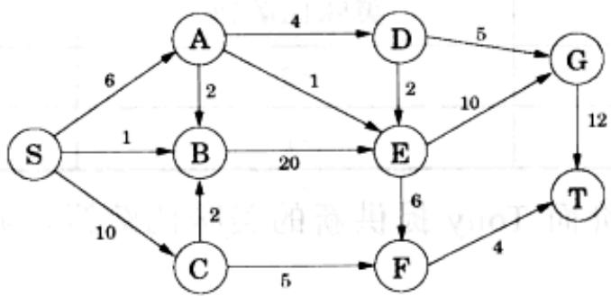
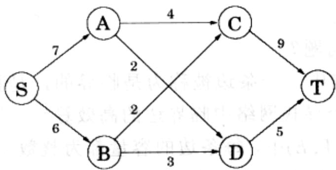
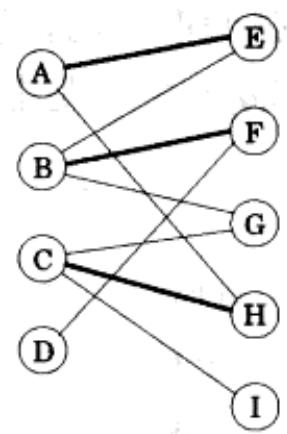
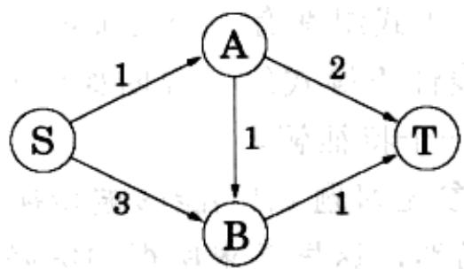
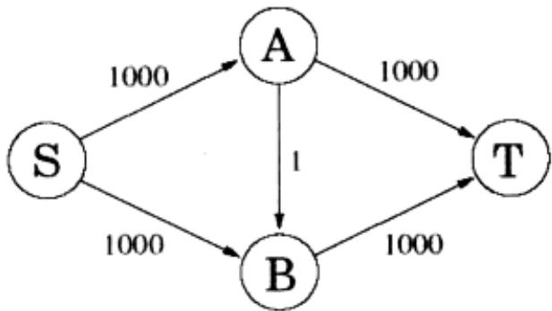
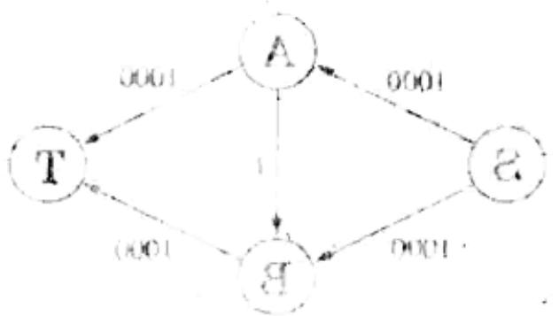

import Guide from '@/components/Guide.astro';
import Knowledge from '@/components/Knowledge.astro';
import Example from '@/components/Example.astro';
import Analysis from '@/components/Analysis.astro';
import Solution from '@/components/Solution.astro';
import Variant from '@/components/Variant.astro';
import Note from '@/components/Note.astro';
import Block from '@/components/Block.astro';
import Method from '@/components/Method.astro';
import Exercise from '@/components/Exercise.astro';
import Algorithm from '@/components/Algorithm.astro';

## 第7章 习题

<Exercise title="习题 7.1">

考虑如下的线性规划：

求 $5x + 3y$ 最大

$$
\begin{array}{r c l} 5 x - 2 y & \geq & 0 \\ x + y & \leq & 7 \\ x & \leq & 5 \\ x & \geq & 0 \\ y & \geq & 0 \end{array}
$$

请绘出其可行区域并指出最优解。

</Exercise>

<Exercise title="习题 7.2">

苦荞麦产自堪萨斯和墨西哥,主要的消费地则在纽约和加州。堪萨斯和墨西哥的苦荞麦产量分别为15和8。同时,纽约和加州的消费量分别为10和13。根据运输路线不同,每单位苦荞麦的运费依次为:墨西哥至纽约\$4,墨西哥至加州\$1,堪萨斯至纽约\$2,堪萨斯至加州\$3。

请写出一个线性规划，判断每个产地应该分别向不同的消费地运输多少苦荞麦，能够使得总的运费最少。

</Exercise>

<Exercise title="习题 7.3">

货运飞机的单次最大载货限制为重量 100 吨和体积 60 立方米。现有三种需要运送的物资，为了使运输的总收益最大，货运公司需要决定每种物资的具体装载量。

\- 物资 1 每立方米重量 2 吨，可运送总量 40 立方米，每立方米收益\$1,000。

\- 物资 2 每立方米重量 1 吨，可运送总量 30 立方米，每立方米收益\$1,200。

\- 物资 1 每立方米重量 3 吨，可运送总量 20 立方米，每立方米收益\$12,000。

请写出相应的线性规划。

</Exercise>

<Exercise title="习题 7.4">

Moe 需要考虑每周进多少 Duff 啤酒。该啤酒分为常规的和烈性的两类。常规 Duff 每品脱进价\$1，售价\$2；烈性 Duff 每品脱进价\$1.5，售价\$3。不过，作为其复杂的市场规划的一部分，Duff 公司在卖给 Moe 啤酒时，每 1 品脱的烈性啤酒必须搭售 2 品脱或更多的常规啤酒。并且，出于某种不能透露的历史原因，Duff 每周卖给 Moe 的啤酒总量不会超过 3,000 品脱。此外，Moe 知道，不论进多少啤酒最后总能卖光。请为 Moe 建立一个线性规划，决定他每周进货的常规和烈性啤酒数量，目的是使得总的利润最高。然后，请用几何方法求解该问题。

</Exercise>

<Exercise title="习题 7.5">

狗食产品公司生产两种狗食,欢闹小淘气(简称小淘气)和爱斯基摩猎犬(简称猎犬),生产的基本原料为谷物和肉。生产一包小淘气需要1磅谷物和1.5磅肉,售价\$7。生产一包猎犬则需要2磅谷物和1磅肉,售价\$6。原料谷物每磅售价\$1,原料肉为每磅\$2。此外,小淘气和猎犬的包装费用分别为\$1.40和\$0.60。每月共有可用的谷物和肉类240,000磅和180,000磅。生产能力的唯一限制是每月最多能包装110,000包小淘气。不用说,管理层当然希望利润越高越好。

(a) 请写出该问题对应的包含两个变量的线性规划。

(b) 绘出其可行区域，给出每个顶点的坐标，并标出使得利润最大的顶点。计算最大的可能利润是多少。

</Exercise>

<Exercise title="习题 7.6">

请给出一个线性规划示例，其中包含两个变量且可行区域无限，但却存在一个代价有界的最优解。

</Exercise>

<Exercise title="习题 7.7">

请给出关于实数值 $a$ 和 $b$ 的充要条件，使得以下线性规划

max $x + y$ $ax + by\leq 1$ $x,y\geq 0$

分别具有下列性质：

(a) 不可行。

(b) 无解。

(c) 具有有限且唯一的最优解。

</Exercise>

<Exercise title="习题 7.8">

给定平面上的点：

(1, 3), (2, 5), (3, 7), (5, 11), (7, 14), (8, 15), (10, 19).

你需要找到一条近似通过这些点的直线 $ax + by = c$ (不存在恰好经过以上所有点的直线)。请写出一个线性规划(不必求解)使得所得直线的最大绝对误差

$$
\max _ {1 \leq i \leq 7} | a x _ {i} + b y _ {i} - c |
$$

最小。

</Exercise>

<Exercise title="习题 7.9">

二次规划的目标是基于一组线性约束使某个二次目标函数(形如 $3x_{1}^{2}$ 或 $5x_{1}x_{2}$ )取值最大。请给出一个包含两个变量 $x_{1}$ 和 $x_{2}$ 的二次规划，其可行区域是非空且有界的，但是该区域的任一顶点都无法使得(二次)目标函数取值最优。

</Exercise>

<Exercise title="习题 7.10">

对如下的网络(边容量如图所示)，寻找由 $S$ 到 $T$ 的最大流，并指出其对应的分割。

</Exercise>

<Exercise title="习题 7.11">

写出以下线性规划的对偶问题

$$
\begin{array}{c} \text {max} \\ x + y \\ 2 x + y \leq 3 \\ x + 3 y \leq 3 \\ x, y \geq 0 \end{array}
$$

并求原问题及对偶问题的最优解。

</Exercise>

<Exercise title="习题 7.12">

对线性规划

$$
\begin{array}{r l} \max & x _ {1} - 2 x _ {3} \\ & x _ {1} - x _ {2} \leq 1 \\ & 2 x _ {2} - x _ {3} \leq 1 \\ & x _ {1}, x _ {2}, x _ {3} \geq 0 \end{array}
$$

证明解 $(x_{1}, x_{2}, x_{3}) = (3 / 2, 1 / 2, 0)$ 最优。

</Exercise>

<Exercise title="习题 7.13">

便士配对。在这个简单的二人游戏中，玩家(分别称为 $R$ 和 $C$ )每人每次选择硬币的一面，正面或反面。如果两个玩家的选择一样， $C$ 付给 $R$ 一元；反之 $R$ 付给 $C$ 一元。

(a) 请用一个 $2 \times 2$ 矩阵表示其支付；

(b) 该游戏的价值是多少？两个玩家的最优策略又分别是什么？

</Exercise>

<Exercise title="习题 7.14">

小镇的比萨饼业务由两家竞争对手提供，Tony 和 Joey。它们都希望采取有力的策略夺取对手的市场。Joey 考虑采取降价或将比萨饼切割得更大的方法；而 Tony 希望采取的手段则是推出新的美味比萨饼生产线、提供户外订座或在午餐中提供免费苏打。这些不同策略产生的结果最终反映在如下的支付矩阵中(每个单元格对应于 Joey 从 Tony 处赢取的比萨饼打数):

<table><tr><td rowspan="2" colspan="2"></td><td colspan="3">Tony</td></tr><tr><td>美味比萨饼</td><td>订座</td><td>免费苏打</td></tr><tr><td rowspan="2">Joey</td><td>降价</td><td>+2</td><td>0</td><td>-3</td></tr><tr><td>更大块</td><td>-1</td><td>-2</td><td>+1</td></tr></table>

例如：如果 Joey 降价而 Tony 提供新的美味比萨饼，则 Tony 将输给 Joey 相当于两打比萨饼的业务量。

</Exercise>

<Exercise title="习题 7.15">

该博弈的价值是多少？Tony 和 Joey 各自的最优策略又分别是什么呢？求如下支付矩阵描述的博弈的价值。

$$
\begin{array}{c c c c} 0 & 0 & - 1 & - 1 \\ 0 & 1 & - 2 & - 1 \\ - 1 & - 1 & 1 & 1 \\ - 1 & 0 & 0 & 1 \\ 1 & - 2 & 0 & - 3 \\ 0 & - 3 & 2 & - 1 \\ 0 & - 2 & 1 & - 1 \end{array}
$$

(提示：考虑混合策略(1/3,0,0,1/2,1/6,0,0)和(2/3,0,0,1/3。)

一种沙拉由以下几种食材混合而成：(1)西红柿，(2)莴苣，(3)菠菜，(4)胡萝卜，(5)食用油。每份沙拉必须包含：(A)最少15克蛋白质，(B)最小2克最多6克脂肪，(C)最少4克碳水化合物，(D)最多100毫克钠。此外，(E)你不希望沙拉中绿色蔬菜的总比例超过 $50\%$ 。每种食材的营养成分含量(每100克)如下：

<table><tr><td>营养成分</td><td>热量(千卡)</td><td>蛋白质(克)</td><td>脂肪(克)</td><td>碳水化合物(克)</td><td>钠(毫克)</td></tr><tr><td>西红柿</td><td>21</td><td>0.85</td><td>0.33</td><td>4.64</td><td>9.00</td></tr><tr><td>莴苣</td><td>16</td><td>1.62</td><td>0.20</td><td>2.37</td><td>8.00</td></tr><tr><td>菠菜</td><td>371</td><td>12.78</td><td>1.58</td><td>74.69</td><td>7.00</td></tr><tr><td>胡萝卜</td><td>346</td><td>8.39</td><td>1.39</td><td>80.70</td><td>508.20</td></tr><tr><td>食用油</td><td>884</td><td>0.00</td><td>100.00</td><td>0.00</td><td>0.00</td></tr></table>

请在Web上找一个线性规划小程序，使用其计算出满足前述约束且具有最低卡路里的沙拉配方。请写出该线性规划及最优解(每种食材的配比与最优值)，并列出你所引用的Web资源地址。

</Exercise>

<Exercise title="习题 7.17">

考虑如下的网络(其中的数字为对应边的容量)

(a) 求其最大流和最小分割。

(b) 画出剩余网络 $G_{f}$ (标准其剩余流量)。在剩余网络中，标出由 $S$ 可达的顶点和可达 $T$ 的顶点。

(c) 网络中的一条边被称为瓶颈边是指其容量的增加将导致最大流规模的增加。请指出以上网络中所有的瓶颈边。

(d) 请给出一个不含瓶颈边的简单(最多包含四条边)网络。

(e) 请给出一个识别网络中瓶颈边的高效算法。(提示：由运行一般的网络流算法开始，然后检查其剩余网络。)

</Exercise>

<Exercise title="习题 7.18">

最大流问题有许多常见的变型。以下是其中的四个：

(a) 图中有多个源点和汇点，我们希望使得由所有源点到所有汇点的流最大。

(b) 每个顶点也有能够流入的最大流量限制。

(c) 每条边不仅有容量限制，而且要求其承载的流量不能低于某个下界。

(d) 节点 $u$ 的流出流量与流入流量不同，前者仅为后者的 $(1 - \varepsilon_{u})$ 倍，其中 $\varepsilon_{u}$ 是与

u 相关的一个流量损耗系数。

这些问题都能够被有效解决。请参照如下思路证明这一点：将(a)和(b)归约为原最大流问题，将(c)和(d)归约为线性规划。

</Exercise>

<Exercise title="习题 7.19">

假设有人告诉你某个网络上最大流问题的解。请给出一个线性时间的算法判断该解是否真的最优。

</Exercise>

<Exercise title="习题 7.20">

考虑对最大流问题的如下推广: 给定有向网络 $G = (V, E)$ , 其边容量为 $\{c_e\}$ 。网络中不再只包含一对源-汇点, 而是存在多个 $(s_1, t_1), (s_2, t_2), \ldots, (s_k, t_k)$ , 其中 $s_i$ 和 $t_i$ 分别为 $G$ 中的源点和汇点。现在有 $k$ 个需求值 $d_1, \ldots, d_k$ 。我们的目标是找到满足以下性质的 $k$ 个流 $f^{(1)}, \ldots, f^{(k)}$ :

\- $f^{(i)}$ 为 $s_i$ 到 $t_i$ 的一个可行流。

\- 对每条边 $e$ ，总载流量 $f_{e}^{(1)} + f_{e}^{(2)} + \ldots + f_{e}^{(k)}$ 不超过边容量 $c_{e}$ 。

\- 每个流 $f^{(i)}$ 的规模最多为 $d_i$ 。

\- 总流量尽可能大。

你准备如何求解该问题？

</Exercise>

<Exercise title="习题 7.21">

在一个流网络中，一条边被称为是临界的，是指降低其容量将导致最大流规模下降。请给出一个寻找网络中临界边的高效算法。

</Exercise>

<Exercise title="习题 7.22">

在某网络 $G = (V, E)$ 中，每条边的容量都为整数 $c_e$ ，且我们已经得到了由 $s$ 到 $t$ 的最大流 $f$ 。但是，我们突然发现其中某条边的容量被弄错了，不妨：对边 $(u, v)$ ，我们错误地使用 $c_{uv}$ 代替了其真实的流量 $c_{uv} - 1$ 。非常不幸的是，最大流 $f$ 恰好完全占用了 $(u, v)$ ，即： $f_{uv} = e_{uv}$ 。

我们可以从头开始再计算一次新的最大流，不过其实还有某种更简便的方法。请说明如何在 $O(|V| + |E|)$ 的时间内求得新的最大流。

</Exercise>

<Exercise title="习题 7.23">

无向图 $G = (V, E)$ 的一个顶点覆盖是顶点集的一个与所有边都保持接触的子集——即：顶点覆盖集 $S \subset V$ 满足：对任意 $\{u, v\} \in E$ ， $u$ 和 $v$ 之一必属于 $S$ 。

请证明求二部图的最小顶点覆盖问题能够被归约为最大流问题。(提示：你能否将该问题与求对应网络的最小分割问题建立联系？)

</Exercise>

<Exercise title="习题 7.24">

直接的二部图匹配。我们已经掌握了如何通过将原问题归约为最大流问题来求解二部图的最大匹配。现在，我们来研究一种更直接的方法。

令 $G = (V_{1} \cup V_{2}, E)$ 为一个二部图(每条边都一个端点在 $V_{1}$ ，另一个端点在 $V_{2}$ )。同时，令 $M \subset E$ 为该图的一个匹配(即相互不连的边的集合)。我们说一个顶点被 $M$ 覆盖，是指它是 $M$ 中某条边的端点。交替路径是一条长度为奇数的路径，其以某个未被覆盖的顶点为起始和终结，其组成边交替地属于 M 和 E-M。

(a) 在如下的二部图中，加粗的边代表一个匹配 $M$ 。请找出图中的一个交替路径。

(b) 证明一个匹配是最大的当且仅当不存在与之相关的交替路径。

(c) 使用广度优先搜索，设计一个求交替路径的算法，要求时间在 $O(|V| + |E|)$ 内。

(d) 请给出一个时间 $O(|V| \cdot |E|)$ 的求最大匹配的直接算法。

</Exercise>

<Exercise title="习题 7.25">

最大流的对偶。考虑如下包含边容量的图

(a) 写出求 S 到 T 最大流的线性规划问题。

(b) 写出该问题的对偶问题。其中应包含和每条边及不包含 $S$ 和 $T$ 在内的每个顶点对应的对偶变量。

现在我们用最一般的方式求解该问题。还记得求一般最大流问题的线性规划吗(7.2节)?

(c) 写出该一般 LP 的对偶，使用 $y_{e}$ 为每条边对应的变量， $x_{u}$ 为除 s, t 外每个顶点对应的变量。

(d) 证明一般对偶 LP 的任意解都必须满足以下性质：对网络中由 s 到 t 的任意有向路径，沿着该路径的 $y_{e}$ 值之和至少为 1。

(e) 对偶变量的直观含义是什么？请说明网络的任意 $s - t$ 分割都可以被转换为一个对偶可行解，且该可行解的代价恰为分割的容量。

</Exercise>

<Exercise title="习题 7.26">

在如下一个可满足的线性不等式组中：

$$
a _ {1 1} x _ {1} + \dots + a _ {1 n} x _ {n} \leq b _ {1}
$$

$$
a _ {m 1} x _ {1} + \dots + a _ {m n} x _ {n} \leq b _ {m}
$$

我们称其中的第 $j$ 个不等式是强制取等的，是指以上不等式组的任意解 $\mathbf{x} = (x_{1},\dots,x_{n})$ 都会令该式取等号。等价地， $\Sigma_{i}a_{ji}x_{i}\leqslant b_{j}$ 是非强制取等的是指存在某个解 $\mathbf{x}$ 使 $\Sigma_{i}a_{ji}x_{i} <   b_{j}$

举例来说，在

$$
\begin{array}{r l r} {x _ {1} + x _ {2}} & {\leq} & {2} \\ {- x _ {1} - x _ {2}} & {\leq} & {- 2} \\ {x _ {1}} & {\leq} & {1} \\ {- x _ {2}} & {\leq} & {0} \end{array}
$$

中，最前面的两个不等式都是强制取等的，而后两个则不是。不等式组的某个解 $\mathbf{x}$ 被称为特征解，是指对于每个非强制取等的不等式 $I$ ， $\mathbf{x}$ 使 $I$ 取不等号。在以上的例子中， $(x_{1}, x_{2}) = (-1, 3)$ 就是这样一个解，其满足 $x_{1} < 1$ 和 $-x_{2} < 0$ ，且有 $x_{1} + x_{2} = 2$ 和 $-x_{1} - x_{2} = -2$ 。

(a) 证明每个可满足的不等式组都有一个特征解。

(b) 给出一个可满足的线性不等式组，说明如何利用线性规划判断其中哪些不等式是强制取等的，并给出一个特征解。

</Exercise>

<Exercise title="习题 7.27">

证明换零钱问题(参见习题6.17)能够被转换成一个整数线性规划。我们能够以LP的方式求解它吗？当然，这里要求所得的解必须都是由整数值组成的(类似于二部图的匹配)。请证明你的判断或者给出反例。

</Exercise>

<Exercise title="习题 7.28">

最短路径问题的线性规划。假设我们需要在一个有向图(边长 $l_{e} > 0$ )中求节点 $s$ 到 $t$ 的最短路径。

(a) 证明以上问题等价于求一个 $s - t$ 流 $f$ , 使得在 $f$ 规模为 1 的前提下 $\Sigma_{e}l_{e}f_{e}$ 最小。这里没有任何流量限制。

(b) 将最短路径问题写成一个线性规划。

(c) 证明其对偶问题可写成

$$
\begin{array}{c} {{\max x _ {s} - x _ {t}}} \\ {{\text {对所有} (u, v) \in E, \text {有} x _ {u} - x _ {v} \leq l _ {u v}}} \end{array}
$$

(d) 图 7-11 给出了对偶的一个解释。为什么我们的对偶 LP 与之不同？

</Exercise>

<Exercise title="习题 7.29">

好莱坞。一家电影制品厂正在为新电影寻找演员和投资人。有 $n$ 个可供选择的演员，每个演员 $i$ 的出场费为 $s_i$ 。出于预算需要，共联系了 $m$ 个可选的投资人。投资人 $j$ 愿意提供 $p_j$ 元，但前提是某些演员 $L_{j} \subset \{1, 2, \ldots, n\}$ 必须被选中 ( $L_j$ 中的所有人都必须被选中)。

制片商的利润等于所有投资人的投资总额减去支付给演员的出场费之和。目标是使得利润最高。

(a) 请将该问题表达为一个整数规划，要求其中变量的取值范围都是 $\{0,1\}$ 。

(b) 现在将其放松为一个线性规划，请证明其确实存在一个整数值的最优解(与最大流和二部图匹配中的情形一样)。

</Exercise>

<Exercise title="习题 7.30">

Hall 定理。回到 7.3 节的匹配场景，假设在我们的二部图中，左侧的男孩数和右侧的女孩数恰好相等。Hall 定理告诉我们存在一个完美匹配的充要条件是：男孩的任意子集 S 至少与 $|S|$ 个女孩相连接。

请证明该定理。(提示：最小分割最大流定理在此可能会派上用场。)

</Exercise>

<Exercise title="习题 7.31">

考虑如图标注了边容量的简单网络：

(a) 请证明，如果在该图上运行 Ford-Fulkerson 算法，不当的更新选择将导致算法最终需要 1000 次迭代。想象一下如果这里的数字不是 1000 而是 1 百万！

现在我们来寻找一个选择路径的可靠策略，以保证该算法的迭代次数能够处于可接受的范围。

考虑任意的有向网络 $(G = (V, E), s, t, \{c_e\})$ ，我们要求其最大流。为了简化问题，我们假设所有边的容量都至少为1，且定义任一 $s - t$ 路径的容量为其组成边的最小容量。 $s$ 到 $t$ 的最丰满路径即容量最大的路径。

(b) 证明图中 $s - t$ 的最丰满路径可通过Dijkstra算法的一个变体求得。

(c) 证明 $G$ 中的最大流为由 $s$ 到 $t$ 的沿最多 $|E|$ 条路径的独立流之和。

(d) 证明如果我们总是沿着剩余网络中的最丰满路径增大流，则 Ford-Fulkerson 算法最多需要 $O(|E| \log F)$ 次迭代，其中 $F$ 为最大流的规模。(提示：也许你可以从 5.4 节的覆盖集贪心算法中得到一些启发。)

事实上，还有一个更加简单的规则——利用广度优先搜索寻找剩余网络中的路径能保证算法最多需要 $O(|V| \cdot |E|)$ 次迭代。

图中(1)中数则必知 $\{0, \ldots, S, J\} = J$ 员数些某星射前卧，又 $Q$ 共射意愿 $i$ 人变进。人（中数则必答入音视

赫目。陈云贵映出的员所指甘支去御赐总览姓的人资饼官刊于善陈陈商氏鼎。高景陈怀昇更景

&#123;1,0&#125;显暗周或直难函数变中其来要，故跟爱整个一夜击珠题向对齐新（s）

(1) 轴龄是中卧矮整个一个卒实制其即王衡，设假卦类个一次公始其称奇赋 (d)

(2) 一浙卦团中酒四图暗二味施大量

果的圆玉，中圆圆二的圆建亦封卧，景就圆画的青 8.5 晚回。野宝 HsH 08.5：晨并杀要赏的圆四美完个一五首四建再青黑宝 HsH。静脉铁合遮庭文的圆古味藏观。对真脉葛文个21己处至2巢于意卦的赵畏

（，铝土测会箱回执齐昭宝藏大量赠仓小量：示费）。昭宝藏即玉青

：按网单筒的量容下我林图成题表 16.7

莫疑是林著数源夏的而不，志翼noztox10-7-bro? 计云工图数若果或，使亚新(s)！百

，圆同外商丁式。疏大量其乘要[外乘 $(\{0\}, x, z, (3, 4) = 0)$ 空圆向官的意丑息容小量团应如里其伏量容的登调 $1 - z$ 一卦义宝且， $1$ 大处至确量容的立官预费则印赛。卧强团大量量容吸分器邮丰量的 $x$ 坚。量

.辟朱朴变个一的悬翼 $s_{1} + 2\mu \mathrm{U}$ 上断顶全截断半量的 $t - 2$ 中图四面(d)

$^{1}$ 由长流大景向中 D 阳 (c)

</Exercise>

