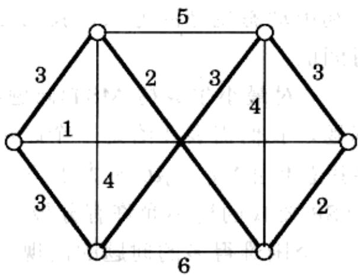
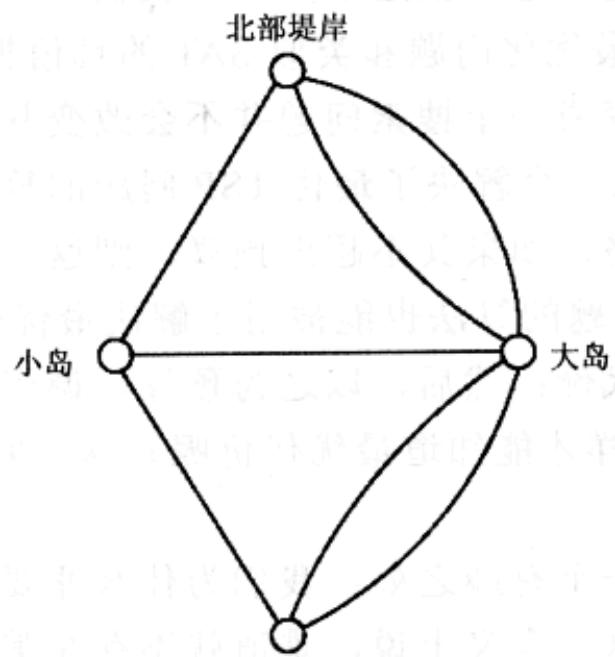
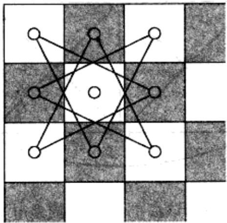
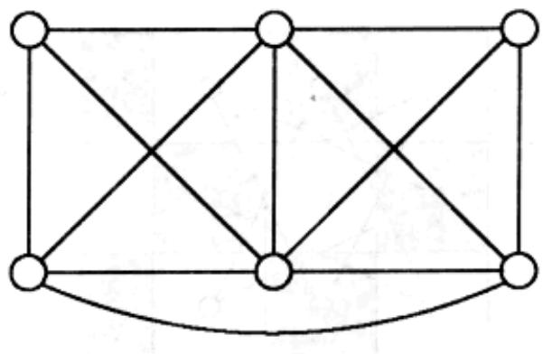
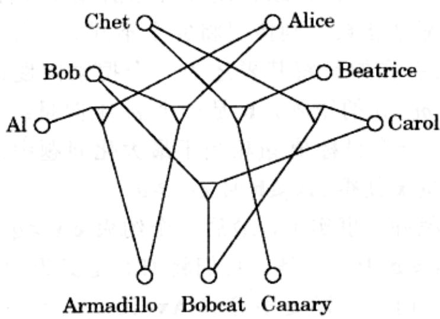
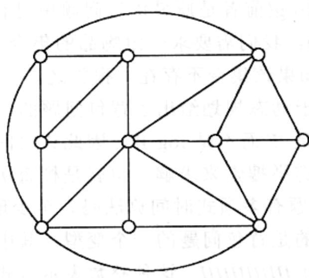

import Guide from '@/components/Guide.astro';
import Knowledge from '@/components/Knowledge.astro';
import Example from '@/components/Example.astro';
import Analysis from '@/components/Analysis.astro';
import Solution from '@/components/Solution.astro';
import Variant from '@/components/Variant.astro';
import Note from '@/components/Note.astro';
import Block from '@/components/Block.astro';
import Method from '@/components/Method.astro';
import Exercise from '@/components/Exercise.astro';
import Algorithm from '@/components/Algorithm.astro';

## 第8章 NP-完全问题

## 8.1 搜索问题

在此前的7章中，我们已经为很多计算问题建立了算法，例如：图的最短路径和最小生成树、二部图的匹配、最大递增子序列、网络最大流等。所有这些算法都可以说是高效的，因为随着输入规模 $(n)$ 的递增，它们所需的计算时间仅仅呈现多项式(例如 $n$ 、 $n^2$ 或 $n^3$ )的变化。

为了更好地理解这些算法的效率，我们来换个角度思考一下。在这类问题中，我们通常需要在指数量级的可能情形中搜索一个解(如路径、树、匹配等)。事实上， $n$ 个男孩和 $n$ 个女孩间可能有 $n!$ 种不同的匹配方式，包含 $n$ 个顶点的图最多可能有 $n^{n-2}$ 个不同的生成树，而在一个典型的图中，由 $s$ 到 $t$ 的可能路径数也是指数量级的。所有这些问题，都可以通过逐个检查所有的可能解而最终在指数时间内得到解决。但是，一个时间为 $2^n$ 或更长的算法，无论多么有效都没有任何实用价值(参见稍后灰色方框中的内容)。高效算法的任务就是要避开笨拙的穷举式搜索，利用输入提供的线索大幅缩减搜索空间的规模，从而以一种巧妙的方式找到答案。

迄今为止，在本书中我们已经看到了许多成功完成以上任务的案例，并从中了解到一些应对指数规模搜索的算法技术，例如贪心策略、动态规划、线性规划(分治方法更多地是使已经能在多项式时间内解决的问题求解得更快)。下面，我们将遇到一些最令人头疼甚至注定为不可能成功的任务。我们将看到另外一些“搜索问题”，其中仍然需要在指数量级的繁杂的可选对象中搜索某个具有特定性质的解。不同以往的是，求解这些问题似乎没有什么捷径可行。关于这些问题，目前我们所知的最快算法都是指数时间的——相比穷举搜索没有本质性的改善。下面，首先介绍其中一些重要的例子。

## 可满足性问题

可满足性问题(简称SAT)(参见习题3.28和本书5.3节)是一类具有重要应用价值的问题，其应用范围涉及从芯片测试、计算机设计到图像分析与软件工程等众多领域。它是一个标准的困难问题。SAT的一个实例形如：

$$
(x \vee y \vee z) (x \vee \overline {{y}}) (y \vee \overline {{z}}) (z \vee \overline {{x}}) (\overline {{x}} \vee \overline {{y}} \vee \overline {{z}})
$$

<Knowledge title="专栏: Sissa 与 Moore 的故事">

传说中，国际象棋游戏是印度人Brahmin Sissa发明的，其目的是为了娱乐和教导他的国王。当心存感激的国王问Sissa想要什么赏赐时，充满智慧的Sissa向国王提出了这样的请求：请在棋盘的第一个格子里放上一粒稻谷、第二个格子里放上两粒稻谷、第三个四粒，然后依次类推，每次在下一个格子里放上前一格加倍数量的稻谷，直到2的64次方个。国王立刻答应了。结果这位国王成了领教指数级增长威力的第一人。因为满足Sissa的请求一共需要 $2^{64} - 1 = 18446744073709551615$ 粒稻谷，足够将整个印度国土覆盖好几层！

在自然界中，从细菌的繁殖到胚胎的细胞分裂，我们都可以见到一些指数增长的例子，只不过它们持续的时间通常比较短暂。1798年，英国哲学家T.Robert Malthus在一篇文章中预测，全球人口的指数增长(他称之为“几何增长”)将很快耗尽线性增长的各类资源。这一结论最终对Charles Darwin产生了深刻的影响。Malthus的预测源于这样一个基本事实：指数增长迟早会战胜任何多项式增长。

1965年，计算机芯片业的先驱Gordon E. Moore注意到，在20世纪60年代早期，芯片中的晶体管密度每两年会翻一番，于是他预测这一规律会一直延续下去。经过适当的修正，如今这一规律被表述为，每18个月计算机的处理速度将翻一番，也就是著名的Moore定律。40年来，Moore定律很好地预测了计算机硬件的发展。而在最近几十年中，Moore定律和高效的算法技术已经成为了支撑信息技术爆炸式发展的两大源动力。

表面上看，Moore定律对于多项式时间算法的发展产生了某种反面刺激。毕竟，如果算法是指数级的，为什么不能等到Moore定律使它的实现成为可能呢？但是现实的情况却恰恰相反：Moore定律对高效算法的发展产生了巨大的激励，其原因在于人们需要这样的算法来充分发挥计算机速度指数级提升的好处。

让我们举例说明, 如果给定 1 小时的时间用于执行一个 $O(2^n)$ 的布尔可满足性问题(SAT), 倒退到 1975 年, 当时的计算机在此时间内最多可以处理完包含 25 个变量的问题实例，对1985年的较快计算机而言，问题实例可包含31个变量，1995年38个，今天则约为45个。这确实是在一点点进步——只是每增加一个新变量平均需要等待一年半时间，而应用需求的增长(具有讽刺意味的是，它常常源于计算机设计本身的改变)常常比这快得多。作为对比，一个 $O(n)$ 或 $O(n \log n)$ 算法所能解决问题的最大规模，每10年可增长约100倍； $O(n^{2})$ 算法所能解决问题的规模，每10年可增长约10倍；即使是 $O(n^{6})$ 这样一种令人望而却步的算法，其所能解决问题的规模每10年也至少可提高一倍以上。也就是说，观察一个算法所能解决问题的规模在固定时间内的增长速度，我们最终可以得到这样一个结论：指数时间算法的能力将以多项式速度提高，而多项式时间算法能力的提升速度却是指数级的。结论中多项式和指数级二者的地位恰好做了一个互换！因此，为了反射Moore定律的光辉，我们确实需要更高效的算法。

Sissa 和 Malthus 都清楚，指数级增长不可能在我们这个资源有限的世界上一直持续下去。细菌最终会耗尽所有食物；芯片的粒度最终也将触及原子的边界。在 10 到 20 年内，Moore 定律将不再能使计算机的速度继续翻番。到那时，计算能力的提升也许将更多地依赖算法上的创造——当然，或许真的可以另辟蹊径，比如利用所谓的量子计算技术(请参见第 10 章)。

这是一个采用合取范式(Conjunction Normal Form, CNF)的布尔公式。它由一组子句——括号内的公式组成，每个子句都是多个文字的析取(逻辑或(or)，记为v)，这里的文字要么为一个布尔变量(例如x)要么为其否定(例如 $\bar{x}$ )。一个可满足赋值是对每个变量的一个false或true赋值，使得每个包含文字的子句都取值为true。SAT问题即为：给定一个采取合取范式的布尔公式，为其找到一个可满足赋值或判定该赋值不存在。

在前述的例子中，如果令所有的变量取 true，则除最后一个子句外所有的子句都被满足。那么是否存在能使所有子句都满足的真赋值呢？

稍加思考，不难发现这样的真赋值不存在。(提示：中间的三个子句要求三个变量 $x, y, z$ 必须取值相同)。那么，一般情况下我们该如何进行判断呢？当然，我们总是可以逐个搜索变量赋值的所有组合。但是，对于包含 $n$ 个变量的公式，所有可能的赋值总数是指数级的，共有 $2^n$ 个。

SAT 是一个典型的搜索问题。给定一个问题实例 $I$ (即一组用于确定当前问题的输入数据。此刻我们关注的问题是采用合取范式的布尔公式)，我们需要求它的一个解 $S$ (即某个符合特定描述的对象。在我们当前的问题中为一组满足所有子句的赋值)。如果这样的解不存在，则称该问题不可解。

说得更具体些，一个搜索问题必须具有如下性质：对实例 $I$ ，其任意一个解 $S$ 的正确性都应该能被快速地检验。这意味着什么呢？一方面， $S$ 必须足够简明(可被快速阅读)，长度在 $I$ 规模的多项式范围内。对于 SAT，这一点显然成立，其中 $S$ 为变量的赋值。对快速检验给出一个规范的描述如下：能被快速检验意味着存在一个以 $I$ 和 $S$ 为输入的多项式时间算法，用于验证 $S$ 是否为 $I$ 的一个解。对于 SAT，这是非常容易的，仅需将 $S$ 中的赋值逐个代入 $I$ ，检查每个子句的运算结果是否为真即可。

在本章的后面部分，我们有必要稍微转换一下观察的角度，并将检验解的高效算法作为对搜索问题的定义。因此：

一个搜索问题是由一个算法 $C$ 描述的, 以问题实例 $I$ 和一个可能的解 $S$ 为输入, 运行在关于 $|I|$ 的多项式时间内。我们说 $S$ 是 $I$ 的一个解, 当且仅当 $C(I, S) = \text{true}$ 。

由于 SAT 搜索问题的重要性，为了找到求解它的有效途径，过去的 50 年中学者们付出了艰苦努力，但是至今也没有获得成功。目前所知最快的求解算法在最差情况下仍需要指数时间。

不过，有趣的是，SAT有两个自然的变型，它们都存在高效的算法。如果每个子句都最多包含一个肯定文字，则该布尔公式称为Horn公式，如果其存在真可满足赋值，则必可利用5.3节的贪心算法求得。另一种情形，如果每个子句仅包含两个文字，则采用图论的方法，可以通过寻找实例所对应图中的强连通部件(参见习题3.28)在线性时间内求解该SAT。事实上，第9章中我们还将看到针对此特殊情形(我们称之为2SAT)的另一个多项式算法。

另一方面，如果我们更加宽容一些，允许子句中包含3个文字，则对应的问题，我们称之为3SAT(我们此前已经看到了该问题的一个实例)，将再一次变得难以求解！

</Knowledge>
## 旅行商问题

在旅行商问题(TSP)中，我们给定 $n$ 个顶点1、...、 $n$ 和它们之间的 $n(n - 1) / 2$ 个两两距离值，以及旅行预算 $b$ 。我们需要确定一条旅行路线，该路线为一个恰好经过每个顶点一次的环，且总的旅行费用不能超过 $b$ ——否则将报告不存在这样的路线。也即，我们寻求所有顶点的一个排列 $\tau(1), \ldots, \tau(n)$ ，使得按照该排列的顺序旅行，总共最多产生费用 $b$ ：

$$
d _ {\tau (1), \tau (2)} + d _ {\tau (2), \tau (3)} + \dots + d _ {\tau (n), \tau (2)} \leq b
$$

图 8-1 为一个示例(图中仅标出了一部分距离值；我们假设未标出的距离都非常大)。

  
图 8-1 加粗的边表示商人的最佳旅行线路，长度为 18

请留意我们如何将 TSP 定义为一个搜索问题：给定一个实例，寻找一个总费用在预算内的可行路线(或者报告其不存在)。为什么我们用这种方式来表达旅行商问题呢？我们知道其本来是一个最优化问题，目标是求最短的可能线路。为什么要采取另一种描述方式呢？

一个合理的解释是，本章中我们的目的就是要对一些问题进行比较和联系。出于这一考虑，采用搜索问题的基本描述框架会对我们有所帮助，因为这种描述方式能够同时概括类似TSP的最优化问题和类似SAT的真值搜索问题的某些特征。

将一个最优化问题转变成一个搜索问题并不会改变其困难程度，因为这两种问题是可以相互归约的。任意一个解决了最优 TSP 问题的算法事实上也解决了其对应的搜索问题：寻找最优线路，如果其不超出预算，则返回之；否则，无解。

反之，一个求解搜索问题的算法也能被用于解决最优化问题。为什么呢？首先，假设我们知道最优路线的代价；然后，以之为预算，调用搜索问题的算法可以得到对应的旅行路线。但是，怎样才能知道最优代价呢？这很容易：通过二分查找法！(参见习题8.1)

顺带提一句，这里有一个有趣之处：我们为什么非要引入一个预算值呢？从搜索一个具有最优性质的解这一意义上说，难道就不存在某个同时也是搜索问题的最优化问题吗？关键在于，一个搜索问题的解应该是容易被验证的，正如我们此前所指出的，其正确性应该能在多项式时间内得到确认。给定TSP问题的一个可能解，容易检验其是否为“一个旅行路线”(仅需判断它是否恰好经过每个顶点一次)以及是否“总代价不大于 $b$ ”。但是，该如何检验它是否“最优”呢？

和SAT一样，TSP到目前为止还不存在任何多项式时间的算法，而就此问题人们所做的尝试已长达一个世纪。当然，有一种指数时间的算法，就是尝试所有 $(n - 1)!$ 种可能路线。在6.6节中，利用动态规划的方法，我们已经研究过一种相对更快的算法，不过它仍然是指数时间的。

作为一个完全反面的例子，对最小生成树(MST)问题我们已经有了高效的算法。为了将其表达成一个搜索问题，我们需要在给定一个距离矩阵的基础上再给定一个上界 $b$ ，目标于是变成了寻找总权重 $\Sigma_{(i,j)\in T}d_{ij}$ 不大于 $b$ 的生成树 $T$ 。TSP可以说是MST的一个近亲，只不过TSP要找的树不允许有分枝，因此它是一条路径 $^1$ 。对树结构的这一额外限制导致了一个困难得多的问题的出现。

## Euler 和 Rudrata

1735年夏的一天，著名瑞士数学家Leonhard Eular正在东普鲁士哥尼斯堡某座公园的桥群中散步。走着走着，他突然感到有些困惑，因为不管从哪个位置开始，也不管他怎样精心地选择行走的路线，他都不可能恰好走遍所有的桥一次。正是这看似一念之间的冲动，最终导致了图论的诞生。

Eular 很快找到了问题的根源。首先，他将公园的地形转换成一个图，其中的顶点对应于四个不同的地点(两座小岛、两条堤岸)，连接它们的边则是对应的七座桥梁：

  
南部堤岸

在这个图中，两个顶点间可能存在多条边——这一特征在本书此前的讨论中都不曾出现。在这一特定的问题中，由于每座桥都将被独立计数，因此这样的特征有其特别的意义。我们需要找一条恰好经过每条边一次的路径(该路径可以重复通过同一节点)。换句话说，我们的想知道的是：在什么条件下，可以一笔画出某个图形？

Eular 的答案是非常简洁、优雅和直观的：以上结论成立，当且仅当(a)该图是连通的且(b)除最多两个顶点(行走路线的起点和终点)外，所有顶点上的边数为偶数(习题 3.26)。这就是为什么哥尼斯堡公园的桥群不可能被一次性遍历的原因——所有四个顶点的度数都为奇数。

在上述背景下，我们定义一个称为 Euler 路径的搜索问题如下：给定一个图，寻找一条恰好包含每条边一次的路径。从 Euler 给出的答案出发，稍加思考不难发现，这一搜索问题能在多项式时间内求解。

冥冥中巧合的是，时间上溯到 Euler 在东普鲁士的那个夏天的一千年前，一个克什米尔诗人 Rudrata 曾经问过这样的问题：采用规定的国际象棋骑士步法，我们能否从某个棋盘格出发，不重复地走遍所有的棋盘格，并最终回到出发的格子？这也是一个图论问题：该图包含 64 个节点，如果骑士能够在一步内从某个格子走到另一个格(即如果格子间两个维度的坐标的差的绝对值分别是 2 和 1)，则在对应节点间就存在一条边。图 8-2 表示棋盘左上角对应的图。您能在其中为骑士找到一条路径吗？

  
图 8-2 骑士在棋盘一角的移动

这是一类不同的图论搜索问题：我们要求一个经过所有顶点(不同于 Euler 问题中的所有边)恰好一次的环路。不拘泥于棋盘，我们可以针对任意图提出相同的问题。定义 Rudrata 环路搜索问题如下：给定一个图，求一条经过每个顶点恰好一次的环路——或者，报告该环路不存在 $^{2}$ 。它不禁令我们想起了 TSP，与 TSP 相似的是，该问题目前也不存在任何多项式时间算法。

Euler 问题和 Rudrata 问题的定义有两个不同之处。首先，前一个问题要求访问所有的边，而后者则关注所有的顶点。其次，前者要求的是一条路径，而后者则要求一个环。究竟是以上的哪一点使这两个问题在计算复杂度上呈现出了如此巨大的差别？应该会是第一点，因为我们可以说明后一个差别通过对 Rudrata 问题进行一些修改后将不复存在。事实上，我们可以定义一个与 Rudrata 环路问题类似的 Rudrata 路径问题，其中仅需将问题的目标修改为求一条恰好经过每个顶点一次的路径。我们很快将会看到，两个不同版本的 Rudrata 问题是等价的。

## 分割与二等分

分割是一个边的集合，将其从图中移除将导致图不再连通。最小分割常常是令人感兴趣的，我们如下定义最小分割问题：给定一个图和预算 $b$ ，求最多包含 $b$ 条边的分割。图8-3中的最小分割规模为3。最小分割问题可以在多项式时间内通过计算 $n - 1$ 次最大流而求解。具体来说，令每条边容量为1，然后求某个确定节点到其它每个节点的最大流。其中最小的流(根据最小分割最大流定理)就对应于最小分割。您能解释这是为什么吗？我们此前还介绍过一个与此完全不同的随机算法(参见图5-9后的灰色方框)。

  
图8-3 该图的最小分割是什么

在很多图(例如图8-3)中，最小分割使得某个顶点被单独分在一边——分割包含了与该顶点相连的所有边。一种更令人感兴趣的情况是能够将图中顶点近似平分的最小分割。具体来说，平衡分割问题可以表述为：给定一个包含 $n$ 个顶点的图和预算 $b$ ，平衡分割将所有的顶点分成两个集合 $S$ 和 $T$ ，使得 $|S|$ 、 $|T| \geqslant n / 3$ ，并且 $S$ 和 $T$ 之间最多有 $b$ 条边。这又是一个困难的问题。

平衡分割问题来源于一些重要的应用，例如聚类问题。举例来说，考虑将一幅图片(比方说，图上的内容是一头大象站在草地上，头顶着蓝天)分割成若干构成元素(例如大象、草地、蓝天)的问题。一个较好的途径是为其生成一个图，在图上对应于图片的每个像素建立一个节点，同时在位置和色彩都相近的节点间建立一条边。这样一来，图片中的每个对象(比方说那头大象)将对应于图中一组紧密相连的节点。在此基础上，平衡分割将对图片中的像素进行划分，同时不破坏图片中主要构成元素的完整性。对于我们的小例子，通过第一次分割，可能会先分割出一头大象，对剩下的图再进行分割将进一步得到相互分离的草地和蓝天。

## 整数线性规划

尽管单纯形法并不是一个多项式时间算法，但我们曾在第7章中提到，对于线性规划的确存在另一个多项式时间算法。因此，线性规划无论在理论上还是实践中都是可以高效求解的。但如果在保持原有线性目标函数和线性约束不等式的前提下，还要求解中的数值必须都是整数，则情况将完全不同。这类问题我们称之为整数线性规划(ILP)。让我们来看看如何将其表述为一个搜索问题：给定一组线性不等式 $Ax \leqslant b$ ，其中A是一个 $m \times n$ 的矩阵，b是一个m维向量；一个由n维向量c定义的目标函数；以及最后，一个目标值g(相当于最大化问题中的预算值)。我们需要求一个非负整数构成的向量x使得 $Ax \leqslant b$ 且 $c \cdot x \geqslant g$ 。

这种表述形式略显臃肿，事实上，最后一个约束 $\mathbf{c} \cdot \mathbf{x} \geqslant g$ 本身也是一个线性不等式，因此可以被融入 $\mathbf{A}\mathbf{x} \leqslant \mathbf{b}$ 中。于是，我们将ILP定义为如下的搜索问题：给定A和b，求一个非负整数值向量 $\mathbf{x}$ 满足不等式 $\mathbf{A}\mathbf{x} \leqslant \mathbf{b}$ ；或者，报告其不存在。虽然该问题有许多重要应用，并且吸引了众多学者的热切关注，但是它至今还没有任何高效的算法。

ILP 有一个形式特别简洁但也非常困难的特例：目标是求由 0 和 1 构成的向量 x，满足 Ax=1，其中 A 是一个由 0 和 1 构成的 $m \times n$ 阶矩阵，而 1 是由 1 构成的 m 维向量。该问题显然是由 7.1.4 节的问题归约而来，但事实上它是 ILP 的一个特例，我们称之为零一方程 (ZERO-ONE EQUATION, ZOE)。

至此，我们已经介绍了一些重要的搜索问题，其中的一部分是我们在前面的章节中就已熟知的，它们存在高效的算法；剩余的则常常因为一些细小而重要的变化成为非常困难的问题。作为本部分的结束，我们还要介绍一些更加困难的问题。这些问题在本章后面的内容中都有着自己的角色，到时我们将对所有这些问题的困难程度进行一一梳理。读者可以跳过接下来的这部分内容，直接进入8.2节，并在需要的时候回头查找以下针对这些问题的定义。

## 3D匹配

回忆二部图匹配问题：给定一个每一侧包含 $n$ 个节点(男孩和女孩)的二部图，求 $n$ 条互不相连的边组成的集合，或者指出该集合不存在。在7.3节中，我们已经了解了如何通过将其归约到最大流问题来进行求解。然而，二部图匹配问题有一个有趣的推广，即所谓3D匹配(3D MATCHING)问题，该问题还不存在已知的多项式算法。在3D匹配问题中，除了 $n$ 个男孩和 $n$ 个女孩，新增了 $n$ 个宠物；它们之间的相容关系被表达为一个三元组的集合，集合中每个元素都包含一个男孩、一个女孩和一个宠物。直观上，三元组 $(b, g, p)$ 意味着男孩 $b$ ，女孩 $g$ 和宠物 $p$ 能够融洽相处。我们需要求 $n$ 个独立的三元组，从而最终形成 $n$ 个和谐的“家庭组合”。

您能在图8-4中标出该问题的一个解吗？

  
图8-4 一个更加复杂的匹配场景。每个三元组都被表示为连接了一个男孩、一个女孩和一个宠物的三角形节点

## 独立集、顶点覆盖和团

在独立集问题(6.7节)中，给定一个图和整数 $g$ ，目标是求图中的 $\pmb{g}$ 个相互独立的顶点，即：任意两个这样的顶点间都不存在相连的边。您能在图8-5中找到一个由三个顶点构成的独立集吗？如果要求有四个顶点呢？在6.7节中，我们了解到该问题在图为树结构的情况下能被高效求解，但是对于一般的图还没有任何多项式时间的算法。

  
图8-5 该图的最大独立集规模是多少

图论中还有许多其它的搜索问题。例如，在顶点覆盖问题中，输入为一个图和预算 $b$ ，求 $b$ 个能够覆盖到每条边的顶点。您能用7个顶点覆盖图8-5吗？6个顶点呢？(您是否能看出该问题与独立集问题之间的联系？)

顶点覆盖问题是集合覆盖问题的一个特例，后者我们在第5章已经接触过。在集合覆盖问题中，给定一个集合 $E$ 和它的多个子集 $S_{1}$ 、...、 $S_{m}$ ，以及预算 $b$ ，我们需要从这些子集中选出 $b$ 个使它们的并为 $E$ 。若令 $E$ 包含图中的所有边，且对每个顶点 $i$ 定义子集 $S_{i}$ ，使 $S_{i}$ 包含与 $i$ 相连的所有边，则不难看出顶点覆盖只是集合覆盖问题的一个特殊情形。您能说明为什么3D匹配问题也是集合覆盖问题的一个特例吗？

最后还有一个团(CLIQUE)问题：给定一个图以及目标 $g$ ，求图中的 $g$ 个顶点，使得这些顶点间两两都存在相连的边。图8-5中最大的团是什么呢？

## 最长路径问题

我们知道最短路径问题是可以被高效求解的，但是对最长路径问题又如何呢？这里我们给定一个图 $G$ ，其边权重非负，两个不同的顶点 $s$ 和 $t$ ，以及目标 $\pmb{g}$ ，求一条由 $s$ 到 $t$ 总权重至少为 $\pmb{g}$ 的路径。自然地，为了避开平凡解，我们要求该路径是简单的，即其中不包含任何重复的顶点。

截止目前, 还没有任何针对该问题的高效算法(该问题有时也称为出租车敲竹杠(TAXICAB RIP-OFF)问题)。

## 背包问题与子集和

回忆背包问题(6.4节): 给定 n 件物品的整数值重量 $w_{1}, \ldots, w_{n}$ 和整数值价值 $v_{1}, \ldots,$ $v_{n}$ ，以及背包容量 W 和目标 g（前者是原最优化问题中已有的，后者的加入是为了使该问题成为一个搜索问题）。我们需要求一组物品的集合，使其总重量不超过 W 且总价值为 g。一如从前，如果该集合不存在，报告之。

在 6.4 节中，我们基于动态规划给出了背包问题的一个 $O(nW)$ 的算法。由于该算法的运行时间中包含的是 W 而不是 $\log W$ ，因此该时间与输入规模是指数关系。当然，我们还是可以使用穷举搜索来求解，也就是检查所有的物品组合——但是这些组合共有 $2^{n}$ 种。背包问题有多项式时间算法吗？至少现在还没人知道答案。

但若我们现在感兴趣的是背包问题的一个变型：其中所有的整数都被表示为一元数——例如12将被写为IIIIIIIIII。这种整数表示方式虽然会带来指数量级的浪费，但它却定义了一个合理的问题，我们称之为一元数背包问题。从我们此前的讨论可知，这一看似生造的问题却存在多项式时间算法。

另一个变型：假设每件物品的价值都等于其重量(都用二进制表示)。并且，为了取最大的可能值，令目标 $g$ 等于容量 $W$ 。(相应地，在背包问题最初的打劫场景中，假设强盗们面对的都是一块块金砖，他们此刻的心情当然是希望装得越多越好)。这一特例等价于一个求整数集子集的问题，目标是使子集中所有元素的和恰好为 $W$ 。作为背包问题的一个特例，该问题不会难于背包问题。但是能在多项式时间内解决该问题吗？实际上，这一被称为子集和(SUBSET SUM)的问题，同样也非常困难。

此时此刻，有人可能会问：如果子集和问题这一特例和普通的背包问题难度相当，那为什么我们还要对它如此感兴趣呢？原因在于子集和问题在一定程度上还是实现了某种简化(simplicity)。对于我们在本章中将要探讨的介于搜索问题之间的复杂归约关系，类似子集和和3SAT这样在概念上相对简单的问题，其价值可以说是难以估量的。
