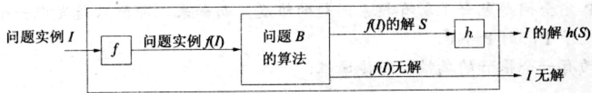
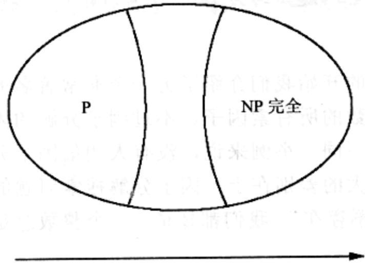

import Guide from '@/components/Guide.astro';
import Knowledge from '@/components/Knowledge.astro';
import Example from '@/components/Example.astro';
import Analysis from '@/components/Analysis.astro';
import Solution from '@/components/Solution.astro';
import Variant from '@/components/Variant.astro';
import Note from '@/components/Note.astro';
import Block from '@/components/Block.astro';
import Method from '@/components/Method.astro';
import Exercise from '@/components/Exercise.astro';
import Algorithm from '@/components/Algorithm.astro';

## 8.2 NP-完全问题

## 困难的问题与容易的问题

这个世界充满了各种搜索问题，有些可以被高效求解，有些看起来则非常困难。下表罗列了其中的一些：

<table><tr><td>困难的问题(NP-完全)</td><td>容易的问题(P)</td></tr><tr><td>3SAT</td><td>2SAT, HORN SAT</td></tr><tr><td>旅行商问题</td><td>最小生成树</td></tr><tr><td>最长路径</td><td>最短路径</td></tr><tr><td>3D匹配</td><td>二部图匹配</td></tr><tr><td>背包问题</td><td>一元数背包问题</td></tr><tr><td>独立集</td><td>树的独立集</td></tr><tr><td>整数线性规划</td><td>线性规划</td></tr><tr><td>Rudrata 路径</td><td>Euler 路径</td></tr><tr><td>平衡分割</td><td>最小分割</td></tr></table>

这张表真是耐人寻味。表右侧的问题都可以被高效求解，左侧的则像是一堆顽固的坚果，为了高效“破解”它们人们已花费了几十年甚至几个世纪！

表右侧的众多问题可以用各种不同的方法进行求解，例如：动态规划、网络流、图搜索、贪心方法等。而它们之所以简单，原因也各不相同。

与之相对地，表左侧的问题却都因为相同的原因而变得困难！事实上，这些问题都具有相同的核心部分，只是它们的外在表现有所不同！因此可以说，所有这些问题都是相互等价的：我们将在8.3节中了解到，它们之中的任意两个都可以相互归约。

## P 和 NP

是时候介绍一些重要概念了。我们已经了解了什么是一个搜索问题，其特征性定义是：任意可能解的正确性都能被快速检验，也即：存在以问题实例 $I$ (用于确定待求解问题的数据)和可能解 $S$ 为输入的高效检验算法 $C$ ，其输出为true的充要条件是 $S$ 确实是 $I$ 的解。此外， $C(I, S)$ 必须是关于实例长度 $|I|$ 的多项式时间算法。我们将所有这些搜索问题称为NP-问题。

我们已经见过许多能在多项式时间内求解的 NP 搜索问题。在这些例子中，存在一个算法以问题实例 I 为输入并且运行在关于 $|I|$ 的多项式时间内。如果 I 的解存在，算法将返回之；而如果 I 无解，算法也会做出正确的报告。所有能在多项式时间内求解的搜索问题被记为 P。也即，前述表右侧的问题都是属于 P 的。

是否存在不能在多项式时间内求解的搜索问题呢？换句话说， $\mathbf{P} \neq \mathbf{NP}$ 吗？多数算法研究者都会同意这一点。很难相信所有的指数量级搜索都可以避免，因为这意味着所有的难题将不复存在，而事实上，其中很多著名的问题已经困扰了人们几十甚至上百年。同时，有一个很好的理由让数学家们相信 $\mathbf{P} \neq \mathbf{NP}$ ——为某个数学断言寻求证明的任务是一个搜索问题并因此为 NP 的(如果能将一个数学证明中那些令人痛苦的细节都一一写出，它将有可能用某个高效的算法进行机械式检验)。因此，如果 $\mathbf{P} = \mathbf{NP}$ ，则必然存在某个证明定理的高效途径，数学家们也就无事可做了！总之，关于人们为什么要相信 $\mathbf{P} \neq \mathbf{NP}$ ，有着各种各样的理由。不过，证明它也是极其困难的，完全可以称得上是数学家们所面临的最为重要也最艰深难解的问题之一。

## 为什么是P和NP?

显然，P意味着“多项式的”。但是为什么采用缩写NP(在公共聊天室里，这个缩写意味着“没有问题”)来描述搜索问题类呢，要知道其中有些问题真是难的可怕啊？

NP 的真实含义是 “不确定多项式时间”，根源于复杂性理论。直观来说，NP 意味着所有搜索问题的解都可能通过某类特殊(和相当不切实际)的算法在多项式时间内求解和验证，这类算法常被称为 “不确定算法”。此类算法的神奇之处在于其每一步都能猜到正确的结果。

顺带说一句，NP 最初的(也是现今最广为认可的)定义并不是针对搜索问题类的，而是用在所谓的决策问题类——一类总是以是或否为答案的算法问题——中。比如：“是否存在满足某布尔公式的可满足赋值？”它反映了这样一个历史现实：在 NP-完全性理论构建的过程中，计算理论研究者们的主要兴趣在于研究形式语言，而决策问题正是其中最为核心和重要的问题。

## 再论归约

即使我们接受了 $\mathbf{P} \neq \mathbf{NP}$ ，关于表左侧的那些问题我们还能说些什么呢？还有哪些证据能使我们相信这些特定的问题没有高效的算法呢(当然不包括许多聪明的数学家和计算机科学家虽然刻苦努力却仍然找不到任何高效算法这一历史事实)? 证据来自于归约，它可以将一个问题转化为另一个。事实上，除了采用不同的语言表述，关于表左侧的问题，已经证明都可以在某种意义下被归约为完全相同的问题。此外，我们还将使用归约来说明这些问题是 NP 搜索问题中最难的——只要其中某一个存在多项式时间算法，则所有 NP 问题也都存在类似的算法。因此，如果我们相信 $\mathbf{P} \neq \mathbf{NP}$ ，则所有这些搜索问题都是困难的。

第7章中我们定义了什么是归约，并给出了一些相关的例子。现在我们给出针对搜索问题的归约概念。由搜索问题 $A$ 到搜索问题 $B$ 的归约是一个多项式时间算法 $f$ ，其将问题 $A$ 的任意实例 $I$ 转换为问题 $B$ 的实例 $f(I)$ ；同时存在另一个多项式时间算法 $h$ ，将 $f(I)$ 的任意解 $S$ 映射到 $I$ 的一个解 $h(S)$ ，具体过程如下图。如果 $f(I)$ 无解，则 $I$ 也无解。基于算法过程 $f$ 和 $h$ 可以将求解问题 $B$ 的算法可以转化为求解问题 $A$ 的算法。

问题 $A$ 的算法  
  
现在我们终于可以定义什么是最困难的搜索问题类了。

称一个搜索问题是 NP-完全的，是指其它所有搜索问题都可以归约到它。

这是一个非常强的条件。一个问题要成为 NP-完全的，它必须能用于解决世界上所有的搜索问题！这样的问题当然是非常引人注目的。不过它确实存在，在此前的表中，左侧所列出的正是其中最著名的一些例子。在 8.3 节中，我们还将看到这些问题是如何相互归约的，以及为什么其它问题都可以归约到这些问题。

  
难度不断递增  
图 8-6 所有 NP 搜索问题的空间，假设 P≠NP

<Knowledge title="专栏: 使用归约的两种途径">

截止目前，本书对归约目的的描述都非常直接和充满敬意：如果问题 $A$ 可以归约为问题 $B$ ，则意味着如果我们知道如何高效求解 $B$ ，也一定能高效求解 $A$ 。然而在本章中，将 $A$ 归约为 $B$ 的目的却显得多少有些保守：如果我们知道 $A$ 是难的，则归约将证明 $B$ 也是难的！

如果我们将 $A$ 归约为 $B$ 记为

</Knowledge>
## $A\to B$

则我们可以说问题的难度在沿着箭头方向流动，而高效的算法则反之。通过这种难度的传播，我们知道 NP-完全问题是难的：所有其它搜索问题都可以归约到它们，因此 NP-完全问题包含了所有搜索问题的难度。而如果，即便只是发现一个 NP-完全问题属于 P，则 P=NP。

归约有一个很好的属性，即传递性：

## 若 $A \to B$ 且 $B \to C$ ，则 $A \to C$ 。

为了解释这一点，首先注意到归约本身完全是由预处理和后处理函数 $f$ 和 $h$ 定义的。如果 $(f_{AB}, h_{AB})$ 和 $(f_{BC}, h_{BC})$ 分别定义了从 $A$ 到 $B$ 和从 $B$ 到 $C$ 的归约，则从 $A$ 到 $C$ 的归约就可以由复合函数 $f_{BC}^{\circ} f_{AB}$ 以及 $h_{AB}^{\circ} h_{BC}$ 定义，它们分别将 $A$ 的实例映射为 $C$ 的实例以及将 $C$ 的解映射为 $A$ 的解。

以上这些结论意味着，一旦我们知道 $A$ 是 NP-完全的，则我们可以用它来证明另一个新的问题 $B$ 也是 NP-完全的，仅需将 $A$ 归约到 $B$ 。同时这样的归约表明，借助 $A$ 可以将任意 NP-完全问题归约为 $B$ 。

## 因子分解

最后一点：在本书的开始我们介绍了另一个非常著名的难的搜索问题：因子分解，其目标是求给定整数的所有素因子。不过因子分解的困难之处与我们刚才看到的那些难的问题还有所不同。举例来说，没有人相信因子分解是 NP-完全问题。它与其它 NP-完全问题最大的差别在于，因子分解搜索问题的定义中不存在我们所熟悉的句子“或者报告解不存在”。我们都知道，一个整数总是可以被分解为素数的乘积的。

另一个(也许并非完全无关的)差别是：如我们将在第10章所见，因子分解问题最终将被量子计算所解决——而SAT、TSP以及其它的NP-完全问题看起来却都并非如此。
