import Guide from '@/components/Guide.astro';
import Knowledge from '@/components/Knowledge.astro';
import Example from '@/components/Example.astro';
import Analysis from '@/components/Analysis.astro';
import Solution from '@/components/Solution.astro';
import Variant from '@/components/Variant.astro';
import Note from '@/components/Note.astro';
import Block from '@/components/Block.astro';
import Method from '@/components/Method.astro';
import Exercise from '@/components/Exercise.astro';
import Algorithm from '@/components/Algorithm.astro';

## 8.3 所有的归约

下面我们将开始介绍8.1节的各种搜索问题是如何按图8-7的顺序相互归约的。

并由此说明，这些问题都是 NP-完全的。

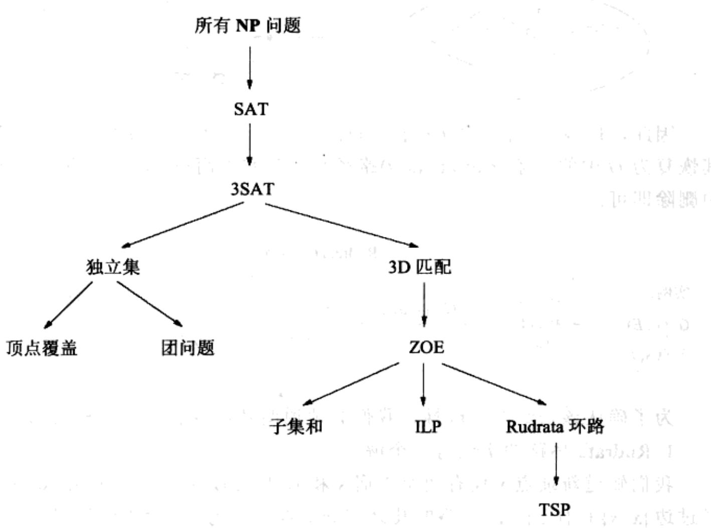  
图8-7 搜索问题的相互归约

在开始图中的归约之前，作为一个热身，让我们先来看看两个不同版本 Rudrata 问题是如何相互归约的。

## Rudrata (s, t)-路径→Rudrata 环路

Rudrata 环路问题定义如下：给定一个图，求是否存在一个恰好经过每个顶点一次的环路？而它的“近亲”，所谓 Rudrata $(s, t)$ -路径问题，需要指定两个特殊的顶点 s 和 t，然后求一条由 s 到 t 的恰好经过每个顶点一次的路径。Rudrata 环路问题会比 Rudrata $(s, t)$ -路径问题更简单吗？以下的归约给出了否定的答案。

归约将 Rudrata $(s, t)$ -路径的一个实例 $(G = (V, E), s, t)$ 映射到 Rudrata 环路的一个实例 $G' = (V', E')$ ，其中 $G'$ 仅为 $G$ 加上一个新顶点 $x$ 以及两条新边 $\{s, x\}$ 和 $\{x, t\}$ 。例如下图：

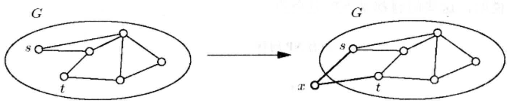

因此， $V' = V \cup \{x\}$ ， $E' = E \cup \{\{s, x\}, \{x, t\}\}$ 。那么给定 $G'$ 中的一个环路，如何将其恢复为 G 中的一条 Rudrata $(s, t)$ 路径呢？其实很简单，只需将边 $\{s, x\}$ 和 $\{x, t\}$ 从环中删除即可。

Rudrata $(s,t)$ -路径  
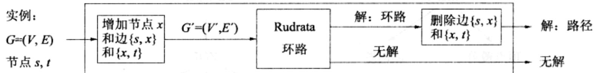

为了确认该归约的正确性，我们必须说明其对各种可能的输出都是有效的。

## 1. Rudrata 环路的实例有一个解。

我们知道新顶点 $x$ 仅有两个邻居 $s$ 和 $t$ , 因此 $G'$ 中的任意 Rudrata 环必然连续地经过边 $\{x, s\}$ 和 $\{t, x\}$ 。而环路的其余部分则在由 $s$ 到 $t$ 的途中经过了图上的所有其它顶点。因此, 将边 $\{x, s\}$ 和 $\{t, x\}$ 从 Rudrata 环路中删除将恰好留下原图 $G$ 中的一条由 $s$ 到 $t$ 的 Rudrata 路径。

## 2. Rudrata 环路的实例无解。

这种情况下我们需要说明原Rudrata $(s, t)$ -路径问题实例也不可能有解。考虑其逆否命题，即：若 $G$ 中存在一条Rudrata $(s, t)$ -路径，则 $G'$ 中也必有一个Rudrata环路。事实上，只需在Rudrata路径的基础上增加两条边 $\{s, x\}$ 和 $\{x, t\}$ 使其构成一个环路即可。

最后一点是一个很重要但也很容易验证的细节：预处理和后处理过程关于实例 $(G, s, t)$ 的规模必须为多项式时间的。

我们同样可以从另一个方向将Rudrata环路问题归约为Rudrata $(s,t)$ -路径问题。这两个归约说明了两个不同形式的Rudrata问题本质上是同一个问题——考虑到它们的问题表述几乎相同，这似乎也并不令人意外。接下来我们所要接触的许多归约将更多地在看似完全不同的问题间进行。为了证明它们本质上都是同一个问题，在归约的过程中我们必须进行非常灵活而巧妙的转换。

## 3SAT→独立集

好像很难再找到彼此间差异比它们两个更大的两个问题了。在3SAT中，问题的输入是一个子句集，每个子句包含不超过3个的文字，例如

$$
(\bar {x} \vee y \vee \bar {z}) (x \vee \bar {y} \vee z) (x \vee y \vee z) (\bar {x} \vee \bar {y}),
$$

目标是求它的一个可满足赋值。在独立集问题中，输入是一个图和一个数 $g$ ，目标是求 $g$ 个互不相邻的顶点。这次我们必须用某种方式把布尔逻辑和图联系起来！

让我们想一想。为了构造一个可满足赋值，我们需要从每个子句中选取一个文字并将其赋值为 true。但是我们的选择必须是相互一致的，例如：如果我们从某个子句中选择了 $\overline{x}$ ，就不能再从别的子句中选择 $x$ 。从每个子句选择一个(与其它赋值)保持一致的文字后，则可确定一个可满足赋值(即一组变量，对其而言没有哪个文字能够同时取两个不同的值)。

于是我们可以将一个子句，比如 $(x \vee \overline{y} \vee z)$ ，表示为一个三角形，其中的顶点分别标注为 $x$ 、 $\overline{y}$ 、 $z$ 。为什么用三角形？因为三角形的三个顶点是完全相连的，独立集只能从三个顶点中选择其一。对所有的子句重复这一做法——仅包含两个文字的子句可以简单地表示为连接两个文字的一条边。(仅含一个文字的子句是没有意义的，因为对应变量的值已经确定了，在预处理过程中可以将其删除。)在最终的图中，每个独立集最多可以从每个组(子句)中选择一个文字。为了保证每个子句恰好被选择一次，令目标 $g$ 等于子句的数量；在我们的例子中， $g = 4$ 。

现在唯一缺少的是在不同的子句中阻止选择相反文字(比如 $x$ 和 $\overline{x}$ )的方法了。要做到这一点其实很简单：在两个相反的文字间添加一条边即可。最后，对以上的示例我们得到了图8-8。

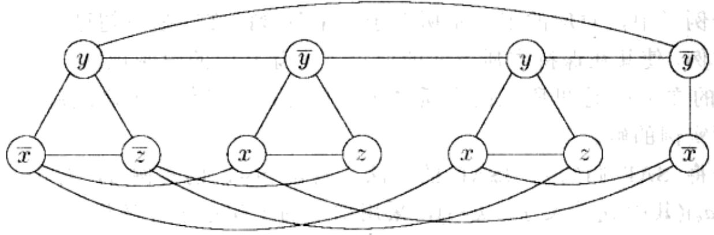  
图8-8 与 $(\overline{x} \vee y \vee \overline{z})(x \vee \overline{y} \vee z)(x \vee y \vee z)(\overline{x} \vee \overline{y})$ 相对应的图

让我们对构造过程进行一番整理。给定3SAT的一个实例 $I$ ，我们采用如下方式生成一个独立集问题实例 $(G,g)$ ：

\- 对每个子句，图 $G$ 中包含一个对应的三角形(或者一条边，对应于两个文字的子句)，其顶点用子句中的文字标注。同时，在两个相反的文字间，存在一条额外的边。

\- 目标值 $g$ 等于子句的数量。

很明显，完成这样的构造仅需多项式时间。然而，对于一个归约，我们不仅需要一个实现问题实例映射的高效方法(本书8.2节中的函数 $f$ )，还需要一种反向映射问题实例解的方法(函数 $h$ )。和通常一样，需要证明以下两点：

1. 给定图 $G$ 中包含 $g$ 个顶点的独立集 $S$ , 可以将其高效地恢复成 $I$ 的一个可满足赋值。

对于任意变量 $x$ ，集合 $S$ 不可能同时包含标注 $x$ 和 $\overline{x}$ 的顶点，因为在这样的一对顶点间总是存在相连的边。因此，如果 $S$ 包含标注 $x$ 的顶点则将 $x$ 赋值为 true，包含标注 $\overline{x}$ 的顶点则将 $x$ 赋值为 false（如果二者都不包含，则可将 $x$ 赋为任意值）。由于 $S$ 包含 $g$ 个顶点，因此其中必然每个顶点对应于一个子句；以上给出的真赋值满足了对应的文字，也使得所有子句得到了满足。

## 2. 如果图 $G$ 不存在规模为 $g$ 的独立集，则布尔公式 $I$ 是不可满足的。

考虑其逆否命题，即如果 $I$ 存在可满足的赋值，则 $G$ 也有规模为 $g$ 的独立集。对于每个子句，任意选择一个在可满足赋值中取值为true的文字(其中至少会有一个这样的文字)，将对应的顶点加入 $S$ 。您能看出为什么 $S$ 是一个独立集吗？

## SAT→3SAT

我们下面将看到一类有趣同时也很常见的归约类型，即由一个问题归约到其特例。我们将说明，即便加入了一些关于输入的限制，该问题(特例)仍然是很难的——在当前这个例子中，对应的限制是所有子句中包含的文字都不超过3个。归约将修改给定的实例，使其在保持本质不变的前提下去除其中的限制规则(子句中将可包含4个或更多的文字)。这里所说的本质不变意味着我们能够基于修改后实例的任意解得到原问题实例的解。

以下是将 SAT 归约到 3SAT 的方法：给定 SAT 的实例 $I$ ，对于 $I$ 中的子句 $(a_1 \vee a_2 \vee \ldots \vee a_k)$ (其中 $a_i$ 为文字， $k > 3$ )，采用如下的子句集进行替代

$$
(a _ {1} \vee a _ {2} \vee y _ {1}) (\overline {{{y}}} _ {1} \vee a _ {3} \vee y _ {2}) (\overline {{{y}}} _ {2} \vee a _ {4} \vee y _ {3})... (\overline {{{y}}} _ {k - 3} \vee a _ {k - 1} \vee a _ {k}),
$$

其中 $y_{i}$ 是一些新增的变量。我们记这样生成的3SAT实例为 $I'$ 。由 $I$ 到 $I'$ 的转换显然是多项式时间的。

为什么这样的归约是有效的？ $I^{\prime}$ 和 $I$ 之所以在可满足性上等价，是因为对于 $a_{i}$

的任意赋值，有

盖露点和《棠立邸

$$
\left\{ \begin{array}{c} (a _ {1} \vee a _ {2} \vee \ldots \vee a _ {k}) \\ \text {满足} \end{array} \right\} \Leftrightarrow \left\{ \begin{array}{c} \text {存在一组} y _ {i} \text {值，使得} \\ (a _ {1} \vee a _ {2} \vee y _ {1}) (\overline {{y}} _ {1} \vee a _ {3} \vee y _ {2})... (\overline {{y}} _ {k - 3} \vee a _ {k - 1} \vee a _ {k}) \\ \text {满足} \end{array} \right\}
$$

为了证明该式成立，首先假设右侧的子句都满足。则 $a_1, \ldots, a_k$ 中至少有一个为真——否则 $y_1$ 必须为真，并进而使得 $y_2$ 必须为真，依次类推，最终导致右侧最后一个子句不满足。因此， $(a_1 \vee a_2 \vee \ldots \vee a_k)$ 也必然是满足的。

反之，若 $(a_{1} \vee a_{2} \vee \ldots \vee a_{k})$ 满足，则必有某个 $a_{i}$ 为真。令 $y_{1}, \ldots, y_{i-2}$ 为 true，其余的都为 false。将使得右侧的子句都满足。

因此，SAT 的任意实例都可以被转换为 3SAT 的一个等价的实例。事实上，即使在 3SAT 中增加每个变量最多在不同子句中出现三次这一限制，其仍然是很难的。为了说明这一点，我们需要将出现次数过多的变量都想办法删除。

以下是由3SAT到这个附加限制版本的归约。假设在3SAT的实例中，变量 $x$ 在 $k > 3$ 个子句中出现。则将其第一次的出现替换为 $x_{1}$ ，第二次的替换为 $x_{2}$ ，如此继续，将其所有的 $k$ 次出现都替换为一个新的变量。接下来，增加一组子句

$$
(\overline {{{x}}} _ {1} \vee x _ {2}) (\overline {{{x}}} _ {2} \vee x _ {3})... (\overline {{{x}}} _ {k} \vee x _ {1})
$$

然后对所有出现超过三次的变量重复以上过程。

我们很容易发现，在新的公式中不再存在出现次数超过3的变量(事实上，已没有出现超过两次的文字)。同时，包含 $x_{1}, x_{2}, \ldots, x_{n}$ 的附加子句使得这些变量都必须取值相同。(您知道是为什么吗？)因此原3SAT实例可满足当且仅当加入限制后的实例可满足。

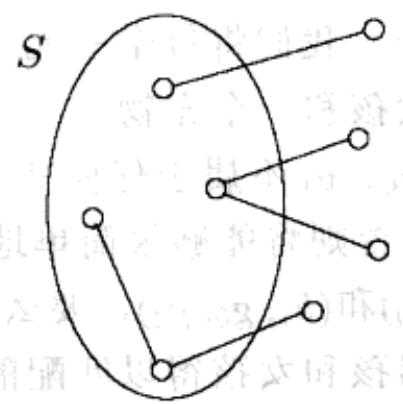

$$
\underline {{1}} ^ {\left( \begin{array}{c c} \frac {r}{3} \\ 0 \end{array} \right)} \quad r + i \in^ {d}
$$

$$
(1, 3, 0)
$$

$$
\xi \left(1, 1\right)
$$

图8-9 $S$ 是一个顶点覆盖当且仅当 $V - S$ 是一个独立集

## 独立集→顶点覆盖

为了在两个不同的问题间建立联系，有些归约需要依赖非常精巧的创造构造。然而另一些归约却反映了这样一种事实，即：有些问题不过是其它问题稍加修饰的结果。为了将独立集问题归约为顶点覆盖问题，我们只需要注意一点：节点集合 $S$ 是图 $G = (V, E)$ 的一个顶点覆盖，当且仅当剩余节点的集合 $V - S$ 是 $G$ 中的一个独立集(图8-9)。

因此，为了求解独立集问题的一个实例 $(G, g)$ ，仅需找到 $G$ 的一个包含 $|V| - g$ 个节点的顶点覆盖。如果存在这样的顶点覆盖，则选择所有未包含在其中的节点即可构成一个独立集。如果不存在这样的顶点覆盖，则 $G$ 不可能有一个规模为 $g$ 的独立集。

## 独立集→团问题

独立集问题和团问题之间的归约也是非常简单的。定义图 $G = (V, E)$ 的补集为 $\overline{G} = (V, \overline{E})$ ，其中 $\overline{E}$ 包含所有不属于 $E$ 的无序结点对。于是节点集 $S$ 是 $G$ 的一个独立集当且仅当 $S$ 是 $\overline{G}$ 中的一个团。理解这一点只需注意到，这些节点在 $G$ 中都相互不连当且仅当在 $\overline{G}$ 中任意两个节点间都有边相连。

因此，我们能够通过将独立集的实例 $(G, g)$ 映射到相应的团问题实例 $(\overline{G}, g)$ ，实现两者间的归约；并且这两个实例的解是一致的。

## 3SAT→3D 匹配

这又是两个非常不同的问题。我们需要将3SAT问题归约到在男孩-女孩-宠物的三元组集合中寻找一个恰好包含每个男孩、女孩和宠物各一次的子集的问题。简单来说，我们需要构造一个男孩-女孩-宠物三元组的集合，使之具有与布尔变量和逻辑门相类似的行为！

考虑如下四个三元组的集合，我们将每个三元组表示为一个三角形节点，三个角分别连接了一个男孩、一个女孩和一个宠物。

假设男孩 $b_{0}, b_{1}$ 以及女孩 $g_{0}, g_{1}$ 不属于任何其它的三元组。(四个宠物 $p_{0}, \ldots, p_{3}$ 当然也就属于其它的三元组；否则将能够很简单地证明该实例无解。)则任意的匹配要么包含两个三元组 $(b_{0}, g_{1}, p_{0})$ 和 $(b_{1}, g_{0}, p_{2})$ ，要么包含 $(b_{0}, g_{0}, p_{1})$ 和 $(b_{1}, g_{1}, p_{3})$ ，因为这是仅有的两种使得这两对男孩和女孩得以匹配的方式。因此，以上的“器件”就具有了两个可能的状态，恰好类似于一个典型的布尔变量的行为！

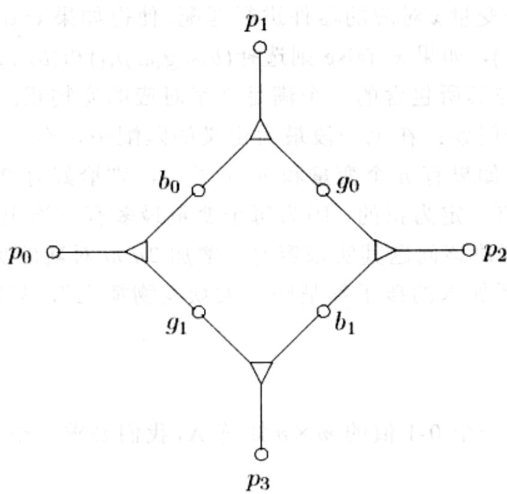

然后我们来将一个3SAT实例转换成一个3D匹配实例。首先我们为每个变量 $x$ 生成一个以上器件的拷贝。记生成的节点形如 $p_{x1}$ 、 $b_{x0}$ 、 $g_{x1}$ 。其中蕴涵的意义是：若 $x = \text{true}$ ，则男孩 $b_{x0}$ 与女孩 $g_{x1}$ 相匹配，否则与 $g_{x0}$ 相匹配。

接下来我们需要生成一些三元组以模仿子句。对于每个子句，比如 $c = (x \vee \overline{y} \vee z)$ ，引进一个新的男孩 $b_{c}$ 和一个新的女孩 $g_{c}$ 。他们将被包含在三元组中，子句中每个文字对应一个三元组。同时，这些三元组中的宠物将用于反映这些子句被满足的三种途径：(1) $x = \text{true}$ ，(2) $y = \text{false}$ ，(3) $z = \text{true}$ 。对于(1)，我们有三元组 $(b_{c}, g_{c}, p_{x1})$ ，其中 $p_{x1}$ 即 $x$ 的器件中的宠物 $p_{1}$ 。以下是为什么选择 $p_{1}$ 的理由：若 $x = \text{true}$ ，则 $b_{x0}$ 与 $g_{x1}$ 匹配且 $b_{x1}$ 与 $g_{x0}$ 匹配，因此采用宠物 $p_{x0}$ 和 $p_{x2}$ 。在此情况下， $b_{c}$ 和 $g_{c}$ 可以和 $p_{x1}$ 相匹配。但如果 $x = \text{false}$ ，则 $p_{x1}$ 和 $p_{x3}$ 将被采用，于是 $g_{c}$ 和 $b_{c}$ 就无法采用这种方式进行匹配了。对于子句中的另外两个文字我们采取同样的方式，最终产生的包含 $b_{c}$ 和 $g_{c}$ 的三元组将分别包含 $p_{y0}$ 或 $p_{y2}$ （对应于变量 $y$ 的否定）和包含 $p_{z1}$ 或 $p_{z3}$ （对应于变量 $z$ ）。

我们需要确定一点，即对于一个文字在子句 $c$ 中的每次出现，都有不同的宠物与 $b_{c}$ 和 $g_{c}$ 相匹配。这其实很简单：由此前的一个归约，我们可以假定每个文字的出现都不会超过两次，因此每个变量的器件都有足够多的宠物，其中两个对应于否定的出现，另两个对应于非否定的。

归约到此似乎已经完成了：通过简单地查看每个变量的器件中哪个女孩 $b_{x0}$ 被匹配，我们可以从任意的匹配中恢复出一个可满足赋值。并且，由任意的可满足赋值我们可以对与每个变量 $x$ 对应的器件进行匹配，使得如果 $x = \text{true}$ 则选择三元组 $(b_{x0}, g_{x1}, p_{x0})$ 和 $(b_{x1}, g_{x0}, p_{x2})$ ，如果 $x = \text{false}$ 则选择 $(b_{x0}, g_{x0}, p_{x1})$ 和 $(b_{x1}, g_{x1}, p_{x3})$ ；并且每个子句 $c$ 将使得 $b_{c}$ 和 $g_{c}$ 与其所包含的一个满足文字对应的宠物相匹配。

还存在最后一个问题：在上一段最后定义的匹配中，有些宠物可能被剩余下来无从匹配。事实上，如果有 $n$ 个变量和 $m$ 个子句，则恰好有 $2n - m$ 个宠物将不会被匹配(您可以检验该值一定为正的，因为每个变量最多有三次出现，且每个子句中最少有两个文字)。要解决该问题其实很容易：增加 $2n - m$ 对新的男孩和女孩(两者已配对好了)，假设这些新加入的孩子都是些“大众宠物情人”，只需将他们与所有剩下的宠物配对即可！

## 3D 匹配→ZOE

在 ZOE 中, 给定一个 0-1 值的 $m \times n$ 矩阵 $\mathbf{A}$ , 我们要求一个 0-1 值向量 $\mathbf{x} = (x_1, \ldots, x_n)$ 使得

$$
\mathbf {A x} = \mathbf {1}
$$

成立，其中1表示所有分量都为1的列向量。如何用这样一个框架来表示3D匹配问题呢？

ZOE 和 ILP 都是非常有用的问题，其原因在于它们正好提供了一种表达许多组合问题的形式。在这种形式中，我们将 0-1 值变量的组合视为一个解，并用方程来表达问题的约束条件。

举例来说，使用 ZOE 的语言，我们可以这样表达 3D 匹配问题 (m 个男孩、m 个女孩、m 个宠物和 n 个男孩-女孩-宠物三元组)。对每个三元组，我们设置一个 0-1 变量 $x_{i} (i = 1, \ldots, n)$ ， $x_{i} = 1$ 意味着第 $i$ 个三元组被用于匹配，反之则表示没有被使用。

现在我们要做的是写下一些方程以说明由 $x_{i}$ 所表达的解是一个合法的匹配。对每个男孩(或者女孩，或者宠物)，假设包含他(她、它)的三元组下标为 $j_{1}, j_{2}, \ldots, j_{k}$ ，于是对应的方程就是

$$
x _ {j 1} + x _ {j 2} + \dots + x _ {j k} = 1
$$

其含义为恰好有一个三元组被包含在匹配中。例如，以下矩阵 $\mathbf{A}$ 对应于我们此前看到的3D匹配实例：

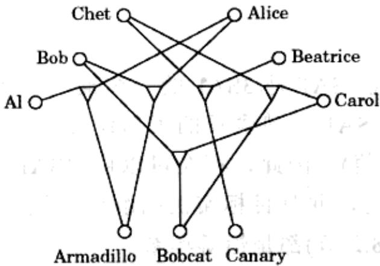

$$
\mathbf {A} = \left( \begin{array}{c c c c c} 1 & 0 & 0 & 0 & 0 \\ 0 & 0 & 0 & 1 & 1 \\ 0 & 1 & 1 & 0 & 0 \\ 1 & 0 & 0 & 0 & 1 \\ 0 & 1 & 0 & 0 & 0 \\ 0 & 0 & 1 & 1 & 0 \\ 1 & 0 & 0 & 0 & 1 \\ 0 & 0 & 1 & 1 & 0 \\ 0 & 1 & 0 & 0 & 0 \end{array} \right)
$$

A 中的 5 列对应于 5 个三元组,9 行则分别对应于 Al、Bob、Chet、Alice、Beatrice、Carol、Armadillo、Bobcat 和 Canary。

两个实例的解可以直接进行相互转换，在此不再赘述。

## ZOE→子集和

这是一个发生在ILP的两个特例间的归约：一个包含很多方程但是系数都为0-1，另一个只有一个方程却允许任意整数系数。这个归约的灵感来自于一个简单却闪烁着当今科学技术光辉的思想：0-1向量可以用于数字编码！

例如，给定如下的 ZOE 实例：

$$
\mathbf {A} = \left( \begin{array}{c c c c} 1 & 0 & 0 & 0 \\ 0 & 0 & 0 & 1 \\ 0 & 1 & 1 & 0 \\ 1 & 0 & 0 & 0 \\ 0 & 1 & 0 & 0 \end{array} \right)
$$

我们要求 A 的一个列集合，将其相加恰好为值全部为 1 的向量。如果我们将列看成是二进制整数(自上向下地读)，则我们所求的就是整数 18、5、4、8 的一个子集，其中的数相加等于二进制数 $11111_{2}=31$ 。这恰好是子集和问题的一个实例。归约就这样完成了！

不过还存在一个细节问题，一个通常会导致0-1向量和二进制整数间紧密联系被破坏的操作——进位。由于进位的原因，即使对应向量的和不是(1,1,1,1,1)，几个5-比特二进制整数相加也可能等于31(例如， $5+6+20=31$ ，用二进制表示为， $00101_{2}+00110_{2}+10100_{2}=11111_{2}$ )。但是这很容易解决：将列向量视为不是以2为基数的整数，而是以 $n+1$ ——列号加1为基数的。这样一来，因为最多有n个整数相加，且它们的各位都是0和1，将不会发生进位，这样我们的归约就没有任何问题了。

## ZOE→ILP

3SAT 是 SAT 的一个特例——或者说，SAT 是 3SAT 的一个推广。所谓特例是指 3SAT 的实例也都是 SAT 的实例(只不过 SAT 不包含长的子句)，且对于两个问题其解的定义完全相同(即满足所有子句的赋值)。因此，存在可以由 3SAT 迁移到 SAT 的赋值，其对问题输入不需做任何的改变，并且目标实例的解也无须进行转换。换句话说，归约中的函数 f 和 h(参考本书 8.2 节)都是恒等函数。

这看起来很平常，但却是证明 NP-完全性的一种非常常见和有效的方法：只需说明该问题是某个已知 NP-完全问题的推广即可。举例来说，集合覆盖问题是顶点覆盖问题的一个推广(同样地，3D 匹配也是)，因此它是 NP-完全的。更多的这类例子请参见习题 8.10。

说明一个问题是另一个问题的特例常常并不需要很多的工作。从 ZOE 到 ILP 的例子也是这样。在 ILP 中，对于给定的矩阵 A 和向量 b，我们要求一个满足 Ax ≤ b 的整数向量 x。为了将 ZOE 的一个实例也写成这种形式，我们只需要将 ZOE 中的每个约束方程重写为两个不等式(参见 7.1.4 节的变换)，然后对于每个变量 $x_{i}$ ，增加新的约束 $x_{i} \leqslant 1$ 和 $-x_{i} \leqslant 0$ 。

## ZOE→Rudrata 环路

在 Rudrata 环路问题中我们要求图中的一个环路，使其恰好经过每个顶点一次。证明其为 NP-完全的需要分为两步：首先我们将 ZOE 归约为 Rudrata 环路的一个推广问题，所谓含有成对边的 Rudrata 环路(RUDRATA CYCLE WITH PAIRED EDGES)问题，然后我们去除它的附加特征，将其归约为一个普通的 Rudrata 环路问题。

含有成对边的 Rudrata 环路实例给定一个图 $G = (V, E)$ 和一个边对集合 $C \subseteq E \times E$ 。我们要求一个满足以下条件的环：(1) 经过所有的顶点一次，这也是 Rudrata 环路所要求的；(2) 对 $C$ 中的每个边对 $(e, e')$ ，环路恰好使用了其中的一条边——要么 $e$ ，要么 $e'$ 。在图 8-10 的简单示例中，加粗的线条标出了一个解。请注意在此我们允许两个节点间存在两条或更多的平行边——一个大多数图都不具备的特征——原因在于同一条边的不同拷贝可以通过该边与其它边的相互配对而有所区别。

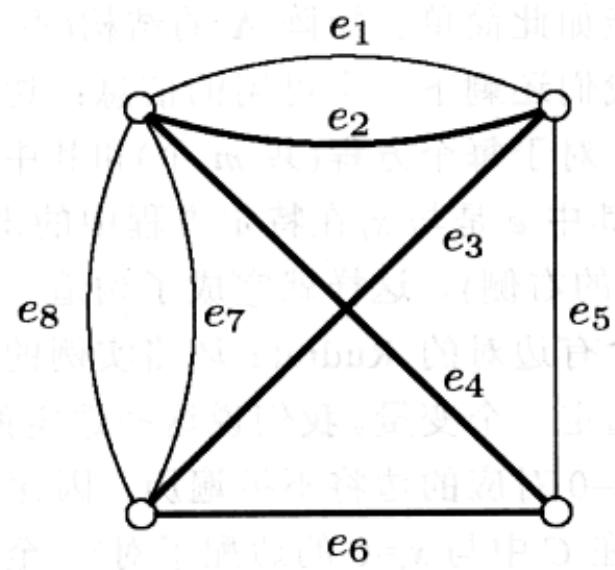  
图 8-10 包含成对边的 Rudrata 环路： $C=\{(e_{1}, e_{3}), (e_{5}, e_{6}), (e_{4}, e_{5}), (e_{3}, e_{7}), (e_{3}, e_{8})\}$

现在考虑由 ZOE 到含有成对边的 Rudrata 环路问题的归约。给定一个 ZOE 实例，Ax=1(其中 A 是一个 $m \times n$ 的 0-1 值矩阵，描述了 m 个方程和 n 个变量)，我们为其所创建的图结构非常简单，如图 8-11：一个连接了 $m+n$ 个平行边集合的环。对每个变量 $x_{i}$ ，我们创建两条平行边(对应于 $x_{i}=1$ 和 $x_{i}=0$ )。对包含 k 个变量的方程 $x_{j_{1}} + \ldots + x_{j_{k}} = 1$ ，我们创建 k 条平行边，每条边对应于方程的一个变量。这就是图的全部了。很显然，该图的 Rudrata 环路需要依次遍历 $m+n$ 个平行边集，其中恰好从每个边集中选择一条边。按照这种方式，环路为每个变量“选择”了一个值——0 或 1，并为每个方程选择了一个出现在其中的变量。

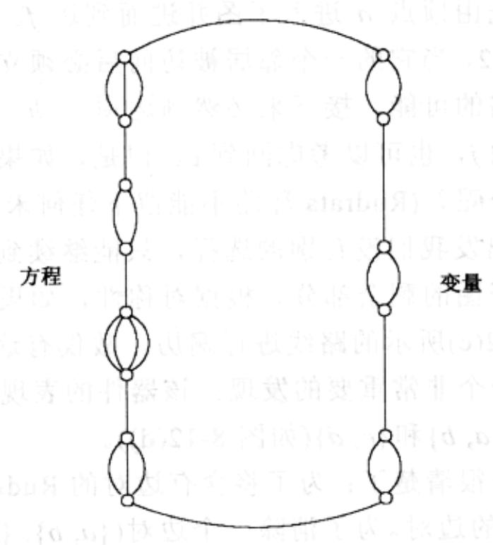  
图 8-11 将 ZOE 归约为含有成对边的 Rudrata 环路

当然，整个归约不可能如此简单。矩阵 A 的结构(不仅是它的维数)必须要在新问题中有所反映，而现在我们还剩下一个可用的信息：边对集合 C，环路应该恰好从每个边对中选择一条边。对于每个方程(共 m 个)和其中的所有变量 $x_{i}$ ，我们在 C 中加入如下的边对 $(e, e')$ ，其中 e 是与 $x_{i}$ 在特定方程中的出现对应的边(图 8-11 的左侧)， $e'$ 是 $x_{i}=0$ 对应的边(图的右侧)。这样就完成了构造。

如前所述，以上这一含有边对的Rudrata环路实例的解，将在为每个变量选定一个值的同时为每个方程选定一个变量。我们说这些选定的值恰好就是原ZOE实例的一个解。如果 $x_{i} = 1$ ，则 $x_{i} = 0$ 对应的边将不被遍历，因此所有方程一侧与 $x_{i}$ 有关的边都将被遍历(因为它们都在 $C$ 中与 $x_{i} = 0$ 的边配了对)。至此每个方程中恰好有一个变量取值为1——这也就是说所有的方程都满足了。反向的过程也是很直截了当的：从ZOE实例的一个解很容易得到一个对应的Rudrata环路。

## 去除边对：

我们已经有了由 ZOE 到含有边对的 Rudrata 环路的归约，但是我们真正的兴趣还是 Rudrata 环路，它可以说是含有边对问题的一个特例——其边对集合 C 为空集。为了实现我们的目标，和往常一样，要想办法去除那些不需要的特征——边对。

考虑图8-12中的图，假设其为某个更大的图 $G$ 的一部分，并且假设只有四个节点 $a, b, c, d$ 与剩余部分的图相连。我们说这个图具有如下的重要性质： $G$ 的任意Rudrata环路必然采用图8.12(b)和(c)两者之一的方式(加粗的线条)遍历该子图。原因如下：假设环路首先由顶点 $a$ 进入子图并进而到达 $f$ 。于是它必然继续到达顶点 $g$ 。这是因为 $g$ 的度为2，当它的一个邻居被访问后必须立即访问它——否则将再也没有把该顶点纳入环路的可能。接下来必然到达顶点 $h$ ，在此我们似乎面临一个选择。我们可以继续到达 $j$ ，也可以考虑回到 $c$ 。但是，如果我们采用后一选择，该如何访问子图的剩余部分呢？(Rudrata环路不能留下任何未被访问的顶点。)因此这是不可能的，于是从 $h$ 出发我们没有别的选择，只能继续到达 $j$ 并由它继续按照图8-12(b)所示的路线访问子图的剩余部分。根据对称性，如果Rudrata环由 $c$ 进入该子图，它必然按照图8-12(c)所示的路线进行遍历。故仅有这两种可能的路线。

这一性质带给我们一个非常重要的发现：该器件的表现非常类似于含有边对的Rudrata环路中的两条边 $\{a, b\}$ 和 $\{c, d\}$ (如图8-12(d))。

归约剩余的部分已经很清楚了：为了将含有边对的Rudrata环路归约为Rudrata环路，我们逐个考虑 $C$ 中的边对。为了消除一个边对 $(\{a, b\}, \{c, d\})$ ，我们用图8-12(a)中的器件替代原来的两条边。对于 $C$ 中其它包含 $\{a, b\}$ 的边对，使用一条新边 $\{a, f\}$ 进行替代，其中 $f$ 来自于器件：从现在开始，经过 $\{a, f\}$ 的遍历意味着原图中的边 $\{a, b\}$ 被遍历。类似地，用 $\{c, h\}$ 替代 $\{c, d\}$ 。经过 $|C|$ 次这样的替代（由于每次替代仅在图中增加 12 个顶点，故替代操作仅需多项式时间），我们最终完成了任务。最后得到的图中的 Rudrata 环路与包含 $C$ 相关约束的原图的 Rudrata 环路是一一对应的。

(a)  
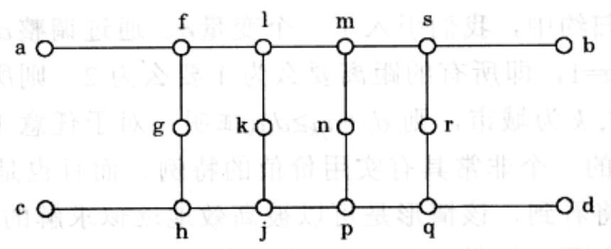

(b)  
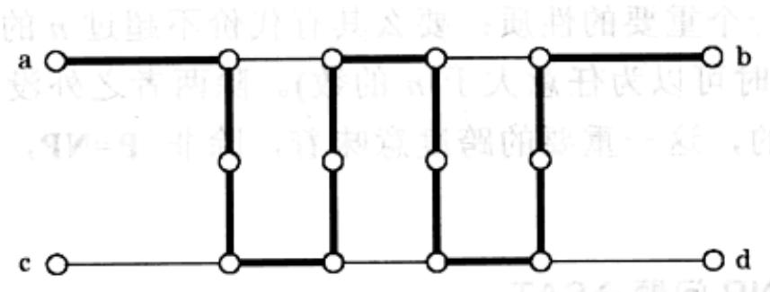

(c)

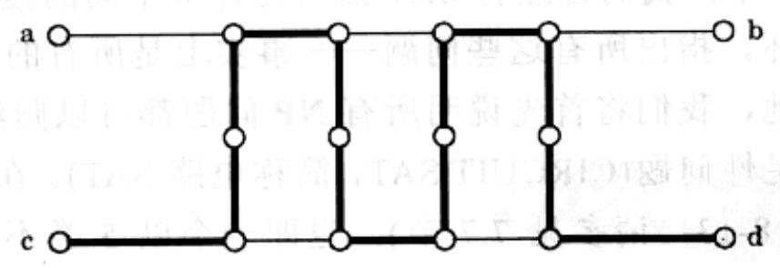

(d)  
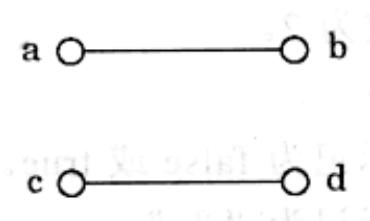  
图 8-12 表现出配对边行为的器件

$$
C = \{\left(\{a, b \}, \{c, d \}\right) \}
$$

## Rudrata 环路→TSP

给定一个图 $G = (V, E)$ ，构造如下的TSP实例：城市集合等同于 $V$ ，如果 $\{u, v\}$ 为 $G$ 中的一条边，则令城市 $\pmb{u}$ 和 $\nu$ 间的距离为1，否则为 $1 + \alpha$ ，其中 $\alpha > 1$ 待定。TSP实例的预算等于节点数量 $|V|$ 。

容易看到，如果 $G$ 有一个Rudrata环路，则该环路同样也是TSP实例在预算内的一条旅行路线。反之，如果 $G$ 没有Rudrata环路，则无解：最经济的TSP路线代价至少为 $n + \alpha$ (路线中至少包含了一条较长边 $1 + \alpha$ ，且包含其余 $n - 1$ 个节点的路径的最小长度为 $n - 1$ )。如此就将Rudrata环路归约到了TSP。

在该归约中，我们引入了一个变量 $\alpha$ 。通过调整 $\alpha$ 的值，可以得到两个有趣的结果：如果 $\alpha = 1$ ，即所有的距离要么为1要么为2，则所有的距离值满足三角不等式，即：若 $i,j,k$ 为城市，则 $d_{ij} + d_{jk}\geq d_{ik}$ （证明：对于任意 $1\leqslant a,b,c\leqslant 2$ ，都有 $a + b\geqslant c)$ 。这是TSP的一个非常具有实用价值的特例，而且也是一个相对简单的情形。在第9章中我们将看到，该情形是可以被高效地近似求解的。

另一方面，如果 $\alpha$ 是一个很大的数，则最终的TSP将不再满足三角不等式，但却具有另一个重要的性质：要么其有代价不超过 $n$ 的解，要么其所有解的代价至少为 $n + \alpha$ (此时可以为任意大于 $n$ 的数)。除两者之外没有其它可能！如我们在第9章中将看到的，这一重要的跨度意味着，除非 $\mathbf{P} = \mathbf{NP}$ ，否则该情形将不存在任何近似算法。

## 任意 NP 问题→SAT

图 8-7 中，我们曾经将 SAT 归约为许多不同的搜索问题。现在我们将完成整个归约的循环，指出所有这些问题——事实上是所有的 NP 问题都可以归约为 SAT。

特别地，我们将首先说明所有 NP 问题都可以归约为 SAT 的一个推广，所谓的电路可满足性问题(CIRCUIT SAT，简称电路 SAT)。在电路 SAT 中，给定一个(布尔)电路(如图 8-13，请参见 7.7 节)，也即一个以 5 类不同门电路为节点的有向无环图(dag):

\- 与(AND)门和或(OR)门度数为2。

\- 非(NOT)门度数为1。

\- 已知输入门没有进入边，标记为 false 或 true。

\- 未知输入门没有进入边，标记为“？”。

最后，dag 的一个汇点被标注为输出门。

给定对未知输入的一个赋值，我们可以根据布尔逻辑(例如 faslev=true=true)按照电路的逻辑次序对其求值，并最终在输出门上读出结果。这是电路关于特定输入赋值的值。举例来说，图 8-13 在 true、false、true 的赋值(由左至右)下求值结果为 false。

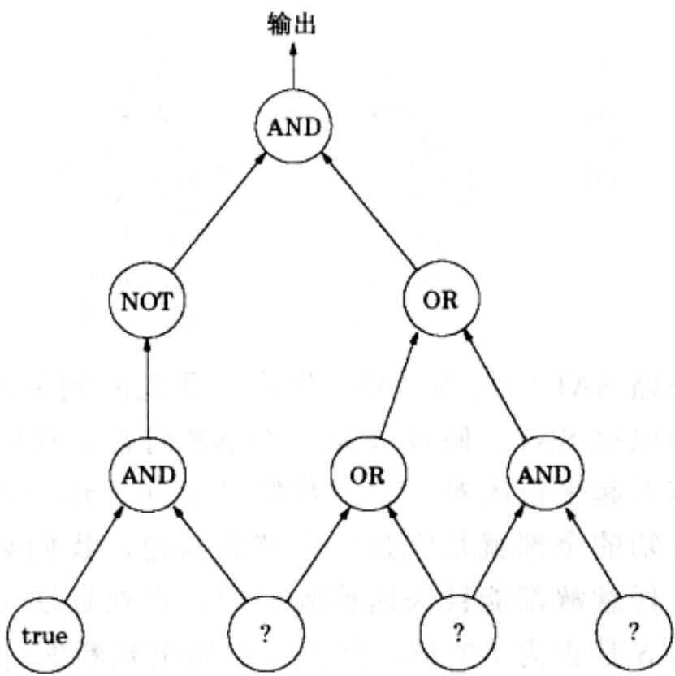  
图 8-13 电路 SAT 的一个实例

于是电路SAT就成为如下的搜索问题：给定一个电路，求其中未知输入的一个可满足赋值，使得输出门上的值为true，或者报告这样的赋值不存在。举例来说，对图8-13的电路将返回(true, false, true)，因为用这些值(从左至右地)替代图中的未知赋值，最后的输出将是true。

电路 SAT 是 SAT 的一个推广。为了说明这一点，只需注意 SAT 所要求的是一类具有较简单结构电路的可满足赋值，这类电路的特点是：在其顶端，一组与(AND)操作将所有子句联合起来，最终以这组与操作的联合结果为输出。每个子句都是其中文字的或(OR)操作。并且每个文字要么是一个未知的输入门，要么是其否定(NOT)。且其中不包含任何已知输入门。

从另一个方面来看，电路SAT也可以被归约为SAT。我们可以将电路重写为合取范式(子句的与(AND)操作)，具体来说：为电路中的每个门生成一个变量 $g$ ，并利用如下的子句模仿门的效果：

(您能否看出这些子句确实产生了我们所期望的效果？)作为结束，如果 g 是一个输出门，我们通过加入子句(g)强制其为 true。最后得到的 SAT 实例等价于所给的电路 SAT 实例：该合取范式的可满足赋值与电路的满足赋值是一一对应的。

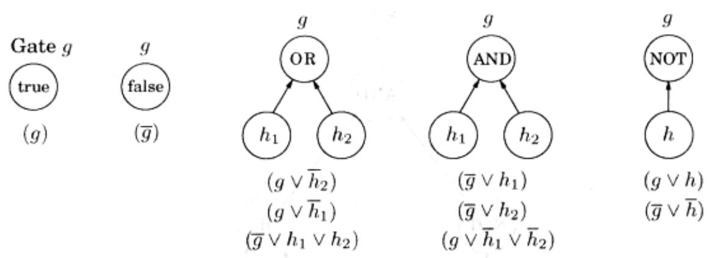

了解了如何将电路SAT归约为SAT，现在让我们回到主要的工作，证明所有的搜索问题都能归约为电路SAT。假设 $A$ 是一个NP问题。我们必须找到由 $A$ 到电路SAT的一个归约。这看起来很困难，因为我们对 $A$ 几乎还一无所知！

关于 $A$ ，我们所知的全部就是它是一个搜索问题，我们必须利用这一点。搜索问题的主要特征是其任意解都能被快速检验，即：存在算法 $C$ ，以问题实例 $I$ 和可能解 $S$ 为输入，判断 $S$ 是否为 $I$ 的解。此外， $C$ 做出判断的时间关于 $I$ 的长度(我们可以假设 $S$ 本身是用二进制串表示的，且我们知道该串的长度关于 $I$ 的长度是多项式规模的)为多项式规模的。

回顾 7.7 节的结论，任意多项式算法都可以被表示为一个电路，其输入门将用于编码算法的输入。对任意长度(输入的比特数)的输入，电路可以扩展出适当数量的输入门，但电路中门的总数关于输入数量是多项式规模的。如果问题的多项式时间算法给出的是一个是或否的答案(类似如下情形的 C: “S 所编码信息的是否为 I 所编码实例的解？”)，则该答案将由输出门给出。

总结一下，给定问题 $A$ 的一个实例 $I$ ，我们可以在多项式时间内构造一个电路，其已知输入为 $I$ 对应的比特，未知输入为 $S$ 对应的比特，则其最终输出为 true 当且仅当未知输入对应的 $S$ 为 $I$ 的解。换句话说，电路未知输入的可满足赋值与 $A$ 的实例 $I$ 的解是一一对应的。归约到此结束。

<Knowledge title="专栏: 不可解的问题">

一个 NP-完全问题总可以用某个算法求解——但该算法是指数时间的。这其实还不算什么，因为有些看起来完全规范的计算问题甚至根本不存在任何算法！此类问题中一个著名的例子来自 SAT 的一个算术版本。给定一个包含多个变量的多项式方程，例如

$$
x ^ {3} y z + 2 y ^ {4} z ^ {2} - 7 x y ^ {5} z = 6,
$$

```txt
function paradox(z: file)
1: if terminates(z, z) goto 1
```

是否存在使其成立的整数值 $x, y, z$ ? 该问题没有求解算法。是的，没有任何算法，无论是多项式的、指数的、还是加倍指数的、甚至更糟糕的，都没有！这样的问题被称为是不可解的。

第一个不可解问题 1936 年由 Alan M. Turing 发现，当时他还是英国剑桥大学数学系的一名学生。当 Turing 提出该问题时，世界上还没有任何计算机和编程语言(事实上，可以说正是 Turing 的智慧造就了它们的诞生)。不过今天我们已经可以用熟悉的词汇来叙述它了。

假设有一个用您所喜欢的编程语言写的程序以及它的某个输入。从该输入开始，这个程序的运行会停止吗？这是个非常合理的问题。如果能找到一个如下的算法，我们中的许多人都会感到欣喜若狂，不妨称该算法为 terminates(p, x)，它以一个包含程序 p 的文件和一个包含数据 x 的文件为输入，经过一段时间的运行后，最终将告诉我们开始于输入 x 的程序 p 是否会停止。

如果要您来写这个 terminates 呢？(如果您此前对此问题并不了解，我认为您有必要花些时间稍作思考，以此来体会一下创造这个所谓的“通用无限循环探测器”的艰难。)

不过，您一定写不出来。因为这样的算法根本不存在！

以下是有关的证明：假设我们确实有一个程序 terminates(p, x)。则我们可以用它来编写一个如下的程序：

注意到 paradox 的特点：它能终止的充要条件是当程序 z 以自身代码为输入时不会终止。

您应该已经发现了问题。如果我们将这个程序保存为文件 paradox，然后再运行 paradox 会怎样呢？这次的运行会终止吗？不会吗？答案是二者都不是。我们关于存在程序停止判定算法的假设导致了矛盾出现，因此我们说这一程序停止判定问题是不可解的。

顺便说一句，以上这些结果告诉了我们一件重要的事情，即：程序设计永远不可能完全自动化，它始终需要依赖于知识、天赋和灵感。我们已经知道了无法利用算法判断程序中是否存在无限循环。那么您能利用算法判断一个程序是否会发生缓冲区溢出吗？您能利用“停机问题”的不可解性证明这一问题也是不可解的吗？

</Knowledge>
