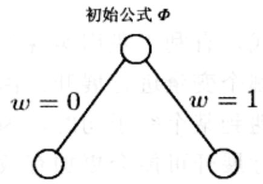
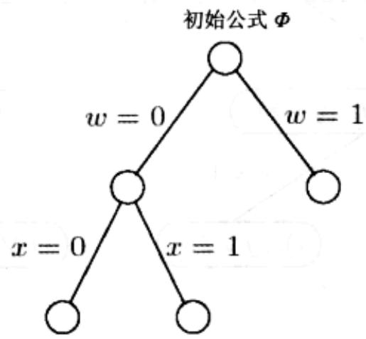
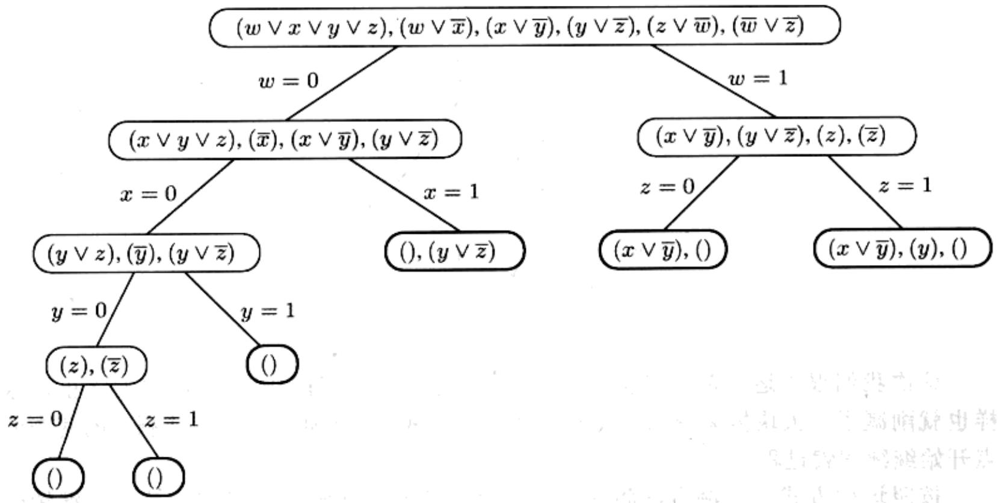
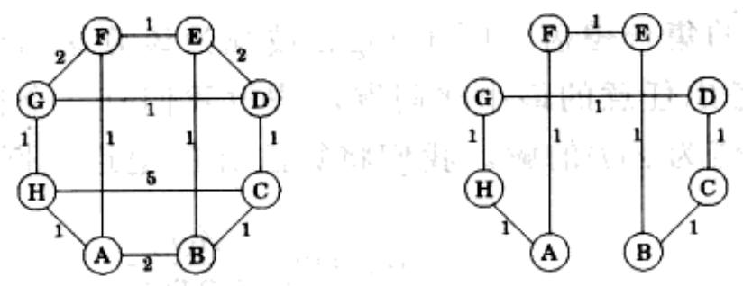
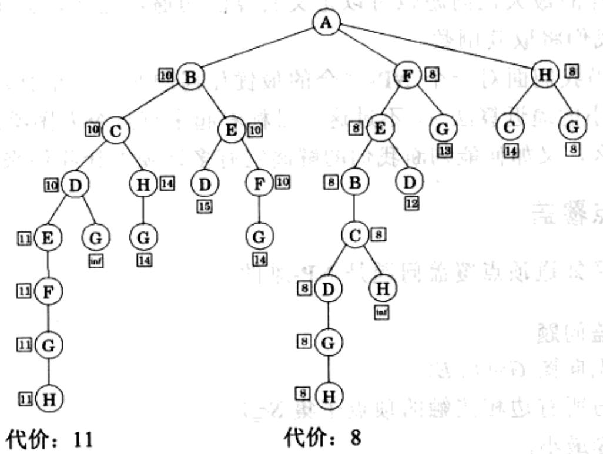

import Guide from '@/components/Guide.astro';
import Knowledge from '@/components/Knowledge.astro';
import Example from '@/components/Example.astro';
import Analysis from '@/components/Analysis.astro';
import Solution from '@/components/Solution.astro';
import Variant from '@/components/Variant.astro';
import Note from '@/components/Note.astro';
import Block from '@/components/Block.astro';
import Method from '@/components/Method.astro';
import Exercise from '@/components/Exercise.astro';
import Algorithm from '@/components/Algorithm.astro';

## 第9章 NP-完全问题的处理

假定您是一个经验丰富的项目组中的新人。您现在要为一个包含图和数字的看起来颇为简单的问题编写代码。您打算怎么做呢？

幸运的话，您所面对的可能正是我们在本书中已经解决了的带边权重的众多图论问题之一(例如最短路径问题、最小生成树问题、最大流问题，等等)。即便如此，将这些问题从其所处的环境(它常常被现实中错综复杂的情况弄得有些扑朔迷离)，中识别出来，也需要一定的经验和技巧。很多情况下，您可能需要将您的问题归约为以上这些幸运的问题之一——或者，干脆使用动态规划或线性规划来求解它。

但是以上这些可能都不会发生。由于人们针对搜索问题研究成果的匮乏，因此这个领域可谓黯淡。其中的少数光亮——一些精彩机智的算法思想常常仅能照亮各自周围的小片领地(一个类比，泛指能够归约为该算法所能解决的问题。相对而言，线性规划和动态规划所“照耀”的范围是相当大的)。余下则是大片的“黑暗”——NP-完全问题。您能做些什么呢？

您可以从证明问题的 NP-完全性开始。这常常只需要一个基于推广的证明(参见8.3节的 ZOE 到 ILP 的归约和习题 8.10); 有时则是一个类似由 3SAT 到 ZOE 的简单归约。听起来就像是个理论习题，但如果您成功了，将会获得非常实际的回报：您在项目组中的地位将获得提升，您将不再是个需要别人帮助的毛头小孩，您此刻更像是一个无坚不摧的高贵骑士。

但是，证明了问题的 NP-完全性，并没有最终解决问题。您面临的真正挑战是，下一步该做些什么？

这正是本章的主题，同时这也是当代许多非常重要的算法和复杂性研究的出发点。NP-完全性并不是一张“死亡证书”，恰恰相反，它应该说是接下来一段奇异旅程的起点。

在问题的 NP-完全性证明中，您可能构造了一些复杂而奇特的图，它们看起来和您从应用中得到的那些完全不同。举例来说，SAT 问题虽然是 NP-完全的，但对于 HORN 公式的 SAT 问题(SAT 问题在逻辑规划中的实例)，仍然能够高效地求得其可满足赋值(参见 5.3 节)。或者，假定从应用中抽象得到的图为树，则对很多 NP-完全问题例如独立集问题，常常可以用动态规划方法在线性时间内对其进行求解(参见 6.7 节)。

然而，这条路也并不总是可行。例如，我们知道3SAT问题是NP-完全的；包括独立集问题在内的众多NP-完全问题，对于平面图(即指那些可以在平面上画出且没有边交叉的图)都未找到有效的解决途径。此外，您常常也许根本无法清晰刻画应用问题实例。反而您将不得不依赖于某种形式的智能指数搜索(intelligent exponential search)，比如回溯(backtracking)和分支定界。虽然在最坏情况下这些方法完成搜索也需要指数时间，但是如果设计得当，常常能使它们对求解特定实例变得十分高效。我们将在9.1节讨论这些方法。

或者，您可以尝试为 NP-完全的最优化问题写一个并非最优却“相去不远”的算法。例如，在 5.4 节中，我们发现贪心算法总是能产生一个规模不超过最优覆盖 $\log n$ 倍的覆盖集。类似这样的算法被称为近似算法。9.2 节中我们将看到，对于许多 NP-完全的最优化问题都存在这样的算法，而这些算法称得上是所有算法中最精妙和复杂的一类。NP 完全性理论可以指导近似算法中对问题最优解的逼近过程，通过对一些问题的近似算法进行研究，我们将发现近似算法的解与最优解的近似程度将有更加严格的限制——除非 P=NP。

本章的最后，将介绍启发式方法，一种对于运行时间和逼近程度都不做保证的方法。用启发式方法解决问题将更多地依赖于灵感和直觉，加之对应用本身的深刻理解、精心设计的实验过程和对物理学或生物学原理的洞察力。我们将在9.3节中看到启发式方法的一些常用类型。

## 9.1 智能穷举搜索

## 9.1.1 回溯

回溯的原理基于以下经验，即常常可以通过观察解的某一部分来判定解本身不可行。例如，若SAT问题的一个实例包含子句 $(x_{1} \vee x_{2})$ ，则所有 $x_{1} = x_{2} = 0$ （赋值为false）的赋值都可以被排除。通过尝试不同的变量赋值，快速检查和排除这类不可行的部分赋值，我们将能够使搜索空间规模缩减到原来的四分之一。这是一个有前途的方向，但是该如何更为系统地利用它呢？

以下是具体的做法。考虑由一组子句构成的布尔公式 $\Phi(w,x,y,z)$

$$
(w \vee x \vee y \vee z), (w \vee \overline {{z}}), (x \vee \overline {{y}}), (y \vee \overline {{z}}), (z \vee \overline {{w}}), (\overline {{w}} \vee \overline {{z}})
$$

接下来我们将循序渐进地生成一个部分解树。首先，选择任意变量作为树分枝的起点，不妨为 $w$ :

在 $\Phi$ 中插入 $w = 0$ 和 $w = 1$ 。我们发现没有任何子句被破坏(变得无法满足)，因此，这两个部分赋值都不能立即被排除。接下来继续进行分枝。我们可以任意选择一个变量，然后在两个可用节点之一进行展开。比方说：

这次我们很幸运。部分赋值 $w = 0$ ， $x = 1$ 与子句 $(w\vee \overline{x})$ 冲突，因此将被终止，这样也就削减了一大块搜索空间。我们通过回溯来离开这个死胡同，并从剩下的两个节点开始继续搜索过程。

按照这种方式，回溯方法将遍历整个赋值空间，在输出不确定的节点上继续生成分枝，直到遇到可满足的赋值时停止。

在布尔可满足性问题中，树的每个节点都可以用一个部分赋值或插入这些值后剩余的子句来描述。例如，如果 $w = 0$ 且 $x = 0$ ，则所有包含 $\overline{w}$ 或 $\overline{x}$ 的子句将满足，而在包含 $w$ 或 $x$ 的子句中，对应的文字由于不满足将被删除。于是剩下：

$$
(y \vee z), (\overline {{y}}), (y \vee \overline {{z}})
$$

类似地，若 $w = 0$ 且 $x = 1$ ，将剩下

$$
0, (y \vee \overline {{z}})
$$

其中空子句“()”意为不可满足。因此，在搜索树中对应于部分赋值的节点，本身即为一个SAT子问题。

以上这两种不同的描述方式，有利于我们实现以下两个经常重复出现的决策：继续展开哪个子问题，以及用哪个变量进行展开。由于回溯的好处在于其削减搜索空间的能力，而这仅仅发生在遇到某个空子句时，因此选择展开包含最小子句的子问题，同时选择其中的变量进行展开可能会更加有效。如果这个子句恰巧为一个独元子句(singleton)，则至少会有一个结果分枝将被终止。(如果存在两个以上地位相当的子问题，合理的策略是选择在树中层次较低的一个进行展开，因为它可能更接近某个可满足赋值)。图9-1是我们此前例子对应的结果。

  
图 9-1 回溯显示 $\Phi$ 是不可满足的

说得更抽象些，回溯算法需要一个检验过程，用于检视子问题并快速给出以下三种输出之一。

1. 失败：子问题无解。

2. 成功：找到了子问题的一个解。

3. 不确定。

在SAT中，当测试过程中出现一个空子句时返回失败，当没有子句时返回成功，否则返回不确定。因此，回溯可以表示为如下过程：

Start with some problem $P_0$
Let $S = \{P_0\}$, the set of active subproblems
Repeat while $S$ is nonempty:
choose a subproblem $P \in S$ and remove it from $S$
expand it into smaller subproblems $P_1, P_2, \ldots, P_k$
For each $P_i$:
If test($P_i$) succeeds: halt and announce this solution
If test($P_i$) fails: discard $P_i$
Otherwise: add $P_i$ to $S$
Announce that there is no solution

对于SAT，以上的choose过程选择一个待展开的子句，expand选取该子句中的一个变量作为展开参数。具体的选取策略参见我们此前的讨论。

有了正确的 test、expand 和 choose 过程，回溯机制将能在实际中非常有效地工作。我们所介绍的 SAT 的回溯算法是许多成功的可满足性问题程序的基础。回溯的另一个重要标志是：给定一个 2SAT 实例，如果它存在一个可满足赋值，则总可以利用回溯在多项式时间内找到它(参见习题 9.1)!

## 9.1.2 分支定界

同样的原理可以从SAT这样的搜索问题推广到最优化问题。具体来说，假设我们有一个最小化问题——最大化问题可以采用相同的模式。

和前面一样，我们将处理一些部分解，它们每个都代表了某个子问题。得到完整解的最好(最低代价)途径是什么呢？经验告诉我们仍然需要一个削减部分解的依据，而除此之外在我们的方法中不再有其它提高效率的途径。为了否定一个子问题，我们必须确定其代价超过了某个我们已经遇到过的解。但是我们并不了解它的确切代价，并且对该值通常也没有高效的计算方法。因此，我们转而使用该代价的一个能够快速计算的下界作为替代。

Start with some problem $P_0$
Let $S = \{P_0\}$, the set of active subproblems
bestsofar = $\infty$
Repeat while $S$ is nonempty:
    choose a subproblem $P \in S$ and remove
    it from $S$
    expand it into smaller subproblems $P_1, P_2, \ldots, P_k$
    For each $P_i$:
    If $P_i$ is a complete solution: update bestsofar
    else if lowerbound $(P_i) <$ bestsofar: add $P_i$ to $S$
return bestsofar

来看一下该算法在旅行商问题中是如何工作的。这里给定一个图 $G = (V, E)$ ，边长 $d_e > 0$ 。该问题的部分解是顶点 $a$ 经过顶点集 $S \subseteq V$ 到 $b$ 的一条简单路径，这里的 $S$ 包含端点 $a$ 和 $b$ 。我们将该部分解记为三元组 $[a, S, b]$ ——事实上，在该算法中 $a$ 是固定不变的。对应的子问题需要求完成旅行的最优线路，也即，一条由 $b$ 经过中间节点 $V - S$ 到 $a$ 的最经济的补充路径。此外，对于任意选定的 $a \in V$ ，最初的问题都形如 $[a, \{a\}, a]$ 。

在分支定界算法的每一步中，我们将为部分解 $[a, S, b]$ 增加一条新的边 $(b, x)$ ，其中 $x \in V - S$ 。因此，我们共有 $|V - S|$ 个具体的选择，其中的每一个都将导出形如 $[a, S \cup \{x\}, x]$ 的子问题。

如何才能确定完成部分旅行路线 $[a, S, b]$ 的代价下界呢？就此问题已经有很多精妙而复杂的方法，我们来看其中一个相对简单的。旅行线路剩余的部分包含了一条经过 $V - S$ 的路径，外加由 $a$ 和 $b$ 到 $V - S$ 的边。因此，其代价至少是以下几部分边权重的和：

## 1. $a$ 到 $V - S$ 的最轻边。

2. $b$ 到 $V - S$ 的最轻边。

3. V-S 的最小生成树。

(您知道是为什么吗？)利用最小生成树算法可以快速求得该下界。图 9-2 是一个示例的运行过程：树的每个节点代表分支定界过程在某阶段所考虑的一个部分旅行路线(即：由出发点到该节点的路径)。请注意其中仅仅考虑了 28 个部分解，而不是穷举搜索将遇到的 7!=5,040 个。

(a)  

(b)

  
图9-2 (a)一个图及其中的旅行商最佳路线。(b)分支定界搜索树，从左至右。方盒中的数字为代价的下界
