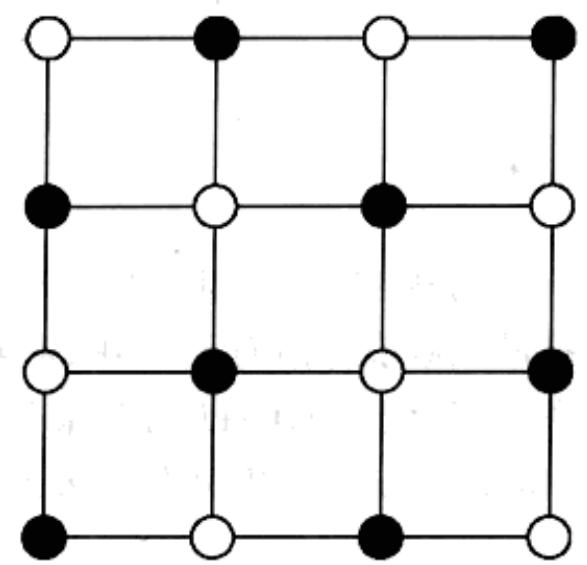
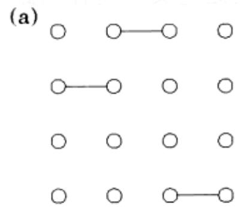
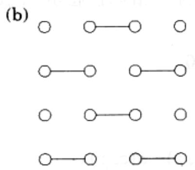
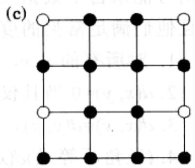
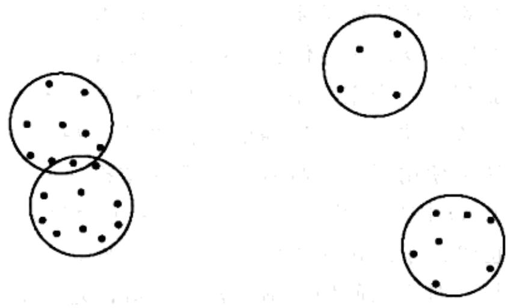
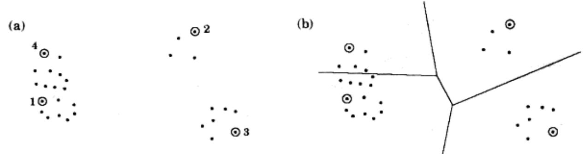
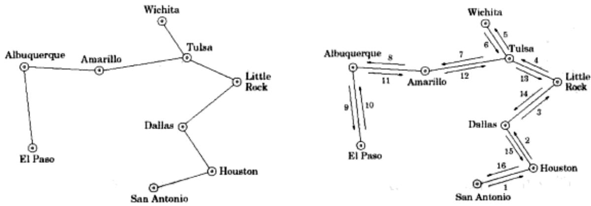
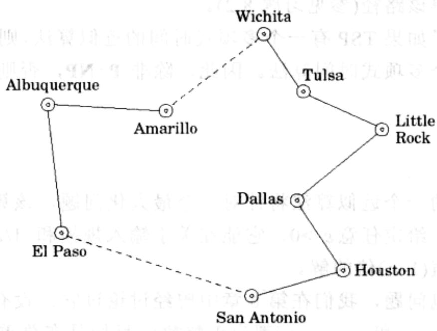

import Guide from '@/components/Guide.astro';
import Knowledge from '@/components/Knowledge.astro';
import Example from '@/components/Example.astro';
import Analysis from '@/components/Analysis.astro';
import Solution from '@/components/Solution.astro';
import Variant from '@/components/Variant.astro';
import Note from '@/components/Note.astro';
import Block from '@/components/Block.astro';
import Method from '@/components/Method.astro';
import Exercise from '@/components/Exercise.astro';
import Algorithm from '@/components/Algorithm.astro';

## 9.2 近似算法

在最优化问题中，给定一个问题实例 $I$ ，我们要求其最优解——对于独立集这样的最大化问题最优解意味着最大收获，而对于TSP这样的最小化问题最优解则意味着最小代价。对于每个实例 $I$ ，我们记 $\mathrm{OPT}(I)$ 为其最优解对应的目标值(收益或代价)。出于数学上的便利(这样做不会与实际情况有很大差异)，我们假设 $\mathrm{OPT}(I)$ 总是一个正整数。

在5.4节中，我们已经看到了近似算法的一个著名例子：集合覆盖问题的贪心算法。对于规模为 $n$ 的实例 $I$ ，我们证明了该算法能够确保快速得到一个规模不超过 $\mathrm{OPT}(I)\log n$ 倍的集合覆盖。因子 $\log n$ 被视为该算法逼近程度的保证。

更一般地，考虑任意的最小化问题。假设我们有一个针对该问题的算法 $A$ ，给定实例 $I$ ， $A$ 返回值为 $A(I)$ 的解。我们将算法 $A$ 的逼近比例定义为

$$
\alpha_ {A} = \max _ {I} \frac {A (I)}{\operatorname{OPT} (I)}
$$

换句话说， $\alpha_{A}$ 通过比值度量了 $A$ 在最坏情况下解偏离最优的程度。类似地，对于独立集这样的最大化问题也可以定义其算法的逼近比例，只不过由于所得到的数值超过1，我们将取其倒数。

于是，当我们面对一个 NP-完全的最优化问题时，一个合理的目标就是为其寻找 $\alpha_{A}$ 尽可能小的逼近算法 A。不过这一目标看起来有点令人困惑：如果我们都不知道最优解是什么，又如何能判断我们的解离它有多远呢？让我们来看一个简单的例子。

## 9.2.1 顶点覆盖

我们已经知道顶点覆盖问题是 NP-难的。

顶点覆盖问题

输入：无向图 $G=(V,E)$ 。

输出：与所有边相接触的顶点子集 $S \subseteq V$ 。

目标： $|S|$ 最小。

图9-3是一个例子。

  
图 9-3 图中的最优顶点覆盖(标注阴影的)的规模为 8

## $\therefore {S}_{\Delta APQ} = {S}_{\Delta AQP} + {S}_{\Delta QPQ}$

由于顶点覆盖问题是集合覆盖问题的特例，由第5章可知，利用贪心算法可以在 $O(\log n)$ 的范围内逼近其最优解。具体只需重复地删除度数最高的顶点并将其加入顶点覆盖即可。此外，对于特定的图，利用贪心算法恰好可以得到顶点数为最优解规模 $\log n$ 倍的顶点覆盖。

顶点覆盖的一个更好的近似算法是基于匹配(matching)概念构造的。所谓匹配就是没有共同端点的边组成的集合(如图 9-4 所示)。当没有更多的边可以加入时，匹配达到了最大。最大匹配能够帮助我们找到比较好的顶点覆盖，同时，它是很容易生成的，只需重复地选择与已选定边不相交的边，直到没有可加入的边即可。

匹配和顶点覆盖之间是什么关系呢？请注意以下这样一个非常重要的事实：图 $G$ 的任意顶点覆盖规模都至少与 $G$ 的任意匹配规模(边数)一样大。也即，每个匹配都给出了OPT的一个下界。原因很简单，因为匹配中的每条边都必然有一个端点属于某个顶点覆盖！找到这样的下界是设计近似算法的一个关键步骤，因为我们必须要将该算法求得的解与OPT进行比较，而计算OPT则是NP-完全的。

  
图9-4 (a)一个匹配，(b)达到最大匹配的状态，(c)最终得到的顶点覆盖

为了完成我们的近似算法，还需要进行一些观察：令 $S$ 是包含某最大匹配 $M$ 中所有边的端点的集合。则 $S$ 必然是一个顶点覆盖——如果不是，则意味着它可能没有接触到某条边 $e \in E$ ，于是 $M$ 也不可能是最大的，因为 $e$ 显然可以继续加入到其中。我们的工作到此完成。覆盖集 $S$ 包含了 $2|M$ 个顶点。从上一段的分析我们知道任意顶点覆盖的规模至少为 $|M|$ 。

以下是相应的顶点覆盖算法：

Find a maximal matching $M \subseteq E$  
Return $S = \{ \text{all endpoints of edges in } M \}$

这个简单的算法总是能返回不超过最优解规模两倍的顶点覆盖！

总结一下，即使我们不知道如何求最优的顶点覆盖，我们也能很容易地找到最

大匹配这样一种结构，它具有如下两点性质：

1. 其规模给出了最优顶点覆盖的一个下界。

2. 可以以之为基础构造一个顶点覆盖，且利用性质1可以将该顶点覆盖的规模与最优覆盖相比较。

因此，这样一个简单算法的逼近因子 $\alpha_{A} \leqslant 2$ 。事实上，不难找到一个确实会造成 $100\%$ 错误(相对于最优覆盖的规模，近似解的规模增加了 $100\%$ )的例子；故实际上 $\alpha_{A} = 2$ 。

## 9.2.2 聚类

下面我们来看聚类问题。在该问题中，我们需要将一些数据(比如文本文档、图像或者声音采样等)划分为多个组。为了反映这些数据之间的关联关系，常常需要在其对应的“点”之间定义“距离”的概念。通常情况下，我们面对的数据就是某个高维空间中真实的点，其间的距离可以用欧几里德距离来度量。还有其他情况，距离则可能来自于数据点之间的某种“相似性检验”。假设我们已经定义了这样的距离，并且他们满足常见的度量性质：

1. 对所有的 $x, y, d(x, y) \geqslant 0$ 。

2. $d(x,y)=0$ 当且仅当 x=y。

3. $d(x, y) = d(y, x)$ 。

4. (三角不等式) $d(x, y) \leqslant d(x, z) + d(z, y)$ 。

我们希望把数据点划分为不同的组，使这些组从直径较小的意义上来说是紧凑的。

k-聚类(k-CLUSTERING)

输入：点集 $X=\{x_{1},\ldots,x_{n}\}$ ，距离函数 $d(\cdot,\cdot)$ ，整数 k。

输出：k 个聚类 $C_{1}, \ldots, C_{k}$ 。

目标：聚类直径

$$
\max _ {j} \max _ {x _ {a}, x _ {b} \in C _ {j}} d (x _ {a}, x _ {b})
$$

最小。

一种将该任务形象化的方法是假设空间中有 $n$ 个点，我们需要给出 $k$ 个大小相等的圆将它们完全覆盖。这些圆的最小直径是多少呢？图9-5是一个例子。

  
图9-5 一些数据点和 $k = 4$ 的最优聚类

该问题是 NP-难的，但它却有一个很简单的逼近算法。基本思想是选择 k 个数据点作为聚类的中心点，然后将剩余点中与之最靠近的都划为一组(包括中心点本身)，从而构造出 k 个聚类。每次选择一个中心点，且每次选择都采用如下的直观法则：下一个中心点应该与现有中心点距离最远(如图 9-6 所示)。

Pick any point $\mu_1 \in X$ as the first cluster center for $i = 2$ to $k$: Let $\mu_i$ be the point in $X$ farthest from $\mu_1, \ldots, \mu_{i-1}$ (i.e., that maximizes $\min_{j < i} d(\cdot, \mu_j)$) Create $k$ clusters: $C_i = \{ \text{all } x \in X \text{ whose closest center is } \mu_i \}$

显然该算法将返回一个合法的划分。此外，它可以保证结果所得的聚类直径最多为最优解的两倍。

以下是关于这一点的解释。令 $x \in X$ 为距离 $\mu_1, \ldots, \mu_k$ 都最远的点(换句话说， $x$ 是我们所要选择的下一个中心点——如果我们需要 $k + 1$ 个中心点的话)，并令 $r$ 为 $x$ 与离自己最近的中心点间的距离。于是 $X$ 中的每个点都必须与其聚类中心距离不超过 $r$ 。由三角不等式，这意味着每个聚类的直径最多为 $2r$ 。

  
图 9-6 (a) 最远优先法则选定的 4 个中心点。(b) 最终得到的聚类

但是 $r$ 和最优聚类的直径是何关系呢？我们已经指定了 $k + 1$ 个点 $\{\mu_1, \mu_2, \ldots, \mu_k, x\}$ ，这些点之间的距离都至少为 $r$ （为什么？）。任意形成 $k$ 个聚类的划分至少会将这些中心点中的某两个放到同一个聚类中，因此其直径应该至少为 $r$ 。

从较高层次上看，该算法与顶点覆盖的近似算法有些相似。我们没有使用最大匹配，而是在新的算法中使用了另一种容易计算的结构—— $k$ 个点的集合，这些点能够以半径 $r$ 覆盖整个 $X$ ，同时它们相互之间的距离至少为 $r$ 。这一结构不仅可用于产生一个聚类，同时也给出了最优聚类的一个直径下界。

最后需要指出的是，对于该问题目前还没有更好的近似算法。

## 9.2.3 TSP

三角不等式在 $k$ -聚类问题的近似算法中扮演了十分重要的角色，它同样也能在旅行商问题中发挥作用：如果各个城市间距离满足前述的度量性质，则存在一个可输出长度最多为最优解1.5倍路线的算法。下面我们将看到一个近似程度稍微差一些的算法例子，其逼近比例为2。

继续采用以上两个逼近算法的思路，我们想知道是否存在某个容易计算的结构，能与最优的商人旅行路线建立起某种可能的联系(给出OPT的一个较好下界)。不须过多的思索和实验，答案是最小生成树。

试着理解一下其中的关系。从商人的旅行路线中任意删除一条边，将剩下一条经过所有顶点的路径，该路径是一个生成树。因此，

$$
\text { T   S   P } \geq \text { 该路径的代价 } \geq \text { M   S   T } \text { 的代价。 }
$$

现在，我们需要从MST构造出一个商人旅行线路。如果我们能使用每条边两次，则依据MST的构造我们可以得到一条访问所有城市的路线，只是可能会经过某些城市不止一次。下面是一个例子，左侧为MST，右侧则是对应的旅行路线(数字用来标出访问的次序)。

显然，该路线的长度最多为MST代价的两倍，而我们已经知道后者应该为TSP的代价的两倍。

这就是我们想要的结果，但仍然存在一些不合理的地方，因为路线中有些城市可能被访问了不止一次，因此该路线可能是不合法的。为了修正这一问题，只需使路线跳过它已经访问过的城市，直接移动到序列中下一个新(未访问)的城市即可：

  
由三角不等式可知，这种跳跃只会使得总的线路长度更短。

## 普通 TSP

但是如果我们感兴趣的是不一定满足三角不等式的TSP实例呢？对这个问题求近似算法将变得困难得多。

原因如下：请回忆8.2节“Rudrata环路 $\rightarrow$ TSP”中我们曾给出的一个多项式时间归约，给定图 $G$ 和整数 $C > 0$ ，能够生成一个TSP实例 $I(G,C)$ ，使其满足：

(i) 如果 $G$ 有一条Rudrata路径，则 $\mathrm{OPT}(I(G,C)) = n$ ，其中 $n$ 为 $G$ 中的顶点数。

(ii) 如果 G 没有 Rudrata 路径，则 $\mathrm{OPT}(I(G, C)) \geqslant n + C$ 。

这意味着即使 TSP 的一个近似解也可以帮助我们求得 Rudrata 路径！具体细节如下：

考虑 TSP 的一个近似算法 A，记 $\alpha_{A}$ 为其逼近比例。给定 Rudrata 路径的任意实例 G，基于参数 $C=n\alpha_{A}$ ，我们可以生成一个 TSP 实例 $I(G,C)$ 。在该 TSP 上运行 A 会发生什么呢？对于情形(i)，它将输出一条长度最多为 $\alpha_{A}\mathrm{OPT}(I(G,C))=n\alpha_{A}$ 的线路；而对于情形(ii)，其输出的线路长度至少为 $\mathrm{OPT}(I(G,C))>n\alpha_{A}$ 。因此，我们可以判断出 G 是否存在 Rudrata 路径！最终的过程如下：

Given any graph $G$: compute $I(G, C)$ (with $C = n \cdot \alpha_A$) and run algorithm $A$ on it if the resulting tour has length $\leq n\alpha_A$: conclude that $G$ has a Rudrata path else: conclude that $G$ has no Rudrata path

它告诉我们 $G$ 是否存在Rudrata路径。通过多次(多项式规模的次数)调用该过程，我们将能够求得该路径(参见习题8.2)。

我们已经说明了如果 TSP 有一个多项式时间的近似算法，则 NP-完全的 Rudrata 路径问题也将有一个多项式时间算法。因此，除非 P=NP，否则 TSP 不可能存在高效的近似算法。

## 9.2.4 背包问题

我们最后讨论的一个近似算法将针对一个最大化问题，该算法所能提供的保证是令人印象深刻的：给定任意 $\varepsilon > 0$ ，它能在关于输入规模和 $1 / \varepsilon$ 的多项式时间内返回一个最少为最优值 $(1 - \varepsilon)$ 倍的解。

该问题就是背包问题，我们在第6章中曾经讨论过它。设有 $n$ 种物品，其重量和价值分别为 $w_{1}, \ldots, w_{n}$ 和 $v_{1}, \ldots, v_{n}$ (都为正整数)，目标是在总重量不超过 $W$ 的前提下挑选出价值最高的物品组合。

关于该问题，此前我们已看到过一个运行时间为 $O(nW)$ 的动态规划解法。此外，采用类似的方法，还可以得到一个 $O(nV)$ 的算法，其中 $V$ 是物品价值的总和。但是，这两个算法的运行时间都不是多项式的，因为 $W$ 和 $V$ 都可能非常大，达到输入规模的指数量级。

我们来考虑一下 $O(nV)$ 的算法。在 $V$ 很大的情况下，如果我们只是简单地缩小所有的价值，会发生什么呢？举例来说，如果

$$
v _ {1} = 1 1 7 5 8 6 0 0 3, v _ {2} = 7 3 8 4 9 3 2 9 1, v _ {3} = 2 3 8 8 2 7 4 5 3
$$

我们不妨去掉其所有的尾数，留下117、738和238。这并不会使问题有太大的不同，但算法却会快上很多！

算法细节如下。在输入问题实例的同时，用户需要给出某个逼近比例 $\varepsilon > 0$ ，然后：

Discard any item with weight &gt; W
Let  $v_{max} = \max_{i} v_{i}$ 
Rescale values  $\widehat{v}_{i} = \lfloor v_{i} \cdot \frac{n}{\epsilon v_{max}} \rfloor$ 
Run the dynamic programming algorithm with values  $\{\widehat{v}_{i}\}$ 
Output the resulting choice of items

我们来看看它为什么是有效的。首先，由于缩小后的价值 $\hat{v}_{i}$ 最多为 $n/\varepsilon$ ，动态规划程序将是高效的，运行时间在 $O(n^{3}/\varepsilon)$ 内。

现在假定原问题的最优解选出了某个物品集合 $S$ ，其总价值为 $K^{*}$ 。同样的物品搭配经过缩减后价值将是

$$
\sum_ {i \in S} \hat {v} _ {i} = \sum_ {i \in S} \left\lfloor v _ {i} \cdot \frac {n}{\varepsilon v _ {\max}} \right\rfloor \geq \sum_ {i \in S} \left(v _ {i} \cdot \frac {n}{\varepsilon v _ {\max}} - 1\right) \geq K ^ {*} \cdot \frac {n}{\varepsilon v _ {\max}} - n
$$

因此，缩小版本问题的最优物品搭配，不妨记为 $\hat{S}$ ，对应的缩小后的价值最少也会有这么大。在原问题中，物品搭配 $\hat{S}$ 的价值至少为

$$
\sum_ {i \in \tilde {S}} v _ {i} \geq \sum_ {i \in \tilde {S}} \hat {v} _ {i} \cdot \frac {\varepsilon v _ {\max}}{n} \geq \left(K ^ {*} \cdot \frac {n}{\varepsilon v _ {\max}} - n\right) \cdot \frac {\varepsilon v _ {\max}}{n} = K ^ {*} - \varepsilon v _ {\max} \geq K ^ {*} (1 - \varepsilon)
$$

## 9.2.5 逼近的层次

给定一个 NP-完全的最优化问题，我们会寻求其可能的最佳近似算法。如果不成功，我们将进而尝试证明其在多项式时间内能获得的逼近比例下界(我们刚刚对普通 TSP 完成了这样的证明)。综合下来，可以对 NP-完全问题归类如下：

\- 一部分类似于TSP，无法确定一个有限的逼近比例。

\- 一部分可能有一个近似比例，但却被限定了最小的逼近极限。顶点覆盖、 $k$ -聚类以及满足三角不等式的TSP都是这样的问题。(对于这些问题我们都没有给出其逼近的极限，但是该极限确实存在，关于它们的证明构筑了这个领域中一些最为复杂深奥的论证。)

\- 接下来是一类比较幸运的 NP-完全问题，对它的逼近没有极限，且其多项式时间近似算法的误差比例可以任意接近 0。背包问题就是这样。

\- 最后，还有一类问题，位于最前面的两者之间，其逼近比例约为 $\log n$ 。比如集合覆盖问题。

(一个或许会让您沮丧的提醒：以上层次分类的前提是 $\mathbf{P} \neq \mathbf{NP}$ 。如果这一前提不成立，所有的层次都将不复存在，因为此时所有问题都属于 $\mathbf{P}$ ，也即所有的 NP-完全问题都可以在多项式时间内求解。)

关于近似算法需要说明的最后一点是：通常情况下，这些算法，或者它们的变型，在一些特定实例中的表现要远远好于您所看到的最糟糕的情况。
