import Guide from '@/components/Guide.astro';
import Knowledge from '@/components/Knowledge.astro';
import Example from '@/components/Example.astro';
import Analysis from '@/components/Analysis.astro';
import Solution from '@/components/Solution.astro';
import Variant from '@/components/Variant.astro';
import Note from '@/components/Note.astro';
import Block from '@/components/Block.astro';
import Method from '@/components/Method.astro';
import Exercise from '@/components/Exercise.astro';
import Algorithm from '@/components/Algorithm.astro';

## 9.3 局部搜索中的启发方法

我们处理 NP-完全性的下一个策略源于进化的思想(进化堪称是世界上最经得起考验的优化过程)。它是一个不断增长的过程，不断地重复着如下的行为：引进小的突变、对其进行测试、有效则保留之。这种模式被称为局部搜索，它可以被应用于任意的最优化任务。在一个最小化问题中，它看起来是这样的：

```python
let s be any initial solution
while there is some solution s' in the neighborhood of s
    for which cost(s') < cost(s): replace s by s'
return s
```

在每一步迭代中，当前解都被一个靠近它的更好的解所取代，这些靠近它的解被称为它的邻居。邻居结构是我们特意加入到问题当中的，它是局部搜索方法设计的核心之一。让我们再次以旅行商问题为例说明之。

## 9.3.1 重新审视旅行商问题

假设我们知道所有 $n$ 个城市两两之间的距离，于是就有了一个规模为 $(n - 1)!$ 的旅行路线搜索空间。对于旅行路线而言，好的邻居的定义是什么呢？

最显而易见的想法是将不同边数量较少的两条路线认为是相近的。两条路线之间不可能只有一条边不同(您知道为什么吗？)，因此我们考虑两条边不同的情形。定义路线 $s$ 的2-改变邻居如下：从 $s$ 中删除两条边然后再加入其它两条边而得到的路线的集合。以下是一个局部改变的例子：

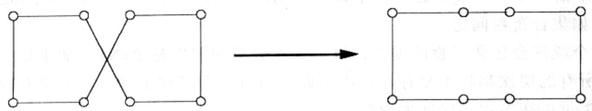

这样我们就有了一个定义良好的局部搜索过程。如果按照我们常用的两个准则——总运行时间和是否总返回最优解——进行评价，它是个怎样的算法呢？

令人失望，这两方面我们都没有得到满意的回答。因为每条路线只有 $O(n^{2})$ 个邻居，所以算法的每步迭代都很快。但是，我们不清楚到底需要多少次迭代——不论是什么样的实例，都有可能需要指数次。同样，虽然我们可以很容易地断定最终得到的线路是局部最优的——也即它总比紧挨着它的邻居要更好，但是在更远的地方可能还存在比它要好的解。例如，下图中一个可能的最终解显然是局部最优的；但简单的局部改变对于解质量的改进很有限。

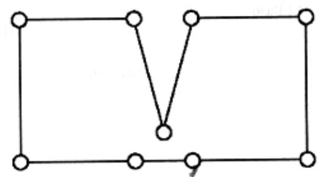

为了克服这一问题，我们尝试一种更加宽泛的邻居概念，所谓3-改变邻居，即其中包含了和当前路线最多有三条边不同的路线。事实证明这确实使得之前的糟糕情形有所改善：

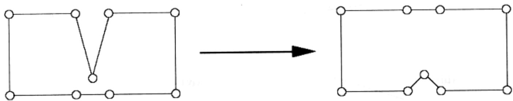

但是，它带来一个负面影响，就是邻居的规模变成了 $O(n^3)$ ，每次迭代将变得更加复杂。此外，仍然可能存在局部的最优，只是数量比之前略有减少。为了避免这一负面影响，我们可能又不得不引进4-改变的邻居，或者更多。如此一来，在局部搜索中效率和质量就成了一对矛盾：高的效率要求能够快速地搜索邻居，但是较少的邻居却会使得质量较差的局部最优更多。两者之间恰当的折衷常常需要由实验来决定。

图9-7给出了局部搜索的一个运行范例。图9-8是对局部搜索的一个更为抽象和程式化的描述。其中所有的解积聚在未加阴影的区域里，当我们向下移动时解的代价将降低。从一个初始的解开始，算法采用“下山”的方法进行移动，直到到达一个局部最优。

(a)  
(b)  
(i)  
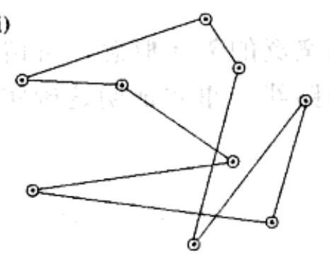

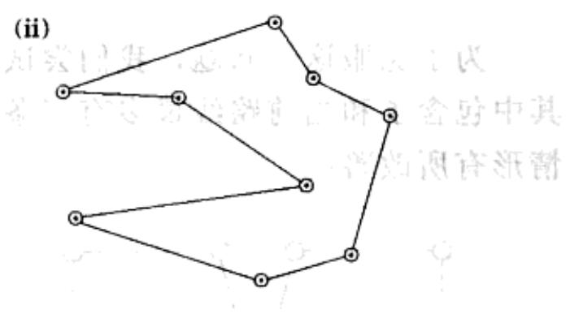

(iii)  
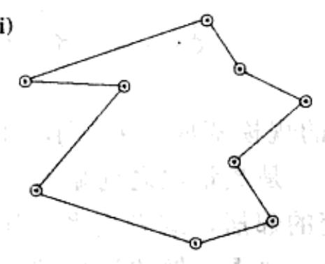

(iv)  
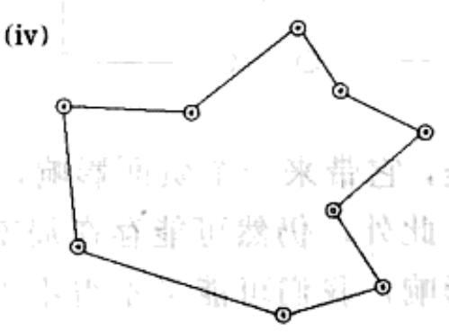  
图9-7 (a)9座美国城市。(b)由随机路线开始的局部搜索，使用3-改变邻居。经过三次改变得到了商人的旅行路线

一般来说，搜索空间中可能掺杂了许多的局部最优解，它们中有很多质量都非常差。问题的关键在于我们能够对邻居结构有一个明智的选择，从而保证局部最优的质量也是可接受的。不论是因为现实的确如此，抑或这只是我们的一厢情愿，经验告诉我们，局部搜索算法针对应用背景广泛的最优化问题大都有着一流的表现。让我们来看一个这样的例子。

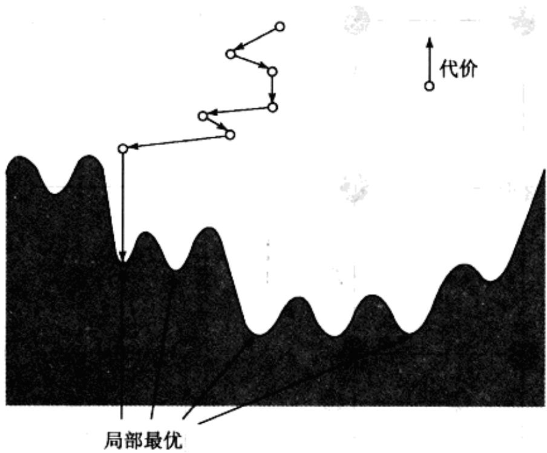  
图9-8 局部搜索

## 9.3.2 图划分

图划分问题源自类型各异的应用，从电路布局到程序分析再到图形分割，等等。在第8章中，我们曾看到过它的一个特例，所谓平衡分割问题。

## 图划分问题

输入：具有非负边权重的无向图 $G = (V,E)$ ；实数 $\alpha \in (0,1 / 2]$ 。

输出：将顶点划分为 A, B 两组，每组的规模都不小于 $\alpha|V|$ 。

目标：分割 $(A, B)$ 的容量最小。

图9-9为包含16个节点的图，其中每条边的权重均为0或1，最优解的代价为0。移除关于 $A, B$ 规模的约束条件，将得到最小分割(MINIMUM CUT)问题，我们知道利用计算网络流的方法可以高效地求解该问题。然而，我们目前看到的这个变型是NP-难的。在为其设计局部搜索算法时，专注于 $\alpha = 1 / 2$ 的特殊情形将能够带来很大的便利，也即我们将要求 $A, B$ 恰好各包含图中一半的顶点。虽然这看似会丧失问题的普遍性，但其实只是表面现象，因为一般的图划分问题都可以被归约到这一特例。

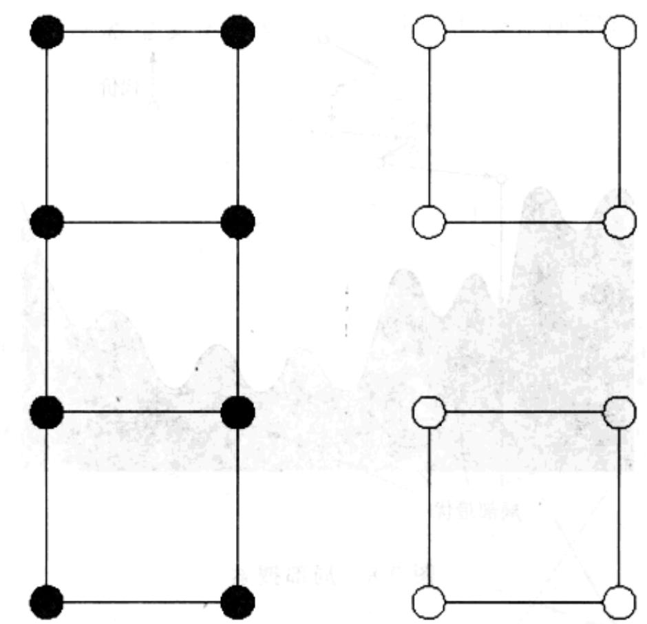  
图9-9 图划分问题的一个实例，其中 $\alpha = 1 / 2$ 。阴影节点标出了划分后的一半顶点

我们需要为该问题决定一种邻居结构，而这里存在一种比较显而易见的方式。令满足 $|A|=|B|$ 的分割 $(A,B)$ 为一个候选解。我们将其邻居定义为可以通过交换一对跨分割顶点而得到的所有解，形如 $(A-\{a\}+\{b\}, B-\{b\}+\{a\})$ ，其中 $a\in A, b\in B$ 。以下是一个局部改变的例子：

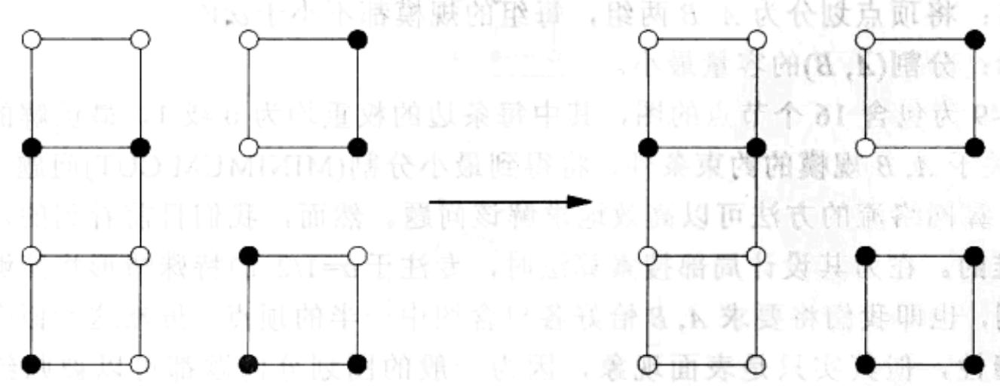

现在我们有了一个可行的局部搜索过程，似乎大功告成了。但是，要提高所得解的质量还有很长的一段路要走。搜索空间中包含了与全局最优距离相差很远的一些局部最优解。以下是一个代价为2的例子：

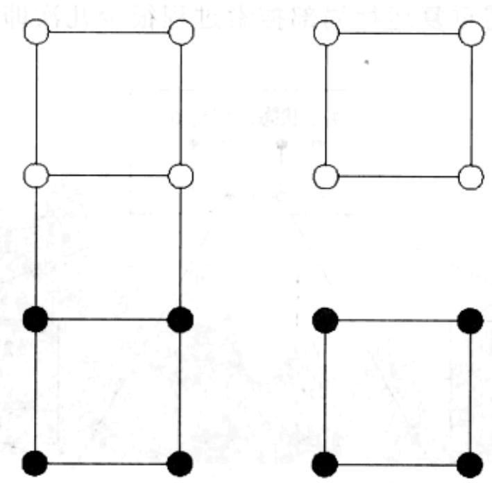

对于这样的次优解还能做些什么呢？我们可以扩大邻居的范围，允许每对邻居间存在两次顶点交换，但是对于以上这个糟糕的问题实例这一方法并不能带来解质量的改善。我们转而寻求能够提高局部搜索质量的其它常用途径。

## 9.3.3 处理局部最优

## 随机化与重启

随机化(randomization)对局部搜索的帮助是无法估量的。它通常有两种用途：选择一个随机的初始解，例如一个随机的图划分；或者，当存在多个选择时，随机选定下一个局部改变。

当存在许多局部最优时，随机化能够保证以至少某个概率得到其中一个较好的解。这样一来，可以通过多次重复局部搜索过程——每次使用不同的随机种子(random seed)以最终返回质量最好的解。如果每次运行返回一个较好的局部最优解的概率为 $p$ ，则在 $O(1/p)$ 次重复运行中应该可以得到该解(参见习题1.34)。

图9-10为图划分问题的一个较小规模的实例，同时给出了其解空间。其中有 $\left( \begin{array}{l}8\\ 4 \end{array} \right) = 70$ 种可能的状态，但是基于分割两侧的互换使得每个状态都有一个等价的状

态，因此有意义的解其实只有35个。图中出于阅读的方便，将这些解分成了7组。该问题有5个局部最优解，其中4个代价为2，质量较差，剩下的一个代价为1，质量较好。如果局部搜索由随机的解开始，算法每一步随机选择一个代价较低的邻居，则整个搜索最多运行4次就可以排除一个较差的局部最优。因此，按照这一方法改善该例中解的质量，仅需重复运行局部搜索过程很少几次即可。

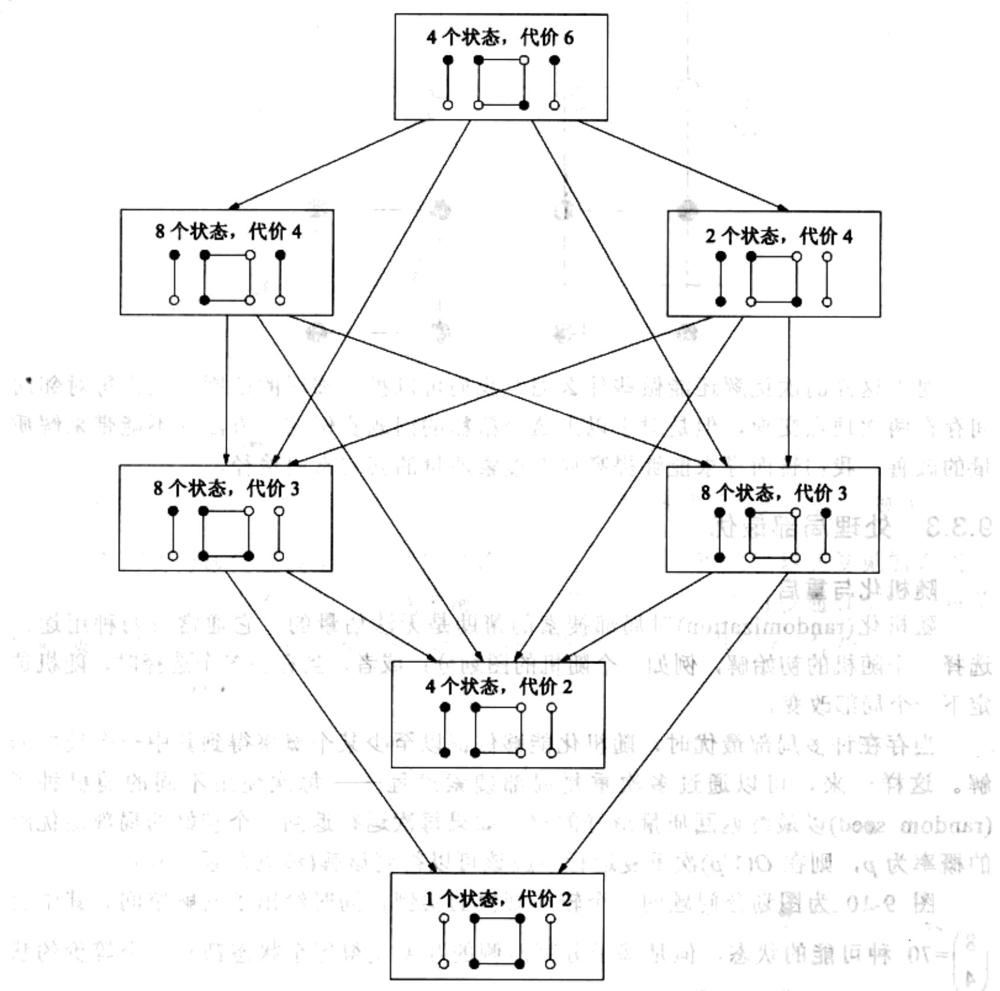  
图9-10 一个包含8个顶点的图的搜索空间。该空间包含35个解，为了便于分辨，我们将其分成7个组。每个组列出一个代表。该问题共有5个局部最优

## 模拟退火

图 9-10 的例子中，局部搜索的每次运行都可能以某个可接受的概率找到全局最优。然而事实并非总是如此。当问题的规模增大，较差局部最优对较好局部最优的数量比常常也会增加，严重时甚至会达到指数量级。这种情况下，仅仅简单重复几次局部搜索不会有太大的效果。

解决问题的另一个途径是时不时地接受一些解代价提高的局部改变，希望能够借此让步，绕过搜索中的死胡同。例如，对图9-10中那些较差的最优，该方法就是非常有效的。通过引入一个温度值 $T$ ，模拟退火方法重新定义了局部搜索过程：

<div class="mineru-algorithm">
let s be any starting solution
repeat
    randomly choose a solution  $s'$  in the neighborhood of s
    if  $\Delta = \text{cost}(s') - \text{cost}(s)$  is negative:
    replace s by  $s'$ 
    else:
    replace s by  $s'$  with probability  $e^{-\Delta/T}$ .
</div>

如果 $T$ 为0，则以上就是我们熟悉的局部搜索。但是如果 $T$ 很大，则会时不时地出现导致解代价提高的改变。那么， $T$ 应该如何取值呢？

一个技巧是起初让 $T$ 取值较大，然后逐渐减少到0。这样一来，最初局部搜索的行为是较自由的，对低代价解的倾向并不明显。随着时间的推进，这种倾向逐渐加强，搜索将更多地在搜索空间中代价较低的区域进行。最终，当温度降得很低时，搜索将收敛到一个解。图9-11是对该过程的示意。

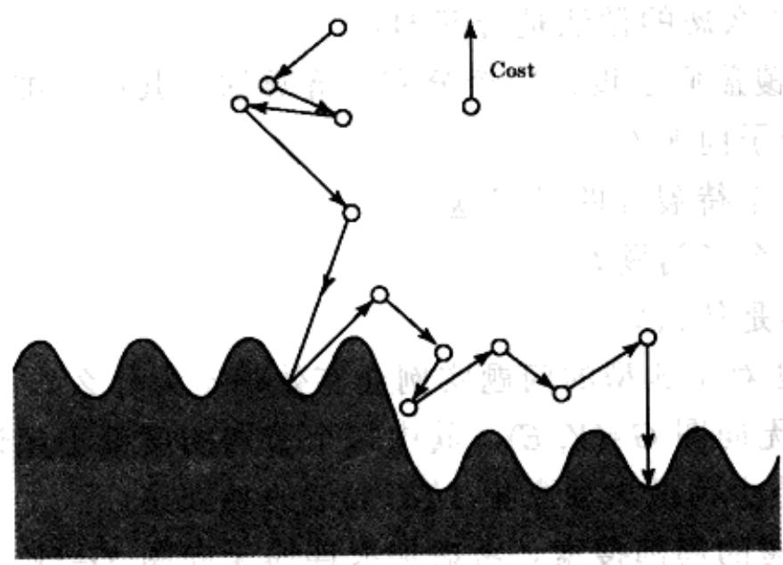  
图 9-11 模拟退火

模拟退火方法受到了物理学中结晶过程的启发。物质的结晶过程开始于其液体状态，最初所有粒子的行动都是不受约束的。随着物质慢慢冷却，粒子也开始进行较为规则的运动。然后这一运动规律不断强化，最终形成了物质的晶格。

模拟退火的好处也伴随着明显的代价：因为变化的温度和最初的自由运动，完成最终解的收敛需要更多的局部改变。此外，为温度下降过程制定一个好的时间表常常需要很高的技巧，这个时间表通常被称为退火进度。但是在很多情况下，由于解的质量会因此得到很大的改善，这一代价还是值得的。
