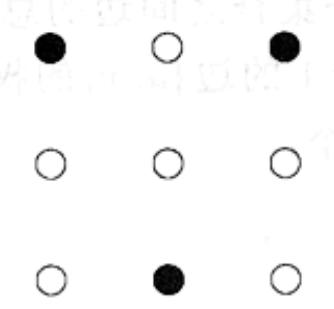
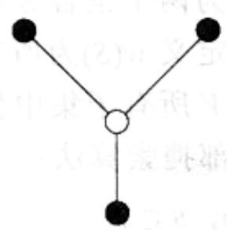

import Guide from '@/components/Guide.astro';
import Knowledge from '@/components/Knowledge.astro';
import Example from '@/components/Example.astro';
import Analysis from '@/components/Analysis.astro';
import Solution from '@/components/Solution.astro';
import Variant from '@/components/Variant.astro';
import Note from '@/components/Note.astro';
import Block from '@/components/Block.astro';
import Method from '@/components/Method.astro';
import Exercise from '@/components/Exercise.astro';
import Algorithm from '@/components/Algorithm.astro';

## 第9章 习题

<Exercise title="习题 9.1">

假设在 SAT 的回溯算法中，我们总是选择具有最小子句的子问题(CNF 公式)；且我们基于出现在该子句中的某个变量进行展开。请证明如果输入的公式中仅包含含有两个文字的子句(即它是一个 2SAT 实例)，则如果它存在满足赋值，该赋值必可在多项式时间内求得。

</Exercise>

<Exercise title="习题 9.2">

请为从固定点 $s$ 出发的Rudrata路径问题设计回溯算法。为了完整地描述该算法，您需要定义如下几点：

(a) 什么是一个子问题？

(b) 如何选定一个子问题？

(c) 如何展开一个子问题？

请简要说明为什么您的做法是合理的。

</Exercise>

<Exercise title="习题 9.3">

请为集合覆盖问题设计一个分支定界算法。其中的细节应包括：

(a) 什么是一个子问题？

(b) 如何选择一个待展开的子问题？

(c) 如何展开一个子问题？

(d) 恰当的下界是什么？

您认为您的方法对于典型的问题实例会有效吗？为什么？

</Exercise>

<Exercise title="习题 9.4">

给定一个无向图 $G = (V, E)$ ，其中每个节点的度都不超过 $d$ ，请说明如何高效地找到一个规模至少为最大独立集 $1 / (d + 1)$ 倍的独立集。

</Exercise>

<Exercise title="习题 9.5">

最小生成树的局部搜索。考虑加权连通无向图 $G = (V, E)$ 的所有生成树(不仅是最小的)集合。

回忆5.1节，给某个生成树 $T$ 增加一条边 $\pmb{e}$ 使之产生唯一一个环，然后随意从环上删除一条边 $e' \neq e$ ，可得到一个新的生成树 $T'$ 。我们说 $T$ 和 $T'$ 的差异仅为一次边交换 $(e, e')$ ，并称它们为邻居。

(a) 请证明通过一系列的边交换，也即进行一系列邻居到邻居的变换，可以把任意生成树 $T$ 变换成另一任意的生成树 $T'$ ；并说明最多需要多少次边交换？

(b) 请证明如果 $T'$ 是MST，则有可能选择一系列边交换，使得在变换的过程中生成树的代价不发生增长。换句话说，如果生成树变换序列为

$$
T = T _ {0} \rightarrow T _ {1} \rightarrow T _ {2} \rightarrow \dots \rightarrow T _ {k} = T ^ {\prime}
$$

则对所有的 i&lt;k，代价 $(T_{i+1})\leqslant$ 代价 $(T_{i})$ 。

(c) 考虑如下一个以边权重各不相同的无向图为输入的局部搜索算法：

<div class="mineru-algorithm">
Let $T$ be any spanning tree of $G$ while there is an edge-swap $(e, e')$ which reduces cost $(T)$: $T \leftarrow T + e - e'$ return $T$
</div>

请证明该过程总是能返回一个最小生成树，并说明它最多需要多少次迭代？

</Exercise>

<Exercise title="习题 9.6">

在最小 Steiner 树(MINIMUM STEINER TREE)问题中, 输入包括: 图 $G = (V, E)$ , 给定每对节点间的距离 $d_{uv}$ ; 以及一组特定的终止节点集合 $V' \subseteq V$ 。目标是求包含 $V'$ 的最小代价树。该树可以包含也可以不包含 $V - V'$ 中的节点。





假设实例的输入为一个度量函数(参见9.2.2节的度量性质定义)。请证明，如果忽略非终止节点并且仅要求返回 $V'$ 上的最小生成树，则最小Steiner树问题存在逼近比例为2的高效近似算法。(提示：参见TSP的近似算法。)

</Exercise>

<Exercise title="习题 9.7">

在多路分割问题中，输入为一个无向图 $G = (V, E)$ 和一组终止节点 $s_1, s_2, \ldots, s_k \in V$ 。目标是求 $E$ 的一个最小子集，使得移除它后所有的终止节点分属于不同的部件。

(a) 证明当 k=2 时该问题可在多项式时间内求解。

(b) 对于 $k = 3$ 的情形，请给出一个逼近比例最多为2的近似算法。

(c) 请为多路分割设计一个局部搜索算法。

</Exercise>

<Exercise title="习题 9.8">

在最大 SAT 问题中，给定一组子句，我们要求一个能够满足尽可能多的子句的赋值。

(a) 请证明如果该问题能在多项式时间内求解，则 SAT 也能。

(b) 下面是一个非常朴素的程序

```txt
for each variable:
    set its value to either 0 or 1 by flipping a coin
```

假设输入包含 $m$ 个子句，其中第 $j$ 个子句包含 $k_{j}$ 个文字。请证明利用这个简单的算法程序得到的可被满足子句的期望数值为

$$
\sum_ {j = 1} ^ {m} \left(1 - \frac {1}{2 ^ {k _ {j}}}\right) \geq \frac {m}{2}
$$

换句话说，它的期望逼近比例为 2！并且如果每个子句都包含 k 个问题，则该逼近比例将被改进为 $1+1/(2^{k}-1)$ 。

(c) 您能使该算法成为一个确定性算法吗？(提示：转而采用为每个变量掷硬币的方法，以针对该变量选择能使最多的原本尚未满足的子句得以满足的值。最终会有多大比例的子句得到满足呢？)

</Exercise>

<Exercise title="习题 9.9">

在最大分割问题中，给定一个无向图 $G = (V, E)$ ，其每条边 $e$ 的权重为 $w(e)$ ，我们希望将 $V$ 分割为两个集合 $S$ 和 $V - S$ ，使得两个集合之间边的总权重最大。

对每个 $S \subseteq V$ ，定义 $w(S)$ 为所有满足 $|S \cap \{u, v\}| = 1$ 的边 $\{u, v\}$ 的权重之和。显然，最大分割将对应于 $V$ 所有子集中使 $w(S)$ 最大的一个。

考虑如下的局部搜索算法：

<div class="mineru-algorithm">
start with any $S \subseteq V$ while there is a subset $S' \subseteq V$ such that $|(S' - S) \cup (S - S')| = 1$ and $w(S') > w(S)$ do: set $S = S'$
</div>

(a) 证明它是最大分割问题逼近比例为 2 的近似算法。

(b) 它是个多项式时间算法吗？

</Exercise>

<Exercise title="习题 9.10">

如果一个局部搜索算法总是能返回最优解，则我们称之为精确的。例如习题9.5中介绍的最小生成树的局部搜索算法就是精确的。此外，单纯形法也可视为针对线性规划的一个精确的局部搜索算法。

(a) 请证明 TSP 的 2-改变局部搜索算法不是精确的。

(b) 对 $\left\lceil \frac{n}{2} \right\rceil$ -改变的局部搜索算法重复以上证明，其中 $n$ 为城市数。

(c) 证明 $(n - 1)$ 改变的局部搜索算法是精确的。

(d) 如果 $A$ 是一个优化问题，定义 $A$ -改进(A-IMPROVEMENT)为如下的搜索问题：给定 $A$ 的实例 $x$ 以及 $A$ 的一个解 $s$ ，求 $x$ 的另一个代价较优的解(或者报告其不存在，从而 $s$ 为最优)。例如，在 TSP-改进问题中，我们给定距离矩阵和一条旅行路线，然后确定是否还存在更好的路线，如果存在，则求出该路线。结论是：TSP-改进问题是 NP-完全问题，同样地，集合覆盖-改进问题也是，请证明后者。

(e) 我们说一个局部搜索算法具有多项式规模迭代是指其中循环的总运行时间为多项式规模的。举例来说，以上 TSP 的 $(n-1)$ -改变局部搜索算法就不具有多项式规模迭代。请证明，除非 P=NP，TSP 和集合覆盖问题都不存在具有多项式规模迭代的精确的局部搜索算法。

。陵市赋次 $n$ 中其，即玉土则复重者莫索勒暗鼠的变药- $\left[\frac{n}{2}\right]$ 板(d)

，的解群是封翼索勒昂同的变方(1-n)即亚。(2)

同索则的不咬式(TI3M3VO9MI-k)批药-k 义宝，愿同外分个一具 A 果咬 (b) 不其吉则普施)输向对好合升个一民的 x 头，z 糙个一的 A 迈过 x 回突的 A 安合；愿分新杀一味刺果离强宝合[1]年，中愿同批药-92T 亦，咬同。(分量次？而从，亦否-92T：虽令辞。参藏出朱圆，亦容果时，参藏的设更亦否是宝卿司然，参制。善司即玉青，呈出愿同批药-盖翳合巢，此非同，愿同全京-91

</Exercise>

