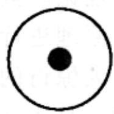
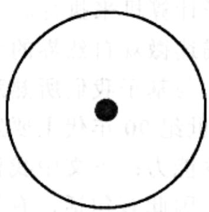
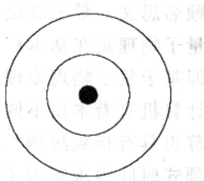
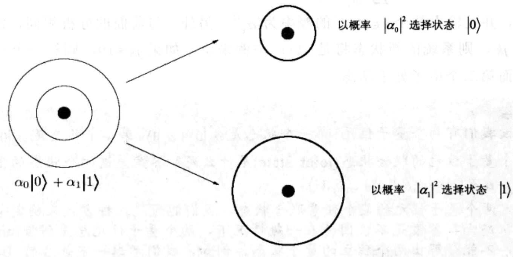

import Guide from '@/components/Guide.astro';
import Knowledge from '@/components/Knowledge.astro';
import Example from '@/components/Example.astro';
import Analysis from '@/components/Analysis.astro';
import Solution from '@/components/Solution.astro';
import Variant from '@/components/Variant.astro';
import Note from '@/components/Note.astro';
import Block from '@/components/Block.astro';
import Method from '@/components/Method.astro';
import Exercise from '@/components/Exercise.astro';
import Algorithm from '@/components/Algorithm.astro';

## 第10章 量子算法

本书以世界上最古老且使用最广泛的运算法则(数的加法和乘法)和一个古老的难题——因子分解——作为开篇。作为本书的最后一章，在这里我们改变一下风格：给出一个最新的算法，一个用以解决因子分解问题的有效算法——量子算法。

顾名思义，量子算法需要用量子计算机来执行。

量子物理是在基本粒子层次上描述微观自然界的奇妙且神秘的理论。量子计算机，即基于量子物理原理的计算机，与基于我们所熟悉的经典物理原理进行运算的传统计算机有着本质不同，这是20世纪90年代主要发现之一。令人惊讶的是，量子计算机具有指数级增长的强大运算能力：下文中我们将可以看到，量子计算机能在多项式时间内求解因子分解问题！因此有句话，有了量子计算机之后，当前基于Internet的安全商务系统(基于RSA密码体系)将不再是安全的。

## 10.1 量子位元、叠加状态和度量

本节我们首先介绍一下量子物理的基本特征，这是我们理解量子计算机如何工作原理的必要知识。 $^{1}$

在普通的计算机芯片中，位在物理意义上表示电路上的高低电压。然而，能存储这种信息的方式有很多——例如，氢原子的状态。原子中的单个电子可以处于基态(最低能量结构)，也可以处于激发态(一个高能量结构)。我们可以分别将这两个状态编码为位值0和1。

下面我们介绍一些量子物理概念。我们将电子的基态表示为 $|0\rangle$ ，因为基态对应于位值 0，类似地将激发态表示为 $|1\rangle$ 。它们是经典物理中电子的两种可能状态。很多量子物理中违背人类直观感受的现象都是由叠加原理导致的，该原理指出：如果一个量子系统能处于上述两个状态中的一个，则它也可以处于这两个状态的任意线性叠加。例如，电子的状态完全可能是 $\frac{1}{\sqrt{2}} |0\rangle + \frac{1}{\sqrt{2}} |1\rangle$ 或 $\frac{1}{\sqrt{2}} |0\rangle - \frac{1}{\sqrt{2}} |1\rangle$ ；或者形如 $\alpha_0 |0\rangle + \alpha_1 |1\rangle$ 的无穷种组合中的任意一个。系数 $\alpha_0$ 称为状态 $|0\rangle$ 的振幅 (amplitude)，类似地， $\alpha_1$ 为 $|1\rangle$ 的振幅。如果以上这些还不足以让人觉得新奇的话，更奇怪的是这些系数还可以取复数值，只要它们满足归一化条件即可： $|\alpha_0|^2 + |\alpha_1|^2 = 1$ 。例如， $\frac{1}{\sqrt{5}} |0\rangle + \frac{2i}{\sqrt{5}} |1\rangle$ (其中 $i$ 表示复数的虚部单位，等于 $\sqrt{-1}$ ) 是完全正确可行的量子状态！叠加状态 $\alpha_0 |0\rangle + \alpha_1 |1\rangle$ 是量子计算机中信息编码的基本单元 (如图 10-1)，我们将其称为量子位元。

  
基态 $|0\rangle$

  
激发态 |1>

  
叠加状态 $\alpha_0|0\rangle +\alpha_1|1\rangle$

图10-1 一个电子可以处于基态也可以处于激发态。在量子物理中使用的Dirac表示法中，这两种状态分别记为 $\left|0\right\rangle$ 和 $\left|1\right\rangle$ 。但是叠加原理告诉我们，电子实际上可以处于这两种状态的线性组合状态： $\alpha_0\left|0\right\rangle +\alpha_1\left|1\right\rangle$ 。这个组合给我们的第一印象是系数 $\alpha$ 表示概率，它们是两个和为1的非负实数。但是叠加原理强调它们可以是任意的复数，只需要满足范数平方和为1的条件

叠加的整个概念认为——电子要么处于基态，要么处于激发态。叠加振幅 $\alpha_{0}$ 表示电子倾向于基态的程度。沿着这个思路，我们也许可以认为 $\alpha_{0}$ 表示电子处于基态的概率。但是，实际情况并非如此，因为 $\alpha_{0}$ 可以是负数，甚至可以是复数。以上仅仅是量子物理最神秘的表现之一，它好像已经超出了我们关于物理世界的直观认识。

然而，线性叠加是电子世界中特有的。为了更好地理解叠加状态，使人们对它有一个大概的印象，我们给出一种度量方法，将该状态变换为单个位表示的信息，即为0或1。如果电子的状态是 $\alpha_0|0\rangle +\alpha_1|1\rangle$ ，那么度量过程的输出是0和1的概率分别为 $\left|\alpha_0\right|^2$ 和 $\left|\alpha_1\right|^2$ （它们满足归一化条件 $\left|\alpha_0\right|^2 +\left|\alpha_1\right|^2 = 1)$ 。此外，度量过程导致系统状态的改变：如果输出为0，则系统的新状态为 $|0\rangle$ (基态)；如果输出为1，则系统新状态为 $|1\rangle$ (激发态)。度量过程扰乱了系统并强迫系统不得不在基态和激发态之间进行选择，这又是一个量子物理的所特有的奇异现象。

  
图10-2 叠加状态的度量过程使得系统必须选定一个特定的状态，选择的概率由状态的振幅确定

叠加原理不仅适用于上述的这类2值系统，同样也适用于更一般的 $k$ 值系统。例如，在实际情况中，氢原子的电子可能处于多个能级之一，这些能级由基态开始，依次为第一激发态、第二激发态等等。下面我们考虑由基态和前 $k - 1$ 个激发态构成的 $k$ 值系统，这些状态分别记为 $\left|0\right\rangle ,\left|1\right\rangle ,\left|2\right\rangle ,\ldots ,\left|k - 1\right\rangle$ 。在这里，叠加原理可以表示为：系统一般的量子状态是 $\alpha_0\left|0\right\rangle +\alpha_1\left|1\right\rangle +\alpha_2\left|2\right\rangle +\ldots +\alpha_{k - 1}\left|k - 1\right\rangle$ ，其中系数满足归一化条件 $\sum_{j = 0}^{k - 1}\left|\alpha_j\right|^2 = 1$ 。因此，系统状态的度量结果为一个0到 $k - 1$ 之间(包含0和 $k - 1$ )的整数，且其输出为 $j$ 的概率为 $\left|\alpha_j\right|^2$ 。前面已经提过，度量会扰乱系统。当前，度量过程使得系统状态实际上是状态 $\left|j\right\rangle$ ，也就是说系统被强迫处于第 $j$ 个激发态。

那么我们如何编码 $n$ 位的信息呢？我们可以考虑氢原子的 $k = 2^n$ 级状态，但是推荐的选择是使用 $n$ 个量子位元来表示。

首先，我们考虑两个量子位元(也就是说两个氢原子的电子状态)的情况。因为每个电子可能处于基态或激发态，按照经典物理的方法，这两个电子共有四种可能的状态——00, 01, 10 和 11，由此可见它们非常适合于用两个位信息表示。但是在量子物理中，叠加原理告诉我们，两个电子的量子状态是上述四个经典状态的线性

组合：

$$
\left| \alpha \right\rangle = \alpha_ {0 0} | 0 0 \rangle + \alpha_ {0 1} | 0 1 \rangle + \alpha_ {1 0} | 1 0 \rangle + \alpha_ {1 1} | 1 1 \rangle
$$

其中归一化条件为 $\sum_{x\in \{0,1\}^2}\left|\alpha_x\right|^2 = 1^2$ 。那么，系统状态的度量值域是所有2位信息的集合，并且输出某个 $x\in \{0,1\}^2$ 的概率为 $\left|\alpha_x\right|^2$ 。另外，与前面的分析相同，如果度量输出是 $jk$ ，则系统的新状态将是 $\left|jk\right\rangle$ ：举例来说，如果 $jk = 10$ ，则第一个电子处于激发态而第二个电子处于基态。

<Knowledge title="专栏: 纠缠">

假设我们有两个量子位元: 第一个状态是 $\alpha_{0}|0\rangle + \alpha_{1}|1\rangle$ ，第二个状态是 $\beta_{0}|0\rangle + \beta_{1}|1\rangle$ 。那么两个量子位元的联合状态(joint state)是什么呢？答案是这两个状态的张量积： $\alpha_{0}\beta_{0}|00\rangle + \alpha_{0}\beta_{1}|01\rangle + \alpha_{1}\beta_{0}|10\rangle + \alpha_{1}\beta_{1}|11\rangle$ 。

给定两个量子位元的某个任意联合状态，我们能通过这种方式来确定每个量子位元的状态吗？答案是不，因为在一般情况下，两个量子位元总是纠缠(entangled)在一起，不能分解出两个独立的量子状态。例如，我们考虑一下著名的 Bell 状态 $\left|\psi\right\rangle=\frac{1}{\sqrt{2}}\left|00\right\rangle+\frac{1}{\sqrt{2}}\left|11\right\rangle$ 。它不能被分解为两个单独量子位元的状态(参见习题 10.1)。纠缠是量子力学中最神奇的方面之一，也是量子计算拥有巨大计算能力的最根本原因。

这样就会产生一个很有趣的问题：如果要给出一个局部度量又会怎样呢？例如，如果我们仅仅度量第一个量子位元，其输出为0的概率是多少？很简单，与度量两个量子位元的方法完全相同，也即 $\operatorname{Pr}\{\text{第一个位} = 0\} = \operatorname{Pr}\{00\} + \operatorname{Pr}\{01\} = |\alpha_{00}|^2 + |\alpha_{01}|^2$ 。那么，这个局部度量将系统的状态归结为几类呢？

以下的答案很好地回答了这个问题。如果度量第一个量子位元的度量输出为0，那么我们将得到一个新的叠加规则，该规则是通过删除所有与当前输出不一致的 $|\alpha\rangle$ 项(也即第一位是1的状态)得到的。因此，新的振幅平方和已经不再是1了，我们必须重新将其归一化。在这个例子中，新的状态可以表示为：

$$
\left| \alpha_ {\mathrm{new}} \right\rangle = \frac {\alpha_ {0 0}}{\sqrt {\left| \alpha_ {0 0} \right| ^ {2} + \left| \alpha_ {0 1} \right| ^ {2}}} \left| 0 0 \right\rangle + \frac {\alpha_ {0 1}}{\sqrt {\left| \alpha_ {0 0} \right| ^ {2} + \left| \alpha_ {0 1} \right| ^ {2}}} \left| 0 1 \right\rangle
$$

最后，我们考虑更一般的 $n$ 个氢原子的情况。假设 $n$ 是非常小的原子数量，比如 $n = 500$ 。很明显，在经典情况下，500个电子的状态能用于存储500位的信息。但是，500个量子位元的状态是 $2^{500}$ 个可能的经典状态的线性叠加，可以表示如下：

$$
\sum_ {x \in \{0, 1 \} ^ {n}} \alpha_ {x} | x \rangle
$$

就好像自然界中某处有 $2^{500}$ 张纸片，每个纸片上写下一个复数，正好可以用于记录由这500个氢原子构成的系统的状态！进而，在系统状态随时间演化的每一个瞬间，我们可以认为存在某种自然力量将这些纸片上原有的复数值删除并写上新的值。

下面我们考虑一下所有这些操作的结果。 $2^{500}$ 是比人们估计的宇宙中元素微粒总数还大的数字。自然界将如此多的信息存储在什么地方了呢？几百个原子的微观量子系统能包含比整个宏观宇宙空间还要多的信息吗？仅仅维持这样一个微小的系统在时间上不断的演化就需自然界付出如此大的代价，无疑再次印证了量子物理是一个令人惊讶的理论。

然而，这个现象中包含了我们进行量子计算的基本动机。毕竟，如果自然界在量子层次上的结果是如此丰富的，那么我们的计算机为什么还一定要基于传统物理呢？为什么不将人们花费大量精力研究的计算系统扩展到量子层次上呢？

但是这里存在一个基本问题：这个指数规模的线性叠加只存在于电子的世界中。对该系统的度量仅能展现出 $n$ 位的信息。前面提到过，系统度量的输出为某个特定的500位字符串 $x$ 的概率为 $\left|\alpha_{x}\right|^{2}$ ，并且度量之后的新状态正好就是 $\left|x\right\rangle$ 。

</Knowledge>
